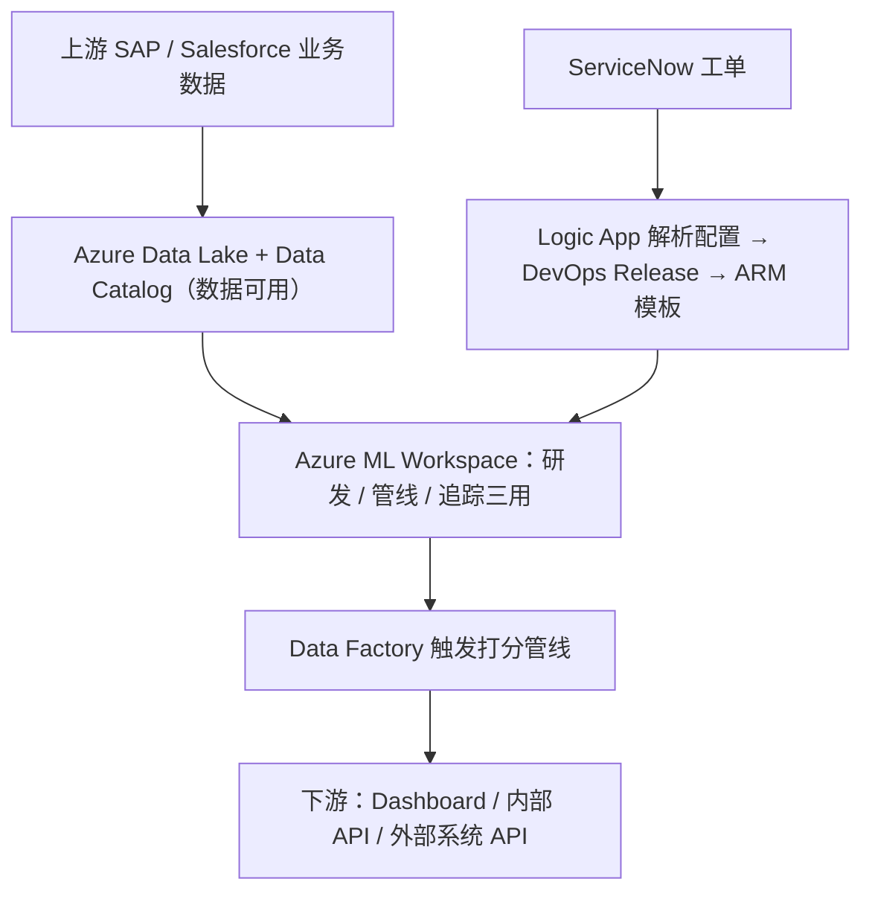

# Scaling Enterprise Recommender Systems for Decentralization (面向去中心化的企业级推荐系统规模化)

- **会议/期刊**: RecSys '21（Industry Poster / Industry Talk，5 页短文）
- **作者与机构**: Maurits van der Goes，The HEINEKEN Company（荷兰，Global Analytics 数据工程团队）
- **推荐链路定位**: 端到端工程架构（覆盖数据管理→模型研发→部署→下游服务的全链路，而非单一召回/精排环节）
- **研究方向**: 工业级全链路架构与可信治理（主）
- **论文原文**: [https://arxiv.org/abs/2109.09231v1](https://arxiv.org/abs/2109.09231v1)
- **开源代码**: 暂未开源

## TL;DR (1分钟核心速览)

本文针对跨国去中心化企业中“子公司推荐系统需求激增 vs. 中心团队人力有限、数据源与 IT 基建高度异构”的矛盾，提出一套以自服务为核心的 MLOps 工程方法与五项最佳实践（管线自动化、数据可用、可交换工件、可观测、策略化安全），并落地两个云原生应用：自服务 ML 工作区自动开通管线与解耦式推荐系统架构。原文为工业实践报告，**不含离线数据集评测与模型指标对比**，其唯一量化证据是 ML 工作区交付时延由“数周”降至“分钟级”，支撑 70+ 国家子公司共享工件、降低整体技术债。

## Background & Motivation (背景与核心矛盾)

- **主流范式**: 企业内由中心数据团队集中建设推荐系统，按子公司需求逐个定制交付；工程侧参照标准 DevOps / MLOps 四阶段生命周期（含数据管理）。原文引用 MLOps 基本概念，未做算法层面的基线对比。
- **前人局限（矛盾一：规模与人力）**: 数据人才稀缺，扩编昂贵；且团队规模增长并不能线性提升软件产出与质量，靠“加人”无法承接子公司指数增长的需求。
- **前人局限（矛盾二：技术债的特殊形态）**: 推荐系统的技术债不同于纯软件——代码之外还捆绑**数据集与模型**，三者任一未版本化/未自动化即形成长期负债，甚至使组织“停摆”；而多数团队只在 CI/CD 管线里管代码，不管数据与模型。
- **核心洞察 (Key Insight)**: 真正的瓶颈不是算法精度而是**交付速度 (delivery velocity)**；要同时获得高速度与低技术债，必须把“数据—模型—配置”全部纳入自动化与版本化，并把所有权（ownership）分散到子公司（“You build it, you run it”）。
- **本文切入点**: 用五项 MLOps 实践 + 自服务文化，将中心团队的角色从“交付系统”转为“交付能力与模板”，实现全局设计、本地适配。

## Method (核心方法设计)

### 1. 整体框架 (Overall Architecture)

方法由“一套生命周期 + 五项实践 + 两个应用”组成。生命周期采用四阶段（含数据管理），因为数据管理是推荐系统成败前提。五项实践贯穿其中：管线自动化消除人工等待；数据可用通过 feature store + data catalog 保证可复现；可交换工件要求模型/代码/配置全部版本化、描述性、PEP8 一致，生产环境以脚本替代 notebook；可观测性收集指标、事件、日志、痕迹并对产品团队（非仅工程师）开放；策略化安全把发布分为 dev/test/acceptance/prod 四环境，用 ABAC 的 control plane 与 data plane 双平面鉴权，密钥存于环境专属 key vault。方法由数据科学家与数据工程师共担，从而支撑自服务。

*图 1（原文图 1–3 合成示意）：四阶段 MLOps 生命周期与两个应用的交织关系——ML 工作区是推荐系统的引擎。*

### 2. 关键设计拆解 (Key Designs)

1. **自服务 ML 工作区开通管线（把“审批流程”改造成“部署事件”）**：痛点是新工作区申请为纯手工流程，耗时以周计且占用宝贵工程人力。本文把 ServiceNow 工单打到 Azure Logic App 的 HTTP 端点，解析配置后经 REST 调 Azure DevOps Release Pipeline，用 ARM 模板在目标环境分钟级落地；对数据科学家屏蔽容器化等底层复杂度。直觉：一旦把“申请”表达为**参数化模板 + 幂等部署**，开通能力就从少数工程师扩散到全体数据同事，边际人力成本趋零。

2. **解耦式推荐系统架构 + 配置即代码（全局设计、本地适配）**：数据自上游抽取入湖，ML 工作区同时承担研究与管线执行，Data Factory 先触发 ML 管线、再把结果推往下游（看板/内外 API），各步骤按调度或数据事件触发。本地化差异不写在代码里，而分离到独立 YAML，资源模板与配置作为 infrastructure as code 存放于各自 DevOps 仓库。直觉：**把“变的部分（配置）”与“不变的部分（solution pattern）”解耦**，才能让同一套工件跨子公司复用而不牺牲本地敏捷性。

3. **治理与安全基线（本文最可迁移的工程增量）**：四环境隔离 + ABAC 双平面鉴权 + 环境专属密钥库，配合面向产品团队的可观测性。原文未给出训练目标、负采样或推理开销等模型侧细节（本文不涉及新模型）。

   笔记归纳（原文无显式公式）：若设子公司 $s$的建设与运维成本为$c^{build}_s, c^{ops}_s$，工件复用率为$\rho_s$，则总成本$C_{total}=\sum_{s}\left[(1-\rho_s)c^{build}_s+c^{ops}_s\right]$，技术债随未复用资产与手工环节累积——五实践即分别抬高$\rho_s$、压低手工项。

## Experimental Setup & Evaluation Protocol (实验设置与评估协议)

- **数据集与预处理**: 无公开数据集。本文为工业实践报告，**不做离线训练/评测**，因此不存在 `5-core` 过滤、负采样或特征工程配置，亦无 #Users/#Items 统计表。其“数据对象”是企业内多子公司异构业务数据（销售拜访、营销、物流、财务等信息过滤场景）。
- **数据划分与防穿越 (Splitting Strategy)**: 不适用（无监督学习实验）。工程侧对应机制为：数据经 feature store 校验并登记 data catalog，以保障**可复现性**（等效于“实验可追溯”而非“数据划分”）。
- **排名评测协议 (Ranking Protocol)**: **不适用**——原文未使用 Full-Ranking、Sampled Ranking 或任何离线排序指标（HR/NDCG/Recall）。
- **对照与度量口径**: 采用前后对照的工程效能度量（交付时延、可执行开通的人员范围、环境隔离级别、工件复用程度、技术债），业务侧 KPI 为收入、成本节约、使用量与用户评价（原文仅列名，未给数值）。无显著性检验、无 Embedding 维度等超参（不涉及模型）。

## Key Experimental Results (实验关键数据)

### 1. 主实验对比 (Main Results)

原文无传统主实验表。以下为文中可核查的前后对照，**唯一量化项为“数周 → 分钟级”**，其余为定性结论：

| 评估维度 | 改造前 | 改造后（五实践） | 出处 |
| :--- | :--- | :--- | :--- |
| ML 工作区交付时延 | 手工受理，**数周** | **分钟级** | §3.1 / §4 |
| 可执行开通的主体 | 少数工程师 | 全体数据同事（自服务） | §4 |
| 环境隔离 | 未描述 | dev/test/acceptance/prod 四环境 + ABAC 双平面 | §2 |
| 工件复用 | 每子公司重建 | 内部 solution pattern 跨子公司复用 | §4 |
| 集体技术债 | 高（基建不成熟导致长期成本） | 文中称“显著降低”（无量化） | §4 |
| 支撑范围 | — | 70+ 国家、多业务线 | §1 |

### 2. 消融实验 (Ablation Study)

原文**未做消融实验**。下表为依据 §2/§4 描述整理的“实践缺失风险拆解”，供读者判断各组件边际价值（属笔记推断，非论文实测数据）：

| 移除项 | 预期退化 | 原文依据 |
| :--- | :--- | :--- |
| w/o pipeline automation | 回退手工工单，交付时延回到“周”级 | §3.1 |
| w/o data availability（feature store + catalog） | 实验/模型不可复现，跨团队协作断裂 | §2 |
| w/o exchangeable artifacts | notebook 流入生产、配置漂移、复用率 $\rho\to 0$ | §2 |
| w/o observability | 故障根因定位依赖工程师，产品团队失明 | §2 |
| w/o policy-based security | 越权与环境串扰、密钥管理失控 | §2 |

### 3. 关键实验发现 (Key Findings)

1. **瓶颈定位在交付速度而非模型精度**：唯一硬数字是工作区交付“数周→分钟级”，说明本文的收益几乎全部来自流程自动化（把人工串行改为流水线触发），而非任何建模改进。
2. **复用的前提是“配置与模板分离”**：原文强调 YAML 配置分离与 infrastructure as code，使同一套推荐系统工件可服务 70+ 国家子公司——即 $C_{total}$的下降主要由$\rho_s$ 提升驱动，而非单点成本优化。
3. **技术债必须从初始设计就纳入**：作者明确指出若基建不成熟，长期成本将以技术债形式累积并可能使组织停摆，故四环境 + ABAC + 可观测性被列为“基线”而非“后续优化”。

## Highlights & Limitations (亮点、对比与审稿批判)

- **与代表作对比 (vs. Prior Work)**: 与典型 RecSys 论文（新模型 + 离线指标 + 消融）完全不同——本文不提出模型、不做排序评测；与通用 MLOps 规范（如 TFX / ML Test Score 类框架）相比，其差异在于把“**自服务 + 所有权下放 + 文化**”视为一等公民，并针对推荐系统“代码/数据/模型三件套”的技术债形态定制治理；与常见工业架构论文相比，本文停留在架构图与实践叙述，缺少吞吐、延迟、成本等系统级量化。
- **可迁移亮点**: (1) 用“工单→Logic App→Release Pipeline→ARM 模板”把任何内部平台能力（特征平台、向量索引、模型注册）做成分钟级自服务；(2) 四环境 + ABAC 双平面 + 环境专属 key vault 的最小可信基线，可直接套用到多租户推荐平台。
- **审稿级局限批判**: (1) **证据强度弱**——全文只有一个量化数字（周→分钟），无 A/B、无业务 KPI 数值、无消融，无法排除“收益来自组织因素而非方法”的混淆；(2) **单案例 + 云厂商绑定**——结论建立在 HEINEKEN × Azure 栈上，ARM/Logic App/ADF 深度耦合，向 AWS/GCP 或自建栈迁移的代价未讨论；此外 5 页 poster 未涉及模型更新频率、在线推理延迟与服务成本等推荐系统关键运维指标。

## Rating (四维评分)

- **方法创新性 (Novelty)**: ⭐⭐ （五实践本身是成熟 MLOps 组件的组合，增量在于面向去中心化组织的自服务化编排与所有权下放，无算法/理论创新）
- **评估协议与实验扎实度 (Protocol & Experiments)**: ⭐ （无数据集、无划分与排序协议、无消融、无显著性检验，仅一个“周→分钟”的交付时延数字与定性陈述）
- **写作与数学规范度 (Clarity & Rigor)**: ⭐⭐⭐ （架构图与流程叙述清晰、实践清单可直接照做；但无形式化定义与复杂度/成本分析，属工程报告文体）
- **工业落地与复现价值 (Industrial & Practical Value)**: ⭐⭐⭐⭐ （架构蓝图与四环境+ABAC 基线对多子公司推荐平台极具参考价值；但无开源代码，且强绑定 Azure 生态，复现需等价替换）

