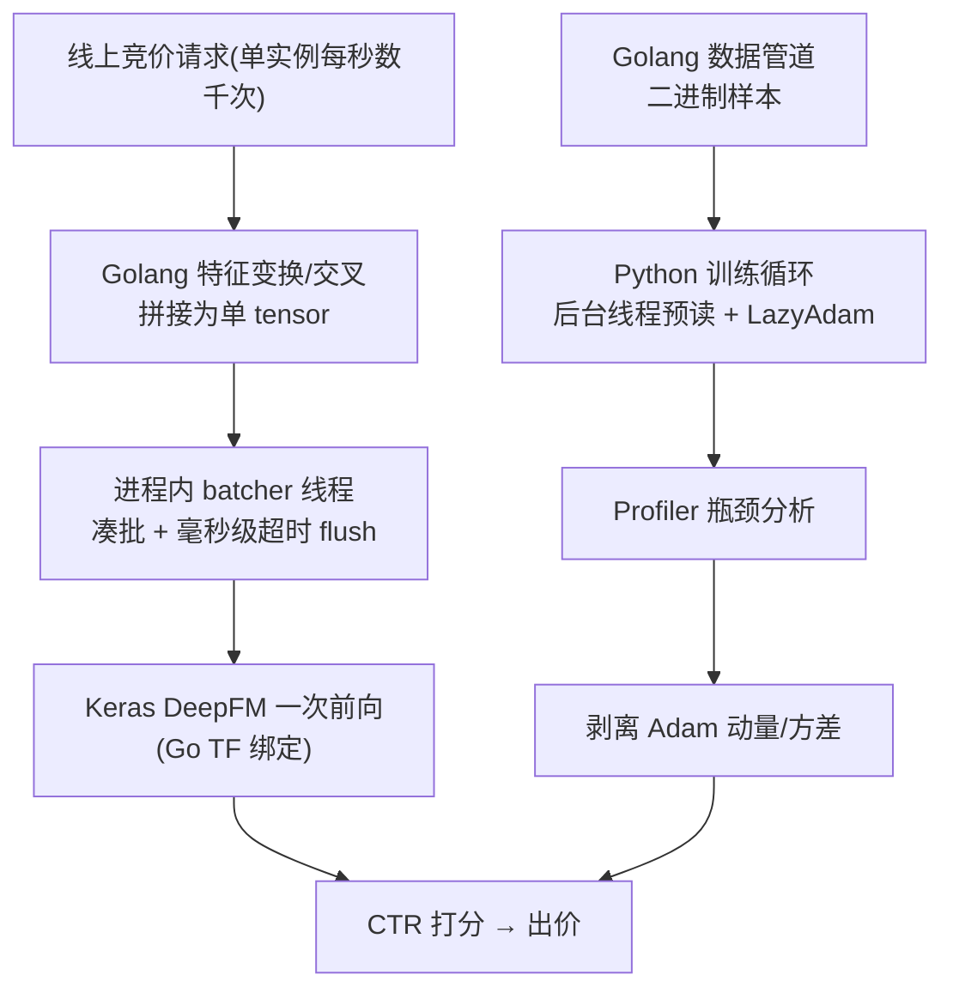

# Scaling TensorFlow to 300 million predictions per second (把 TensorFlow 扩展到每秒 3 亿次预测)

- **会议/期刊**: RecSys 2021（Industry Track / Extended Abstract，5 页）
- **作者与机构**: Jan Hartman, Davorin Kopič（Zemanta, an Outbrain company, Slovenia）
- **推荐链路定位**: 精排（RTB 竞价 CTR 预估）+ 在线推理服务
- **研究方向**: 工业级全链路架构与评测基准 / CTR 预估与特征交叉
- **论文原文**: [https://arxiv.org/abs/2109.09541v1](https://arxiv.org/abs/2109.09541v1)
- **开源代码**: 暂未开源（文中仅链接 TensorFlow Go 绑定、TF Serving、Keras 与 tfa.LazyAdam 的上游仓库）

## TL;DR (1分钟核心速览)

本文是 Zemanta（Outbrain 旗下 DSP）的工业实践报告，解决的核心痛点是：自研 Golang 逻辑回归/FM 模型表达力不足，而切换到 TensorFlow/DeepFM 后，通用框架的 per-call 开销与稀疏权重优化器开销让 100 ms 硬实时期的竞价系统 CPU 成本失控。作者不提新算法，而是给出三项系统级改造——**进程内自动批处理（autobatching）**、面向稀疏 Embedding 的 **LazyAdam**、以及**剥离优化器状态的模型瘦身 + 二进制样本管道**。在无 GPU、单体 bidder 的部署下，计算调用降为 1/5、TF 计算 CPU 减半、训练提速 40%、下发模型体积减 66%、平均延迟仅增约 5 ms，全集群达成 3 亿次预测/秒。

## Background & Motivation (背景与核心矛盾)

- **主流范式**: RTB/DSP 场景下以 CTR 预估模型（LR、FM 及其神经增强版 DeepFM）驱动出价，模型需在网页加载的竞拍窗口内完成打分；业界的通行做法是用 TF Serving 类独立服务 + GPU 集群承载推理。
- **前人局限**: 自研 Golang LR/FM 需手写全部学习过程，实验迭代慢、表达力被锁死，无法吃到深度交叉特征的红利；而换成通用 TF 后，框架的 per-call 固定开销、稀疏权重上的冗余梯度更新，又使 CPU 用量高到"扩到 100% 流量需大规模采购硬件"的程度——叠加全球缺芯，不可行。
- **核心洞察 (Key Insight)**: 作者对 RTB 负载的三个内生约束做了重新解读：① 请求量大（单实例每秒数千次竞价）、② 延迟上限 100 ms、③ 数据分布漂移快需持续训练。由此得出关键判断——**TF 的每样本计算成本随 batch 增大近乎线性（代码高度向量化），而非恒定**，因此把大量单条请求拼成一次计算，就能把固定开销摊薄。
- **本文切入点**: 不做模型侧压缩（会损失效果），而是**在单体 bidder 内部做零网络调用的批处理**，配合正确的稀疏优化器与模型瘦身，把框架税降到可接受区间。

## Method (核心方法设计)

### 1. 整体框架 (Overall Architecture)

系统被刻意切分为两段：**特征变换与特征交叉仍留在 Golang 侧**，只有"最小可替换、收益最大"的学习算法搬进 TF。线上侧，bidder 单体进程通过 Go 版 TF 绑定加载 Keras 实现的 DeepFM；每个实例内的若干 batcher 线程接收请求、把单条样本的所有输入特征拼接为**单个扁平 tensor**（消除多次序列化与拷贝），凑批后初始化一次计算并回填各请求。训练侧因 Go 绑定只支持预测，训练循环用 Python 子进程实现，通过标准输入以二进制格式接收 Golang 数据管道推送的样本（免解析），并在后台线程预读以避免模型空转。模型由持续训练任务产出后下发全机队，下发前执行状态剥离。全链路不使用 GPU、不使用 TF Serving。

### 2. 关键设计拆解 (Key Designs)

1. **进程内 Autobatching（把固定开销摊到 batch 上）**：痛点起因是 Go 版 TF 开箱即用时 DeepFM 的 CPU 占用远高于自研 FM，而瓶颈并非矩阵乘本身，而是每次 compute 调用的框架开销与向量化不足。做法是让 batcher 线程在**同一 bidder 进程内**聚合请求，凑满或到达极短的 flush 时间窗即触发一次计算：

   $$t_{\text{flush}} = \min\big(t_{\text{batch full}},\, t_{\text{arrive}} + \Delta\big),\qquad C(N) \approx c_{0}\left\lceil \frac{N}{B}\right\rceil + \alpha N$$

   其中 $c_0$为单次 compute 固定开销、$\alpha$为每样本边际成本、$B$为批大小。物理直觉：当$c_0 \gg \alpha B$时增大$B$几乎"免费"提吞吐，代价只是$\Delta$ 量级的排队时延。实测计算调用次数降为 1/5，TF 计算 CPU 减半，平均延迟 +5 ms。
2. **LazyAdam（让优化器尊重稀疏权重）**：痛点起因是模型特征几乎全为高基数类别特征，权重极度稀疏，而 Adam 每步对全参数做动量/方差更新，大量时间花在从未被激活的行上；Adagrad 虽快但使深度模型效果显著退化。改为 LazyAdam 后只对当前 batch 出现的稀疏索引 $i\in\mathcal{I}(x_t)$ 做状态更新，其余行保持惰性：

   $$\boldsymbol{m}_t[i] = \beta_1 \boldsymbol{m}_{t-1}[i] + (1-\beta_1)\boldsymbol{g}_t[i],\quad \boldsymbol{\theta}_t[i] \leftarrow \boldsymbol{\theta}_{t-1}[i] - \eta\,\hat{\boldsymbol{m}}_t[i]\big/\big(\sqrt{\hat{\boldsymbol{v}}_t[i]}+\epsilon\big),\ \ i\in\mathcal{I}(x_t)$$

   这样既保留 Adam 的自适应性与效果，又拿到 Adagrad 级的稀疏效率，整体训练加速 40%。
3. **训练目标、数据管道与推理开销**：损失即标准 CTR 交叉熵 $\mathcal{L}=-\frac{1}{N}\sum_{n}\big[y_n\log\hat{p}_n+(1-y_n)\log(1-\hat{p}_n)\big]$，负采样沿用真实曝光日志的自然分布（无人工负采样）；数据管道弃用 CSV 改用二进制格式，带来 25% 提速。推理侧另一项关键优化是**模型瘦身**：自适应优化器为每个参数额外存动量与方差，使保存体积达 3 倍，但这些量预测时无用，下发前剥离可减少 66% 传输数据量与内存占用。整个推理路径无网络调用、无 GPU、无远程服务。

## Experimental Setup & Evaluation Protocol (实验设置与评估协议)

- **数据集与预处理**: 本文**没有公开学术数据集**，全部结论来自 Zemanta 生产环境的真实竞价流量与线上机队统计，故不适用 `5-core` 过滤等离线预处理约定：

| 场景要素 | 规模/数值 | 说明 |
| :--- | :---: | :--- |
| 竞价请求到达率 | > 1,000,000 req/s（公司级） | 单 bidder 实例每秒数千次 |
| 单请求延迟预算 | ≤ 100 ms | 拍卖硬性响应上限 |
| 部署形态 | 单体 bidder + 进程内 Go TF 绑定 | 不用 TF Serving、不用 GPU |
| 模型族 | FM（校验管道）→ DeepFM（生产） | 特征变换/交叉留在 Golang |
| 优化器 | Adam → LazyAdam / 对比 Adagrad | 稀疏 Embedding 权重 |
| 全集群推理吞吐 | 3 亿次预测/秒 | 无 GPU 的纯 CPU 机队 |

- **数据划分与防穿越 (Splitting Strategy)**: 非学术式划分；采用**持续训练 + 滚动下发**应对分布漂移（等价于按时间前推的在线增量训练，训练数据始终早于服务时刻）。
- **排名评测协议 (Ranking Protocol)**: 不适用 Full-Ranking / Sampled Ranking；评测为**线上业务指标（CTR 类 KPI）与系统指标（CPU 用量、计算调用次数、训练吞吐、模型体积、P99 超时率）**的双轨度量，无负采样排序实验。
- **对比基线与超参设置**: 基线是**自研 Golang LR/FM** 与 **TF 开箱即用配置**；未报告 Embedding 维度、学习率等超参，也未做显著性检验（$p$ 值），这属于工业短文的固有缺失。

## Key Experimental Results (实验关键数据)

### 1. 主实验对比 (Main Results)

原文无离线主实验表，核心可比数据为"自研 FM / TF 默认配置 / 本文优化后"的系统级对照：

| 系统指标 | 自研 Golang FM | TF 默认（Go 绑定） | 本文优化后 | Improv. |
| :--- | :---: | :---: | :---: | :---: |
| 模型表达力 / 业务 KPI | 基准 | 显著提升 | 显著提升（保持） | 业务侧 lift |
| 单次 serve 的 compute 调用次数 | 1× | 5× | 1× | **−80%** |
| TF 计算 CPU 占用 | 基准 | 2× | 1× | **−50%** |
| 平均预测延迟 | 基准 | 高于基准 | 基准 + ≈5 ms | 可接受劣化 |
| 请求超时率 | — | — | < 0.01% | 可忽略 |
| 端到端训练吞吐 | — | Adam 基准 | LazyAdam | **+40%** |
| 下发模型体积 | — | 1×（含 m/v） | 0.34× | **−66%** |
| 样本管道吞吐（二进制 vs CSV） | — | CSV 基准 | 二进制 | **+25%** |
| 全集群预测能力 | — | — | 3 亿次/秒（纯 CPU） | — |

### 2. 消融实验 (Ablation Study)

以"逐项移除工程优化"的方式等价还原消融（数值均取自原文陈述）：

| 配置 | 计算调用次数 | CPU 占用 | 训练吞吐 | 模型体积 | 结论 |
| :--- | :---: | :---: | :---: | :---: | :--- |
| Full（autobatch + LazyAdam + strip + binary） | 1× | 1× | 1.40× | 0.34× | 最优 |
| w/o autobatching | 5× | 2× | 1.40× | 0.34× | 推理侧几乎不可行 |
| w/ Adam 替代 LazyAdam | 1× | 1× | 1.00× | 1.00× | 训练回退 40%，体积 3× |
| w/ Adagrad 替代 LazyAdam | 1× | 1× | ≈1.40× | — | 速度快但深度模型效果显著退化 |
| w/o strip optimizer states | 1× | 1× | 1.40× | 1.00× | 下发数据量与内存 3× |
| w/ CSV 替代二进制管道 | 1× | 1× | ≈1.12× | 0.34× | 管道解析成为瓶颈 |

### 3. 关键实验发现 (Key Findings)

1. **批处理是这批优化中唯一的"放大器"级手段**：compute 调用从 5× 降到 1×、CPU 直接减半，且代价仅 5 ms 平均延迟与 < 0.01% 超时——说明在 RTB 这类"每样本计算量小、调用极密"的负载里，框架固定开销而非浮点算力才是真瓶颈。
2. **优化器选择在稀疏权重上等价于一次 40% 的训练加速器**：Adam→LazyAdam 在几乎不损效果的前提下追平 Adagrad 的速度，而 Adagrad 虽同样快却让深度模型效果显著退化——即"稀疏感知"是同时拿到速度与效果的必要条件，而非折中。
3. **推理侧的收益可以完全来自"删无用状态"而非压缩模型**：剥离动量/方差使下发体积降 66%、内存与成本同步下降，且**预测精度零损失**——这提示自适应优化器让服务成本平白多付了 3 倍参数存储。

## Highlights & Limitations (亮点、对比与审稿批判)

- **与代表作对比 (vs. Prior Work)**: 与同期工业 CTR 系统论文（如以 TF Serving + GPU 集群 + 分布式 Embedding 为主流方案的工作）不同，本文恰恰**反其道而行**：坚持单体、单进程、纯 CPU、无网络调用，把优化全部压在进程内 batching 与稀疏算子效率上；与纯算法类 DeepFM 改进工作相比，本文不触碰模型结构，只改"模型如何被喂进去、如何被算出来"。
- **可迁移亮点**: ① **进程内 autobatching + 毫秒级 flush 超时**这一模式可直接迁移到任何硬实时推荐/广告精排服务（召回、粗排链路同样适用），是用延迟预算换吞吐的标准范式；② **下发前剥离优化器状态**与**全特征拼单 tensor** 是两个几乎零成本、可立即复用的工程惯例。
- **审稿级局限批判**: ① **评估协议极弱**——无公开数据集、无离线可复现实验、无显著性检验、无 Embedding 维度与超参披露，"业务指标 lift"只有定性描述而无数字，学术可验证性接近于零；② **吞吐数字口径模糊**：3 亿次/秒是全机队聚合值，未给出单机 QPS、机器数量与成本对照，也未报告峰值流量下 batcher 线程饥饿导致超时的分布尾部；③ 该方案的成立前提是"模型相对 CV/NLP 模型足够小且权重极稀疏"，模型一旦变大或转稠密，进程内 batching 的内存与排队延迟优势会迅速消失。

## Rating (四维评分)

- **方法创新性 (Novelty)**: ⭐⭐⭐ （无算法创新，autobatching 与 LazyAdam 均为已知技术的组合与工程化落地，价值在"踩坑地图"而非新机制）
- **评估协议与实验扎实度 (Protocol & Experiments)**: ⭐⭐ （纯生产环境自评，无公开数据集、无划分协议、无显著性检验，关键业务 lift 缺少数值）
- **写作与数学规范度 (Clarity & Rigor)**: ⭐⭐⭐ （5 页短文叙述清晰、因果链条完整，但全文零公式、复杂度与容量分析缺失）
- **工业落地与复现价值 (Industrial & Practical Value)**: ⭐⭐⭐⭐⭐ （单体纯 CPU、3 亿次/秒、延迟仅 +5 ms 的完整可复制路径，对硬实时推荐系统极具直接参考价值）

