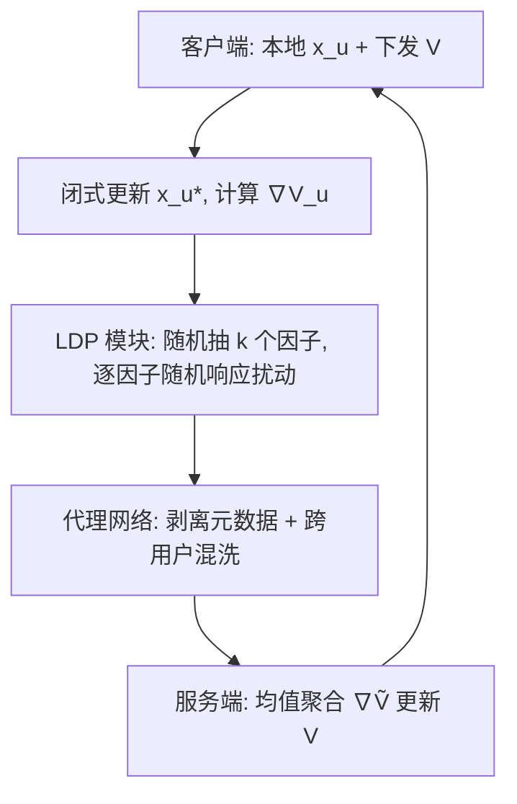
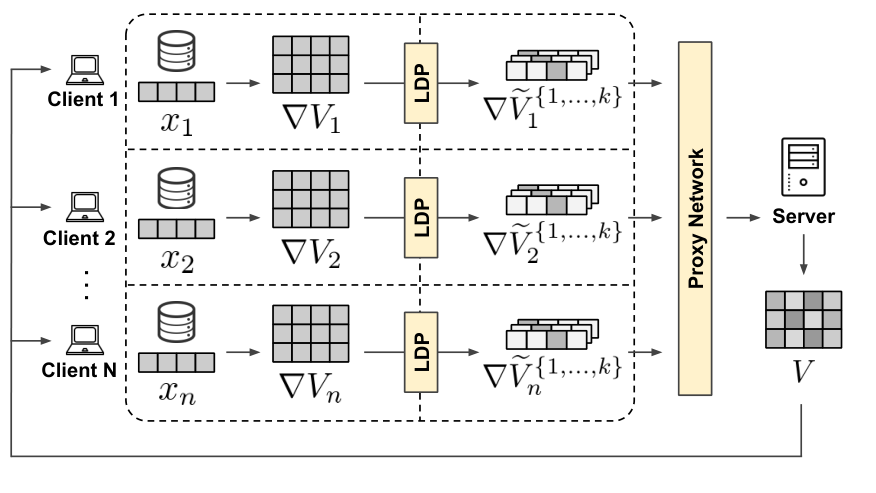

# Stronger Privacy for Federated Collaborative Filtering with Implicit Feedback (面向隐式反馈的更强隐私联邦协同过滤)

- **会议/期刊**: RecSys 2021
- **作者与机构**: Lorenzo Minto, Moritz Haller, Hamed Haddadi, Benjamin Livshits（Brave Software；Imperial College London）
- **推荐链路定位**: 召回（端侧矩阵分解 + 联邦训练）
- **研究方向**: 去偏公平、可信隐私与工业架构 / 协同过滤
- **论文原文**: [https://arxiv.org/abs/2105.03941v3](https://arxiv.org/abs/2105.03941v3)
- **开源代码**: 暂未开源

## TL;DR (1分钟核心速览)

现有隐私推荐要么只给出**事件级 (event-level)** 差分隐私、要么依赖对原始隐式交互加噪（如 DPLCF），在隐式反馈场景下保护粒度弱且依赖中心可信。本文提出 FMF-LDP：在联邦隐式矩阵分解中，每个客户端对物品梯度矩阵随机抽取 $k$个因子，用随机二元响应机制各自做$\epsilon$-LDP 扰动后上报，得到用户级$k\epsilon$-LDP；再加一层代理网络剥离元数据并打乱上报流，切断跨轮次可链接性。在 MovieLens 全库（7.5 万用户 / 9781 物品）上以 Leave-One-Out + 99 负采样排序取得 HR@10=0.5384（$k=250$），远超随机基线（0.10）。

## Background & Motivation (背景与核心矛盾)

- **主流范式**: 隐式协同过滤以矩阵分解为主，服务端集中收集点击/浏览数据并求解带置信度的加权平方损失 $c_{ui}=1+\alpha r_{ui}$ 的 MF 目标；隐私侧的代表作是联邦 CF（FCF）与在原始交互上加噪的 DPLCF。
- **前人局限**: ① 现有隐私推荐（Polat、Shen & Jin、Gao 等 DPLCF）几乎都只保证**事件级** $\epsilon$-DP，即仅隐藏单条评分/点击，而用户整体画像仍可由$d$条事件的组合定理暴露为$d\epsilon$-DP；② 少数做到用户级 LDP 的工作（Shin 等）依赖随机投影 + 稀疏恢复，**仅适用于显式评分这类稀疏梯度**，对稠密隐式反馈失效。
- **核心洞察 (Key Insight)**: 梯度数据比原始交互数据的隐私敏感度更低，因此在相同 $\epsilon$下对梯度做 LDP 比 Ma 交互做 LDP 的保护更强；且用户级预算是$k\epsilon$而$k\ll M$（物品数），故实际隐私预算远小于交互加噪方案的$M\epsilon'$。作者同时观察到：若每轮只上报$k=1$个因子，信号仅占梯度矩阵的$1/(MF)$，聚合后几乎是纯噪声，模型完全学不动。
- **本文切入点**: 用"多因子随机响应上报 + 代理网络去链接"在联邦 MF 上同时拿到可用的精度与用户级 LDP 的形式化保证。

## Method (核心方法设计)

### 1. 整体框架 (Overall Architecture)

三方结构：客户端、代理网络、服务端。服务端初始化并下发与用户无关的物品矩阵 $V\in\mathbb{R}^{M\times F}$；每个客户端本地持有用户向量$\mathbf{x}_u$（**永不出端**），用闭式解更新$\mathbf{x}^*_u=(VC_uV^\top+\lambda I)^{-1}VC_u\mathbf{p}(u)$，再计算物品梯度$\nabla V_u$；该梯度进入 LDP 模块，随机抽$k$个因子分别扰动成$k$个元组$(i,j)$；元组经代理网络去元数据与混洗后到达服务端，服务端求均值重构全局梯度并更新$V$，进入下一轮。推理完全在端侧，用$\langle\mathbf{x}_u,\mathbf{v}_i\rangle$ 打分，服务端只掌握公共物品矩阵。

<figure class="paper-figure" markdown="span">
  <figcaption>图 1：所提出的带隐式反馈的隐私保护联邦协同过滤系统设计。用户向量 𝑥 从不离开设备。</figcaption>
</figure>

### 2. 关键设计拆解 (Key Designs)

1. **多因子随机二元响应梯度上报（k 因子扩展）**: 原机制（Nguyên 等）只随机选 1 个物品 1 个因子，输出 $B$或$-B$；因稀疏使联邦训练几乎不收敛，本文将其扩展为每轮抽$k$个因子、各自独立扰动、组成$k$个$\epsilon$-LDP 元组，把有效信号放大约$k$ 倍。核心算子是编码常数与伯努利采样概率：
$$B=\frac{e^{\epsilon}+1}{e^{\epsilon}-1}\cdot MF,\qquad \Pr[\beta=1]=\frac{\nabla V^{i,f}_u\,(e^{\epsilon}-1)+e^{\epsilon}+1}{2e^{\epsilon}+2}$$
直觉：把连续梯度值压成 1 bit 的频率编码，$B$的量级补偿了维度$MF$ 带来的均值估计方差，因此对扰动值取平均即可**无偏**还原全局梯度。

2. **代理网络去可链接化（Anti-Fingerprinting）**: 仅靠 LDP 仍会被恶意推荐方通过 IP、时序把同一用户的多轮上报拼成纵向画像。代理网络剥离元数据、把消息拆成单条报告并与他人报告混洗后再转发，使服务端在同一轮内与跨轮间都无法归属报告。该设计还附带 shuffle 模型下的隐私放大效应。

3. **训练目标、隐私组合与通信开销**: 全局目标即带置信度的隐式 MF 损失 $\mathcal{L}=\sum_{u,i}c_{ui}(p_{ui}-\mathbf{x}_u^\top\mathbf{y}_i)^2+\lambda(\|\mathbf{x}_u\|^2+\|\mathbf{y}_i\|^2)$，服务端用扰动梯度的均值更新$\tilde{\nabla}V=\frac{1}{N}\sum_u\tilde{\nabla}V_u$，$V\leftarrow V-\gamma(\tilde{\nabla}V+2\lambda V)$，**无需负采样**（全物品隐式置信度建模）。隐私由组合定理给出用户级$k\epsilon$-LDP。通信极轻：上行每轮约$4k$字节（$k=100$ 时 0.4 KB），20 轮共 8 KB；下行物品矩阵从 20 KB（1k 物品）到 0.2 MB（9781 物品），累计最坏 4 MB。

## Experimental Setup & Evaluation Protocol (实验设置与评估协议)

- **数据集与预处理**: MovieLens 20M，评分 $>0$二值化为隐式反馈，按已有工作保留交互数$\ge 60$ 的用户与物品：

| 数据集 | #Users | #Items | #Interactions | 稀疏度 | 特征/场景说明 |
| :--- | :---: | :---: | :---: | :---: | :--- |
| MovieLens (full) | 75,040 | 9,781 | 17,386,309 | 97.7% | 二值化隐式反馈，全库 |
| 9 个子集 | {1k,10k,50k} | {1k,5k,9781} | — | — | 用户×物品基数网格 |

- **数据划分与防穿越 (Splitting Strategy)**: `Leave-One-Out`（每用户随机留 1 条作测试，多次随机划分取均值）；基准对比额外采用"最近一次交互作测试"的 latest split。
- **排名评测协议 (Ranking Protocol)**: `Sampled Ranking`，每用户采 99 个未交互物品 + 1 个测试物品共 100 候选排序，报告 HR@{2,5,10}（相当于归一化折扣的命中率）。
- **对比基线与超参设置**: 基线含 Random（下界）、MF-NP（非隐私上界）、DPLCF（Gao 等，最可比隐私方案）。超参 $F=5$、$\lambda=10^{-6}$、$\gamma=10^{-3}$，每轮 20 步梯度下降、最多 20–30 轮；隐私侧扫$\epsilon$与$k$。未报告显著性检验。

## Key Experimental Results (实验关键数据)

### 1. 主实验对比 (Main Results)

全库 MovieLens、latest split、$\epsilon=2.5$、20 轮：

| 方法 | HR@2 | HR@5 | HR@10 | 隐私保证 |
| :--- | :---: | :---: | :---: | :--- |
| MF-NP（非隐私上界） | 0.4310 | 0.6700 | **0.8179** | 无 |
| DPLCF (Gao 等) | **0.4203** | **0.5969** | **0.7000** | 用户级 $M\epsilon'$（交互加噪） |
| FMF-LDP-100 (本文) | 0.2163 | 0.3755 | 0.5131 | 用户级 $k\epsilon$ |
| FMF-LDP-250 (本文) | 0.2315 | 0.3980 | 0.5384 | 用户级 $k\epsilon$ |
| Random | 0.0200 | 0.0500 | 0.1000 | — |

用户/物品基数网格（HR@10，$\epsilon=2.5$，$k=100$，20 轮）：

| Users \ Items | 1K | 5K | 10K(≈9781) |
| :--- | :---: | :---: | :---: |
| 1,000 | 0.1160 | 0.1010 | 0.1090 |
| 10,000 | 0.6325 | 0.1988 | 0.1216 |
| 50,000 | **0.6972** | **0.6801** | **0.5654** |

### 2. 消融实验 (Ablation Study)

原文未设组件级消融，以 $\epsilon$、$k$、基数扫描作为机制归因：

| 配置变化 | HR@10 变化 | 说明 |
| :--- | :---: | :--- |
| $k=1$（单因子上报） | ≈随机基线 0.10 | 信号仅占梯度$1/(MF)$，完全学不动 |
| $k$: 50 → 100 | +10% | 通信/隐私成本同比例上升 |
| $k$: 100 → 250 | +5%（0.5131→0.5384） | 边际收益递减 |
| 用户 1k → 10k → 50k（1k 物品） | +≈150% / +≈50% | 用户规模收益同样递减 |
| 物品 1K → 10K（50k 用户） | 0.6972 → 0.5654 | 梯度维度升高导致信号稀释 |

### 3. 关键实验发现 (Key Findings)

1. **$k$是隐私—效用杠杆而非免费午餐**: 把$k$从 1 提到 100 带来从随机水平到 0.51 的跃变，但$k$同时线性放大隐私预算（$k\epsilon$）与上行通信；$k$100→250 只换来 2.5 个点，性价比明显下降，作者据此建议按效用增益"按需加$k$"。
2. **瓶颈在维度而非隐私预算**: 固定 $k=100$时，物品集从 1K 增到 10K 使 50k 用户组 HR@10 从 0.6972 掉到 0.5654（−19%），说明固定$k$下梯度维度$MF$升高使上报信号被稀释，是比$\epsilon$ 更硬的可扩展性瓶颈。
3. **收敛极快、可跟兴趣漂移**: $\epsilon=2.5$、$k=100$ 时仅 5–10 轮即达 HR@10>0.5，这使端侧周期性重训在隐私约束下仍工程可行；而用户规模只影响渐近性能，不改变前期学习速率。
4. **与 DPLCF 的取舍是"隐私强度换 22% 效用"**: 全库上 0.5384 vs 0.7000（低 22%），但本文保证的是 $k\epsilon$（$k\ll M$）梯度级 LDP，DPLCF 是$M\epsilon$ 交互级 DP；在中小物品集（≤5k）下本文可达 0.68，具备竞争力。

## Highlights & Limitations (亮点、对比与审稿批判)

- **与代表作对比 (vs. Prior Work)**: 相比 FCF（Ammad-ud-din 等）——本文在其梯度更新闭环上补了 LDP 扰动与代理层，代价是需多轮与 $k$ 倍通信；相比 DPLCF（Gao 等）——对方扰动原始交互并靠 item-kNN 端侧推理，本文扰动梯度且保证更细粒度的用户级 LDP，但绝对精度低 22%；相比 Shin 等——对方需梯度稀疏才可稀疏恢复，本文直接面向稠密隐式梯度，无需随机投影。
- **可迁移亮点**: ① "随机抽 $k$ 维 + 1-bit 频率编码 + 无偏均值"这一梯度压缩范式，可直接迁移到端侧 embedding 上传、联邦召回增量更新等场景；② 代理网络剥离元数据 + 混洗以切断纵向画像，是任何端云协同推荐都可复用的部署模式。
- **审稿级局限批判**: ① 评测仅用 100 候选的采样排序且只做随机 LOO，未做全库 Full-Ranking 与时间切分，HR 绝对值被高估、也缺乏显著性检验；② 隐私—效用比较停留在"直觉论证"，且全库精度（0.54）与工程可用的推荐质量仍有差距，同时固定 $k$ 的方案随物品库增长会持续退化，缺少自适应分配隐私预算的机制；③ 无开源代码、无真实端侧带宽/延迟测量，代理网络本身的可信假设（不与服务端串通）也未形式化建模。

## Rating (四维评分)

- **方法创新性 (Novelty)**: ⭐⭐⭐ （把 1-bit 随机响应梯度机制扩展到 $k$ 因子并叠加去链接代理层，属扎实的机制组合创新，但核心算子沿用 Nguyên 等，理论贡献以隐私组合证明为主）
- **评估协议与实验扎实度 (Protocol & Experiments)**: ⭐⭐⭐ （基数×预算网格扫描较为充分，但仅 99 负采样排序、单次随机 LOO、无显著性检验与组件级消融，削弱了结论强度）
- **写作与数学规范度 (Clarity & Rigor)**: ⭐⭐⭐⭐ （LDP 定义、$B$ 常数推导与无偏性估计算子交代清楚，隐私预算对比的论证偏定性）
- **工业落地与复现价值 (Industrial & Practical Value)**: ⭐⭐⭐ （上行 8 KB / 下行 4 MB 的通信预算极具部署吸引力，20 轮内收敛适合端侧重训，但全库精度偏低且无开源实现，落地需按中小物品集场景裁剪）

