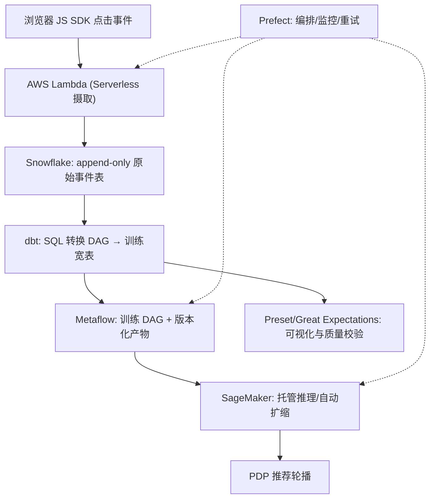

# You Do Not Need a Bigger Boat: Recommendations at Reasonable Scale in a (Mostly) Serverless and Open Stack (合理规模推荐系统：一条几乎全 Serverless 的开源栈)

- **会议/期刊**: RecSys 2021 (Manuscript / Camera-ready forthcoming)
- **作者与机构**: Jacopo Tagliabue (Coveo Labs, USA)
- **推荐链路定位**: 端到端（数据采集 → 训练 → 在线服务全链路架构）
- **研究方向**: 工业级全链路架构与评测基准 / MLOps 工程实践
- **论文原文**: [论文原文链接](https://arxiv.org/abs/2107.07346v1)
- **开源代码**: [开源代码仓库链接](https://github.com/jacopotagliabue/metaflow-)

## TL;DR (1分钟核心速览)

本文是一篇工业立场/实践论文：它指出真正阻碍中长尾电商用上最新推荐研究的不是模型，而是**不成熟的数据管道**。作者把服务对象界定为“合理规模”（年 GMV 千万至 5 亿美元、年行为数据 TB 级、数十名而非数百名 ML 工程师），提出「数据为王 / ELT 优于 ETL / PaaS-FaaS 优于 IaaS / 分布式计算是万恶之源」四条原则，并给出以 AWS Lambda + Snowflake + dbt + Metaflow + SageMaker + Prefect 组成的（几乎）全托管开源栈。全文**不含离线数据集、划分协议与排名指标**，其“证据”是作者在数十家数字商店的部署经验与一条可处理 TB 级数据的实跑链路，收益以工程量（无需自维护基础设施）而非 nDCG 提升来衡量。

## Background & Motivation (背景与核心矛盾)

- **主流范式**: 学界（RecSys/KDD 电商 workshop）持续产出序列建模、图卷积、CTR 特征交叉等模型创新，隐含前提是“数据已就绪、算力已就绪”。
- **前人局限**: 创新与收益高度集中在少数巨头；中长尾商家同时缺三样东西——代表性开放数据集、与业务对齐的基准（如复现 [15] 时的争议[8]）、以及可负担的算力与工具链。即使模型侧打通，从原始事件到线上轮播的“最后一公里”仍无人负责。
- **核心洞察 (Key Insight)**: 建模正在被商品化，**边际收益最大处永远在数据**；而“工程质量”是最稀缺资源——因此任何让数据科学家依赖其他团队（取数、开 GPU、部署）的架构都会让 time-to-ROI 飙升，同时也不该指望科学家自己变成 DevOps。
- **本文切入点**: 不做新模型，而是把“合理规模”当成一等约束，用托管服务把基础设施复杂度整体外包，交付一份可照抄的端到端栈蓝图。

## Method (核心方法设计)

### 1. 整体框架 (Overall Architecture)

系统以“会话内推荐（in-session recommendation）”为落地场景，串成五段式闭环：浏览器端 JS SDK 采集点击事件 → 经 API Gateway 触发 **AWS Lambda** 无状态写入 **Snowflake**，以 append-only 方式保存**不可变原始事件**（可回放）→ **dbt** 在仓库内用纯 SQL 构建转换 DAG，生成展开属性的训练表，并接 Superset/Preset 做 BI、Great Expectations 做质量校验 → **Metaflow** 以装饰器声明式定义训练 DAG，自动完成云上执行与 GPU 申请，产物带版本（artefacts/versioning）→ **SageMaker** 托管推理与自动扩缩容，向商品详情页（PDP）返回推荐轮播。**Prefect** 贯穿编排、监控、重试与告警。关键点在于：除仓库内的 SQL 外，所有重计算都被下推到托管服务，模型训练与调参可在本地舒适完成。

### 2. 关键设计拆解 (Key Designs)

1. **“合理规模”的显式建模（把模糊的“中小客户”变成可设计的约束）**：前人讨论要么假设 PB 级数据湖，要么假设单机玩具数据，中间地带缺失。作者将其写成一组量纲约束：年营收 $10^{7}\!\sim\!5\times10^{8}$USD、年行为事件量$\mathcal{O}(\text{TB})$、ML 工程师规模$|T|=\mathcal{O}(10)$。直觉是：**规模小一个数量级，就应当少用一个数量级的分布式组件**，约束越清晰，工具选型的自由度反而越大。
2. **ELT + append-only 原始层（可回放性是复现与排障的根）**：传统 ETL 在摄取阶段就做有损清洗，导致“线上指标与离线表对不上”时无法回溯。本文要求整条管道是原始事件的确定性函数 $\mathcal{D}^{(t)}_{\text{train}} = f\big(\mathcal{E}_{\le t}\big)$，原始层只追加不改写，任何下游表都能由$\mathcal{E}_{\le t}$ 重算。这样数据质量事故、特征口径变更、模型回滚都变成“重跑 DAG”而非“猜”。
3. **托管抽象替代自建集群 + 训练/服务解耦**：痛点是用 Spark 做 TB 级聚合慢、难调试、强制陌生编程范式；K8s 集群则需专人运维。本文把分布式“藏进” Snowflake 的弹性 SQL 引擎，把云执行“藏进” Metaflow 装饰器，把服务“藏进” SageMaker；由于 Metaflow 产物自带版本，部署目标可替换。代价是供应商锁定，收益是把唯一稀缺资源（工程师注意力）全部押在 ML 上。

## Experimental Setup & Evaluation Protocol (实验设置与评估协议)

- **数据集与预处理**: **无**。本文不发布数据集，也不做离线训练实验；数据侧只给出目标量级（TB/年行为事件）与“原始层 append-only、派生层由 dbt 重建”的预处理契约。
- **数据划分与防穿越 (Splitting Strategy)**: 不适用。文中唯一的时间语义要求是原始事件按到达时间只追加，从而在处理 $t$ 时刻训练集时天然排除未来事件（工程层面的防穿越）。
- **排名评测协议 (Ranking Protocol)**: 不适用——没有 Full-Ranking 或 Sampled Ranking 评测。功能需求以“能力清单”方式验收，见下表。
- **对比基线与超参设置**: 无对照基线、无 Embedding 维度与显著性检验；对照对象是“自建 Iaas/Spark 栈”这一整体工程范式，而非某个模型。

| 功能需求 (Desiderata) | 交付组件 | 关键约束/说明 |
| :--- | :--- | :--- |
| 原始数据摄取 | AWS Lambda + API Gateway | 自动扩缩、无状态、无服务器运维 |
| 存储与回放 | Snowflake（append-only 原始表） | 不可变原始记录，保证 re-playability |
| 数据准备/BI/QA | dbt + Preset(Superset) + Great Expectations | 转换即 SQL DAG，可视化与校验开源 |
| 模型训练 | Metaflow | 装饰器申请 GPU，产物版本化 |
| 模型服务 | SageMaker | 托管推理、自动扩缩、硬件可选 |
| 编排与监控 | Prefect | 监控 UI、自动重试、告警通知 |

## Key Experimental Results (实验关键数据)

### 1. 主实验对比 (Main Results)

本文**不含数值型主实验表**。作者的主张性结论是：该栈可在“有限至零 DevOps 工作”下完成从原始事件到 GPU 推荐的 TB 级处理，且除仓库外多数组件为开源或有开源替代（Prefect、Metaflow、dbt、Superset、Great Expectations，甚至 Serverless 本身可用 OpenWhisk）。下表是对文中定性主张的整理，未提供任何指标数值。

| 方案范式 | 基础设施负担 | 调试/复现性 | 本文判断 |
| :--- | :--- | :--- | :--- |
| 自建 Spark + K8s (IaaS) | 高（需专职运维、扩缩容自负） | 分布式难调试、范式陌生 | 合理规模下不划算 |
| 传统 ETL 单栈 | 中 | 摄取即清洗，原始态丢失 | 不可回放，排障成本高 |
| 本文 Serverless + ELT | 低（全托管） | 原始层可重算、产物版本化 | 推荐采用 |

### 2. 消融实验 (Ablation Study)

以“移除某组件后的工程后果”作定性消融（非性能消融）：

| 移除项 | 直接后果 | 受影响能力 |
| :--- | :--- | :--- |
| w/o append-only 原始层 | 派生表不可重算，指标对账失败无法回溯 | 复现性、特征迭代 |
| w/o dbt（转换散落脚本） | SQL DAG 与文档消失，口径不可审计 | 数据质量与协作 |
| w/o Metaflow（手写脚本+手动开 GPU） | 云执行与版本管理回流到科学家身上 | 独立性、time-to-ROI |
| w/o 托管服务（改自建集群） | 需专人维护扩缩容与高可用 | 团队规模与成本可预测性 |
| w/o Prefect 编排 | 无统一监控/重试/告警，故障静默 | 线上稳定性 |

### 3. 关键实验发现 (Key Findings)

1. **瓶颈定位在管道而非模型**：作者跨数十家数字商店的经验显示，中长尾商家的时间损耗集中在取数、开机器、上线三处协作摩擦，而模型微调带来的边际收益远小于把干净、标准化数据变成“随手可取”。
2. **ELT 的可回放性是唯一被反复强调的“硬”工程收益**：把原始事件固定为不可变层后，所有下游表都是 $\mathcal{E}_{\le t}$ 的确定性函数，使数据事故、口径变更与模型回滚从“不可控”变为“重跑一次 DAG”。
3. **Serverless 的代价被明确承认为锁定与成本可预测性的权衡**：作者直言按需扩缩的成本曲线比“雇人维护 K8s”更容易预测，但这也意味着议价能力与迁移成本转移到云厂商一侧。

## Highlights & Limitations (亮点、对比与审稿批判)

- **与代表作对比 (vs. Prior Work)**: 与同期工业系统论文（如 Meta 的 DHEN / 大规模 CTR 系统）相比，本文不追求模型规模与指标 SOTA，而是服务“小两个数量级”的客户；与 MLOps 工具综述相比，它给出的是**一条被实际跑通的、带取舍理由的具体链路**，而非组件清单；与 [15] 类可复现性研究相比，它把“可复现”从离线脚本扩展到原始事件层。
- **可迁移亮点**: ① append-only 原始层 + 派生层重算的 ELT 契约，可直接用于任何需要特征回溯或因果去偏重加权的推荐训练；② 用“量级约束（营收/数据量/人数）”而非“行业标签”来界定系统设计目标，这一做法可迁移到多场景推荐的能力规划。
- **审稿级局限批判**: ① **零量化评估**——没有延迟、成本、nDCG 或 A/B 数字，“可处理 TB 级”只是经验陈述，无法证伪，作为 RecSys 论文其证据强度明显弱于常规实验论文；② **单一作者、单一供应商视角**，Lambda/Snowflake/SageMaker 深度绑定 AWS 生态，“开源”主要在训练与编排侧，迁移成本与冷启动延迟、突发流量下的成本尖峰均未讨论；③ 未涉及推荐特有难点（冷启动、曝光偏差、实时特征时效），会话内推荐只是载体而非研究对象。

## Rating (四维评分)

- **方法创新性 (Novelty)**: ⭐⭐ （定位为立场/实践论文，无新模型与新理论；新意在于把“合理规模”形式化为可设计约束并提出四原则）
- **评估协议与实验扎实度 (Protocol & Experiments)**: ⭐ （无数据集、无划分与排名协议、无基线与显著性检验，仅凭部署经验论证，证据强度弱）
- **写作与数学规范度 (Clarity & Rigor)**: ⭐⭐⭐⭐ （原则—需求—组件三层映射清晰、图表自洽、取舍理由坦率，但全文几乎无形式化与复杂度分析）
- **工业落地与复现价值 (Industrial & Practical Value)**: ⭐⭐⭐⭐⭐ （栈可直接照抄，附开源实现，对无专职 DevOps 的中长尾团队收益立竿见影）

