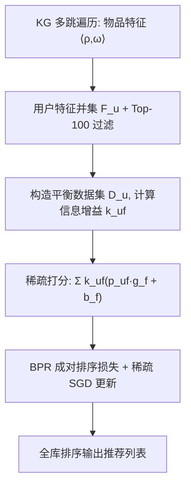
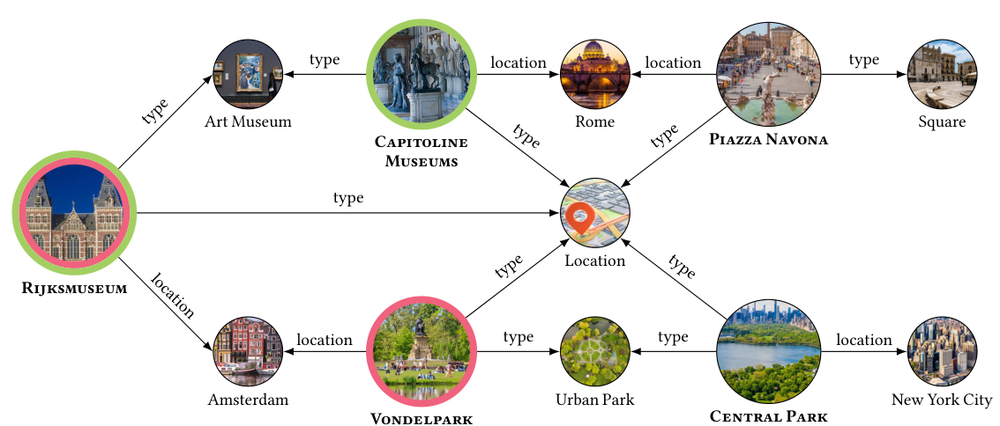
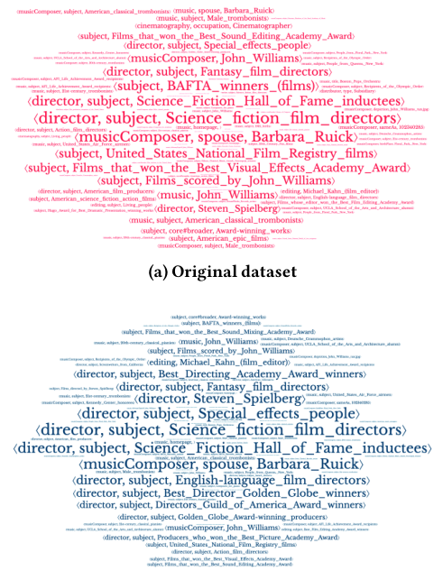

# Sparse Feature Factorization for Recommender Systems with Knowledge Graphs (知识图谱推荐中的稀疏特征分解)

- **会议/期刊**: RecSys 2021
- **作者与机构**: Vito Walter Anelli, Tommaso Di Noia, Eugenio Di Sciascio, Antonio Ferrara, Alberto Carlo Maria Mancino（Polytechnic University of Bari, SisInfLab）
- **推荐链路定位**: 召回/打分（feature-level 因子分解模型）
- **研究方向**: 图神经网络与知识图谱推荐 / 协同过滤与双塔召回
- **论文原文**: [https://arxiv.org/abs/2107.14290v1](https://arxiv.org/abs/2107.14290v1)
- **开源代码**: [https://github.com/sisinflab/LinkedDatasets](https://github.com/sisinflab/LinkedDatasets)（论文正文另指向 `split.to/kgflex`）

## TL;DR (1分钟核心速览)

知识感知推荐（KaRS）把 KG 侧信息全部塞进稠密嵌入后，参数量与训练时间随特征规模线性甚至超线性膨胀，且大量与用户决策无关的特征稀释了信号。KGFlex 改用**稀疏特征因子分解**：物品只用 KG 多跳谓词特征 $\langle\rho,\omega\rangle$描述，用户画像即其历史物品特征的并集；再用**信息增益**为用户-特征对估计重要性权重$k_{uf}$，打分时只累加用户与物品共享的特征子集，反向传播也只更新该用户"专家"的那部分参数。在 3 个 DBpedia 关联数据集的 **All-Unrated-Items 全库排序**下，精度与 kaHFM/Item-kNN 同档（Yahoo nDCG@1 0.3122 vs 0.3238），但 Gini@10 提升 **+68.8%**、ACLT@10 由 0.462 升至 2.145、PopREO 降低 **41.2%**。

## Background & Motivation (背景与核心矛盾)

- **主流范式**: 以 BPR-MF/MF/NeuMF 为代表的嵌入式 CF，以及 kaHFM 等把 KG 三元组通过 TransE 式知识图嵌入注入物品向量的知识感知混合模型。
- **前人局限**: ①稠密表征使训练时间正比于嵌入表大小，叠加数千维 KG 特征后模型既大又难训；②全局静态的特征嵌入无法表达"同一特征对不同用户权重不同"（有人因导演看电影，有人因国籍看书），导致推荐过度专门化或流行度塌缩。
- **核心洞察 (Key Insight)**: 用户决策只依赖特征的**极小子集**，且该子集可由"该特征区分其正/负反馈的能力"信息论地度量——信息增益接近 0 的特征（如所有物品共有的 `type=Location`）应被直接抑制。
- **本文切入点**: 用 IG 把"用户×特征"变成带权稀疏边，模型退化为只在用户相关特征上做因子分解，从而同时获得表达力与稀疏性。

## Method (核心方法设计)

### 1. 整体框架 (Overall Architecture)

离线阶段对每个物品做 DBpedia 上深度 2 的谓词链遍历，得到特征集 $\mathcal{F}_i$；用户特征集为用户交互物品特征的并集$\mathcal{F}_u=\bigcup_{i\in I_u}\mathcal{F}_i$，并按 1-hop / 2-hop 各保留 IG 最高的 100 个。随后为每个用户构造平衡的正负样本集$\mathcal{D}_u$，逐特征计算信息增益作为权重$k_{uf}$。在线打分不查用户/物品 ID 嵌入，而是取$\mathcal{F}_{ui}=\mathcal{F}_u\cap\mathcal{F}_i$，对每个共有特征做"个人视图$\mathbf{p}_{uf}$× 全局视图$\mathbf{g}_f$+ 偏置"的加权求和；训练用 BPR 成对损失 + SGD，梯度只落在$k_{uf}\neq 0$ 的稀疏坐标上。

<figure class="paper-figure" markdown="span">
  <figcaption>图 1</figcaption>
</figure>
图 1：KG 片段示例——Pink/Green 两位用户的正反馈物品共享 `location=Amsterdam` 等谓词，共有谓词 `type=Location` 因无区分度而被 IG 赋零权。

### 2. 关键设计拆解 (Key Designs)

1. **熵驱动用户-特征赋权（IG as user-feature weight）**：痛点是把特征等同对待会让共有特征淹没个性化信号。对用户 $u$的平衡集$\mathcal{D}_u$（正样本$|I_u|$个 + 从"他人交互过但$u$未交互"中随机等量采样），特征二值化为存在/缺失，令$p_{uf},n_{uf}$为特征$f=1$时的正/负样本数，$t_{uf}=p_{uf}+n_{uf}$，则
$$k_{uf}=\mathrm{IG}(\mathcal{D}_u,f)=1-H(\mathcal{D}_u|f=1)-H(\mathcal{D}_u|f=0),\quad H(\mathcal{D}_u|f=1)=\frac{t_{uf}}{|\mathcal{D}_u|}\Big(-\frac{p_{uf}}{t_{uf}}\log_2\frac{p_{uf}}{t_{uf}}-\frac{n_{uf}}{t_{uf}}\log_2\frac{n_{uf}}{t_{uf}}\Big)$$
直觉：只有能把正负样本"劈开"的特征才获得高权，$k_{uf}=1$表示该特征对该用户近乎决定性，$k_{uf}\approx 0$ 表示无信息量，权重同时充当特征选择器。

2. **全局-个人双视图稀疏因子分解**：痛点是无 ID 嵌入时不同用户对同一特征应有不同偏好强度。打分只在共有特征上展开
$$\hat{x}_{ui}=\sum_{f\in\mathcal{F}_{ui}}k_{uf}\big(\mathbf{p}_{uf}^{\top}\mathbf{g}_f+b_f\big)$$
$\mathbf{g}_f,b_f$全局共享，$\mathbf{p}_{uf}$为$u$私有；梯度为$\partial\hat{x}_{ui}/\partial\mathbf{p}_{uf}=k_{uf}\mathbf{g}_f$、$\partial\hat{x}_{ui}/\partial\mathbf{g}_f=k_{uf}\mathbf{p}_{uf}$、$\partial\hat{x}_{ui}/\partial b_f=k_{uf}$。因此一次更新只触碰$\mathcal{F}_{ui}$ 内的坐标，训练开销与"用户相关特征数"成正比而非与全特征表成正比，即所谓"专家原则"。

3. **训练目标、负采样与推理效率**：损失为 BPR 成对目标 $\mathcal{L}=-\sum_{(u,i^+,i^-)}\ln\sigma(\hat{x}_{ui^+}-\hat{x}_{ui^-})+\lambda\|\Theta\|_2^2$，训练负例即 BPR 的未观测采样；IG 估计阶段另需一次"等量随机负采样"（同一用户等量未交互物品）。推理时无 ANN 索引，需对候选集逐物品求特征交集并累加，但每用户活跃特征上限 200，单次打分代价为$O(|\mathcal{F}_{ui}|)$，常数极小且完全可解释。

## Experimental Setup & Evaluation Protocol (实验设置与评估协议)

- **数据集与预处理**: 显式评分二值化（≥3 视为正反馈），Yahoo! Movies / MovieLens 用迭代 `10-core`，Facebook Books 用 `5-core`；物品经公开 URI 映射到 DBpedia 做 2-hop 特征抽取，剔除 `owl:sameAs`、`rdf:type`、`dbo:wikiPageWikiLink` 等辅助谓词，并过滤共享物品数 <10 的稀有特征。

| 数据集 | #Users | #Items | #Interactions | 稀疏度 | 特征/场景说明 |
| :--- | :---: | :---: | :---: | :---: | :--- |
| Yahoo! Movies | 4,000 | 2,626 | 69,846 | 99.34% | 电影，2003 年前评分，DBpedia 2-hop 特征 |
| MovieLens 1M | 6,040 | 3,706 | 1,000,209 | 95.53% | 电影，密度最高 |
| Facebook Books | 1,398 | 2,933 | 18,978 | 99.54% | 图书，最稀疏 |

- **数据划分与防穿越 (Splitting Strategy)**: 逐用户 `hold-out 80/20` 比例划分，训练 80%、测试 20%，无时间戳切分（存在轻度未来信息泄漏风险）。
- **排名评测协议 (Ranking Protocol)**: 无偏 **All Unrated Items 全库排序**（对每用户全部未交互物品打分），非采样排序；指标 nDCG@{1,10}、Item Coverage、Gini Index、ACLT、PopREO/PopRSP，超参用 Bayesian 优化在 10 组配置中按验证 nDCG 选取，显著性用配对 t 检验 + Wilcoxon（$p<0.05$）。
- **对比基线与超参设置**: 非竞争基线 Random / MostPop / VSM；CF 类 Item-kNN、MultiVAE；竞争基线 BPR-MF、MF、NeuMF、kaHFM；嵌入维度 $E\in\{1,10,100\}$ 网格，KGFlex 每用户上限 100 个 1-hop + 100 个 2-hop 特征。

## Key Experimental Results (实验关键数据)

### 1. 主实验对比 (Main Results)

Yahoo! Movies（10-core，全库排序，↑ 越大越好，PopREO↓ 越小越好）：

| Model | nDCG@10 | nDCG@1 | Gini@10↑ | ACLT@10↑ | PopREO@10↓ |
| :--- | :---: | :---: | :---: | :---: | :---: |
| VSM | 0.0478 | 0.0453 | 0.0525 | **3.1177** | 0.4959 |
| Item-kNN | **0.3074** | **0.3472** | 0.1583 | 0.9884 | 0.7059 |
| MultiVAE | 0.2370 | 0.2455 | 0.0914 | 0.2347 | 0.8543 |
| BPR-MF | 0.1857 | 0.1710 | 0.0219 | 0.0006 | 0.9954 |
| MF | 0.2897 | 0.2999 | 0.0902 | 0.0823 | 0.8735 |
| NeuMF | 0.0918 | 0.0855 | 0.0113 | 0.0006 | 1.0000 |
| kaHFM | 0.3006 | 0.3238 | 0.1659 | 0.4624 | 0.7610 |
| **KGFlex** | 0.2464 | 0.3122 | **0.2802** | 2.1447 | **0.4477** |
| Improv. vs 最强基线 | −14.8% | −10.1% | **+68.8%** | **+363.2%** | **−41.2%** |

跨数据集核心指标（同协议）：

| 数据集 | Model | nDCG@10 | Gini@10↑ | ACLT@10↑ | PopREO@10↓ |
| :--- | :--- | :---: | :---: | :---: | :---: |
| MovieLens 1M | Item-kNN | **0.3690** | 0.0584 | 0.0666 | 0.9606 |
| MovieLens 1M | BPR-MF | 0.3676 | 0.0765 | 0.0633 | 0.9551 |
| MovieLens 1M | kaHFM | 0.3222 | 0.0482 | 0.0450 | 0.9720 |
| MovieLens 1M | **KGFlex** | 0.1982 | **0.0844** | **0.8613** | **0.8207** |
| Facebook Books | kaHFM | **0.1267** | 0.1387 | 0.3294 | 0.8766 |
| Facebook Books | Item-kNN | 0.1290 | **0.3752** | 2.2252 | 0.4885 |
| Facebook Books | **KGFlex** | 0.0853 | 0.3070 | 3.0264 | **0.1521** |

### 2. 消融实验 (Ablation Study)

MovieLens 1M 上对 KG 特征阶数与嵌入维度 $E\in\{1,10,100\}$ 的消融（图 3，趋势描述）：

| 变体 | KG 特征来源 | nDCG@10 | Gini@10↑ | 结论 |
| :--- | :--- | :---: | :---: | :--- |
| KGFlex(∅) | 无 KG 特征 | 最低（近 0） | — | 无共有内容可对齐，模型失效 |
| KGFlex(1) | 仅 1-hop（Top-100） | 较高 | 低 | 精度可用但多样性差，加大 $E$ 无收益 |
| KGFlex(2) | 仅 2-hop（Top-100） | 中 | **最高** | 多跳语义（如导演国籍）更贴近真实动因 |
| KGFlex | 1-hop + 2-hop | **最高** | 略低于 (2) | 完整版精度最优，多样性轻微回退 |

### 3. 关键实验发现 (Key Findings)

1. **增益主要落在"覆盖面"而非 top-N 命中**：Yahoo 上 nDCG@10 落后 kaHFM 14.8%，但 ACLT@10 从 0.462 跃至 2.145（约 4.6 倍）、PopREO 从 0.761 降到 0.448；MovieLens 上 nDCG@10 仅 0.198（vs BPR-MF 0.368），却把 PopREO 从 0.955 压到 0.821——IG 加权充当了流行度去偏器，代价是头部精度。
2. **多跳特征是多样性的真正来源，单跳特征只贡献精度**：消融显示 KGFlex(1) 精度尚可但 Gini 低、KGFlex(2) 多样性最高，二者合并后精度超过任一单跳版本；说明 2-hop 谓词链（导演国籍、系列归属）承载了"为什么消费"的因果线索，而 1-hop 只提供粗粒度类别匹配。
3. **语义可保持但有衰减**：Yahoo 上原数据集 Top-100 信息特征有 **79%** 出现在推荐列表中（图 4），且用户最关键的 $k=5$特征中位保留率 40%、$k=100$ 时降至 21%——模型稳健保留最强兴趣，但长尾弱兴趣会随推荐漂移，解释性并非无损。

<figure class="paper-figure" markdown="span">
  <figcaption>图 4</figcaption>
</figure>
图 4：原始数据集与推荐列表上 Top-100 信息增益特征词云对比，科幻、Spielberg、John Williams 等主题在推荐后依旧居前，佐证语义延续性。

## Highlights & Limitations (亮点、对比与审稿批判)

- **与代表作对比 (vs. Prior Work)**: 与 BPR-MF 同为 BPR 成对优化，但因引入 KG 特征与 IG 加权，Yahoo nDCG@1 从 0.171 提升到 0.312、ACLT 从 0.0006 提升到 2.145；与 kaHFM 相比放弃"知识图嵌入初始化 + 稠密物品向量"，改为"无 ID 嵌入 + 特征级稀疏交互"，因此精度略降但多样性与去偏大幅领先；与 VSM 共享内容特征，但用可学习双视图替代 TF-IDF 余弦，长尾覆盖由 3.118 略降至 2.145，而 top-N 精度显著更高（0.0478→0.2464）。
- **可迁移亮点**: ①将信息增益作为"用户-特征"重要性权重，可直接插入 FFM/DLRM/DeepFM 做特征门控与特征选择；②"全局共享 + 用户私有"的双视图稀疏更新，可推广到任意特征级因子分解以降低训练内存。
- **审稿级局限批判**: ①精度并非 SOTA，作者以多样性/去偏换精度，但未给出多目标加权或帕累托前沿，工业精排难以直接采用；②IG 依赖对负样本的**随机等量采样**估计，交互稀疏用户的 $p_{uf}/n_{uf}$ 方差极大，冷启动场景权重不稳；③划分用逐用户 80/20 而非全局时间戳切分，存在轻度信息穿越；④仅利用特征的二值存在性，丢弃 KG 多值与数值属性，2-hop 探索深度与 Top-100 截断均为敏感超参且未做敏感性曲线。

## Rating (四维评分)

- **方法创新性 (Novelty)**: ⭐⭐⭐⭐ （把信息增益从决策树搬到"用户-特征"粒度做稀疏门控，思想简洁有新意，但本质仍是线性特征因子分解，缺乏理论/谱分析支撑）
- **评估协议与实验扎实度 (Protocol & Experiments)**: ⭐⭐⭐⭐ （三数据集 + 全库排序 + 配对 t 检验/Wilcoxon + 精度/多样性/偏置三视角完整，扣分在缺少时间切分与超参敏感性分析）
- **写作与数学规范度 (Clarity & Rigor)**: ⭐⭐⭐⭐ （IG 推导与梯度逐项给出、例子贯穿全文，但 Eq.7 省略条件熵权重写法略显不严谨，特征过滤规则分散在多处）
- **工业落地与复现价值 (Industrial & Practical Value)**: ⭐⭐⭐ （稀疏更新对内存友好、权重天然可解释、代码与 Elliot 配置公开；但依赖高质量 KG、推理需逐候选特征交集、精度损失使其更适合作为多样性/长尾通道而非主精排）

