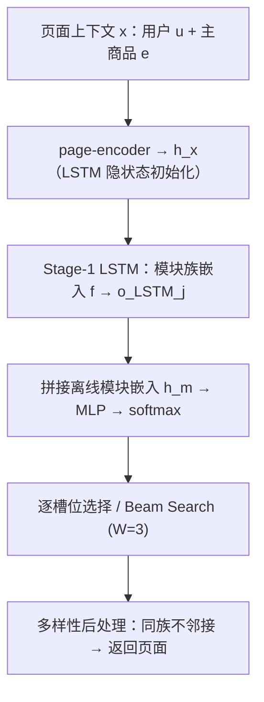
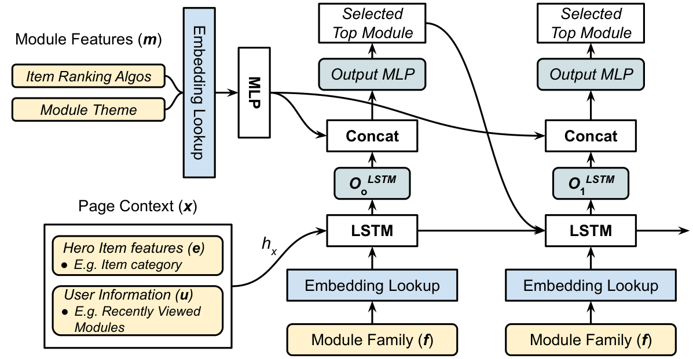

# Page-level Optimization of e-Commerce Item Recommendations (电商商品详情页模块的页面级优化)

- **会议/期刊**: RecSys 2021 (Fifteenth ACM Conference on Recommender Systems)
- **作者与机构**: Chieh Lo, Hongliang Yu, Xin Yin, Krutika Shetty, Changchen He, Kathy Hu, Justin Platz, Adam Ilardi, Sriganesh Madhvanath (eBay Inc.)
- **推荐链路定位**: 重排（页面级模块选序 / Page-level Re-ranking）
- **研究方向**: 多任务学习与列表级重排 / 强化学习与动态探索推荐
- **论文原文**: [arXiv:2108.05891v1](https://arxiv.org/abs/2108.05891v1)
- **开源代码**: 暂未开源

## TL;DR (1分钟核心速览)

商品详情页（IDP）的推荐模块（carousel）长期采用**全局静态配置**，忽略用户当前购物意图与模块间相互影响；逐页穷举又面临组合爆炸与在线延迟。本文把"选哪些模块、按什么序放"形式化为**序列排序问题**，提出两阶段 RNN（TRNN）：用 LSTM 隐状态承载"已选模块前缀 + 页面上下文"，在**模块族空间**上解码而非在数百个模块上穷举，并以束搜索（W=3）平衡多样性与相关性。数据侧用 Thompson 采样 + 逆倾向得分（IPS）去偏，训练侧学习多目标权重。线上 A/B 相对静态页提升 **CTR 2.48%、PTR 7.34%**（p<0.05）。

## Background & Motivation (背景与核心矛盾)

- **主流范式**: 每个模块由独立召回/排序算法填充 item，模块的选择与垂直顺序则按业务规则静态写死，对所有用户一致。
- **前人局限 1（点位式排序）**: 给每个模块打一个独立的 point-wise 相关性分再排序，完全忽略模块间交互——连续出现同质模块会显著降低满意度与转化。
- **前人局限 2（整页式/成对式）**: 把每种整页排列当作候选打分需评估组合爆炸量级的排列；成对交互近似（pairwise/greedy）在类别特征高基数时不可扩展；线性 contextual bandit 受限于有限特征，且需承担探索期的业务损失。
- **核心洞察 (Key Insight)**: 模块总数可达数百，但**模块族（module family）数量恒定且远小于模块数**；页面是自上而下的扫描结构，用户"逐槽位"决策天然适配 RNN 的链式条件概率分解。
- **本文切入点**: 用 RNN 在族级动作空间上做自回归解码，隐式捕获任意高阶模块交互，再用束搜索将组合搜索压到可在线服务的量级。

## Method (核心方法设计)

### 1. 整体框架 (Overall Architecture)

输入为页面上下文 $x$（用户特征$u$+ 主商品特征$e$），经 page-encoder 压成$d_h$维向量$h_x$并作为 LSTM 第 0 步的隐状态初始化（cell state 置零）。第一阶段的 LSTM 以"可用模块族特征$f\in\mathbb{R}^{F\times d_f}$"为输入，输出$o^{LSTM}_j\in\mathbb{R}^{F\times d_o}$，刻画"上下文 + 已选前缀$\pi_{<j}$"的潜在状态；第二阶段将候选模块的离线预计算嵌入$h_m\in\mathbb{R}^{d_m}$ 与之拼接，送入 MLP + softmax 得到每个模块在当前槽位的条件概率，逐槽位选出 top-K 模块。推理时用束搜索（W=3）解码整页；训练时按多目标加权损失与 IPS 加权联合优化。

<figure class="paper-figure" markdown="span">
  <figcaption>图 2. TRNN 模型架构。第一阶段处理页面上下文，包括“主商品”特征和用户信息。LSTM 单元的输入为在给定页面上下文（𝑥）下的可用模块族。LSTM 单元的输出（𝑜𝐿𝑆𝑇𝑀</figcaption>
</figure>

### 2. 关键设计拆解 (Key Designs)

1. **链式条件概率的页面打分（序列排序建模）**：整页排列的概率按链式法则精确分解，不做任何条件独立性假设，因此多样性、相似性等任意高阶交互都被"前缀 + 隐状态"吸收：
$\phi(\pi\mid x)=\prod_{j=1}^{K}\phi(\pi_j\mid \pi_{<j},x),\quad r_{xmi}=\phi(m_i\mid M_x^{S})$其中$M_x^{S}$为已占前$s$个槽位的模块集合。关键工程点在于**动作空间降维**：LSTM 每步只输出$F$个族级分数（$F\ll|M_x^{N}|$），得分最高的族内再取该族最优模块，从而使在线复杂度与模块总数脱钩。

2. **族级多样性约束 + 束搜索解码**：按排序算法/内容主题把模块划入族集合 $\mathcal{F}$，推理时禁止同族模块占据相邻槽位——把"多样性"从软特征变成硬约束，避免 point-wise 模型堆叠同质模块。束搜索的序列评分定义为"页面至少命中一次购买"的概率：
$\phi(\pi^{b}_{<s+1})=1-\prod_{i=1}^{s}\big(1-P(y_p=1\mid \pi^{b}_{i})\big)$即可递推$\phi(\pi^b_{<s+1})=1-(1-\phi(\pi^b_{<s}))(1-P(y_p=1\mid\pi^b_s))$，贪心是其$W=1$ 的特例。

3. **训练目标、去偏与数据采集**：总损失为多目标标量化 $\mathcal{L}(\theta)=\sum_{i=1}^{Q}w_i L_i(\theta)$，本文取点击$L_c$、购买意图$L_u$（加购/收藏/watch）与**归因购买意图**$L_{ap}$，权重$w_i$按文献[9]的方案作为参数自动学习而非人工调。为解决购买事件比点击稀疏数个量级的问题，按下式把同一会话内购买前的点击按时间衰减归因为购买意图：$\eta^{(t_p-t_c)/\epsilon T}$（$\eta\in(0,1)$为衰减因子）。位置偏置用基于位置的点击模型校正：$CTR(m,s)=P_e(s)P(y_c=1\mid m)$，以$P_e(s)/P_e(1)=CTR(m,s)/CTR(m,1)$估计倾向并乘到损失上（IPS）。训练数据由 Thompson 采样（$r_{\hat{x}mi}\sim Beta(\alpha_i,\beta_i)$，按主商品类别等低维上下文分批日更）与生产模型日志混合，生产侧降采样至与探索数据同量级，且两侧采集时均施加同一套多样性策略以对齐分布。

## Experimental Setup & Evaluation Protocol (实验设置与评估协议)

- **数据集与预处理**: eBay 生产日志，约 **1M 页面曝光**；正样本定义为"模块内任一 item 被点击/购买/意图交互"，无交互页面做降采样以缓解类别不平衡。特征含类别型（item 类目）、数值型（模块历史 CTR，做缩放/截断/log 变换）与 token 嵌入（标题）。

| 数据来源 | 规模 | 用途 | 说明 |
| :--- | :---: | :--- | :--- |
| Thompson 采样流量 | 与生产日志降采样后同量级 | 训练/无偏评估 | 低维上下文 Beta 后验采样，含随机化以支撑 DM/DR 估计 |
| 生产模型日志 | 约 1M 页面曝光 | 训练 | 按槽位 IPS 加权去偏 |
| 随机流量（<5%） | 少量 | 位置偏置估计 | 打乱模块顺序估计 $P_e(s)/P_e(1)$ |

- **数据划分与防穿越**: 按 **80%/10%/10%** 划分为 train/valid/test；位置倾向与归因在 Spark ETL 中离线预计算，避免测试期信息泄漏。
- **排名评测协议**: 工业日志无法做全库 Full-Ranking，采用**重排评估 + 无偏估计**双轨：AUC、F1（购买二分类）、NDCG、MRPR（Mean Reciprocal Purchase Rank），以及用 **DM（Direct Method）与 DR（Doubly Robust）** 估计的 CTR/PTR，DF 估计用于消除"只观测到被展示模块"的选择偏置。
- **对比基线与超参设置**: XGBoost（默认参数 + 限制树深防过拟合）为基准，MLP 采用与 TRNN 同嵌入方式、相近参数量（嵌入维度 $d=50$，线性层 1–3 层），Adam、lr=0.001、训练 10 epoch，指标取 5 次独立评估均值；线上 A/B 显著性$p<0.05$。

## Key Experimental Results (实验关键数据)

### 1. 主实验对比 (Main Results)

所有数值为相对 XGBoost 基线的**相对提升 Δ**（负值即下降）：

| 模型 | ΔAUC | ΔF1 | ΔNDCG | ΔMRPR | ΔCTR(DM) | ΔPTR(DM) | ΔCTR(DR) | ΔPTR(DR) |
| :--- | :---: | :---: | :---: | :---: | :---: | :---: | :---: | :---: |
| XGBoost | 0 | 0 | 0 | 0 | 0 | 0 | 0 | 0 |
| MLP | +5.09% | +11.36% | -35.82% | -8.10% | +2.24% | +4.70% | +5.80% | +12.16% |
| MLP + IPS | +5.20% | +11.62% | -35.07% | -9.56% | +1.77% | +4.09% | +5.21% | +8.94% |
| TRNN | +7.32% | +12.27% | +27.81% | +8.96% | +11.00% | +18.76% | +11.65% | +24.18% |
| **TRNN + IPS** | +4.58% | +5.61% | **+40.67%** | **+16.39%** | **+14.86%** | **+24.12%** | **+15.78%** | **+29.20%** |

线上 A/B（相对静态配置，p<0.05）：

| 线上模型 | ΔCTR | ΔPTR |
| :--- | :---: | :---: |
| TRNN | +2.40% | +4.40% |
| TRNN + 个性化特征 | +2.61% | +4.89% |
| **TRNN ($L_c,L_u,L_{ap}$) + 个性化特征** | **+2.48%** | **+7.34%** |

### 2. 消融实验 (Ablation Study)

以仅用归因购买意图 $L_{ap}$ 的 TRNN 为基线（Δ 为相对提升）：

| 变体 | ΔNDCG | ΔMRPR | ΔCTR(DM) | ΔPTR(DM) | ΔCTR(DR) | ΔPTR(DR) |
| :--- | :---: | :---: | :---: | :---: | :---: | :---: |
| 仅 $L_c$ | +0.41% | -4.54% | -2.50% | -4.36% | -3.39% | -5.26% |
| 仅 $L_u$ | +2.03% | -3.89% | +0.69% | +1.27% | -1.17% | -1.52% |
| $L_c+L_u+L_{ap}$（等权） | +1.09% | 0.00% | -1.44% | -2.36% | -1.56% | -5.65% |
| **$L_c+L_u+L_{ap}$ + auto 权重** | -1.48% | +2.40% | **+2.29%** | **+3.86%** | -0.96% | -0.96% |
| TRNN + 个性化特征 | +1.82% | +5.95% | +1.93% | +3.48% | +7.69% | +16.95% |
| w/o 槽位 IPS（即 TRNN 行） | +27.81% | +8.96% | +11.00% | +18.76% | +11.65% | +24.18% |

### 3. 关键实验发现 (Key Findings)

1. **序列建模是主要增益来源**: 同为深度模型，MLP 在有偏 NDCG 上比 XGBoost 低 35.82%，而 TRNN 反超 +27.81%、ΔPTR(DR) 达 +29.20%——说明增益不是"用了神经网络"，而是链式条件概率显式建模了模块间交互。
2. **IPS 与模型容量呈互补而非叠加**: 槽位 IPS 让 TRNN 的无偏指标升至最高（ΔNDCG 27.81%→40.67%，ΔPTR(DR) 24.18%→29.20%），却把 ΔAUC 从 +7.32% 压到 +4.58%；作者归因于 IPS 重加权牺牲了有偏拟合以换取高槽位上的相关性排序，而 MLP 因已把 slot 位置当输入特征，反而吃不到 IPS 红利。
3. **多目标的"权重怎么来"比"用几个目标"更关键**: 等权融合三目标使 CTR(DM) 掉 1.44%，自动学习权重后转为 +2.29%/+3.86%；线上对应 PTR 提升从 4.89%（加个性化特征）跃至 **7.34%**，验证了相关性（点击）与转化（购买）目标确实相互冲突、需显式平衡。此外，Thompson 采样相对全随机带来 +1.69% CTR/+1.74% PTR，叠加多样性策略后再提升至 +2.38%/+3.25%；束搜索"延迟到第 3 槽启动"比"从第 1 槽启动"再得线上 +1.40% CTR/+2.19% PTR。

## Highlights & Limitations (亮点、对比与审稿批判)

- **与代表作对比 (vs. Prior Work)**: 相比 point-wise 打分的模块排序，本文通过 RNN 前缀状态隐式捕获任意阶模块交互，无需枚举整页排列；相比成对交互近似与线性 contextual bandit 方案，本文不受高基数类别特征与线性后验的限制，把 bandit 退化为**数据采集工具**而非在线决策器，从而规避探索期业务损失；相比 set-wise 编码全部候选的神经排序器，模块嵌入离线预计算、在线只跑族级 LSTM + W=3 beam，延迟可控。
- **可迁移亮点**: (i) **"族级动作空间"降维**——当候选集合可按语义聚成少量族时，用族级自回归解码替代候选级枚举，可迁移到首页模块编排、广告位选序、电商组合推荐；(ii) **会话内时间衰减的意图归因** $\eta^{(t_p-t_c)/\epsilon T}$，把稀疏的转化信号扩散到前置点击，是缓解 CVR 稀疏与延迟反馈的通用技巧。
- **审稿级局限批判**: (i) **评价体系不可复现**——全部指标是相对 XGBoost 的相对提升，未给绝对值，且依赖生产日志与 <5% 随机流量估计倾向，外部无法复现或横向比较；(ii) **离线收益与无偏收益方向不一致**（auto 权重在 DM 上涨、DR 上仍 -0.96%），说明 IPS/DR 估计方差大、结论稳健性不足；(iii) 线上束搜索宽度被硬限为 W=3，且 Beta-Binomial Thompson 采样仅支持低维类别上下文，作者自认需转向深层贝叶斯 bandit 与 Transformer 解码器；(iv) 多样性仅用"同族不邻接"的硬约束，缺乏对内容层面冗余（跨族同质）的建模。

## Rating (四维评分)

- **方法创新性 (Novelty)**: ⭐⭐⭐⭐ （把页面模块编排形式化为族级自回归序列决策，配合链式概率分解+束搜索，工程降维思路清晰，但 RNN+beam 的组合本身属成熟组件的巧妙拼装）
- **评估协议与实验扎实度 (Protocol & Experiments)**: ⭐⭐⭐⭐ （线上 A/B 与 DM/DR 无偏估计双轨验证、$p<0.05$、5 次重复，消融覆盖 IPS/个性化/多目标；扣分在仅报相对提升、缺绝对值与可公开数据集）
- **写作与数学规范度 (Clarity & Rigor)**: ⭐⭐⭐⭐ （符号表完备、公式简洁可推、系统架构与数据管线交代细致；但部分表格正负号与文字结论需读者自行对齐，归因分析略欠推导）
- **工业落地与复现价值 (Industrial & Practical Value)**: ⭐⭐⭐⭐⭐ （完整给出在线推理/离线 Spark ETL/Jenkins+ONNX 部署三段式架构与延迟约束下的 beam 配置，可直接照搬到首页、结算成功页等场景）

