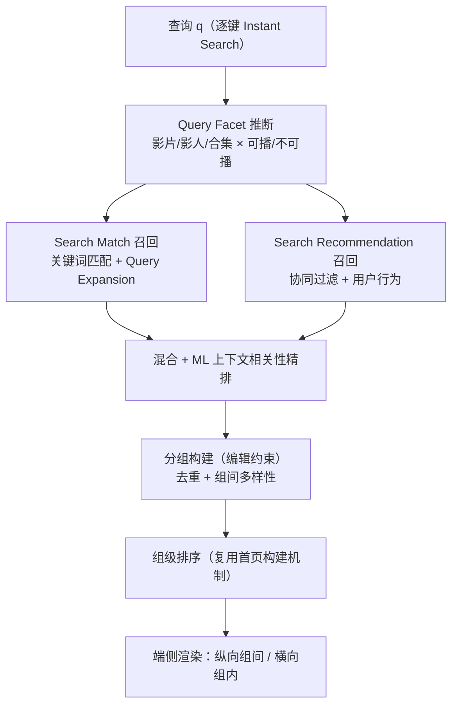

# Recommendations and Results Organization in Netflix Search (Netflix 搜索中的推荐与结果组织)

- **会议/期刊**: RecSys 2021 Industry Track（extended abstract，5 页）
- **作者与机构**: Sudarshan Lamkhede, Christoph Kofler（Netflix Inc.，搜索算法与搜索产品团队）
- **推荐链路定位**: 重排（检索后混合排序 + 组级列表组织）/ 端到端结果页构建
- **研究方向**: 多任务学习与列表级重排 / 去偏公平与工业架构
- **论文原文**: [https://arxiv.org/abs/2105.14134v1](https://arxiv.org/abs/2105.14134v1)
- **开源代码**: 暂未开源

## TL;DR (1分钟核心速览)

Netflix 搜索的痛点是：纯关键词匹配的 IR 只能满足"我知道要什么"的 Fetch 意图，完全无法覆盖"我也不知道要什么"的 Explore 意图，还会在用户搜不可播影片时给出"死胡同"。本文提出把首页推荐的协同过滤能力搬进查询上下文，把检索结果拆成 **search match** 与 **search recommendation** 两条召回并混合打分，再用带语义标签的分组结构做列表级组织与组间排序。评估完全依靠用户研究与在线实验，**原文未披露任何离线数据集、基线与指标数值**，收益以定性论证与产品案例（如 `sonic t` 仅命中 1 条匹配结果）呈现。

## Background & Motivation (背景与核心矛盾)

- **主流范式**: 视频搜索沿用经典 IR——查询与索引文本关键词匹配、必要时做 query expansion，按相关性返回扁平结果列表；而首页推荐早已由协同过滤与用户行为驱动。
- **前人局限**: 其一，纯 match 只能覆盖 Fetch 意图的一个子集，Explore 意图被整体忽略；其二，受版权约束大量影片不可播，关键词匹配会直接返回空结果，形成体验断裂。
- **核心矛盾之二**: 反过来把首页那种"与查询无关的个性化排序"或"全局热门"直接塞进搜索页，则与查询上下文失配，反而伤害满意度，并放大流行度偏置（popularity bias）。
- **核心洞察 (Key Insight)**: 用户意图是一个从 Fetch 到 Explore 的**连续谱**，而意图通过 query facet（可播/不可播影片、影人、合集）表达；facet 与意图是两维正交的，同一 facet 可对应两种意图。
- **本文切入点**: 在查询上下文内做推荐（而非无查询推荐），并用"分组 + 标签"的结果组织同时承担解释与降认知负荷两个职责。

## Method (核心方法设计)

### 1. 整体框架 (Overall Architecture)

对每个搜索请求（Instant Search 下按每次击键触发），系统先并行取回两路候选：关键词匹配命中的 search match 与协同过滤产生的 search recommendation；二者混合后由机器学习相关性模型在给定查询上下文中统一打分排序；Top 结果再按编辑约束聚成若干个内聚分组，每组配一个描述性标签，组间用与首页构建机制同源的排序器排序，并强制去除重复的"结果—组"指派以提升多样性；最后后端把"组头 + 组内有序列"下发到设备端，横向组内浏览、纵向组间浏览。

### 2. 关键设计拆解 (Key Designs)

1. **双路候选与查询条件化打分（Search Match ∪ Search Recommendation）**：痛点是单路 match 无法覆盖 Explore、且对不可播 facet 无解。记匹配函数为 $\mathbb{I}[\mathrm{kw}(q,v)=1]$，推荐路给出上下文偏好分，则候选集为$\mathcal{R}(q,u)=\{v:\mathbb{I}[\mathrm{kw}(q,v)=1]\}\cup \mathrm{TopK}_{v}\,s_{\mathrm{rec}}(v\mid q,u)$。关键约束是打分必须**条件在查询上**：$s(v\mid q,u)\neq s(v\mid u)$，因为文中明确指出查询无关的个性化排序在搜索场景"不够相关且可能有害"。物理直觉：查询项收紧了解空间，推荐只在剩余子空间里做个性化重排，既有 Explore 又不跑题。
2. **组化组织作为列表级重排（Grouping as Listwise Re-ranking）**：痛点是结果超出"显然匹配"后必须解释其相关性，并降低用户逐条判断的认知负荷。给定精排 Top-$N$，以编辑语义标签$c_k(\cdot)$定义组$G_k=\{v:c_k(v)=1\}$，组选取与排序近似求解$\max_{\{G_k\}}\sum_{k} w_k\,\mathrm{rel}(G_k\mid q,u)-\lambda\,\mathrm{red}(G_k,G_{<k})$，并施加互斥约束$\sum_{k}\mathbb{I}[v\in G_k]\le 1$。直觉：把"逐条相关性"升维成"逐视角相关性"，既让弱匹配结果获得可解释的归属，又通过去重与多样性惩罚避免若干组内容雷同。
3. **短查询 facet 推断与低延迟工程约束**：TV 端输入困难导致大量短而歧义的查询（如 `sonic t`），文中承认无法仅靠文本准确判定 facet，转而**依赖用户实际点击/播放的结果类型作为行为证据**反推 facet；同时 Instant Search 逐键触发 + 服务 2 亿级全球用户，使分组必须在线完成，形成"相关性模型打分 + 编辑约束"的混合架构而非端到端学习。

## Experimental Setup & Evaluation Protocol (实验设置与评估协议)

- **数据集与预处理**: **原文未提供任何离线数据集**（无用户/物品规模表、无 `5-core` 类过滤说明），仅给出产品级规模约束"超过 2 亿全球用户"。
- **数据划分与防穿越**: 未披露。该文不以离线复现为目标，不存在 Leave-One-Out / 比例划分 / 时间戳切分的描述。
- **排名评测协议**: 未使用 Full-Ranking 或 Sampled Ranking 等离线协议。依据关键词与正文，评估手段为 **用户研究（user study）+ 在线实验（experimentation）**，属产品指标体系下的在线 A/B 范式。
- **对比基线与超参**: 无基线模型、无嵌入维度 $d$、无显著性检验。唯一对照是概念性的"传统纯关键词 IR vs. 加入推荐与结果组织"，以图 2 的 `sonic t` 案例做定性对比。
- **披露程度说明**: 本文为 RecSys Industry Track 的**演讲扩展摘要**，定位是系统与经验分享，因此下文表格以"论据—证据类型"形式呈现，**所有数值均未在原文中出现，笔记不做任何编造**。

| 评估层次 | 使用手段 | 原文披露情况 |
| :--- | :--- | :---: |
| 意图/ facet 分布 | 定性 + 定量用户行为观察 | 结论有，数值无 |
| 结果有效性 | 用户研究 | 提及，无细节 |
| 线上效果 | 在线实验（A/B） | 提及，无指标 |
| 延迟与规模 | 工程约束陈述 | 仅"2 亿用户/逐键触发" |

### 主实验定性对比（无数值，替代主表）

| 能力维度 | 纯关键词 IR（仅 match） | Netflix Search（match + rec + 组织） |
| :--- | :--- | :--- |
| Fetch 意图 | 部分覆盖 | 覆盖 |
| Explore 意图 | **不覆盖** | 覆盖（推荐补足） |
| 不可播影片查询 | 空结果 / 死胡同 | 给出"看过该片的人还看了"式替代与相关 pill |
| 查询打错/记不清片名 | 需反复改写查询 | 推荐降低改写次数 |
| 结果可解释性 | 无（仅"命中了关键词"） | 组标签提供视角解释 |
| 认知负荷 | 扁平长列表 | 纵向组间、横向组内，分组降载 |

### 组件归因（相当于消融，基于原文因果陈述）

| 移除的组件 | 原文预期的退化 | 证据强度 |
| :--- | :--- | :---: |
| 移除 Search Recommendation | 仅剩 1 条 match，Explore 与不可播场景全面失效 | 案例佐证（`sonic t`） |
| 移除查询条件化（改用首页个性化） | 结果与查询失配，满意度下降 | 作者断言 |
| 移除分组组织 | 用户需自行判断相关性，认知负荷上升、缺解释 | 设计论证 |
| 移除组间去重/多样性 | 组内容高度雷同，组织收益被抵消 | 设计论证 |

### 关键实验发现 (Key Findings)

1. **匹配与推荐在用户价值上"大致同等重要"（roughly equally important）**：这是全文最强的定量倾向性陈述，直接否定了"搜索只需 IR"的工程默认假设，也是把推荐系统整体搬进搜索页的立项依据。
2. **`sonic t` 案例量化了纯 IR 的天花板**：该查询在库内仅返回 **1 条** match（`Sonic X`），而目标影片 `Sonic the Hedgehog` 不可播；一旦引入推荐，同一查询即可产出多组相关视角，说明收益主要来自"0→1"与"1→N"的候选扩充而非排序微调。
3. **facet 与意图是两个正交维度**：同一"不可播影片"facet 下，Fetch 用户需要替代内容的明确证据（提升信任），Explore 用户需要 pivot 入口（如 Myths & Legends 类 pill），这解释了为何组织方案必须是"分组 + 标签 + 组内序"的三元结构而非单一排序列表。

## Highlights & Limitations (亮点、对比与审稿批判)

- **与代表作对比 (vs. Prior Work)**: 与经典 query expansion / 伪相关反馈相比，本文不扩写查询文本，而是引入行为驱动的协同过滤候选，本质是把"检索"变成"检索 + 上下文推荐"的联合问题；与 DCN/MMoE 这类精排特征交叉工作相比，本文的增量不在打分器结构，而在**打分之后的列表组织层**（分组、标签、组间排序、互斥去重），这与列表级重排的动机一致但手段是编辑语义而非学习式上下文交互；与首页推荐工作相比，核心差异是全部模块必须**条件在查询上下文**上。
- **可迁移亮点**: 其一，"match ∪ recommendation 双路混合 + 查询条件化打分"可直接迁移到电商/应用商店搜索，尤其适合有大量不可售 SKU 的场景；其二，"组标签即解释"的设计把可解释性从模型侧搬到界面结构侧，落地成本低、跨端一致性好。
- **审稿级局限批判**: 其一，**证据极弱**——作为 5 页演讲摘要，无数据集、无基线、无指标、无显著性检验，所有收益均为作者断言，无法复现也无法证伪；其二，文中自承协同过滤会**放大流行度偏置**并可能降低相关性，却未给出任何去偏手段或长尾分桶结果；其三，Instant Search 逐键触发叠加在线分组，延迟预算与 2 亿用户规模下的算力开销未量化，工程可迁移性存疑；其四，未来工作列出端到端学习排序与组织，等于承认当前"相关性模型 + 编辑约束"的两段式并非最优。

## Rating (四维评分)

- **方法创新性 (Novelty)**: ⭐⭐⭐ （"推荐进入搜索 + 分组即重排"的框架组合有产品洞见，但无新算子、无理论或谱分析支撑，创新属系统设计层面）
- **评估协议与实验扎实度 (Protocol & Experiments)**: ⭐ （仅声明用户研究与在线实验，零数据集、零基线、零指标数值，消融完全缺失，远低于可复现研究的基本线）
- **写作与数学规范度 (Clarity & Rigor)**: ⭐⭐ （意图/facet 二维框架与 `sonic t` 案例讲得清楚，但全文无一个公式、无形式化定义，match/rec 边界仅靠自然语言描述）
- **工业落地与复现价值 (Industrial & Practical Value)**: ⭐⭐⭐⭐ （来自 Netflix 真实搜索系统，架构决策与工程约束对工业界极具参考价值，但无开源代码，复现需自建全链路）

