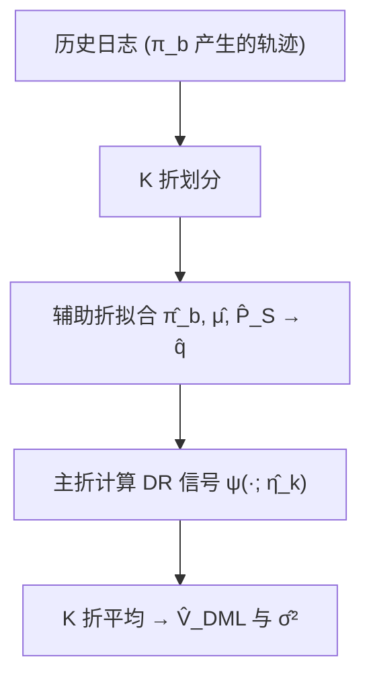

# Debiased Off-Policy Evaluation for Recommendation Systems (推荐系统的去偏离线策略评估)

- **会议/期刊**: RecSys 2021
- **作者与机构**: Yusuke Narita (Yale University)、Shota Yasui (CyberAgent, Inc.)、Kohei Yata (Yale University)
- **推荐链路定位**: 离线评测（Off-Policy Evaluation，服务于召回/排序策略上线前的选型决策）
- **研究方向**: 强化学习与动态探索推荐 / 去偏公平、可信隐私与工业架构
- **论文原文**: [https://arxiv.org/abs/2002.08536v3](https://arxiv.org/abs/2002.08536v3)
- **开源代码**: 暂未开源

## TL;DR (1分钟核心速览)

推荐/广告系统做 A/B 测试成本高、风险大，需要仅凭历史日志（由另一策略产生）预测新策略的 CTR。本文把 Doubly Robust (DR) 估计器与计量经济学中的 Double/Debiased Machine Learning 结合，用 **Neyman 正交 + K 折 cross-fitting** 消除高维 nuisance 估计（behavior policy $\pi_b$、状态动作值$q^{\pi_e}$）带来的过拟合偏差，证明估计量$\sqrt{N}$一致、渐近正态并给出相合方差估计。在 CyberAgent 线上广告日志（4 campaign × 28 batch，$|A|\approx 55$）上 relative-RMSE 从 DR-full 的 0.655 降至 0.566（−13.5%），较 IPW 降低约 22%，且 5% 水平显著。

## Background & Motivation (背景与核心矛盾)

- **主流范式**: 用 IPW（逆概率加权）、DM（直接建模）或 DR（两者结合的控制变量形式）从 behavior policy 的日志数据反事实地估计目标策略价值 $V^{\pi_e}$，以替代 A/B 测试。
- **前人局限 1**: IPW 在高维状态、长 horizon 下重要性权重 $\rho_t=\prod_{t'\le t}\pi_e/\pi_b$连乘爆炸，方差极大（实验中 MSE 达 300 量级），且对$\hat\pi_b$ 的估计偏差完全不稳健（不满足 Neyman 正交）。
- **前人局限 2**: DR-full（全样本既拟合 nuisance 又算最终估计）因过拟合产生一阶偏差；DR-half 虽用样本切分消除偏差，但只利用一半数据，方差约为本文估计量的 2 倍。
- **核心洞察 (Key Insight)**: 若评价泛函 $\psi$ 对 nuisance 的一阶导数为零（Neyman 正交），则任意机器学习方法（RF/GBDT/NN）的带偏估计都可被"安全"代入而不污染一阶偏差；配合 cross-fitting 交换主折与辅助折角色，可在不损失样本的前提下消除过拟合偏差。
- **本文切入点**: 在 DR 的 $\psi$ 上套用 DML 的两件套（正交 + 交叉拟合），并补齐方差推断与高维状态变量下的渐近理论。

## Method (核心方法设计)

### 1. 整体框架 (Overall Architecture)

输入为 $N$条由$\pi_b$独立产生的轨迹$\{H_i\}$（MDP$=\langle\mathcal{S},\mathcal{A},P_{S^0},P_S,P_R\rangle$）。将数据随机分$K$折，对第$k$折用其余数据拟合 nuisance$\hat\pi_{b,k}$、$\hat\mu_k$、$\hat P_{S,k}$，并递推得到$\hat q^{\pi_e}_{t,k}$（$t=T$时$\hat q=\hat\mu$，向前回代）；随后仅在第$k$折上计算 DR 型信号$\psi(H_i;\hat\eta_k)$，最后对$K$折取平均得到$\hat V^{\pi_e}_{\mathrm{DML}}$。由于$\psi$ 对 nuisance 一阶不敏感，任意 off-the-shelf ML 均可作为 nuisance 学习器；训练完成后一次性输出点估计与相合方差，无需在线探索。

### 2. 关键设计拆解 (Key Designs)

1. **Neyman 正交的 DR 信号 $\psi$（消除 nuisance 一阶偏差）**：直接代入 IPW 时$\hat\pi_b$的一阶误差会线性传导到价值估计；本文将 IPW 主项配上一个均值为零的控制变量项，使$\psi$对$(\pi_b,\{q^{\pi_e}_t\})$ 的 Gateaux 导数在真值处消失：
$\psi(H;\tilde\eta)=\sum_{t=0}^{T}\gamma^{t}\Big\{\rho^{\pi_e}_{t}(H^{s,a}_{t};\tilde\pi_b)\big(R_t-\tilde q^{\pi_e}_{t}(S_t,A_t)\big)+\rho^{\pi_e}_{t-1}(H^{s,a}_{t-1};\tilde\pi_b)\sum_{a\in\mathcal{A}}\pi_e(a|S_t)\tilde q^{\pi_e}_{t}(S_t,a)\Big\}$其中第一项是 IPW，第二大括号项即控制变量：无论$\tilde q$取何函数其期望恒为 0，只有当真$\pi_b$被代入时才"归位"，故$\mathbb{E}_{H\sim\pi_b}[\psi(H;\eta)]=V^{\pi_e}$且$\partial_r\mathbb{E}[\psi(H;\eta+r(\tilde\eta-\eta))]|_{r=0}=0$。直觉：$\tilde q$ 只影响方差、不影响一阶偏差，模型错设被"吸收"。
2. **Cross-fitting（消除过拟合偏差并保住样本效率）**：$\hat V^{\pi_e}_{\mathrm{DML}}=\frac{1}{K}\sum_{k=1}^{K}\frac{1}{n}\sum_{i\in I_k}\psi(H_i;\hat\eta_k)$，$n=N/K$。主折只用于求值、辅助折只用于拟合，二者角色轮换，使估计值与 nuisance 估计独立（去偏），同时全部$N$条轨迹都被用于最终平均（降方差）；实验取$K=2$，增至 3/4 结果几乎不变。对比 DR-half 只用$N/2$ 数据，方差约翻倍，恰解释了实验中 DML 优于 DR-half 的幅度。
3. **渐近推断与 contextual bandit 特例**：给出 $\sqrt{N}\hat\sigma^{-1}(\hat V^{\pi_e}_{\mathrm{DML}}-V^{\pi_e})\rightsquigarrow\mathcal{N}(0,1)$与相合方差$\hat\sigma^2=\frac{1}{K}\sum_k\frac{1}{n}\sum_{i\in I_k}(\psi(H_i;\hat\eta_k)-\hat V_{\mathrm{DML}})^2$，可直接构造置信区间。当$T=0$（可视为 contextual bandit）时估计量退化为带 cross-fitting 的 Dudík 型 DR，其渐近方差恰等于半参数效率界，即在所有相合渐近正态估计量中方差最小；且这些性质在$|\mathcal{S}|$随$N$ 增长（大量潜在重要状态变量、且不知哪些真正重要）时仍成立。

## Experimental Setup & Evaluation Protocol (实验设置与评估协议)

- **数据集与预处理**:

| 数据集 | #Users/轨迹 | #Items/Actions | #Interactions | 稀疏度/密度 | 特征/场景说明 |
| :--- | :---: | :---: | :---: | :---: | :--- |
| CartPole-v0 (改造) | 100 轨迹 × 100 次重复 | 2 | 1 万次评估 | — | 状态改为屏幕 patch 差分，随机 10% 像素涂黑并随时间平移，人为注入大量无关状态变量 |
| CyberAgent 线上广告 | 40,101,050 (MAB) / 299,342 (CB) | ≈55 广告设计（按 campaign 微变） | 4,040 万+ | CTR 级极稀疏 | 7 天 A/B，4 campaign × 28 batch（每 6h 更新参数），上下文 $S_0$ 高维（数万取值） |

- **数据划分与防穿越 (Splitting Strategy)**: 本文不做训练/测试集意义的数据划分，而按**时间批次（batch）切分**：在线广告用前 $B-1=27$个 batch 训练点击模型构造反事实策略，最后一个 batch 做 OPE 评估；nuisance 拟合与最终求值通过$K=2$ 折 cross-fitting 隔离，防止信息泄漏。
- **排名评测协议 (Ranking Protocol)**: **不适用**——本文是策略价值估计问题，而非 item 排序。评测协议为「有真值的误差度量」：仿真中用 $\pi_e$ 实跑得到真实回报，报告 100 次重复的 **MSE**（括号内为标准误）；线上用被分流到 CB 算法的用户真实 CTR 作 ground truth，报告按 campaign-batch 归一化的 **relative-RMSE**，其标准误由 100,000 次正态近似 bootstrap 得到，改进以 5% 显著性水平检验。
- **对比基线与超参设置**: DM（回归估计）、IPW、DR-full（全样本）、DR-half（半样本切分）四类基线；CartPole 的 $\pi_b$、$q$用同构 CNN（3 层 conv + BN + dense）、lr 1e-4/2e-4、batch 128；线上用 LightGBM 估$\mu$（leaf 20、lr 0.01、boost 轮数交叉验证定），$\hat\pi_b$ 既可取日志经验占比也可用 Thompson Sampling 的 beta 分布 Monte Carlo 真值。

## Key Experimental Results (实验关键数据)

### 1. 主实验对比 (Main Results)

**表 1 CartPole-v0 仿真：MSE（越小越好，括号内标准误）**

| 方法 | $\epsilon=0.05$|$\epsilon=0.08$|$\epsilon=0.10$ |
| :--- | :---: | :---: | :---: |
| DM | 19.60 (1.96) | 20.51 (1.71) | 28.01 (2.54) |
| IPW | 300.71 (90.92) | 131.44 (47.14) | 100.93 (33.20) |
| DR-full | 32.03 (6.63) | 16.00 (2.47) | 12.63 (1.98) |
| DR-half | 8.70 (1.31) | 9.50 (1.15) | 13.47 (1.73) |
| **DML (Ours)** | **5.31 (0.70)** | **7.07 (0.79)** | **10.52 (1.22)** |
| Improv. vs 最优基线 | −38.9% | −25.6% | −21.9% |

**表 2 CyberAgent 线上广告：relative-RMSE（越小越好）**

| 方法 | 估计 $\hat\pi_b$| 真实$\pi_b$ |
| :--- | :---: | :---: |
| IPW | 0.72531 (0.03077) | 0.72907 (0.03061) |
| DR-full | 0.65470 (0.02900) | 0.65056 (0.02880) |
| DR-half | 0.66331 (0.02726) | 0.67209 (0.02527) |
| **DML (Ours)** | **0.56623 (0.02952)** | **0.56196 (0.02922)** |
| Improv. vs DR-full | −13.5% | −13.6% |
| Improv. vs IPW | −21.9% | −22.9% |

### 2. 消融实验 (Ablation Study)

原文无独立消融表，但四个基线恰构成"组件剥离"式消融（Neyman 正交 × cross-fitting 两维 2×2）：

| 变体 | Neyman 正交 | Cross-fitting | 数据利用率 | CartPole MSE($\epsilon$=0.05) | 线上 rela-RMSE |
| :--- | :---: | :---: | :---: | :---: | :---: |
| IPW | ✗ | ✗ | 全样本 | 300.71 | 0.72531 |
| DM | ✗ | ✗ | 全样本 | 19.60 | — |
| DR-full | ✓ | ✗ | 全样本 | 32.03 | 0.65470 |
| DR-half | ✓ | 半样本切分 | 50% | 8.70 | 0.66331 |
| **DML** | ✓ | ✓（K=2） | 100% | **5.31** | **0.56623** |

### 3. 关键实验发现 (Key Findings)

1. **正交性比模型精度更值钱**：DR-full 在 $\epsilon=0.05$（接近确定性策略、权重最不稳定）时 MSE 32.03 竟劣于朴素 DM 的 19.60，说明仅靠 Neyman 正交不足以抵消全样本过拟合偏差；补上 cross-fitting 后 DML 降至 5.31（相对 DM −73%、相对 DR-half −38.9%），证明偏差与方差必须同时治理。
2. **方差效率来自"用满样本"**：DML 与 DR-half 同具正交性，唯一差别是数据利用率 100% vs 50%，而线上 relative-RMSE 从 0.663 降到 0.566（−14.7%），与理论预测的"半样本方案方差约翻倍"量级一致，说明 cross-fitting 的收益是可量化的效率增益而非仅是理论装饰。
3. **对 behavior policy 已知性的鲁棒性**：无论 $\hat\pi_b$取经验占比还是 Monte Carlo 真值，DML 皆稳定优于其他估计器约 10%+（5% 显著），而 Kallus-Uehara 式边际分布比值估计在$\hat q$ 非参不一致或参数错设时甚至可能不相合——本文估计量更适配"模型必然错设"的工业现实。此外作者用该估计量做反事实策略选型，在 3 个 campaign 中 1 个预测 CTR 显著提升约 30%。

## Highlights & Limitations (亮点、对比与审稿批判)

- **与代表作对比 (vs. Prior Work)**: 相较 Jiang & Li / Thomas & Brunskill 的 DR，本文的关键差异不是换 $\psi$的形式（式 (4) 完全相同），而是补上 cross-fitting、允许$\pi_b$未知、允许高维状态变量并给出方差与渐近理论；相较同期独立的 Kallus & Uehara，本文用重要性权重$\rho_t$而非边际分布比值，在$\hat q$错设时仍相合，但渐近方差略大（其估计器方差更小）；相较 Dudík 等的 bandit DR，本文在$T=0$ 特例上等价，只是将估计从"一次切分"升级为"全折平均"。
- **可迁移亮点**: ①「Neyman 正交 + K 折交叉拟合」可直接套到 MAGIC、SWITCH、MRDR 等 DR 变体，以及任何依赖 nuisance 估计的离线评测/因果效应估计任务；② 高维上下文场景下可用任意 GBDT 当 nuisance 学习器而不必担忧正则化偏差，工程上免去"模型选择焦虑"。
- **审稿级局限批判**: ① 仍需 positivity 假设（$\pi_b(a|s)>0$覆盖$\pi_e$）——若 MAB 日志几乎不给某些广告设计曝光，权重与方差均会失控，长 horizon（CartPole）下 IPW 的 300 量级 MSE 说明该问题只是被 DR 项缓解而非根除；② 需重复拟合$K$份 nuisance，训练成本随$K$线性增长，且真实实验仅 4 个 campaign × 28 batch、单一公司单业务，泛化证据仍偏薄；③ 无开源代码，$K$ 的选择、nuisance 学习器强度对理论速率条件（Assumption 1(ii)(iii)）的满足程度缺少敏感性分析。

## Rating (四维评分)

- **方法创新性 (Novelty)**: ⭐⭐⭐⭐ （把计量经济学 DML 引入 RL/bandit 离线评测，Neyman 正交 + cross-fitting 的组合有半参数效率界支撑，但核心 $\psi$ 沿用既有 DR 形式，增量偏"理论加固+工程化"）
- **评估协议与实验扎实度 (Protocol & Experiments)**: ⭐⭐⭐⭐ （仿真 + 4,040 万曝光真实工业日志双验证，有真值对照、bootstrap 标准误与 5% 显著性检验；扣分在仅 4 个 campaign、无独立消融表、无开源复现）
- **写作与数学规范度 (Clarity & Rigor)**: ⭐⭐⭐⭐⭐ （正交条件、$\sqrt{N}$ 一致性、渐近正态与方差相合性均有完整命题与附录证明，hypothesis 交代清楚，符号体系自洽）
- **工业落地与复现价值 (Industrial & Practical Value)**: ⭐⭐⭐⭐ （无须在线部署即可做策略选型并给出置信区间，直接服务上线决策；代价是$K$ 折重复拟合开销、positivity 依赖与缺开源实现）

