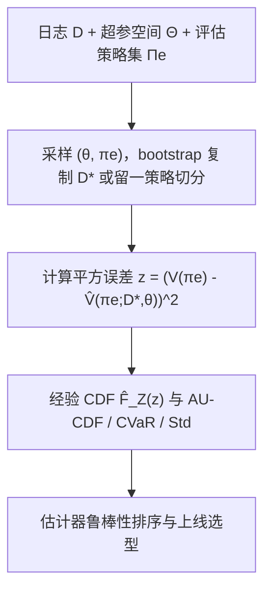
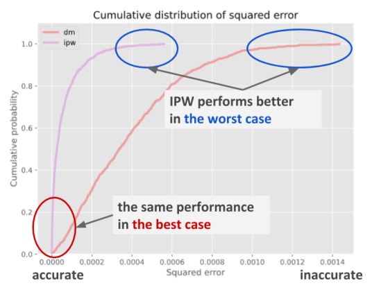
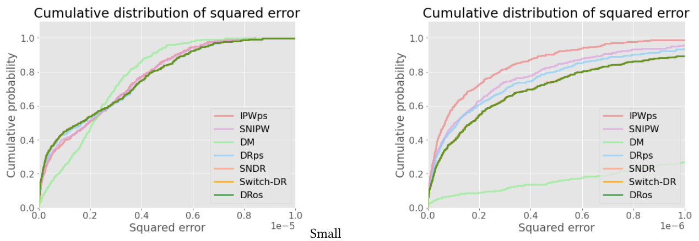

# Evaluating the Robustness of Off-Policy Evaluation (离策略评估的鲁棒性评估)

- **会议/期刊**: RecSys 2021
- **作者与机构**: Yuta Saito (Hanjuku-Kaso)、Takuma Udagawa (Sony)、Haruka Kiyohara (Tokyo Tech)、Kazuki Mogi (Stanford)、Yusuke Narita (Yale)、Kei Tateno (Sony)
- **推荐链路定位**: 离线评估（Offline Evaluation）基础设施，服务于召回/重排等任意候选策略的选型与上线决策
- **研究方向**: 强化学习与动态探索推荐 / 去偏公平、可信隐私与工业架构
- **论文原文**: [https://arxiv.org/abs/2108.13703v1](https://arxiv.org/abs/2108.13703v1)
- **开源代码**: [https://github.com/sony/pyIEOE](https://github.com/sony/pyIEOE)

## TL;DR (1分钟核心速览)

OPE 领域已有 DM/IPW/DR/Switch-DR/DRos 等估计器，但论文普遍只在**单一超参与单一评估策略**下报一个 MSE 均值，无法回答"哪个估计器安全"。本文提出 IEOE：对超参 $\theta$与评估策略$\pi_e$采样，绘出平方误差的**经验 CDF**，并用 AU-CDF、CVaR$_0.7$、Std 三个摘要分数刻画鲁棒性。在 Open Bandit Dataset（30k/300k）上，IEOE 揭示小样本下 DM 尾部最优、大样本下 IPWps 全面反超（AU-CDF$0.186\to1.000$，+437%）；真实电商数据上选出无超参的 SNIPW 并已上线用于优惠券策略评估。

## Background & Motivation (背景与核心矛盾)

- **主流范式**: 用行为策略 $\pi_b$记录的历史日志$\mathcal{D}=\{(x_i,a_i,r_i)\}$估计评估策略值$V(\pi_e)=\mathbb{E}_{p(x)\pi_e(a|x)p(r|x,a)}[r]$，代表性估计器为 DM、IPWps、SNIPW、DRps、SNDR、Switch-DR、DRos。
- **前人局限**: ① 这些估计器带 $\hat q$（回归模型）、$K$（交叉拟合折数）、$\lambda$/$\tau$（收缩或切换阈值）等超参，而 OPE 精度对超参高度敏感，且真值不可见、无法用日志直接调参；② 现有论文只报"某一组超参 + 某一个$\pi_e$"下的 MSE 均值，无法反映估计器在配置漂移时的失效风险。
- **核心洞察 (Key Insight)**: MSE 均值只是性能分布的一个抽样点，真正决定落地风险的是**分布的尾部**——一个在最坏 30% 情形下崩掉的估计器，即使均值漂亮也不可用。
- **本文切入点**: 把 OPE 的评测对象从"点估计精度"改为"性能分布"，用 CDF 可视 + 三个摘要分数做可解释的鲁棒性排序。

## Method (核心方法设计)

### 1. 整体框架 (Overall Architecture)

IEOE 是一个**评测协议**而非新估计器。输入为日志数据、待评估计器集合、超参空间 $\Theta$、评估策略集合$\Pi_e$、采样器$\phi$与随机种子集$S$；每一轮采样一组$(\theta,\pi_e)$，通过 bootstrap 复制日志（合成/分类数据，Alg.1）或按"留一策略"构造$D_{ev}$/$D_{te}$（真实数据，Alg.2），计算一次平方误差$z$；累计$m$个$z$ 后估计经验 CDF，输出曲线与 AU-CDF/CVaR/Std，供研究者与业务方选型。开源实现 pyIEOE 封装全流程。

<figure class="paper-figure" markdown="span">
  <figcaption>图1：所提出的离线评估流程的示例输出</figcaption>
</figure>

### 2. 关键设计拆解 (Key Designs)

1. **性能分布替代点估计（CDF + 三摘要分数）**：痛点是单点 MSE 丢弃不确定性。核心算子为 $\hat F_Z(z)=\frac{1}{m}\sum_{i=1}^{m}\mathbb{I}\{z_i\le z\}$，并派生$\mathrm{AU\text{-}CDF}(z_{\max})=\int_0^{z_{\max}}\hat F_Z(z)\,dz$与$\mathrm{CVaR}_\alpha(Z)=\mathbb{E}[Z\mid Z\ge F_Z^{-1}(\alpha)]$。直觉：CDF 曲线整体靠左/靠下即随机占优，能在同一张图上同时读出"常态精度"和"最坏情形"。

2. **真实日志的留一策略配对评估（Alg.2）**：真实场景没有反事实真值，作者用另一策略的在线收益作锚：取 $D_{te}=D_j$、$D_{ev}=\bigcup_{k\ne j}D_k$，以 on-policy 均值$V_{on}(\pi_j;D_{te})=\mathbb{E}_n[r_i]$近似$V(\pi_j)$，再算$z=\big(V_{on}(\pi_j;D_{te})-\hat V(\pi_j;\theta,D^*_{ev})\big)^2$。这样无需合成数据假设，可直接在工业日志上做估计器 benchmark。

3. **超参采样与训练开销**：$\phi$可取均匀分布（保守，模拟" practitioner 未调参"）或 §2.2 的偏差-方差准则$\hat\theta\in\arg\min_{\theta\in\Theta}\mathrm{BiasUB}(\theta;\mathcal{D})^2+V_n(\theta;\mathcal{D})$；$\hat q$用$K$折 cross-fitting 抑制过拟合偏差。无额外模型训练，成本为$|S|\times$（单次 OPE + 回归拟合），OBD 用 500 个种子、真实场景 1000 个种子。

## Experimental Setup & Evaluation Protocol (实验设置与评估协议)

- **数据集与预处理**: 未做 5-core 等交互过滤；OBD 为日志级随机子采样，真实数据为全量投放实验。

| 数据集 | 规模 | #Actions | 奖励类型 | 策略/场景说明 |
| :--- | :---: | :---: | :---: | :--- |
| OBD-ALL-small | 30,000 条日志 | 80（时尚单品） | 二值点击 | $\pi_A$均匀随机、$\pi_B$Bernoulli Thompson；$x$ 维度 20 |
| OBD-ALL-large | 300,000 条日志 | 80 | 二值点击 | 同上，用于观察样本量效应 |
| 真实电商平台 | 39,687 用户 | 4（优惠券） | 二值内容消费 / 连续 7 日营收 | 三个随机投放策略 $\pi_A,\pi_B,\pi_C$ 各约 1/3 |

- **数据划分与防穿越 (Splitting Strategy)**: 非 Leave-One-Out、非时间戳切分，而是**多策略留一策略切分**：被评策略的数据整份作 $D_{te}$算 on-policy 真值，其余策略数据合并作$D_{ev}$ 供 OPE 使用，严格隔离评估集与测试集。
- **排名评测协议 (Ranking Protocol)**: 不适用——本文评测对象是**策略值的估计误差**而非推荐排序质量，故无 Full-Ranking / Sampled Ranking；取而代之的是 bootstrap 重采样（有放回）生成 $m$ 个平方误差样本估计 CDF。
- **对比基线与超参设置**: 7 个估计器 DM、IPWps、SNIPW、DRps、SNDR、Switch-DR、DRos；$\hat q\in\{\text{LR/RR, RF, LightGBM}\}$，$K\in\{1,\dots,5\}$，$\lambda,\tau\in\{1,5,10,50,\dots,10^5,\infty\}$，回归超参用 RandomizedSearchCV（`n_iter=5`）；OBD 上行为策略概率已知，故 SNIPW 为无超参基线。

## Key Experimental Results (实验关键数据)

### 1. 主实验对比 (Main Results)

OBD 上各摘要分数（按各列最优值归一化，Mean/CVaR/Std 越低越好，AU-CDF 越高越好）：

| 估计器 | $n$=30k Mean↓ | AU-CDF↑ | CVaR$_{0.7}$↓ | Std↓ |$n$=300k Mean↓ | AU-CDF↑ | CVaR$_{0.7}$↓ | Std↓ |
| :--- | :---: | :---: | :---: | :---: | :---: | :---: | :---: | :---: |
| DM | **1.00** | **1.000** | **1.00** | **1.00** | 10.77 | 0.186 | 7.45 | 6.94 |
| IPWps | 1.02 | 0.994 | 1.19 | 1.31 | **1.00** | **1.000** | **1.00** | **1.00** |
| SNIPW | 1.02 | 0.994 | 1.20 | 1.33 | 1.58 | 0.917 | 1.57 | 1.71 |
| DRps | 1.04 | 0.989 | 1.27 | 1.44 | 2.48 | 0.887 | 2.67 | 5.02 |
| SNDR | 1.02 | 0.995 | 1.27 | 1.44 | 3.27 | 0.827 | 3.50 | 6.01 |
| Switch-DR | 1.02 | 0.994 | 1.27 | 1.45 | 3.28 | 0.825 | 3.50 | 6.00 |
| DRos | 1.02 | 0.994 | 1.27 | 1.45 | 3.28 | 0.825 | 3.50 | 6.00 |

**Improv.（$n$=300k，IPWps vs DM）**: AU-CDF **+437.6%**（0.186→1.000），CVaR$_{0.7}$ **−86.6%**，Std **−85.6%**。

真实电商平台（留一策略协议，归一化摘要分数）：

| 估计器 | 二值 Mean↓ | AU-CDF↑ | CVaR$_{0.7}$↓ | Std↓ | 连续 Mean↓ | AU-CDF↑ | CVaR$_{0.7}$↓ | Std↓ |
| :--- | :---: | :---: | :---: | :---: | :---: | :---: | :---: | :---: |
| DM | 8.70 | 0.946 | 10.92 | 35.94 | 1.29 | **1.000** | 1.47 | 2.19 |
| IPWps | 29.45 | 0.648 | 31.96 | 29.84 | 19.00 | 0.572 | 19.84 | 14.67 |
| SNIPW | **1.00** | **1.000** | **1.00** | **1.00** | **1.00** | 0.974 | **1.00** | **1.00** |
| DRps | 8.16 | 0.953 | 10.27 | 34.54 | 1.44 | 0.957 | 1.60 | 2.11 |
| SNDR | 7.45 | 0.942 | 9.35 | 32.19 | 1.21 | 0.935 | 1.22 | 1.17 |
| Switch-DR | 8.16 | 0.953 | 10.27 | 34.54 | 1.48 | 0.919 | 1.57 | 1.68 |
| DRos | 8.16 | 0.953 | 10.27 | 34.54 | 1.43 | 0.968 | 1.60 | 2.21 |

<figure class="paper-figure" markdown="span">
  <figcaption>图2：Open Bandit Dataset中OPE估计器的平方误差累积分布函数比较</figcaption>
</figure>

### 2. 消融与配置敏感性分析 (Ablation / Sensitivity)

本文无网络组件可拆，故以"配置消融"代替：固定估计器、只变数据规模/奖励类型，观察同一估计器的性能漂移。

| 配置变化 | 估计器 | Mean↓ | AU-CDF↑ | CVaR$_{0.7}$↓ | Std↓ |
| :--- | :--- | :---: | :---: | :---: | :---: |
| OBD 30k → 300k | DM | 1.00 → 10.77 | 1.000 → 0.186 | 1.00 → 7.45 | 1.00 → 6.94 |
| OBD 30k → 300k | SNIPW | 1.02 → 1.58 | 0.994 → 0.917 | 1.20 → 1.57 | 1.33 → 1.71 |
| OBD 30k → 300k | DRos | 1.02 → 3.28 | 0.994 → 0.825 | 1.27 → 3.50 | 1.45 → 6.00 |
| 真实数据：DNN 型 $\hat q$ 保留 | DM | 8.70 | 0.946 | 10.92 | 35.94 |
| 真实数据：去掉超参 | SNIPW | 1.00 | 1.000 | 1.00 | 1.00 |

### 3. 关键实验发现 (Key Findings)

1. **均值口径几乎无法区分估计器，尾部可以**：$n$=30k 时 7 个估计器的 Mean 全部落在$1.00\sim1.04$（最大差 4%），但 CVaR$_{0.7}$ 上 DM 为 1.00 而 DR 系为 1.27（差 27%），Std 上 DM 1.00 vs Switch-DR 1.45——若只看均值会误判"所有估计器一样好"，从而在尾部风险上踩坑。
2. **样本量与 overlap 决定赢家，结论会反转**：$n$ 从 30k 增至 300k，DM 的 AU-CDF 从 1.000 崩到 0.186，而 IPWps 从 0.994 升到 1.000（相对 DM +437.6%）；原因是大样本下重要性权重估计更稳，模型误差成为 DM 的瓶颈。
3. **近确定性行为策略会击穿 IPW 类估计器**：真实平台上（39,687 用户、每策略约 1.3 万条）IPWps 的二值 CVaR$_{0.7}$达 31.96、连续 19.84，远劣于 SNIPW 的 1.00，说明$\pi_b(a|x)\to0$ 时权重爆炸；最终平台选用**无超参、自归一化**的 SNIPW 上线，印证"少超参 = 低过拟合风险"的工程直觉。

## Highlights & Limitations (亮点、对比与审稿批判)

- **与代表作对比 (vs. Prior Work)**: ① vs Su et al. (DRos)：DRos 是在**单一配置下**优化 MSE 上界，本文则指出该上界本身随配置漂移，主张先评测再选型；② vs Voloshin et al. 的 OPE benchmark：后者横向比均值精度，本文增加"最坏情形"维度；③ vs Saito et al. (OBD 数据集)：OBD 只提供数据，本文把它变成可复现的鲁棒性基准（含留一策略协议）。
- **可迁移亮点**: ① "分布取代点估计"的评测范式可直接搬到离线排序评测（NDCG 的 CDF + CVaR 尾部指标）；② 留一策略构造 on-policy 真值的技巧，可用于任何有多个投放策略日志的工业平台做离线评测校准。
- **审稿级局限批判**: ① Alg.2 要求**至少两份由不同策略采集的日志**，只有单一策略日志的场景完全不可用（作者亦在 Future Work 承认），这限制了多数中小平台；② bootstrap 假设样本 i.i.d.，未处理用户内相关性与时间漂移，可能低估方差；③ 摘要分数（AU-CDF 的 $z_{\max}$、CVaR 的$\alpha$）本身是人为超参，未做敏感性分析；④ 全篇无 A/B 上线对照，SNIPW 的"上线后收益"仅停留在流程叙述，缺因果证据链。

## Rating (四维评分)

- **方法创新性 (Novelty)**: ⭐⭐⭐ （CDF + CVaR 评测思想借鉴自 RL 领域，属"协议创新"而非估计器创新，但把鲁棒性视角系统引入 OPE 选型确有价值）
- **评估协议与实验扎实度 (Protocol & Experiments)**: ⭐⭐⭐⭐ （500/1000 次种子 × 7 估计器 × 2 数据规模 × 2 种奖励类型，覆盖公开与真实工业数据，唯缺显著性检验与时间切分验证）
- **写作与数学规范度 (Clarity & Rigor)**: ⭐⭐⭐⭐ （7 个估计器与超参表定义清晰、Alg.1/2 伪代码可直接复现，公式均为一阶闭式，无冗长推导但足够严谨）
- **工业落地与复现价值 (Industrial & Practical Value)**: ⭐⭐⭐⭐⭐ （pyIEOE 开源 + OBD 公开数据 + 真实优惠券平台已上线 SNIPW，是少见的有生产闭环的评测类论文）

