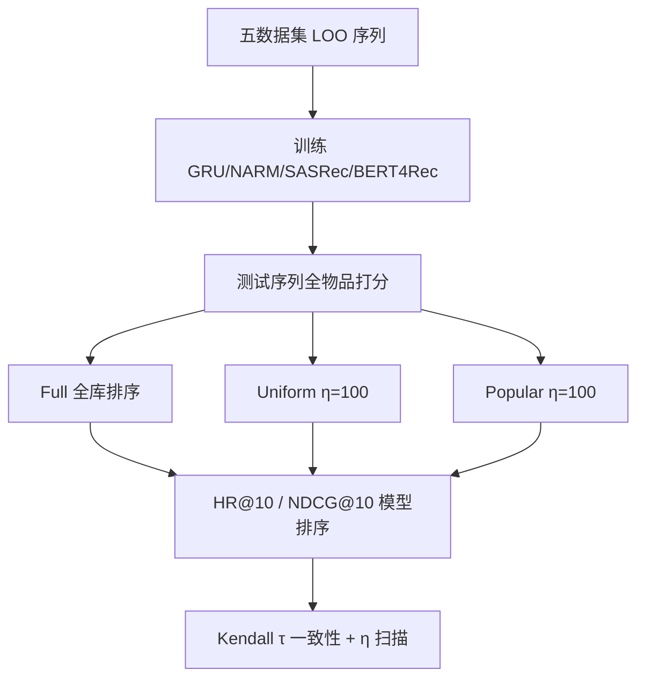
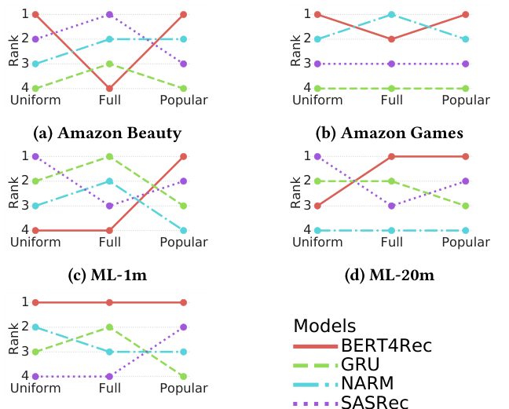
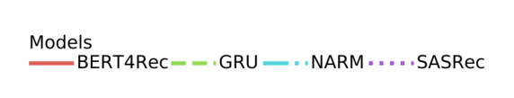

# A Case Study on Sampling Strategies for Evaluating Neural Sequential Item Recommendation Models (神经序列物品推荐模型评估中采样策略的案例研究)

- **会议/期刊**: RecSys 2021
- **作者与机构**: Alexander Dallmann, Daniel Zoller, Andreas Hotho；University of Würzburg, Data Science Chair
- **推荐链路定位**: 召回/排序离线评估（Next-Item）
- **研究方向**: 序列与会话推荐 / 评估协议
- **论文原文**: [论文原文链接](https://arxiv.org/abs/2107.13045v1)
- **开源代码**: [实验代码](https://professor-x.de/papers/metrics-sampling-eval/)；SASRec 基线仓库：[github.com/kang205/SASRec](https://github.com/kang205/SASRec)

## TL;DR (1分钟核心速览)

本文针对神经序列推荐普遍用 $\eta=100$采样目标集排序、却默认其等价全库排序的问题，系统复训 GRU/NARM/SASRec/BERT4Rec 于 5 个数据集，比较 Full、Uniform、Popular 三种评估及$\eta$扫描。结果：两种采样在多数数据集与 Full 排序不一致，Popular 在 ML-1m 的 Kendall$\tau=-0.67$，且无通用安全$\eta$；应优先报告 Full-Ranking。

## Background & Motivation (背景与核心矛盾)

- **主流范式**: 序列推荐以 Leave-One-Out 下一项预测为主，为省算力常从全物品集中采样负例构造目标集，再用 HR@10/NDCG@10 排序模型。
- **前人局限**: Krichene & Rendle 已证明 Uniform 采样对 CF 模型的排序可能不一致，但未覆盖神经序列模型；近年 SASRec/BERT4Rec 等改用 Popularity 采样并默认其更可靠，却缺乏系统检验。
- **核心洞察 (Key Insight)**: 采样排序即使复现了原论文的模型排名，也可能只是“采样协议下的 SOTA”，与全库排序的真序不同。
- **本文切入点**: 固定 4 个代表性序列模型、5 个常用数据集，比较 Full、Uniform、Popular 三种排序，并扫描 $\eta$ 与重复 20 次，检验一致性。

## Method (核心方法设计)

### 1. 整体框架 (Overall Architecture)

本文不是新模型，而是控制变量式评估研究：先按原论文/仓库超参训练四类序列编码器，验证集选 HR@10 最优；再对每个测试序列分别构造 Full、Uniform($\eta=100$)、Popular($\eta=100$) 目标集，计算 HR@10/NDCG@10 并得到模型排序；最后用 Kendall$\tau$衡量采样排序与 Full 排序的一致性，并把$\eta$ 从 100 扫到全库观察排序漂移。四模型覆盖 RNN、注意力 RNN、单向 Transformer、双向 Transformer；采样重复 20 次取均值，候选集排除目标与已交互序列项。

### 2. 关键设计拆解 (Key Designs)

1. **全库排序作为“金标准”与一致性定义**：痛点是指标绝对值会因目标集变化，但论文真正要确立的是模型相对排序；定义两排序一致当且仅当所有模型名次相同，并用 $\tau=\frac{2(m_c-m_d)}{m(m-1)}$量化，$m_c/m_d$ 为 concordant/discordant 对数。
2. **两类目标集采样**：采样候选集为 $N=I\setminus(\{i_r\}\cup set(\hat{s}))$，目标集$T=\{i_r\}\cup S_\eta$；Uniform 令$p(i)\propto1$，Popular 令$p(i)\propto freq(i)$。Popular 直觉上更贴近数据分布，但仍会扭曲“难负例”比例，因而未必保持 Full 排序。
3. **训练目标、负采样与推理效率**：训练保持原模型：GRU/NARM 用交叉熵，SASRec 用 BPR+随机负例，BERT4Rec 用掩码项交叉熵；评估采样与训练负采样解耦。Full 推理需 $O(|I|)$/序列，采样仅$O(\eta)$ 但排序不稳，这是精度—成本核心权衡。

## Experimental Setup & Evaluation Protocol (实验设置与评估协议)

- **数据集与预处理**: 采用 5-core 过滤（ML-20m 因原始统计已匹配而跳过）；按用户时间戳构造序列：

| 数据集 | #Users | #Items | #Interactions | 稀疏度/密度 | 特征/场景说明 |
| :--- | :---: | :---: | :---: | :---: | :--- |
| Amazon Beauty | 40,226 | 54,542 | 0.4m | 0.02% | 美妆评论，短序列 |
| Amazon Games | 29,341 | 23,464 | 0.3m | 0.04% | 游戏评论，短序列 |
| ML-1m | 6,040 | 3,416 | 1.0m | 4.84% | 电影评分，长序列 |
| ML-20m | 138,493 | 26,729 | 20.0m | 0.54% | 电影评分，大规模 |
| Steam | 334,537 | 13,046 | 4.2m | 0.10% | 游戏评论，中等序列 |

- **数据划分与防穿越 (Splitting Strategy)**: `Leave-One-Out`：倒数第二个交互作验证、最后一个作测试；训练用倒数第二个之前的前缀。
- **排名评测协议 (Ranking Protocol)**: 对比无偏 `Full-Ranking` 与 `Sampled Ranking`（$\eta=100$，Uniform/Popular）；并扫描$\eta$ 至全库。指标 HR@10、NDCG@10；随机采样重复 20 次，标准差舍入后近零。
- **对比基线与超参设置**: 对比 GRU、NARM、SASRec、BERT4Rec 四类序列模型；超参取原论文/官方仓库，Adam 训练至多 800 epochs，按验证 HR@10 选模；用 Kendall Tau-a 比较排序，未报告显著性检验。

## Key Experimental Results (实验关键数据)

### 1. 主实验对比 (Main Results)

下表为 HR@10，括号为模型名次；加粗为该数据集该协议最优。NDCG@10 趋势与 HR@10 一致，故省略。

| 数据集 | 模型 | Full | Popular $\eta=100$| Uniform$\eta=100$ |
| :--- | :--- | :---: | :---: | :---: |
| Beauty | GRU | 0.031(3) | 0.188(4) | 0.349(4) |
| Beauty | NARM | 0.033(2) | 0.243(2) | 0.417(3) |
| Beauty | SASRec | **0.036(1)** | 0.241(3) | 0.420(2) |
| Beauty | BERT4Rec | 0.027(4) | **0.281(1)** | **0.425(1)** |
| Games | GRU | 0.066(4) | 0.380(4) | 0.596(4) |
| Games | NARM | **0.087(1)** | 0.514(2) | 0.712(2) |
| Games | SASRec | 0.068(3) | 0.451(3) | 0.688(3) |
| Games | BERT4Rec | 0.082(2) | **0.518(1)** | **0.720(1)** |
| ML-1m | GRU | **0.224(1)** | 0.628(3) | 0.768(2) |
| ML-1m | NARM | 0.202(2) | 0.628(4) | 0.764(3) |
| ML-1m | SASRec | 0.185(3) | 0.656(2) | **0.798(1)** |
| ML-1m | BERT4Rec | 0.160(4) | **0.663(1)** | 0.763(4) |
| ML-20m | GRU | 0.199(2) | 0.651(3) | 0.964(2) |
| ML-20m | NARM | 0.118(4) | 0.569(4) | 0.952(4) |
| ML-20m | SASRec | 0.137(3) | 0.706(2) | **0.974(1)** |
| ML-20m | BERT4Rec | **0.241(1)** | **0.732(1)** | 0.964(3) |
| Steam | GRU | 0.198(2) | 0.344(4) | 0.829(3) |
| Steam | NARM | 0.196(3) | 0.355(3) | 0.840(2) |
| Steam | SASRec | 0.183(4) | 0.384(2) | 0.826(4) |
| Steam | BERT4Rec | **0.215(1)** | **0.414(1)** | **0.861(1)** |

采样排序与 Full 的 Kendall $\tau$：

| 数据集 | Popular vs Full | Uniform vs Full |
| :--- | :---: | :---: |
| Beauty | -0.33 | 0.00 |
| Games | 0.67 | 0.67 |
| ML-1m | -0.67 | 0.33 |
| ML-20m | 0.67 | 0.00 |
| Steam | 0.00 | 0.67 |

<figure class="paper-figure" markdown="span">
  <figcaption>图 1：基于 HR@10 的四种推荐模型 GRU、NARM、SASRec 和 BERT4Rec 在五个所考虑数据集 Amazon Beauty 和 Game、Movielens ML-1m 和 ML-20m 以及 Steam 上的排名。对每个数据集，我们将中间的全排名与左侧的均匀排名和右侧的热门排名进行比较。两种采样排名的负样本数量均设为 𝜂=100。</figcaption>
</figure>

### 2. 消融实验 (Ablation Study)

本文不提出新模型，无组件消融；以采样规模 $\eta$ 的敏感性分析替代：

| 数据集 | Uniform 随 $\eta$| Popular 随$\eta$ | 结论 |
| :--- | :--- | :--- | :--- |
| Beauty | 至 $\eta\approx25k$ 仍漂移 | 同左 | 高波动 |
| Games | 多数 $\eta$近 Full | 多数$\eta$ 近 Full | 少数稳定例外 |
| ML-1m | 随 $\eta$变 | 随$\eta$ 变 | 无安全值 |
| ML-20m | 随 $\eta$变 | 随$\eta$ 变 | 无安全值 |
| Steam | 较稳定 | 500–2500 波动 | 策略差异明显 |

<figure class="paper-figure" markdown="span">
  <figcaption>图 2：四种推荐模型 GRU、NARM、SASRec 和 BERT4Rec 在五个所考虑数据集 Amazon Beauty 和 Game、Movielens ML-1m 和 ML-20m 以及 Steam 上针对不同负样本数量 𝜂 的排名。我们将负样本数量从 100 变化到“完整”，即从完整物品集采样并得到完整排名。左侧绘制均匀排名，右侧绘制热门排名。</figcaption>
</figure>

### 3. 关键实验发现 (Key Findings)

- **Popular $\eta=100$ 复现“BERT4Rec SOTA”，Full 却推翻它**：Popular 下 BERT4Rec 在 5/5 数据集均第一（Beauty 0.281、Games 0.518、ML-1m 0.663、ML-20m 0.732、Steam 0.414）；Full 下它在 ML-1m 仅 0.160（最差）、Beauty 0.027（最差），只在 ML-20m/Steam 第一。说明原 SOTA 结论高度依赖评估协议。
- **不一致不止于 Uniform，Popular 同样失效**：ML-1m Popular 的 $\tau=-0.67$，接近反向；Beauty Uniform 与 ML-20m Uniform 的$\tau=0.00$。Games 是少数例外（两种采样$\tau=0.67$），但仍未完全等同 Full。
- **不存在通用安全 $\eta$**：Beauty 即使采样约一半物品（≈25k/54,542）排序仍未稳定；Games 多数$\eta$接近 Full；Steam Uniform 较稳而 Popular 在 500–2500 波动。$\eta=100$ 只是历史惯例，不是统计保证。

## Highlights & Limitations (亮点、对比与审稿批判)

- **与代表作对比 (vs. Prior Work)**: Krichene & Rendle 主要证 Uniform 对 CF/MF 不一致；本文扩展到 4 个神经序列模型、5 个数据集，并首次系统检验 Popularity 采样。相较 SASRec/BERT4Rec 原文依赖 Popular $\eta=100$ 报告 SOTA，本文指出其模型排序可能不可复现于 Full-Ranking。
- **可迁移亮点**: 评估时把“模型排序一致性”而非绝对指标作为核心报告对象；至少同时报告 Full 与多个 $\eta$的 Kendall$\tau$；采样候选集排除已交互序列项，避免重复交互泄漏。
- **审稿级局限批判**: 仅覆盖 4 个神经模型、5 个评论/评分数据集与 Leave-One-Out，未含 CNN/CF/时间切分；未检验 corrected metrics 与显著性检验，且 Full-Ranking 仍把未观测交互当负例，存在离线评估偏差。

## Rating (四维评分)

- **方法创新性 (Novelty)**: ⭐⭐⭐⭐ （不是新模型，但首次系统检验 Popularity 采样对神经序列模型排序的影响，问题定义清晰。）
- **评估协议与实验扎实度 (Protocol & Experiments)**: ⭐⭐⭐⭐ （5 数据集×4 模型×3 策略×$\eta$ 扫描并重复 20 次，但缺少显著性检验与时间切分。）
- **写作与数学规范度 (Clarity & Rigor)**: ⭐⭐⭐⭐ （一致性定义与 Kendall $\tau$ 使用规范，模型细节多为背景复述。）
- **工业落地与复现价值 (Industrial & Practical Value)**: ⭐⭐⭐ （给出明确评估红线，但全库排序成本高，未提供工业近似校准方案。）

