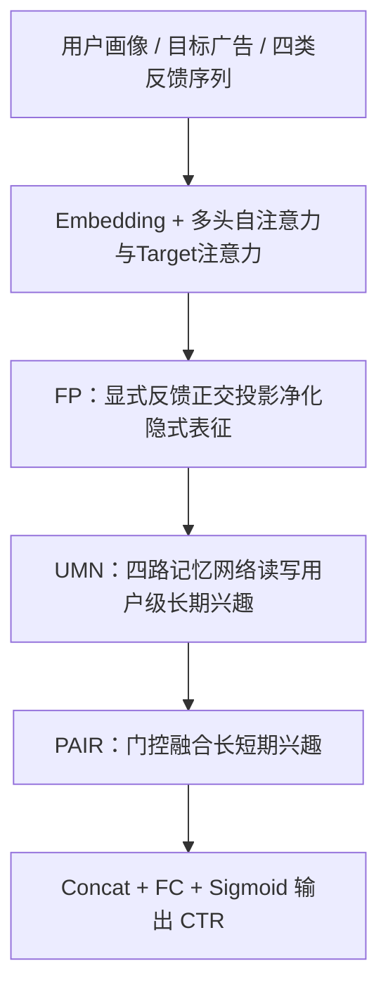
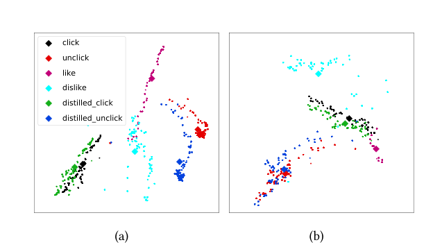

# Denoising User-aware Memory Network for Recommendation (去噪用户感知记忆网络推荐)

- **会议/期刊**: RecSys 2021
- **作者与机构**: Zhi Bian, Shaojun Zhou, Hao Fu 等（阿里巴巴；中国科学技术大学）
- **推荐链路定位**: 精排（CTR 预估）
- **研究方向**: 序列与会话推荐 / 自监督对比学习与交互去噪
- **论文原文**: [https://arxiv.org/abs/2107.05474v1](https://arxiv.org/abs/2107.05474v1)
- **开源代码**: 暂未开源（论文称代码已作为附加材料提交，未给出公开仓库链接）

## TL;DR (1分钟核心速览)

序列 CTR 模型普遍直接使用点击序列，但隐式反馈（误点、滑过未点）天然含噪，且长期兴趣只能靠拉长 item 序列来逼近，受显存与序列长度双重限制。本文提出 DUMN：用显式反馈（like/dislike）方向对隐式表征做**正交投影减法**去噪，用四路**用户级记忆网络**存储与序列长度无关的长期兴趣，再以门控融合长短期兴趣。在 Alibaba 与 Industrial 两个电商数据集上，AUC 达 0.6496 / 0.8136，比最优基线 DMT 分别提升 1.18 / 0.97 个绝对点。

## Background & Motivation (背景与核心矛盾)

- **主流范式**: DIN/DIEN/DSIN/AutoInt 等把点击序列送入 RNN 或 self-attention，用 target attention 聚合出用户兴趣向量；DMT/DFN 进一步引入多类行为序列（点击、加购、订单、dislike）以刻画"无偏偏好"。
- **前人局限 1（噪声）**: 现有去噪手段是 attention 加权或自编码器重构，但**注意力权重本身可能错**，被加权放大的仍是噪声特征；隐式反馈的"误点"与显式 dislike 语义重叠却未被显式削除。
- **前人局限 2（长期兴趣）**: 长期兴趣靠拼接更长的 item 序列实现，长度受显存/算力限制；且"养猫用户定期买猫粮"这类稳定偏好与近期序列无因果关系，item-level 建模天然失配。
- **核心洞察 (Key Insight)**: 显式反馈虽稀疏但语义干净，可充当"噪声方向"——把含噪隐式表征投影到显式负反馈方向上再减掉，即得正交补空间中的纯偏好；长期兴趣应**从用户维度（user profile）而非序列维度读取**，从而与序列长度解耦。
- **本文切入点**: 正交映射去噪（FP）+ 四路记忆网络（UMN）+ 门控交叉融合（PAIR）。

## Method (核心方法设计)

### 1. 整体框架 (Overall Architecture)

输入为 user profile、目标广告（item_id/brand_id）以及 click、unclick、like、dislike 四条长度 $T$的行为序列。Embedding 后，FP 层先用多头 self-attention + target attention 分别聚合成$\mathbf{f}_c,\mathbf{f}_u,\mathbf{f}_l,\mathbf{f}_d$四个短期表征，再用显式表征对隐式表征做正交投影去噪得到$\mathbf{f}_c^o,\mathbf{f}_u^o$。UMN 层以$[\mathbf{f}_c^o; \mathbf{e}_{user}]$为 controller 输入，从 click/unclick/like/dislike 四个记忆库中读取长期兴趣$\mathbf{r}_c,\mathbf{r}_u,\mathbf{r}_l,\mathbf{r}_d$，并在训练时写回。PAIR 层用门控把同类长短期表征交叉融合为$\mathbf{U}_c,\mathbf{U}_u,\mathbf{U}_l,\mathbf{U}_d$，拼接后经 FC 输出$\hat{y}$ 做 CTR 预估。

### 2. 关键设计拆解 (Key Designs)

1. **特征正交映射去噪（FP）**：针对"attention 加权无法剔除噪声"的问题，构造两组对比对 $\langle \mathbf{f}_c,\mathbf{f}_d\rangle$与$\langle \mathbf{f}_u,\mathbf{f}_l\rangle$，把隐式向量在显式向量方向上的分量视为噪声并减去：$\mathbf{f}_c^{p}=\frac{\mathbf{f}_c\cdot\mathbf{f}_d}{\|\mathbf{f}_d\|}\frac{\mathbf{f}_d}{\|\mathbf{f}_d\|}$，$\mathbf{f}_c^{o}=\mathbf{f}_c-\mathbf{f}_c^{p}$。直觉是：click 中混杂的"其实并不喜欢"的成分，恰好落在 dislike 张成的方向上，正交补空间才保留纯正点击偏好（可视化见图 3，去噪后 click 与 dislike 表征明显分离）。

<figure class="paper-figure" markdown="span">
  <figcaption>图3. 净化特性可视化。不同颜色表示FP模块中不同类型反馈的表示结果，每个★表示用户和物品产生的特定反馈，♦表示兴趣表示簇的中心。</figcaption>
</figure>

2. **用户级记忆网络（UMN）**：把 NTM 的记忆从"存 item 序列状态"改造为"存用户长期兴趣"，四个记忆库各含 $m$个 slot；controller 输入换成短期表征与用户画像 embedding 的拼接$\mathbf{k}_c=\mathrm{FFN}([\mathbf{f}_c^{o};\mathbf{e}_{user}])$，用余弦核做寻址$\mathbf{w}_c^r(j)=\mathrm{softmax}_j\big(\cos(\mathbf{k}_c,\mathbf{M}_c(j))\big)$并加权读出$\mathbf{r}_c=\sum_j \mathbf{w}_c^r(j)\mathbf{M}_c(j)$，写入用 erase/add 向量$\mathbf{M}_c=(\mathbf{1}-\mathbf{E}_c)\odot\mathbf{M}_c+\mathbf{A}_c$。这样同一 slot 会聚集相近兴趣的用户，表征比单一 user_id embedding 更具泛化性。

3. **门控融合与训练目标**：长短期兴趣对目标物品的贡献应随物品而异，故用门控而非直接 concat：$\mathbf{U}_c=\mathrm{Concat}\big(\mathbf{f}_c^{o}\odot\sigma(\mathbf{f}_c^{o}\mathbf{W}_1),\ \mathbf{r}_c\odot\sigma(\mathbf{r}_c\mathbf{W}_2)\big)$。总损失为$\mathcal{L}=\mathcal{L}_{1}+\sum_{k\in\{c,u,l,d\}}\mathcal{L}_{k}$，其中$\mathcal{L}_1$为 logloss，$\mathcal{L}_{k}=\max\big(d(\mathbf{q}_k,\mathbf{s}_{k^+})-d(\mathbf{q}_k,\mathbf{s}_{k^-})+\text{margin},0\big)$ 为三元组辅助损失，约束写入记忆的内容真正反映偏好；正负样本在每个 batch 全局交互中按余弦相似度挑最难对，无需额外负采样器，推理侧仅为一次记忆读取 + 两层 FC，开销可忽略。

## Experimental Setup & Evaluation Protocol (实验设置与评估协议)

- **数据集与预处理**: 均为电商真实日志，click（点击未购）/unclick（曝光未点）为隐式，like（收藏/加购/购买）/dislike 为显式。

| 数据集 | #Users | #Items | #Interactions | 稀疏度/密度 | 特征/场景说明 |
| :--- | :---: | :---: | :---: | :---: | :--- |
| Alibaba | 1.14M | 0.8M | 26M | ~2.9e-5 | 公开淘宝展示/反馈日志，12,960 个类目 |
| Industrial | 1.1B | 91.0M | 5.5B | ~5.5e-8 | 30 天工业日志，含四类反馈 |

- **数据划分与防穿越 (Splitting Strategy)**: Industrial 采用**全局时间戳切分**（2020-12-25~2021-01-18 训练，2021-01-19~01-24 测试）；Alibaba 沿用原公开训练/测试划分。
- **排名评测协议 (Ranking Protocol)**: 任务为 point-wise CTR 二分类，指标为 **AUC**，未做全库 Full-Ranking 或采样排序评估；有效点击记 label=1，负例直接来自曝光日志（隐式负反馈天然构成负样本），未额外做负采样比例控制。
- **对比基线与超参设置**: 基线含非序列类（Wide&Deep、DeepFM）与序列类（DIN、DIEN、DSIN、AutoInt、DFN、DMT）；$T=100$，embedding 维度 16，记忆 FFN 512 维，slot 数$m=256$、slot 维度$Z=64$，Adam + lr 0.005，网格搜索调参；**未报告显著性检验**。

## Key Experimental Results (实验关键数据)

### 1. 主实验对比 (Main Results)

| Model | Alibaba AUC | Industrial AUC |
| :--- | :---: | :---: |
| Wide&Deep | 0.6326 | 0.7526 |
| DeepFM | 0.6347 | 0.7612 |
| DIN | 0.6330 | 0.7653 |
| DIEN | 0.6343 | 0.7803 |
| DSIN | 0.6375 | 0.7873 |
| AutoInt | 0.6360 | 0.7708 |
| DFN | 0.6368 | 0.7884 |
| DMT | 0.6378 | 0.8039 |
| **DUMN (Ours)** | **0.6496** | **0.8136** |
| Improv. | +1.18 pt | +0.97 pt |

### 2. 消融实验 (Ablation Study)

| 变体 | Alibaba AUC | Industrial AUC | 说明 |
| :--- | :---: | :---: | :--- |
| DUMN-FP | 0.6417 | 0.7981 | 去掉正交去噪 |
| DUMN-UMN | 0.6434 | 0.7966 | 去掉记忆网络 |
| DUMN+UMN1 | 0.6446 | 0.8073 | 四路记忆合并为一路 |
| DUMN$_{CONCAT}$ | 0.6438 | 0.8023 | 直接拼接融合 |
| DUMN$_{ATTE}$ | 0.6433 | 0.7966 | 注意力融合 |
| DUMN-TL | 0.6467 | 0.7969 | 去掉三元组损失 |
| DUMN$_{RS}$ | 0.6472 | 0.7991 | 随机采样替最难采样 |
| DUMN$_{IF}$ | 0.6392 | 0.8072 | 仅用隐式反馈 |
| DUMN$_{AF}$ | 0.6394 | 0.8091 | 四类反馈混成单序列 |
| **DUMN** | **0.6496** | **0.8136** | 完整模型 |

### 3. 关键实验发现 (Key Findings)

- **去噪与长期兴趣并非冗余，而是互补**：单独去掉 FP 掉 0.79 pt（Industrial），单独去掉 UMN 掉 1.70 pt；而把 UMN 移植到 AutoInt/DFN 上仍带来 +0.36/+0.69 pt（Industrial），说明"用户级长期兴趣"是模型无关的可插拔增益。
- **粗粒度融合或粗粒度反馈建模损失最大**：四类反馈混成一条序列（$_{AF}$）比完整模型低 0.45/0.45 pt，说明多反馈混序会破坏表征空间的可分性；注意力融合（0.6433）甚至不如直接拼接（0.6438），印证了论文对"attention 权重不可靠"的批判。
- **记忆容量需与数据规模匹配**：$m=256,Z=64$ 最优，过小存不下长期兴趣、过大过拟合（图 2）；额外在 dislike 预测任务上，DUMN 以 0.8062/0.7601 大幅超过 DFN 的 0.7609/0.7394，说明细粒度 dislike 记忆确实学到了负向偏好。

## Highlights & Limitations (亮点、对比与审稿批判)

- **与代表作对比 (vs. Prior Work)**: 相比 DFN（同用 click/unclick/dislike，靠 attention 加权去噪），本文把去噪从"加权"改为"算子级正交减法"，参数零增加却更可控；相比 DMT（多 Transformer 建模多行为序列），本文补上了长周期、序列无关的用户级兴趣；相比 MIMN（item 级实时记忆），改为 user-profile 驱动的四路记忆。
- **可迁移亮点**: (1) 用"干净但稀疏"的强监督信号方向做正交投影，可迁移到跨域噪声标签、假阳性交互过滤；(2) 把记忆网络 controller 输入从 item 表征换成 $[\text{短期兴趣};\text{用户画像}]$，是低成本获得序列解耦长期表征的通用技巧。
- **审稿级局限批判**: (1) 正交假设过强——click 与 dislike 未必线性可分，噪声若不在 dislike 张成方向上则减法失效，缺少对该假设的定量验证；(2) 评估仅用 AUC 与单一时间切分，无全库排序、无显著性检验、无线上 A/B 或延迟数据；memory 需按用户维护 256×64×4 状态，工业级存储与更新成本未讨论。

## Rating (四维评分)

- **方法创新性 (Novelty)**: ⭐⭐⭐⭐ （正交投影去噪是简洁且有物理直觉的算子级创新，用户级四路记忆亦填补了长周期兴趣建模空白）
- **评估协议与实验扎实度 (Protocol & Experiments)**: ⭐⭐⭐ （两个大规模数据集 + 8 基线 + 六组消融较完整，但仅 AUC、无显著性检验与排序协议评估）
- **写作与数学规范度 (Clarity & Rigor)**: ⭐⭐⭐⭐ （投影、记忆读写、三元组损失公式定义清晰，代价是未给出复杂度与正交性成立的证明）
- **工业落地与复现价值 (Industrial & Practical Value)**: ⭐⭐⭐⭐ （线上日志验证、推理仅增一次记忆读取，但代码未公开且记忆状态维护成本偏高）

