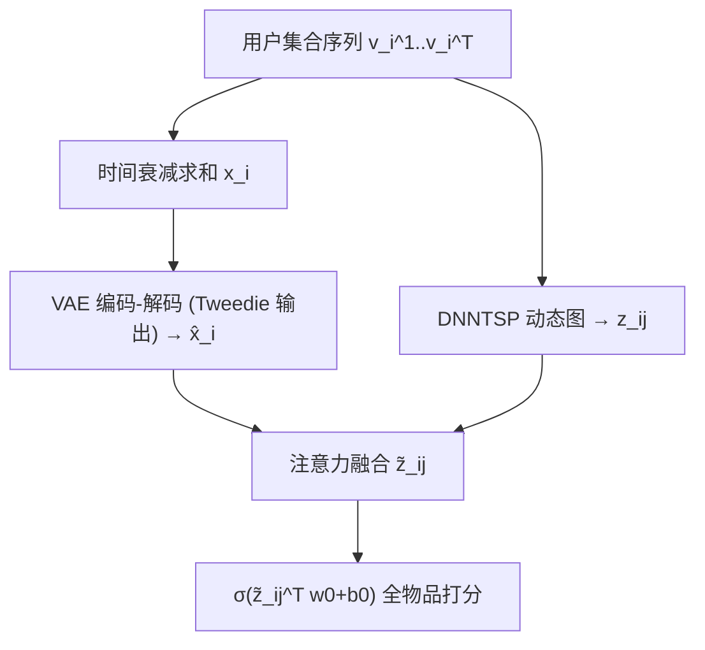
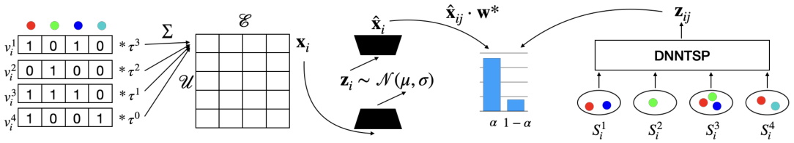
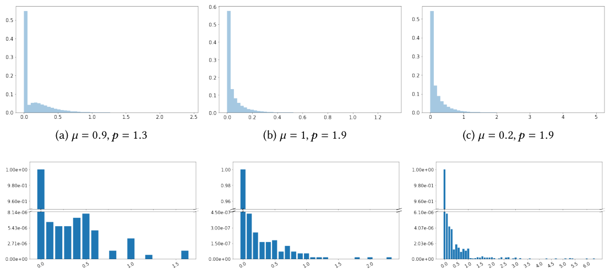

# Global-Local Item Embedding for Temporal Set Prediction (面向时间集合预测的全局-局部物品嵌入)

- **会议/期刊**: RecSys 2021 (Short Paper / LBR)
- **作者与机构**: Seungjae Jung, Young-Jin Park, Jisu Jeong, Kyung-Min Kim, Hiun Kim, Minkyu Kim, Hanock Kwak (Naver R&D Center / NAVER CLOVA / NAVER AI LAB)
- **推荐链路定位**: 召回（下一集合/下一篮预测）
- **研究方向**: 序列与会话推荐 / 协同过滤
- **论文原文**: [https://arxiv.org/abs/2109.02074v1](https://arxiv.org/abs/2109.02074v1)
- **开源代码**: 暂未开源

## TL;DR (1分钟核心速览)

下一篮/下一播放列表预测长期只挖「单个用户自己的集合序列」（局部），对「全体用户的时间集合共性」（全局）几乎未利用，用户平均只交互 4.96–18.05 个物品，稀疏性成为主要瓶颈。GLOIE 把用户整条序列压成时间衰减集合和，用 **Tweedie 输出** 的 VAE 学全局嵌入以匹配真实数据的零膨胀+长尾分布，再与 DNNTSP 动态图学到的局部嵌入以注意力加权融合。三公开基准全库排序下 Recall/NDCG@10 相对 DNNTSP 最高提升 **3.56% / 10.08%**。

## Background & Motivation (背景与核心矛盾)

- **主流范式**: Sets2Sets、DNNTSP 等把用户的集合序列送进 RNN / 自注意力 / 动态加权图，学「用户内部」的时序演化，本质是纯局部建模。
- **前人局限**: ① 每个用户的集合数极少（DC 4.76、TaoBao 5.55 个集合/人），局部序列不足以估计偏好；② 协同过滤式的低秩/全局信号在「时间集合预测」文献里几乎缺位，而 Hu 等的 PIF 最近邻方案推理复杂度随用户数立方增长且无法吃特征。
- **核心洞察 (Key Insight)**: 真实购买/打标签日志呈现**零膨胀 + 长尾**（图 2 的直方图与 Tweedie 采样高度同形），因此 VAE 解码器若用高斯/多项分布会被海量 0 主导，重建出的稠密向量质量差；改用复合 Poisson–Gamma（Tweedie, $1<p<2$）可天然表达「大量 0 + 非零部分为 Gamma 累加」的两段生成过程。
- **本文切入点**: 全局用 VAE-Tweedie 做低秩协同重建，局部用现成 SOTA 动态图嵌入，再用注意力按「是否交互过」自适应融合。

## Method (核心方法设计)

### 1. 整体框架 (Overall Architecture)

GLOIE 是**两阶段、非端到端**流程：先把用户 $u_i$的集合序列压成定长时间衰减向量$\mathbf{x}_i$，用单层 VAE 最大化其 ELBO，解码均值$\hat{\mathbf{x}}_i$即「全体用户视角」的稠密偏好；再单独训练 DNNTSP 得到用户相关物品嵌入$\mathbf{z}_{ij}$；最后对**历史交互过的物品**做注意力加权融合、对**从未交互的物品**只用$\hat{\mathbf{x}}_{ij}$ 投影打分，多标签 soft margin 损失训练顶层。

<figure class="paper-figure" markdown="span">
  <figcaption>图 1. GLOIE 概览。我们首先对时间衰减向量 x𝑖 求和（图左侧部分）。VAE 最大化每个 x𝑖 的 ELBO。ˆx𝑖𝑗· w∗ 与 z𝑖𝑗 的加权和成为交互物品的最终嵌入。权重 𝛼 由注意力机制确定。对于用户从未交互过的物品，我们仅使用 ˆx𝑖𝑗。</figcaption>
</figure>

### 2. 关键设计拆解 (Key Designs)

1. **时间衰减集合和 + VAE 全局重建（把不等长序列对齐成低秩问题）**：不同用户序列长度 $T_i$不同，无法直接喂同一个 VAE。作者用$\mathbf{x}_i=\sum_{k=1}^{T_i}\mathbf{v}_i^k\cdot\tau^{T_i-k}$（$\tau=0.6$）把近期集合加权放大、早期集合指数衰减，得到固定维向量；ELBO 里 KL 项等价于对低秩分解加约束。物理直觉：$\mathbf{x}_{i_1}\approx\mathbf{x}_{i_2}\Rightarrow\mathbf{z}_{i_1}\approx\mathbf{z}_{i_2}\Rightarrow\hat{\mathbf{x}}_{i_1}\approx\hat{\mathbf{x}}_{i_2}$，于是「历史相似的人买过」就能传播成「我没买过但可能喜欢」，且推理是$O(1)$ 次前向而非最近邻检索。

2. **Tweedie 解码器（让似然匹配零膨胀长尾）**：高斯/多项分布假设与数据形状不匹配，重建被 0 拖平。改用 Tweedie 的负对数似然
$$\mathcal{L}_{\text{Tweedie}}(z,\mu,p)=-z\frac{\mu^{1-p}}{1-p}+\frac{\mu^{2-p}}{2-p}$$
只需学均值 $\mu$与幂参数$p$，$p\in(1,2)$时等价于$N\sim\text{Poisson}(\lambda)$、$X_i\sim\text{Gamma}(\alpha,\beta)$、$Z=\sum_{i\le N}X_i$的复合 Poisson 过程，天然给出「$N=0$ 处的原子概率质量 + 非零处重尾」。

<figure class="paper-figure" markdown="span">
  <figcaption>图 2. 上排：来自 Tweedie 分布的样本直方图。下排：衰减向量 x𝑖 之和的各元素直方图。在所有基准数据集上，这些分布均为零膨胀且长尾。</figcaption>
</figure>

3. **注意力融合与训练目标**：VAE 为压低未交互项（大量 0）的似然会**低估高频交互物品**的偏好，故对已交互物品做融合：
$$\tilde{\mathbf{z}}_{ij}=\alpha\cdot\tilde{\mathbf{x}}_{ij}\cdot\mathbf{w}^{*}+(1-\alpha)\cdot\mathbf{z}_{ij},\quad \alpha=\sigma\big((W_q\mathbf{q})^{\top}(W_k\mathbf{k})\big)$$
其中 $\tilde{\mathbf{x}}_{ij}=\hat{\mathbf{x}}_{ij}/\max_j\hat{\mathbf{x}}_{ij}-0.5$归一化到$[-0.5,0.5]$。取$\mathbf{w}^{*}=\mathbf{w}_0$（打分层同权重）可使$\hat{y}_{ij}=\sigma(\hat{x}_{ij}\mathbf{w}_0^{\top}\mathbf{w}_0+b_0)$，**保持 VAE 学到的偏好序不被破坏**；作者实测可学习$\mathbf{w}^{*}$与之持平。最终$\hat{y}_{ij}=\sigma(\tilde{\mathbf{z}}_{ij}^{\top}\mathbf{w}_0+b_0)$，损失为多标签 soft margin$\mathcal{L}_{\text{TSP}}=-\frac{1}{N}\sum_i\sum_j[y_{ij}\log\hat{y}_{ij}+(1-y_{ij})\log(1-\hat{y}_{ij})]$。**训练无负采样**（全物品二分类），推理为一次矩阵乘 + Top-K，无 ANN 开销。

## Experimental Setup & Evaluation Protocol (实验设置与评估协议)

- **数据集与预处理**:

| 数据集 | #Users | #Items | #Sets | 元素/集合 | 集合/用户 | 元素/用户 |
| :--- | :---: | :---: | :---: | :---: | :---: | :---: |
| Dunnhumby Carbo (DC) | 9,010 | 217 | 42,905 | 1.52 | 4.76 | 5.44 |
| TaoBao | 113,347 | 689 | 628,618 | 1.10 | 5.55 | 4.96 |
| Tags-Math-Sx (TMS) | 15,726 | 1,565 | 243,394 | 2.19 | 15.48 | 18.05 |

- **数据划分与防穿越**: 沿用 Yu et al. 的 **70%/10%/20%** 划分（按用户集合序列顺序前/中/后切分），预测最后一个测试集合。
- **排名评测协议**: **Full-Ranking（全库未交互物品排序）**——物品库仅 217/689/1,565 个，故对全部物品打分取 Top-$K$，无采样偏差；指标 Recall@K、NDCG@K、PHR@K（预测集与真值集有交集即命中）。
- **对比基线与超参**: Toppop、PersonalToppop（非个性化/个性化热度）、Sets2Sets（编码器-解码器 + 集合注意力）、DNNTSP（动态加权图 + 时序依赖 + 门控融合，SOTA）。隐空间维 $d=128$（DC/TaoBao）、$512$（TMS）；Adam，lr$=0.001$，VAE 与 DNNTSP 各训 30 epoch；$\tau=0.6$（图 3 在 TaoBao 上的扫描最优点）。

## Key Experimental Results (实验关键数据)

### 1. 主实验对比 (Main Results)

| 数据集 | 模型 | Recall@10 | NDCG@10 | PHR@10 |
| :--- | :--- | :---: | :---: | :---: |
| DC | Toppop | 0.1618 | 0.0880 | 0.2274 |
| DC | PersonalToppop | 0.4104 | 0.3174 | 0.5031 |
| DC | Sets2Sets | 0.4488 | 0.3136 | 0.5458 |
| DC | DNNTSP | 0.4564 | 0.3165 | 0.5557 |
| DC | **GLOIE (Tweedie)** | **0.4658** | **0.3264** | **0.5613** |
| DC | Improv. vs DNNTSP | +2.06% | +3.13% | +1.01% |
| TaoBao | Toppop | 0.1567 | 0.0784 | 0.1613 |
| TaoBao | PersonalToppop | 0.2190 | 0.1535 | 0.2230 |
| TaoBao | Sets2Sets | 0.2811 | 0.1495 | 0.2868 |
| TaoBao | DNNTSP | 0.3035 | 0.1841 | 0.3095 |
| TaoBao | **GLOIE (Tweedie)** | **0.3099** | **0.2007** | **0.3152** |
| TaoBao | Improv. vs DNNTSP | +2.11% | +9.02% | +1.84% |
| TMS | Toppop | 0.2627 | 0.1627 | 0.4619 |
| TMS | PersonalToppop | 0.4508 | 0.3464 | 0.6440 |
| TMS | Sets2Sets | 0.4748 | 0.3782 | **0.6933** |
| TMS | DNNTSP | 0.4693 | 0.3473 | 0.6825 |
| TMS | **GLOIE (Tweedie)** | **0.4860** | **0.3823** | 0.6863 |
| TMS | Improv. vs DNNTSP | +3.56% | +10.08% | +0.56% |

### 2. 消融实验 (Ablation Study)

NDCG@10 逐项拆解（全局解码分布 × 是否做注意力融合）：

| 配置 | DC | TaoBao | TMS |
| :--- | :---: | :---: | :---: |
| VAE-Gaussian（仅全局） | 0.0882 | 0.0750 | 0.1919 |
| VAE-Multinomial | 0.0850 | 0.0798 | 0.1615 |
| VAE-Tweedie | 0.3000 | 0.1939 | 0.3744 |
| GLOIE-Gaussian | 0.2349 | 0.1768 | 0.0833 |
| GLOIE-Multinomial | 0.2465 | 0.1791 | 0.1029 |
| **GLOIE-Tweedie** | **0.3264** | **0.2007** | **0.3823** |

### 3. 关键实验发现 (Key Findings)

1. **解码似然的选择是数量级差异的主因，而非融合技巧**：DC 上把 Gaussian 换成 Tweedie，VAE 单模型 NDCG@10 从 0.0882 跳到 0.3000（3.4 倍）；GLOIE 层面从 0.2349 到 0.3264。说明零膨胀数据下高斯重建几乎退化为「预测全 0」，注意力融合也无从救起。
2. **全局信号单打独斗已接近 SOTA，且在更稀疏数据上更抗跌**：TaoBao 元素/用户仅 4.96，VAE-Tweedie 单独 Recall@10 = 0.2954 vs DNNTSP 0.3035（98.7%），融合后 0.3099；TMS 密度高（18.05），局部模型更强，融合增益主要体现在 NDCG（+10.08%）而非 PHR（+0.56%），即**命中率已被局部模型饱和，全局信息主要改善排序位置**。
3. **融合是「放大器」而非「保险」，坏全局嵌入会反噬**：TMS 上 GLOIE-Gaussian（0.0833）远差于 VAE-Gaussian 单独（0.1919），说明注意力机制无法识别全局分量质量；同时注意力融合相比 Yu et al. 的物品级可学习权重，在 DC/TaoBao/TMS 上 NDCG@10 分别提升 3.09%/0.45%/0.92%——数据越稀疏、全局分量越可信，注意力收益越大。

## Highlights & Limitations (亮点、对比与审稿批判)

- **与代表作对比 (vs. Prior Work)**: 相比 Sets2Sets（纯集合池化 + 单用户内注意力）与 DNNTSP（动态图局部嵌入 + 门控把 Toppop 全局热度塞进未交互项），GLOIE 的全局分量是**可学习的稠密协同重建**（含个性化、非仅热度），而非全局常数；相比 VAECF 类工作，其增量在于把 Tweedie 似然引入解码器以适配零膨胀长尾。
- **可迁移亮点**: ①「时间衰减求和」把变长序列拍平成定长向量，可直接嫁接到任何需要跨用户共享统计强度的任务（如会话冷启动）；② 用 Tweedie 替换 Gaussian/Bernoulli 解码头，是处理稀疏 0 主导交互矩阵的通用低成本改法。
- **审稿级局限批判**: ① **两阶段训练**（VAE 30 epoch → DNNTSP 30 epoch）非端到端，顶层损失无法回传修正全局嵌入，TMS 上的反噬即为例证；② 划分方式为按序 70/10/20 而非严格时间戳切分，跨用户集合可能时间重叠，存在轻度穿越风险，且无显著性检验与多随机种子方差；③ $\tau=0.6$ 由 TaoBao 单数据集扫描后固定全局沿用，对集合间隔分布不同的场景（如低频耐用消费品）缺乏自适应机制。

## Rating (四维评分)

- **方法创新性 (Novelty)**: ⭐⭐⭐⭐ （首次将 Tweedie 复合 Poisson 似然用于 VAE 解码器以匹配集合预测的零膨胀长尾，配合时间衰减全局化的思路简洁有效，但整体仍是「现成模块拼接」框架）
- **评估协议与实验扎实度 (Protocol & Experiments)**: ⭐⭐⭐ （三数据集 Full-Ranking 无采样偏差、含 6 组消融，但缺显著性检验/方差报告，划分未做严格时间切分，短论文无线上或分桶实验）
- **写作与数学规范度 (Clarity & Rigor)**: ⭐⭐⭐⭐ （衰减和、Tweedie 负似然、注意力融合与 $\mathbf{w}^*=\mathbf{w}_0$ 保序性均有清晰公式与直觉解释，仅 KL/ELBO 与低秩等价的论证偏口语）
- **工业落地与复现价值 (Industrial & Practical Value)**: ⭐⭐⭐ （推理仅一次前向 + Top-K，优于 PIF 的立方复杂度；但两阶段训练与动态图需按用户增量维护，代码未开源，复现 DNNTSP 依赖较重）

