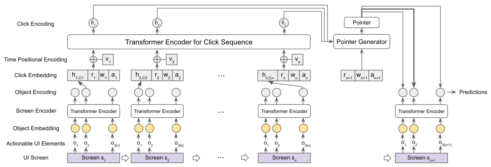
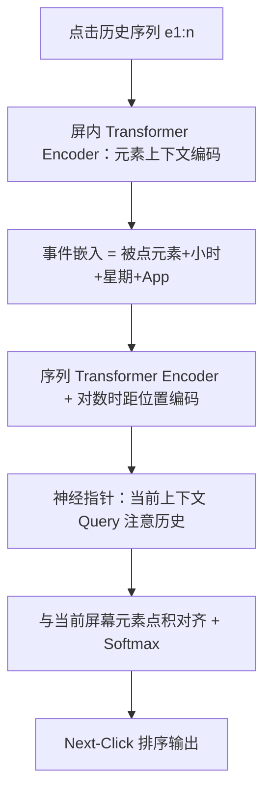

# Large-Scale Modeling of Mobile User Click Behaviors Using Deep Learning (基于深度学习的大规模移动端点击行为建模)

- **会议/期刊**: RecSys 2021（Fifteenth ACM Conference on Recommender Systems）
- **作者与机构**: Xin Zhou, Yang Li（Google Research）
- **推荐链路定位**: 端到端（屏内元素级候选排序 / 行为预测）
- **研究方向**: 序列与会话推荐 / 多模态推荐
- **论文原文**: [论文原文链接](https://arxiv.org/abs/2108.05342v1)
- **开源代码**: 暂未开源

## TL;DR (1分钟核心速览)

本文把"下一个被点击的 UI 元素"建模为序列推荐任务：前人把 UI 元素当作需预定义词表的 token（LSTM/CNN），既无法覆盖持续膨胀的应用生态，也处理不了占 26% 的跨应用跳转。作者提出分层 Transformer（屏内元素上下文编码 + 跨屏点击序列编码）、时距对数离散位置编码与神经指针，在真实屏幕的全部可点击元素上做全候选 softmax 排序。在 4000+ 用户、2000 万点击的用户级 80/10/10 划分下取得 Top-1 48.3%、Top-3 71.4%，相对最强深度基线 CNN 提升 25.5% / 8.8%，绝对排名由 3.44 降至 2.61。

## Background & Motivation (背景与核心矛盾)

- **主流范式**: 移动端行为建模长期停留在 App 级预测（下一个 App、最近使用列表）；细粒度元素级点击预测则沿用 NLP 思路——把元素特征拼接成字符串并映射为整数 token，再用 LSTM/CNN 做序列建模 [Lee et al., Liu et al.]。
- **前人局限**: 其一，预定义元素词表在 13,000+ 应用、24 类 UI 控件、持续迭代的界面下不可维护，新元素即 OOV；其二，用户 26% 的点击会跨应用跳转，而既有模型被设计为仅在单 App 内建模，跨 App 信号被直接丢弃。
- **核心洞察 (Key Insight)**: 数据集分析显示，点击行为由三重信号共同决定——屏内元素的空间/文本结构（决定"哪些位置可点"）、跨屏点击历史（会话意图漂移）、时间规律（小时/星期与点击间隔，如闹钟开关集中在工作日前夜），因此模型必须同时建模"屏内上下文"与"屏间序列上下文"。
- **本文切入点**: 放弃元素词表，改用元素的文本/类型/包围盒特征实时编码；用两级 Transformer 分别编码屏幕与序列，再由指针网络在当前屏幕候选集上生成概率分布——天然支持任意未见 UI 与跨应用场景。

## Method (核心方法设计)

### 1. 整体框架 (Overall Architecture)

输入为一条点击序列 $e_{1:n}=\{(s_i,c_i,t_i,a_i)\}$，每个事件包含屏幕视图树$s_i$、被点元素索引$c_i$、时间$t_i$（含小时$r_i$、星期$w_i$与距预测时刻的间隔$v_i$）与 App 标识$a_i$。模型分三级：第一级 Transformer Encoder 把当前屏幕内所有可点击元素编码为彼此感知的上下文向量（文本词袋 + 控件类型 + 归一化包围盒坐标）；第二级 Transformer Encoder 把"被点元素向量 + 时间/App 嵌入"构成的点击事件序列编码为用户历史；第三级指针生成器以当前上下文为 query，多头注意历史事件得到指针向量，再与当前屏幕每个元素向量做点积对齐、softmax 输出概率，argmax 即预测结果，端到端以交叉熵训练。

<figure class="paper-figure" markdown="span">
  <figcaption>图 7：用于预测给定屏幕上待点击元素的深度模型架构。App ID 𝑎𝑖 在我们的模型中是可选的，且我们的模型与应用无关，为来自任意 UI 的点击建模提供通用解决方案。</figcaption>
</figure>

### 2. 关键设计拆解 (Key Designs)

1. **屏内元素上下文编码（摆脱词表）**：痛点是不预定义 token 就无法做序列建模 $\to$对屏幕$s_i$的全部元素用自注意力互相编码$h_{i,1:|s_i|}=\mathrm{TransformerEnc}\big(\mathrm{Embed}_o(o_{i,1:|s_i|})\big)$ $\to$ 其物理直觉是元素是否被点不仅取决于自身文本，还取决于它在屏内的空间邻近与语义对比（如"确认"与"取消"），自注意力恰好提供这一相对上下文，并让模型对未见控件类型仍可泛化。
2. **时距对数位置编码 + 分层序列建模**：原始 Transformer 的位置编码假设事件等间隔，而实测点击间隔跨度极大 $\to$以经过时间的对数离散值构造位置嵌入$vE_i=\mathrm{Embed}_v\big(\lfloor \log(v_i)\rfloor\big)$，与事件嵌入相加后送入第二级 Encoder$\hat{h}=\mathrm{TransformerEnc}(cE_i+vE_i)$，其中$cE_i=[h_{i,c_i};\mathrm{Embed}_r(r_i);\mathrm{Embed}_w(w_i);\mathrm{Embed}_a(a_i)]W_c$ $\to$ 对数压缩使"秒级连点"与"隔夜回访"落在同一可学习桶空间，兼顾短期相关性与长期习惯。
3. **神经指针替代二分类排序**：采用 M 层注意生成的指针 $q^{M}_{n+1}$与当前屏幕元素对齐$\alpha_{n+1,j}=q^{M}_{n+1}W_q\cdot h_{n+1,j}$，再$P_j=\mathrm{softmax}_j(\alpha_{n+1,j})$ $\to$相比逐候选 sigmoid 打分，softmax 在屏内候选间形成竞争归一化，天然适配"候选数随屏幕变化"的变长输出。训练目标即该分布与真实点击元素的交叉熵$\mathcal{L}=-\log P_{c_{n+1}}$；无需负采样（所有未点击元素即隐式负例），序列按 100 点击切段，batch 128、隐层 128、2 层、dropout 0.1、Adam + 线性 warmup + 指数衰减；TFLite 量化后模型仅 27MB，可端侧推理。

## Experimental Setup & Evaluation Protocol (实验设置与评估协议)

- **数据集与预处理**: 采自 opt-in 用户面板的多周真实点击日志，过滤异常用户（极稀疏使用、短时爆发式点击）后：

| 数据集 | #Users | #Items | #Interactions | 稀疏度/密度 | 特征/场景说明 |
| :--- | :---: | :---: | :---: | :---: | :--- |
| Mobile Click Logs | 4,000+ | 24 类 UI 控件 / 约 2M 测试屏幕 | 20,000,000+ 点击 | 每屏可点元素 Mean=18, Std=12 | 13,000+ 应用；序列长 100–25,000 点击、跨 2–6 周（Mean=4.12）；26% 点击跨 App |

- **数据划分与防穿越 (Splitting Strategy)**: 主实验为 **用户级比例划分 80/10/10**（训练/验证/测试用户互不重叠，冷启动更严格）；另做一组**按时间切分**（每用户前 80%/次 10%/末 10%）以对齐 Chen et al. 的设定，用于公平对比。
- **排名评测协议 (Ranking Protocol)**: 属于**屏内 Full-Ranking（对该屏幕全部可点击元素排序）**，不做负采样；指标为 Top-1/Top-3 准确率、Absolute Ranking（真实元素的名次）与 Relative Ranking（Absolute / 屏内元素数，随机基线 0.5）。
- **对比基线与超参设置**: 9 个基线分三类——启发式（Recency、Personal Frequency、Global Frequency）、传统 ML（LR、SVM、Naive Bayes）、深度模型（LSTM、CNN[Liu]、Transformer[Chen]）；深度模型统一隐层 $d=128$、2 层，未报告显著性检验，以大幅 margin 论证。

## Key Experimental Results (实验关键数据)

### 1. 主实验对比 (Main Results)

| 模型 | Top-1 ↑ | Top-3 ↑ | Abs. Rank ↓ | Rel. Rank ↓ |
| :--- | :---: | :---: | :---: | :---: |
| Recency | 0.2167 | 0.3573 | 7.732 | 0.4023 |
| Personal Frequency | 0.2314 | 0.3684 | 7.648 | 0.3970 |
| Logistic Regression | 0.2704 | 0.5327 | 4.839 | 0.2514 |
| Naive Bayes | 0.2599 | 0.4905 | 4.916 | 0.2503 |
| LSTM [Lee et al.] | 0.3453 | 0.5402 | 5.099 | 0.2663 |
| CNN [Liu et al.] | 0.3847 | 0.6562 | 3.441 | 0.1777 |
| Transformer [Chen et al.] | 0.3761 | 0.6463 | 3.404 | 0.1780 |
| **Ours** | **0.4828** | **0.7140** | **2.607** | **0.1397** |
| Improv. vs CNN | +25.5% | +8.8% | −24.2% | −21.4% |

时间切分复现下，本模型升至 51%/74%（Abs 2.38、Rel 0.12），Chen et al. 为 42%/68%（3.18/0.14），差距保持一致。

### 2. 消融实验 (Ablation Study)

| 变体 | Top-1 | Top-3 | Abs. Rank | 相对全模型变化 |
| :--- | :---: | :---: | :---: | :---: |
| Full Model | **0.4828** | **0.7140** | **2.607** | — |
| w/o element text | 0.2865 | 0.5370 | 4.447 | −40.7% |
| w/o in-screen attention | 0.4373 | 0.6747 | 3.028 | −9.4% |
| w/o type | 0.4777 | 0.7087 | 2.673 | −1.1% |
| w/o time | 0.4711 | 0.7037 | 2.728 | −2.4% |
| w/o app name | 0.4780 | 0.7077 | 2.682 | −1.0% |
| w/o position | 0.4828 | 0.7140 | 2.607 | 0.0% |

### 3. 关键实验发现 (Key Findings)

1. **文本是唯一"支柱级"特征**：移除元素文本使 Top-1 从 0.4828 崩至 0.2865（−40.7%，甚至低于 Naive Bayes），而移除类型/时间/App 仅损失 1–2%，说明模型主要靠语义标签而非上下文元特征辨识候选，也意味着无文本控件（纯图标）将是系统性盲区。
2. **屏内注意力是结构的核心增量**：去掉屏内自注意力、直接用被点元素向量，Top-1 掉 9.4%（0.4828→0.4373）、绝对排名恶化 16%，证实"未点击元素同样携带判别信息"（相邻/对比位置关系）这一假设；反之绝对坐标特征零增益，作者归因于设备与版本差异导致布局漂移。
3. **复杂度分桶与跨应用鲁棒性**：屏幕元素数增加使 Top-1 单调下降，但 ≤10 个元素的屏幕（占 28%）可达 61%/90%，且 Relative Ranking 在不同屏复杂度下保持稳定；在占 26% 的跨应用跳转上模型反而取得 49.6%/73.1%，略高于全库均值，说明 App 无关的表征设计有效；历史长度从 0→1 即带来 4% Top-1 增益，最终取 9 屏为显存上限。

## Highlights & Limitations (亮点、对比与审稿批判)

- **与代表作对比 (vs. Prior Work)**: 相较 Lee et al. 的 LSTM+元素词表方案（0.3453），本文以特征化编码替代词表并额外引入屏内注意力，Top-1 +39.8%；相较同族 Transformer 排序模型 Chen et al.（0.3761），差异在于分层两级编码（屏内 + 序列）及 softmax 指针式归一化，而非单候选内积打分；相较 CNN 方案提升 25.5%。
- **可迁移亮点**: ① 用 $\lfloor\log(\Delta t)\rfloor$ 离散桶做位置编码，可直接复用于任意不规则时间间隔的会话序列（如信息流、短视频、POI 轨迹）；② "候选集内 softmax + 变长指针"模式适合候选数量动态变化的场景重排（候选字段数、SKU 规格数可变）。
- **审稿级局限批判**: ① 仅在单一 Android 生态、4,000 用户面板上验证，且用户级划分与时间划分结果相差 ~3 个百分点，缺少线上 A/B 与冷启动新用户实验；② 消融显示位置特征零增益、App ID 几乎无用，暗示模型对"图标型无文本控件"与跨设备布局的鲁棒性存疑，而文中未给出该失败分桶的定量分析；③ 未开源代码、无显著性检验与置信区间，屏幕哈希仅用于基线复现，可复现性有限。

## Rating (四维评分)

- **方法创新性 (Novelty)**: ⭐⭐⭐⭐ （分层 Transformer + 对数时距位置编码 + 神经指针的组合在 UI 元素级点击预测上属首次系统性突破，但各组件本身均为已有技术的迁移，理论分析略薄）
- **评估协议与实验扎实度 (Protocol & Experiments)**: ⭐⭐⭐⭐ （2000 万点击真实日志、屏内全候选排序无负采样偏差、9 个基线 + 双划分协议 + 完整消融，但缺显著性检验与线上验证）
- **写作与数学规范度 (Clarity & Rigor)**: ⭐⭐⭐⭐ （公式编号与符号链条清晰、复杂度与实现细节交代充分；部分记号如 $q^M$与$\hat{h}_{i,1:|s_i|}$ 的下标复用易误读）
- **工业落地与复现价值 (Industrial & Practical Value)**: ⭐⭐⭐⭐ （已上线 TFLite 27MB 端侧模型，Switch Access 遍历次数可由 9.04 降至 2.61，工程价值明确；但未开源、依赖 Google 私有日志使复现受限）

