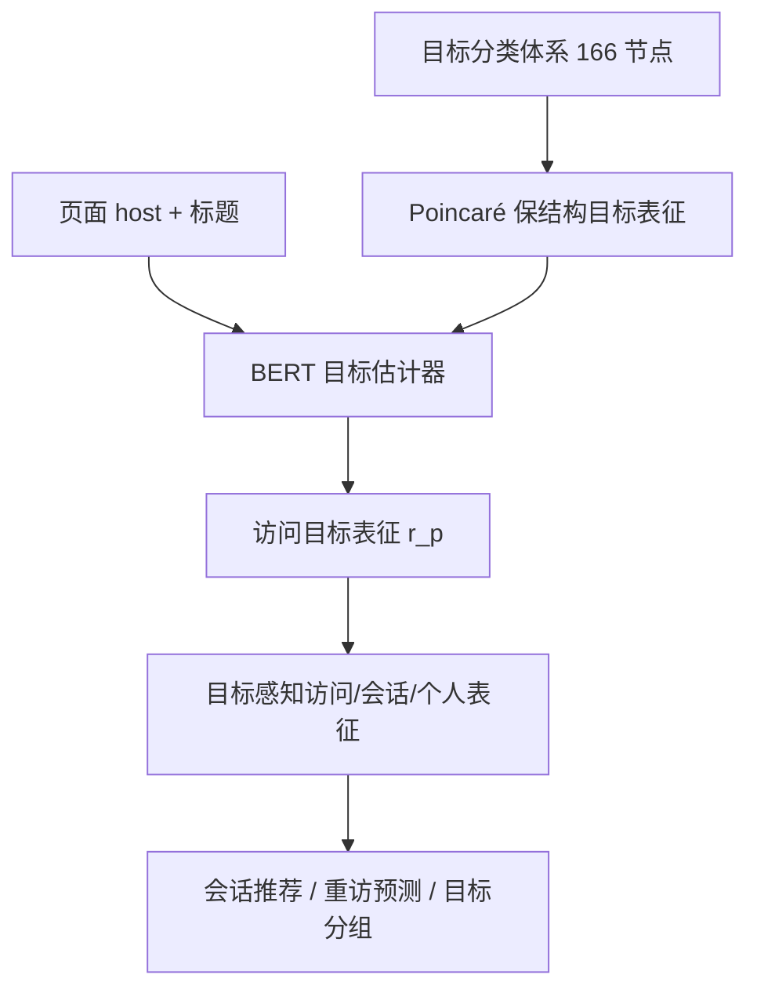
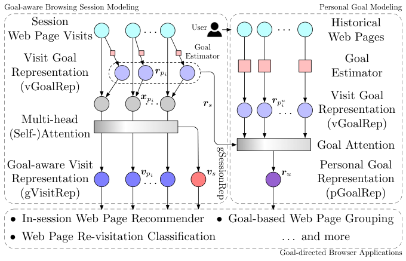

# Learning to Represent Human Motives for Goal-directed Web Browsing (面向目标导向网页浏览的人类动机表征学习)

- **会议/期刊**: RecSys 2021
- **作者与机构**: Jyun-Yu Jiang (UCLA/Microsoft)、Chia-Jung Lee (Amazon/Microsoft)、Longqi Yang、Bahareh Sarrafzadeh、Brent Hecht、Jaime Teevan (Microsoft)
- **推荐链路定位**: 召回 / 会话级排序
- **研究方向**: 序列与会话推荐 / 冷启动推荐
- **论文原文**: [论文原文链接](https://arxiv.org/abs/2108.03350v1)
- **开源代码**: 暂未检索到公开代码

## TL;DR (1分钟核心速览)

网页浏览中的高层目标（动机）通常不可观测，现有会话推荐只建模页面语义与点击序列，难以跨会话保持目标连续性。本文提出 GoWeB：基于心理学 166 节点目标分类体系，在 Poincaré 双曲空间学习保结构目标表征，并用 Bing 查询弱监督训练目标估计器，将页面访问映射为连续目标向量；再以目标感知注意力建模访问、会话与个人目标。在 Microsoft Edge 日志的 warm/cold 两套测试集、50k 候选检索协议下，GoWeB 将 warm MRR@10 提升至 0.1080（较 SemRec +32.22%），cold 无个性化版本达 0.0993（+16.09%），并同步提升重访预测与目标聚类。

## Background & Motivation (背景与核心矛盾)

- **主流范式**: 会话推荐多用 GRU4Rec、SASRec、BERT4Rec 等序列模型，或引入页面文本语义做下一页面预测；目标研究则多集中于搜索查询的导航/信息/交易意图分类。
- **前人局限**: 其一，查询意图是任务型、情境型，无法解释跨会话的长期动机（健康、职业、关系等）；其二，网页开放域稀疏且噪声大，纯语义表征难以区分“同一页面服务不同目标”，冷启动用户又缺少历史行为。
- **核心洞察 (Key Insight)**: 心理学已有人类目标层级 taxonomy，且目标间存在树状父子关系；若用双曲空间嵌入，可用低维连续向量同时保留“层级”与“相似性”，再用搜索引擎查询-页面关联做弱监督，把不可观测目标迁移到任意网页访问。
- **本文切入点**: 先学内在目标表征 iGoalRep，再训练目标估计器输出访问目标表征 vGoalRep，最后用目标感知会话建模统一服务推荐、重访与分组。

## Method (核心方法设计)

### 1. 整体框架 (Overall Architecture)

GoWeB 分两阶段。第一阶段以 Chulef 等的目标分类体系为骨架（135 个叶子目标、30 个父类、1 个 non-goal 根节点，共 166 节点），在 Poincaré ball 中用距离重构损失学习 iGoalRep；同时用 300 条种子查询扩展出 1,932 条相关查询，取 Bing 前 5 页面作为弱正例，训练 BERT+Host 目标估计器，把页面 $p=(h_p,c_p)$映射为 vGoalRep$\mathbf{r}_p$。第二阶段将$\mathbf{r}_p$ 与页面内容 embedding 拼接，经多头自注意力得到 gVisitRep，经会话级 attention 得到 gSessionRep，并以当前会话为 query 聚合用户历史访问得到 pGoalRep；三者分别接入会话推荐、重访二分类与 K-means++ 目标分组。训练上，iGoalRep 用 RSGD 优化，目标估计器与下游任务用 Adam 端到端优化。

<figure class="paper-figure" markdown="span">
  <figcaption>图 4：GoWeB 概览。目标估计器生成目标表示 𝑟𝑝，随后用于推导目标感知的访问表示 𝑣𝑝和会话表示 𝑣𝑠，以及个人目标表示 𝑟𝑢。这些表示促进浏览器应用中的目标导向体验。目标估计器的细节见第 3 节。</figcaption>
</figure>

### 2. 关键设计拆解 (Key Designs)

1. **双曲目标表征（iGoalRep）**：欧氏嵌入难以无 distortion 地表达树状层级，本文用 Poincaré 距离重构 taxonomy 边：
$d(\mathbf{u},\mathbf{v})=\operatorname{arcosh}\left(1+\frac{2\|\mathbf{u}-\mathbf{v}\|^2}{(1-\|\mathbf{u}\|^2)(1-\|\mathbf{v}\|^2)}\right)$，
并以负采样对比损失
$\mathcal{L}_{r}=\sum_{(g_u,g_v)\in H}\log\frac{e^{-d(\mathbf{r}_{g_u},\mathbf{r}_{g_v})}}{\sum_{g_{v'}\in N(g_u)}e^{-d(\mathbf{r}_{g_u},\mathbf{r}_{g_{v'}})}}$
拉近父子/相似目标、推远负例。每个正例采 50 个负例，RSGD 在黎曼流形上更新。直觉是双曲空间容量随半径指数增长，恰好匹配目标树“越深层越细”的结构。
2. **弱监督目标估计器（vGoalRep）**：页面目标不可直接标注，本文用查询-页面关联构造弱标签，将 host embedding 与 BERT 内容编码拼接：
$\mathbf{r}_p=F_G([\operatorname{emb}_G(h_p);\operatorname{BERT}_G(c_p)])$。
训练时把 $\mathbf{r}_p$与各目标$\mathbf{r}_g$的 Poincaré 相似度$s(p,g)=\mathbf{r}_p\otimes\mathbf{r}_g$ 作为分类 logits，做 136 类交叉熵。这样目标估计器不是预测离散目标 ID，而是输出连续向量，缓解目标稀疏并保留目标间相似性。
3. **目标感知会话建模与训练/推理**：访问表征由 $\mathbf{x}_{p_i}=[\mathbf{r}_{p_i};\mathbf{w}_{p_i}]$经多头自注意力上下文化；会话表征用可学习 context query 做 attention pooling；个人目标表征以当前会话聚合向量为 query，对用户历史访问的$\mathbf{r}_{p_i}$做 attention 聚合。推荐任务用$[ \mathbf{v}_s,\mathbf{r}_u ]$过 MLP 输出 50k 候选得分；重访任务用$[ \mathbf{v}_p,\mathbf{r}_u ]$过 sigmoid。总训练为两阶段：RSGD 优化$\mathcal{L}_r$，Adam 优化$\mathcal{L}_c$ 与下游任务损失；推荐/重访端到端微调。推理需 BERT 编码、会话 attention 与候选打分；冷启动用户退化为 GoWeB (NP)，去掉 pGoalRep。

## Experimental Setup & Evaluation Protocol (实验设置与评估协议)

- **数据集与预处理**: Microsoft Edge 匿名浏览日志，会话以 30 分钟无操作切分；出现少于 10 次的页面丢弃，少于 10 次访问的短会话丢弃；全局 79,695 个 host。

| 数据集 | #Users | #Sessions | 平均会话长度 | 说明 |
| :--- | :---: | :---: | :---: | :--- |
| Training | 57,715 | 836,073 | 21.689±11.922 | 2020-06-01 至 06-23 |
| Test (Warm) | 6,701 | 38,737 | 22.257±12.124 | 训练期出现过的用户 |
| Test (Cold) | 6,062 | 75,339 | 22.076±12.127 | 新用户，不可用个性化目标 |

- **数据划分与防穿越**: 按全局时间戳切分，训练期 6 月 1–23 日，测试期 6 月 24–30 日；warm/cold 按用户是否在训练期出现划分，避免未来会话泄漏。
- **排名评测协议**: 会话推荐取每会话前一半访问为输入、后一半为 ground-truth；移除 top-10 热门页面后，从剩余页面取 top-50,000 高频页面作为候选集，属于 **Sampled Candidate Ranking**，非全库 Full-Ranking。指标为 MRR@10、HR@{1,5,10}、NDCG@{5,10}。重访预测为二分类，指标 F1/Precision/Recall/Accuracy；分组用 NMI/AMI，ground-truth 来自私有三层主题分类器。
- **对比基线与超参设置**: 推荐基线含 Pop、BPRMF、NCF、Caser、GRU4Rec、SASRec、BERT4Rec、SemRec（同架构去目标）；重访含 CNN、RNN、SAS、BERT、SemCLS；分组含 doc2vec、BERT。目标/宿主维度 $d_G=d_h=64$，隐层与其余 embedding 为 128，attention head$k=8$；RSGD lr=0.3，Adam lr=$10^{-5}$，$(\beta_1,\beta_2)=(0.9,0.999)$。论文未显式报告显著性$p$ 值。

## Key Experimental Results (实验关键数据)

### 1. 主实验对比 (Main Results)

会话推荐（Warm 用 GoWeB，Cold 用 GoWeB (NP)）：

| 方法 | Warm MRR@10 | Warm HR@10 | Warm NDCG@10 | Cold MRR@10 | Cold HR@10 | Cold NDCG@10 |
| :--- | ---: | ---: | ---: | ---: | ---: | ---: |
| Pop | 0.0386 | 0.1123 | 0.0292 | 0.0454 | 0.1206 | 0.0341 |
| BPRMF | 0.0484 | 0.1243 | 0.0354 | 0.0513 | 0.1355 | 0.0398 |
| NCF | 0.0537 | 0.1365 | 0.0373 | 0.0528 | 0.1269 | 0.0383 |
| Caser | 0.0506 | 0.1329 | 0.0363 | 0.0508 | 0.1340 | 0.0375 |
| GRU4Rec | 0.0533 | 0.1445 | 0.0406 | 0.0559 | 0.1493 | 0.0435 |
| SASRec | 0.0693 | 0.1681 | 0.0503 | 0.0675 | 0.1696 | 0.0505 |
| BERT4Rec | 0.0727 | 0.1748 | 0.0521 | 0.0683 | 0.1761 | 0.0520 |
| SemRec | 0.0817 | 0.1801 | 0.0571 | 0.0856 | 0.1874 | 0.0611 |
| GoWeB (NP) | 0.0968 | 0.2090 | 0.0676 | **0.0993** | **0.2150** | **0.0712** |
| GoWeB | **0.1080** | **0.2276** | **0.0751** | N/A | N/A | N/A |

相对 SemRec：Warm MRR@10 +32.22%，Cold NP +16.09%。重访预测中，GoWeB (NP) 在 Warm/Cold 的 F1 分别为 0.6874/0.7050，GoWeB Warm 达 0.7010；SemCLS 为 0.6718/0.6824。目标分组中，GoWeB 目标表征 NMI/AMI 为 0.7683/0.5155，优于 BERT 的 0.7612/0.4929。

### 2. 消融实验 (Ablation Study)

| 变体/任务 | Rec MRR@10 Warm | Rec MRR@10 Cold | Revisit F1 Warm | Revisit F1 Cold | Group NMI | Group AMI |
| :--- | ---: | ---: | ---: | ---: | ---: | ---: |
| 仅语义（SemRec/SemCLS/BERT） | 0.0817 | 0.0856 | 0.6718 | 0.6824 | 0.7612 | 0.4929 |
| GoWeB (NP)：去个人目标 | 0.0968 | **0.0993** | 0.6874 | **0.7050** | — | — |
| GoWeB：全模型 | **0.1080** | N/A | **0.7010** | N/A | **0.7683** | **0.5155** |

### 3. 关键实验发现 (Key Findings)

1. **目标信号是主增益来源**：仅加目标估计器、不做个性化的 GoWeB (NP) 已比语义基线 SemRec 在 Warm MRR@10 上提升 18.52%，Cold 提升 16.09%；重访 F1 分别提升 2.32%/3.30%，说明弱监督目标表征能把“页面语义”转成“访问动机”。
2. **个人目标注意力对 warm 用户额外有效**：Warm 下 GoWeB 相比 NP 的 MRR@10 从 0.0968 升至 0.1080（+11.57%），F1 从 0.6874 升至 0.7010；但 cold 用户无历史，只能退化到 NP，揭示个性化目标建模的用户覆盖边界。
3. **目标估计器质量与行为解释性同步成立**：目标估计器叶节点 F1 55.27%、父类 F1 83.01%，混淆矩阵中错误多落在同一目标大类；行为分析显示 37% 重访发生在约一天至数天内，社交类目标更倾向小时级重访，而 Finances 有约 16% 会话只追求单一目标、Ethics & Idealism 仅 3%。

## Highlights & Limitations (亮点、对比与审稿批判)

- **与代表作对比 (vs. Prior Work)**: 相比 Broder/Rose 的查询意图分类，本文建模的是跨会话、长期心理学动机；相比 GRU4Rec/SASRec/BERT4Rec，本文不只建模点击序列，而引入目标层级与双曲结构；相比 SemRec，本文的核心增量是 weak-supervised vGoalRep 与目标感知 attention。
- **可迁移亮点**: 用搜索引擎查询-页面关联为不可观测的抽象标签构造弱监督，可迁移到“意图/场景/任务”表征；用 Poincaré 嵌入保留 taxonomy 层级，可迁移到类目体系、知识图谱与技能树推荐。
- **审稿级局限批判**: 数据来自 Edge/Bing 私有日志，候选集为 top-50k 采样排序且未报告显著性检验，复现与泛化证据弱；模型依赖 BERT、RSGD 与 166 节点固定 taxonomy，在线推理和 taxonomy 扩展成本较高，且缺少真实 A/B 与延迟报告。

## Rating (四维评分)

- **方法创新性 (Novelty)**: ⭐⭐⭐⭐ （心理学目标 taxonomy + 双曲保结构表征 + 弱监督目标估计器，跨学科组合新颖，但下游仍是 BERT/attention 的工程整合。）
- **评估协议与实验扎实度 (Protocol & Experiments)**: ⭐⭐⭐⭐ （Edge 大规模日志、warm/cold 双测试与三类任务较完整；但候选 50k 非全库排序，无显著性检验，数据不可公开。）
- **写作与数学规范度 (Clarity & Rigor)**: ⭐⭐⭐⭐ （Poincaré 距离、重构损失与目标分类公式清晰，RSGD 与弱监督流程可读；部分推导与复杂度分析偏简。）
- **工业落地与复现价值 (Industrial & Practical Value)**: ⭐⭐⭐ （浏览器目标感知推荐有明确产品价值，但依赖私有日志与 Bing API，代码未公开，BERT+RSGD 推理成本限制大规模部署。）

