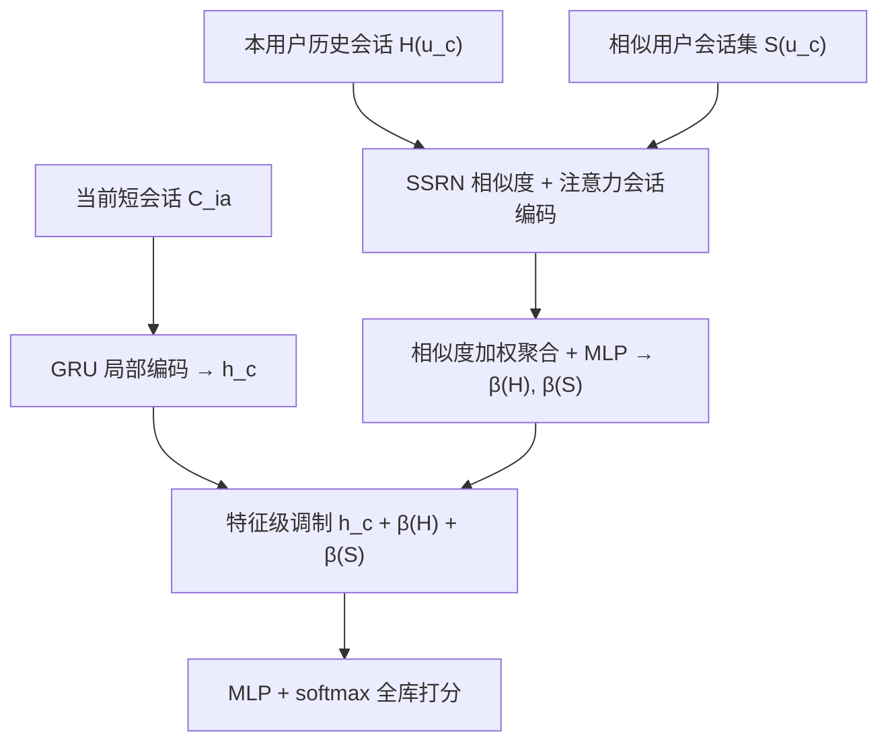
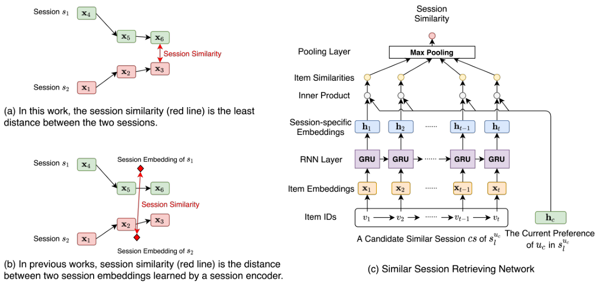

# Next-item Recommendations in Short Sessions (短会话中的下一项推荐)

- **会议/期刊**: RecSys 2021
- **作者与机构**: Wenzhuo Song（吉林大学）、Shoujin Wang、Yan Wang（麦考瑞大学）、Shengsheng Wang（吉林大学）
- **推荐链路定位**: 召回（会话级候选生成与打分）
- **研究方向**: 序列与会话推荐 / 冷启动与长尾推荐
- **论文原文**: [论文原文链接](https://arxiv.org/abs/2107.07453v2)
- **开源代码**: 暂未开源

## TL;DR (1分钟核心速览)

现有会话推荐（SBRS）几乎都在长会话上验证，并在预处理阶段直接丢弃长度 $\le 5$的短会话，但短会话在 Delicious / Reddit 中分别占 64.03% / 96.95%。本文把短会话下一项预测重构为小样本学习问题：局部模块用 GRU 从当前短会话推断偏好$\mathbf{h}_c$，全局模块用相似会话检索网络（SSRN）从「本用户历史会话」与「相似用户会话」中取先验，以$\mathbf{h}_c+\beta(\mathcal{H})+\beta(\mathcal{S})$ 做特征级调制。在仅含短会话的测试集上，Delicious Recall@5 由最优基线 0.1846 提升至 0.2163（+17.2%）。

## Background & Motivation (背景与核心矛盾)

- **主流范式**: 单会话 SBRS（RNN/STAMP/SR-GNN）只建模当前会话内转移；多会话 SBRS（HRNN/II-RNN/CSRM/SKNN）引入本用户历史会话或全库相似会话做补充。
- **前人局限**: ① 短会话内上下文极少，单会话模型无法刻画偏好；② 只用本用户历史，忽略「相似用户」这一在冷启动用户上唯一的可用信号；③ 检索相似会话时先用会话编码器压成定长向量再算内积，短会话下 key 信息量过低，召回的多是无关会话。
- **核心洞察 (Key Insight)**: 短会话 = 只有几个标注实例的任务，正好对应 few-shot 场景；元学习的作用是**用外部先验约束假设空间**，而非从零推断偏好。
- **本文切入点**: 保留「会话内推断」为局部路径，另建一条「跨会话先验」路径并做加性调制，从而在不破坏会话事务结构的前提下补足信息。

## Method (核心方法设计)

### 1. 整体框架 (Overall Architecture)

输入为当前会话的会话内上下文 $C^{ia}=\{v_1,\dots,v_{t-1}\}$及两个候选相似会话集：本用户历史会话$\mathcal{H}(u_c)$与$N{=}10$个最相似用户（按交互物品集合 Jaccard 重叠度$sim_u$选取）的会话集$\mathcal{S}(u_c)$。局部模块逐项过 GRU 得$\mathbf{h}_c=\mathbf{h}_{|C^{ia}|}$；全局模块对两个候选集的每个会话$cs$用 SSRN 算相似度、用注意力会话编码器得该会话的用户偏好$\mathbf{w}_{cs}$，按相似度加权聚合、过 MLP 得先验$\beta(\cdot)$；预测模块把两路先验加到$\mathbf{h}_c$ 上，再经 MLP+softmax 输出全库打分。

### 2. 关键设计拆解 (Key Designs)

**设计一：小样本视角下的加性特征调制**。痛点：短会话下 $\mathbf{h}_c$的监督信号太少，直接 softmax 方差极大。做法是不改表征维度、只做偏置式调制$\psi(\mathbf{h}_c,\mathcal{H},\mathcal{S})=\mathbf{h}_c+\beta(\mathcal{H}(u_c))+\beta(\mathcal{S}(u_c))$，再$\hat{p}(v)=\mathrm{softmax}(\mathrm{MLP}(\psi))$。直觉上这与 meta-learning 的「任务级先验平移」一致：先验只在特征空间内平移假设，不覆盖会话内证据，因此长会话时也不会被先验带偏。

**设计二：SSRN——用「最小项距离」替代「会话向量距离」**。痛点：把短会话压成均值/注意力加权向量会丢掉项的位置与共现结构。SSRN 不做会话级编码，而是把候选会话的 GRU 隐状态序列 $\{\mathbf{h}_i\}$与当前$\mathbf{h}_c$ 逐项比对取最大相似度，即两会话的最小距离：

$$sim(cs,C^{ia})=\max_{i\in[1,t]}\ \mathbf{h}_i^{\top}\mathbf{h}_c$$

随后用会话内注意力 $\alpha(v_i,u_{cs})=\frac{1}{\eta}\mathbf{x}_i^{\top}\boldsymbol{\theta}_{cs}$聚合出$\mathbf{w}_{cs}=\sum_i \alpha(v_i,u_{cs})\mathbf{x}_i$，并按相似度加权：$\beta(\mathcal{H})=\mathrm{MLP}_h(\sum_{cs\in\mathcal{H}}sim(cs,C^{ia})\cdot\mathbf{w}_{cs})$。最大相似度相当于只要求「存在一个高度相关的位置」，避免了均值池化在短会话上的语义稀释。

<figure class="paper-figure" markdown="span">
  <figcaption>图3. (a)和(b)展示了本文与先前工作在会话相似度计算上的差异。本文中，𝑠1与𝑠2（红线）的会话相似度为两个会话之间的最小距离；先前工作中则为由会话编码器（如物品嵌入的加权和）生成的会话嵌入之间的距离。(c) 所提出的相似会话检索网络（SSRN）。</figcaption>
</figure>
图 1：本文（a）以两会话间最小项距离度量相似度，而先前工作（b）先编码整段会话再算距离；(c) 为 SSRN 结构。

**设计三：训练目标与推理开销**。将预测视为全库多分类，用对全体物品求和的交叉熵（等价于全库负采样、无需额外负样本构造）：

$$\mathcal{L}=-\Big[\log p(v^+)+\sum_{v_i\in V,\,v_i\neq v^+}\log\big(1-p(v_i)\big)\Big]$$

训练采用 user-aware mini-batch（每批取不同用户的会话），嵌入与隐状态维度均为 50、dropout 0.2、Adam lr=0.001。推理需对 $\mathcal{H}(u_c)$ 与 10 个相似用户的全部会话跑一遍 GRU+SSRN，属于线性于候选会话数的额外开销，是本文最主要的部署成本。

## Experimental Setup & Evaluation Protocol (实验设置与评估协议)

- **数据集与预处理**: 剔除交互频次 $<10$的用户与物品；相邻交互间隔$<3600$s 归为同一会话；删除长度$>20$ 的会话。

| 数据集 | #Users | #Items | #Sessions | #Interactions | 场景说明 |
| :--- | :---: | :---: | :---: | :---: | :--- |
| Delicious | 1,643 | 5,005 | 45,603 | 257,639 | 社交书签打标签，均长 5.6 |
| Reddit | 18,173 | 13,521 | 1,119,225 | 2,868,050 | 子版块交互，均长 2.6 |

- **数据划分与防穿越**: 按时间戳排序后取每用户**最后 10% 会话为测试、次 10% 验证、其余 80% 训练**（另测 70/10/20、60/10/30 三档，结论一致，正文只报 80/10/10）。
- **排名评测协议**: 评测集**只保留长度 $\le 5$ 的短会话**；训练目标为全库 softmax 交叉熵，故打分接近 `Full-Ranking`（未显式声明截断候选数，可视为全库未交互排序）。指标 Recall@5/20、MRR@5/20，跑 10 次取均值。
- **对比基线与超参**: 单会话（RNN、STAMP、SR-GNN）、多会话（SKNN、STAN、CSRM、HRNN、II-RNN）、通用序列（SASRec $L{=}2,h{=}2$、BERT4Rec 同设置）；所有基线在验证集上调参取最优，CSRM 记忆槽 256。

## Key Experimental Results (实验关键数据)

### 1. 主实验对比 (Main Results)

| 方法 | Delicious R@5 | R@20 | MRR@5 | MRR@20 | Reddit R@5 | R@20 | MRR@5 | MRR@20 |
| :--- | :---: | :---: | :---: | :---: | :---: | :---: | :---: | :---: |
| RNN | 0.1418 | 0.2716 | 0.0830 | 0.0957 | 0.1984 | 0.3544 | 0.1305 | 0.1458 |
| STAMP | 0.1476 | 0.2861 | 0.0861 | 0.0997 | 0.1534 | 0.2555 | 0.0981 | 0.1083 |
| SR-GNN | 0.1680 | 0.3215 | 0.0931 | 0.1082 | 0.2377 | 0.4016 | 0.1555 | 0.1718 |
| SKNN | 0.1707 | 0.3487 | 0.0780 | 0.0960 | 0.1962 | 0.3758 | 0.0731 | 0.0912 |
| CSRM | 0.1774 | 0.3298 | 0.1007 | 0.1157 | 0.2003 | 0.3609 | 0.1310 | 0.1468 |
| HRNN | 0.1749 | 0.3279 | 0.1038 | 0.1189 | 0.3482 | 0.5185 | 0.2436 | 0.2607 |
| II-RNN | 0.1846 | 0.3493 | 0.1118 | 0.1279 | 0.3654 | 0.5481 | 0.2533 | 0.2717 |
| SASRec | 0.1792 | 0.3431 | 0.0947 | 0.1104 | 0.3219 | 0.5711 | 0.1761 | 0.2012 |
| BERT4Rec | 0.1755 | 0.3143 | 0.1096 | 0.1233 | **0.4092** | **0.6231** | 0.2290 | 0.2518 |
| **INSERT** | **0.2163** | **0.3840** | **0.1278** | **0.1443** | 0.3879 | 0.5588 | **0.2684** | **0.2858** |
| Improv.% (vs 最优非 INSERT) | +17.2% | +9.9% | +14.3% | +12.8% | −5.2% | −10.3% | +6.0% | +5.2% |

### 2. 消融实验 (Ablation Study)

| 变体 (Delicious) | R@5 | R@20 | MRR@5 | MRR@20 | 说明 |
| :--- | :---: | :---: | :---: | :---: | :--- |
| INSERT-c | 0.1418 | 0.2716 | 0.0830 | 0.0957 | 去全局模块（仅当前会话，退化为 GRU） |
| INSERT-h | 0.1833 | 0.3407 | 0.1101 | 0.1254 | 仅保留本用户历史 $\mathcal{H}$ |
| INSERT-o | 0.1975 | 0.3629 | 0.1160 | 0.1322 | 仅保留相似用户会话 $\mathcal{S}$ |
| INSERT-a | 0.1891 | 0.3508 | 0.1102 | 0.1259 | SSRN 换成「会话均值向量内积」 |
| **INSERT** | **0.2163** | **0.3840** | **0.1278** | **0.1443** | 完整模型 |

### 3. 关键实验发现 (Key Findings)

1. **先验的两条来源几乎独立且可叠加**：仅用相似用户会话（INSERT-o, R@5 0.1975）已优于仅用本用户历史（INSERT-h, 0.1833），而两者合并再涨到 0.2163（相对 INSERT-o 再 +9.5%），说明冷启动用户缺历史时，协同邻居会话是主要增量来源。
2. **相似度算子比「加了先验」本身更关键**：把 SSRN 换成均值向量内积（INSERT-a, R@5 0.1891）后性能回落 12.6%，甚至低于只看单一来源的 INSERT-o，证明短会话下会话级编码的信息损失是检索失败的主因，而非先验机制无效。
3. **越短越占优，但长会话上并非通吃**：长度分桶曲线显示会话越短 INSERT 相对增益越大；Reddit 上 BERT4Rec 的 Recall@20（0.6231）仍高于 INSERT，因为 Reddit 用户长期反复访问少数话题、物品高频重复，双向掩码复原从中获益，而 INSERT 的 MRR 仍全面领先（0.2858 vs 0.2518），说明其优势在排序精度而非召回广度。

## Highlights & Limitations (亮点、对比与审稿批判)

- **与代表作对比 (vs. Prior Work)**: 相比 SKNN/STAN 用整段会话向量做 KNN，SSRN 改在项级隐状态上取 max 相似度，免去会话编码器设计；相比 HRNN/II-RNN 只用本用户历史，本文额外引入相似用户会话集，等价于把「会话感知」扩展成「协同会话感知」；相比 CSRM 的记忆网络隐式检索，本文的检索是显式、可解释的加权聚合。
- **可迁移亮点**: ① 「$\mathbf{h}_c+\beta$」的加性特征调制可直接插到任意会话编码器（SR-GNN、SASRec 等）之上作为即插即用增强；② 「最大项相似度」是一种无需训练、无需负采样的轻量 session-to-session 匹配算子，可用于召回阶段的相似会话近邻扩展。
- **审稿级局限批判**: ① 相似用户固定取 $N{=}10$且用物品 Jaccard 选人，对交互极少的用户近乎随机，超参敏感度未做敏感性分析；② 每个候选会话都要跑 GRU+SSRN，推理成本随$\mathcal{H}(u_c)$ 线性增长，且论文未报告时延；③ 评测仅保留短会话而未在完整会话分布上报告，且未做显著性检验，Reddit 召回指标落后 BERT4Rec 的解释也仅停留在定性层面。

## Rating (四维评分)

- **方法创新性 (Novelty)**: ⭐⭐⭐⭐ （首次把短会话下一项预测显式建模为 few-shot 问题，加性调制 + 项级 max 相似度两个算子简洁且自洽，但元学习框架本身较为常规）
- **评估协议与实验扎实度 (Protocol & Experiments)**: ⭐⭐⭐⭐ （两数据集 + 10 次重复 + 9 个强基线 + 长度分桶 + 三重消融，划分与过滤描述清晰；缺显著性检验与完整会话分布对比）
- **写作与数学规范度 (Clarity & Rigor)**: ⭐⭐⭐⭐ （模块—公式一一对应，SSRN 与传统会话编码的差异用图示讲透；损失函数对全库求和的实际可扩展性未讨论）
- **工业落地与复现价值 (Industrial & Practical Value)**: ⭐⭐⭐ （SSRN 可无训练地插入现有会话召回；但未开源、候选会话全量编码的在线时延与相似用户选取的冷启动鲁棒性仍需工程验证）

