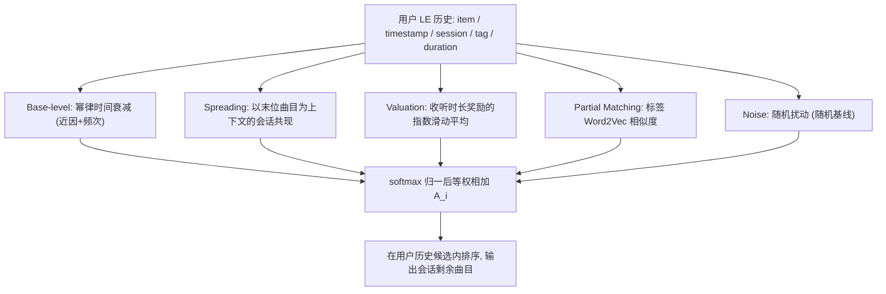

# Predicting Music Relistening Behavior Using the ACT-R Framework (基于 ACT-R 框架的音乐重听行为预测)

- **会议/期刊**: RecSys 2021 (Late-Breaking Results)
- **作者与机构**: Markus Reiter-Haas, Elisabeth Lex (TU Graz); Emilia Parada-Cabaleiro, Markus Schedl (JKU/LIT); Elham Motamedi, Marko Tkalcic (Univ. of Primorska)
- **推荐链路定位**: 召回后的候选排序（候选集 = 用户自身历史曲目）
- **研究方向**: 序列与会话推荐 / 协同过滤
- **论文原文**: [https://arxiv.org/abs/2108.02138v2](https://arxiv.org/abs/2108.02138v2)
- **开源代码**: [https://github.com/socialcomplab/recsys21-relistening-actr](https://github.com/socialcomplab/recsys21-relistening-actr)

## TL;DR (1分钟核心速览)

音乐场景中用户 66% 的收听是**重听**，但现有重听建模（时间点过程、因子分解、神经序列模型）只拟合行为分布，未刻画"记忆如何被唤起"这一生成机制。本文把认知架构 ACT-R 的声明记忆模块五个分量（base-level / spreading / partial matching / valuation / noise）线性叠加为曲目激活值 $A_i$，直接在用户历史候选上排序。在 LFM-2b 的 150 用户、169 万收听事件上，以一周滑窗、逐 LE 推进的协议做 81.1 万次会话内预测，最优组合 ACT-R(B,S,V) 取得 R-prec 0.11119，比最强单组件 Base-level(week, 0.10489) 相对提升 **+6.0%**。

## Background & Motivation (背景与核心矛盾)

- **主流范式**: 重听预测由时间点过程（建模回访间隔）、因子分解与神经序列模型主导，目标是拟合"下一次何时/听什么"的经验分布。
- **前人局限**: ①这些模型是纯统计拟合，缺少对"记忆痕迹强度"的可解释参数化，超参（如衰减）需靠数据重训；②已有 ACT-R 应用只取 base-level 单分量，无法区分"曲目自身曝光"与"曲目间联想"两类记忆来源。
- **核心洞察 (Key Insight)**: 图 1 的重听间隔双对数图呈幂律（全年拟合 $R^2=0.801$、斜率$-1.737$；一周内拟合$R^2=0.811$、斜率$-0.860$），而 ACT-R 的 base-level 衰减项本身正是幂律形式——这意味着认知模型的函数形式与数据分布天然同构，衰减指数可以直接从图上读出而非网格搜索。
- **本文切入点**: 用一件"零训练"的认知方程替代学习式序列模型，把重听拆成近因/频次、共现、内容相似、情感估值、随机性五个可解释通道。

## Method (核心方法设计)

### 1. 整体框架 (Overall Architecture)

模型完全无参数训练：对每个预测点，从用户历史抽取 (item, timestamp)、(item, session)、(item, tag)、(item, reward) 四类元组，分别送入五个分量计算激活值，各自经 softmax 归一到 $[0,1]$后等权相加得$A_i$，最终只在用户历史曲目集合$\mathcal{I}_u$内按$A_i$ 降序输出会话剩余曲目。整个流程是一次前向打分 + 排序，无反向传播、无负采样。

### 2. 关键设计拆解 (Key Designs)

1. **五分量激活和 + 分量级 softmax（解决尺度失衡）**: 前作只用 $B_i$，无法表达"想起这首歌是因为刚听过，还是因为它和刚听的歌常一起出现"。本文定义$A_i = B_i + S_i + P_i + V_i + \epsilon_i$，且每个分量先经 softmax 归一到$[0,1]$ 再加和。直觉：不同记忆通道的"痕迹强度"被拉到同一量纲，任何单一通道（尤其是流行度）都不会因数值尺度而在加法中吞掉其他通道。

2. **Spreading 的反流行度惩罚（组合优于单点的真正原因）**: 纯共现计数会把"到处都是"的热门曲目推高。本文的 spreading 用比值而非计数：$S_i = \mathrm{softmax}\big(P(i\in C_j)/P(i)\big)$，其中$C_j$是上下文曲目$j$（历史中最后一条）出现过的所有会话集合。分母$P(i)$显式抵消全局高频，使该项只保留"与刚听曲目**特异地**共现"的信号。这解释了本文最反直觉的现象：$B$与$V$都奖励热门曲目，$B+V$出现流行度双重计数（0.10069，反低于$B$单独的 0.10489），而一旦加入$S$ 便回升至 0.11119。

3. **训练目标、参数配置与推理效率**: 无损失函数、无负采样，等价于对固定打分器做逐点预测；唯一超参是 base-level 衰减 $d$与 valuation 学习率$\alpha$。Valuation 采用 Rescorla-Wagner 型更新$V_i(n)=V_i(n-1)+\alpha\big(R_i(n)-V_i(n-1)\big)$，奖励取收听时长比或离散映射（$\le 33\%\to -1$，$\ge 66\%\to +1$，其余 0）。推理复杂度为$O(|\mathcal{I}_u|)$ 的一次打分排序，无 GPU 需求。

## Experimental Setup & Evaluation Protocol (实验设置与评估协议)

- **数据集与预处理**: LFM-2b (2019) 分层抽样（剔除 <1000 与 >30000 LE 的用户，按 LE 数分 10 桶等量抽样）得到 150 用户；会话由相邻 LE 间隔 $\le 30$ 分钟切分；标签与时长经 Last.fm API 回填（存在缺失）。

| 数据集 | #Users | #Items | #Interactions | 稀疏度/密度 | 特征/场景说明 |
| :--- | :---: | :---: | :---: | :---: | :--- |
| LFM-2b (2019 抽样) | 150 | 355,464 | 1,686,296 | 密度 3.16% | 人均 11,242 LE；96,156 会话（均 18 LE）；人均重听率 66%；12,434 LE 无标签、108,210 LE 无时长 |

- **数据划分与防穿越 (Splitting Strategy)**: 时间序贯滑窗——以每个 LE 为锚点回看**最近一周**历史，hop size = 1 LE，预测该锚点所在会话的**剩余全部曲目**，共 $|Q|=811{,}025$ 次预测。锚点前信息严格作为可见历史，属时间戳切分的在线式评估。
- **排名评测协议 (Ranking Protocol)**: **非全库排序**。候选集限定为该用户历史中出现过的曲目（$\mathcal{I}_u$），属于历史候选内重排；指标为$R\text{-}prec=\frac{1}{|Q|}\sum_{q\in Q}\frac{r}{R}$（$R$ = 会话剩余**去重**曲目数）与单步 Next-HR（Top-1 是否命中下一条）。
- **对比基线与超参设置**: 非 ACT-R 基线 MostRecent 与 TransProb（连续序列模式挖掘的转移概率）；单分量为 TransProb、Partial Matching、Noise、Valuation(discrete/ratio/MP)、Spreading、Base-level($d{=}0.5$/$d{=}1.737$/$d{=}0.86$)；组合为 B/S/V 的四种加法。无显著性检验（Late-Breaking 短文），PCA 将 300 维 Word2Vec 降至 100 维。

## Key Experimental Results (实验关键数据)

### 1. 主实验对比 (Main Results)

| 方法 | 类型 | R-prec | Next-HR |
| :--- | :--- | :---: | :---: |
| TransProb | 序列模式基线 | 0.03839 | **0.15907** |
| Valuation(MP) | 单分量 | 0.08436 | 0.01477 |
| Spreading | 单分量 | 0.09235 | 0.02117 |
| MostRecent | 非 ACT-R 基线 | 0.10167 | 0.05189 |
| Base-level (default, $d{=}0.5$) | 单分量 | 0.10380 | 0.02451 |
| Base-level (week, $d{=}0.86$) | 单分量（最强单项） | 0.10489 | 0.02883 |
| ACT-R(S,V) | 组合，不含 B | 0.11009 (vs 最强单项 **+4.9%**) | 0.02998 |
| ACT-R(B,S) | 组合 | 0.11042 (+5.3%) | 0.02972 |
| **ACT-R(B,S,V)** | 全组合 | **0.11119 (+6.0%)** | 0.02961 |

### 2. 消融实验 (Ablation Study)

（本文以"逐分量剔除 / 权重学习"作为消融）

| 配置 | R-prec | Δ vs 全模型 |
| :--- | :---: | :---: |
| Full: ACT-R(B,S,V) | **0.11119** | — |
| w/o Spreading → ACT-R(B,V) | 0.10069 | −9.5% |
| w/o Valuation → ACT-R(B,S) | 0.11042 | −0.7% |
| w/o Base-level → ACT-R(S,V) | 0.11009 | −1.0% |
| 线性加权版 $bB+sS+vV$($b{=}0.34,s{=}0.26,v{=}0.18$) | ≈ACT-R(S,V) | 无提升 |
| 加权 + 截距 ($v{=}-0.05$) | ≈ACT-R(S,V) | 无提升 |

### 3. 关键实验发现 (Key Findings)

1. **幂律衰减使超参近乎免调**：$d=0.86$（按一周区间拟合）得 0.10489，而框架默认$d=0.5$已达 0.10380，差距仅 1.0%；反观按全年数据拟合的$d=1.737$ 掉到 0.09903（−5.6%），说明衰减指数必须与评估窗口的时长尺度对齐，而非越"真实"越好。
2. **组合增益来自 S 的纠偏而非简单叠加**：$B+V$因流行度双重计数跌至 0.10069（比$B$单独还低 4.0%），加入$S$ 后回升到 0.11119；且 ACT-R(S,V) 在**完全不含 base-level** 的情况下仍达 0.11009（+4.9%），证明共现项携带了时间衰减之外的独立信息。
3. **单步与会话级目标存在明显错位**：TransProb 在 Next-HR 上以 0.15907 远超所有 ACT-R 变体（约 5.3 倍于 0.02961），但 R-prec 仅 0.03839（全场最低）；而线性加权回归虽给出 $B{=}0.34>S{=}0.26>V{=}0.18$的合理序，加权后性能却无提升，且$V$在含截距模型下系数变为$-0.05$——说明 valuation 项本质上只是拟合流行度偏置（截距），等权相加的式 (1) 已足够。

## Highlights & Limitations (亮点、对比与审稿批判)

- **与代表作对比 (vs. Prior Work)**: 相较时间点过程与神经重听模型（需训练、超参敏感），本文以零训练解析式给出可比性能；相较既有 ACT-R 推荐工作（仅 base-level，如 Tkalcic 系列），本文首次把 spreading / partial matching / valuation / noise 一并纳入会话级重听预测，并明确给出各分量的功能边界（P 与 noise 基本无效，S 与 V 互补）。
- **可迁移亮点**: ①用 $\log$-$\log$拟合斜率直接初始化时间衰减指数，可迁移到任何带近因权重的序列打分器；②$P(i\in C_j)/P(i)$ 形式的"反流行度共现"是一个可插拔的去偏项，能纠正热门商品在会话共现召回中的过度曝光。
- **审稿级局限批判**: ①候选集被限制在用户历史内，未与全库检索或真实召回管线对接，"强 baseline（MostRecent）"与"弱全局性能（R-prec≈0.11）"都受此协议放大；②仅 150 用户、单一音乐数据集、无显著性检验，且无训练/加权方案收益，泛化性与统计可靠性不足；③partial matching 依赖缺失严重的 Last.fm 标签（12,434 LE 无标签），其失效结论可能源于特征稀疏而非认知假设本身。

## Rating (四维评分)

- **方法创新性 (Novelty)**: ⭐⭐⭐⭐ （首次将 ACT-R 声明记忆五分量整体用于会话级重听预测；幂律分布与 base-level 衰减的同构观察是本文最有价值的概念贡献，但无新学习算法）
- **评估协议与实验扎实度 (Protocol & Experiments)**: ⭐⭐⭐ （时间滑窗逐 LE 推进的 81 万次预测协议较严谨，但候选限历史、单数据集、150 用户、无显著性检验，结论强度受限）
- **写作与数学规范度 (Clarity & Rigor)**: ⭐⭐⭐⭐ （五分量定义与超参来源（图 1 斜率）交代清楚、公式简洁；但分量级 softmax 的归一必要性未做消融验证，加权实验的解释略简）
- **工业落地与复现价值 (Industrial & Practical Value)**: ⭐⭐⭐ （代码开源、零训练、$O(|\mathcal{I}_u|)$ 打分极易部署，可作为重排序/重听召回的轻量打分器；但性能天花板受限于无内容与无跨用户信号的纯单用户建模）

