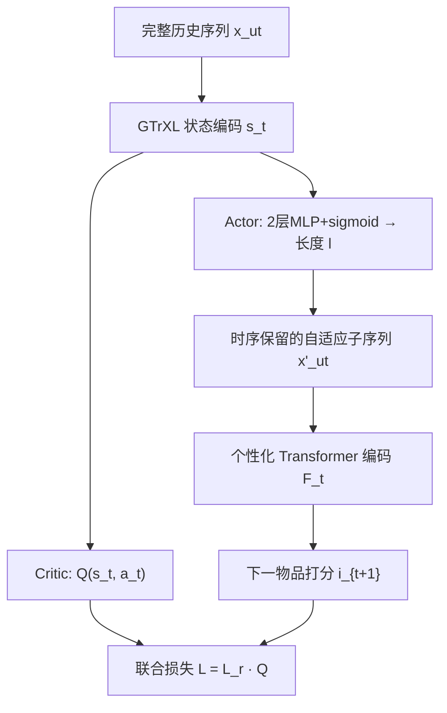
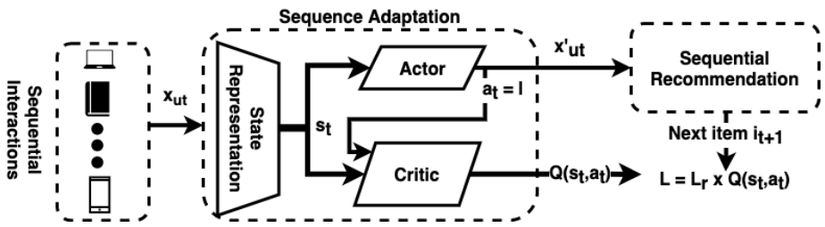

# Sequence Adaptation via Reinforcement Learning in Recommender Systems (基于强化学习的推荐系统序列自适应)

- **会议/期刊**: RecSys 2021 (ACM Conference on Recommender Systems)
- **作者与机构**: Stefanos Antaris (KTH Royal Institute of Technology / Hive Streaming AB), Dimitrios Rafailidis (University of Thessaly)
- **推荐链路定位**: 精排（Next-Item 序列打分）
- **研究方向**: 序列与会话推荐 / 强化学习与动态探索推荐
- **论文原文**: [https://arxiv.org/abs/2108.01442v1](https://arxiv.org/abs/2108.01442v1)
- **开源代码**: [https://github.com/stefanosantaris/sar](https://github.com/stefanosantaris/sar)

## TL;DR (1分钟核心速览)

主流序列推荐（SASRec、SSE-PT++、TiSASRec）一律把输入序列长度 $l$固定为 30/50/100，但用户兴趣漂移速率不同：短序列用户被冗长历史注入噪声，长序列用户的关键早期信号被截断。本文提出 SAR，把「为每个用户在每一步选多大的$l$」形式化为 MDP，用 GTrXL 编码状态、Actor 输出长度、Critic 估计期望回报，并将$Q(s_t,a_t)$与交叉熵做**乘性联合损失**$L=L_r\cdot Q$，使长度选择直接对齐 Top-K 排序精度。在 Steam/ML-10M/Electronics/Kindle 四个数据集、Leave-One-Out + 全库排序协议下，NDCG@10 较次优的 AdaptSubSeq 分别提升 6.5%/12.1%/3.9%/3.2%。

## Background & Motivation (背景与核心矛盾)

- **主流范式**: 以 SASRec / SSE-PT++ 为代表的自注意力序列推荐，把用户最近 $l$条交互（$l$ 全局固定）编码后做下一物品分类；近期亦有 RL 方案（SASRec-SAC/SQN）用 Q 值对推荐损失做正则。
- **前人局限 1（冗余与截断的两难）**: 固定 $l$ 使得短兴趣周期用户（如买完笔记本即止）被无关历史污染，长周期用户（如 ML-10M 平均序列 143.1）早期协同信号被硬截断，二者无法同时最优。
- **前人局限 2（自适应方案丢失顺序）**: 唯一相关的 AdaptSubSeq 以有向无环图 + submodular 贪心选 $k$ 近邻子集，**丢弃了子集内交互的时间先后**，因而仍无法准确刻画兴趣演化轨迹。
- **核心洞察 (Key Insight)**: 最优 $l$ 不是数据集的全局超参，而是随 (用户, 时间步) 二元变化的隐变量；且该隐变量的正确性只能由「下游推荐是否命中」来定义——天然适合 RL 的 reward 驱动范式。
- **本文切入点**: 将长度选择与推荐器解耦为两个模块，用 actor-critic 学一个**全局策略** $\pi_\theta$输出个性化$l$，并保留候选子序列的严格时序。

## Method (核心方法设计)

### 1. 整体框架 (Overall Architecture)

输入用户 $u$截至$t$的完整交互序列$x_{ut}=\{i_1,\dots,i_t\}$。**Sequence Adaptation 组件**先用 GTrXL（Gated Transformer-XL）把全序列编码为状态向量$s_t$，Actor 据此输出动作$a_t=l$（$1\le l\le t$），于是得到保留时序的自适应子序列$x'_{ut}=\{i_{t-l},\dots,i_t\}$；Critic 用$(s_t,a_t)$估计期望回报$Q(s_t,a_t)$。**Sequential Recommendation 组件**（个性化 Transformer，SSE-PT 架构）以$x'_{ut}$与用户向量$u$拼接后编码，输出全物品打分并取 argmax 作为$i_{t+1}$。训练时两模块共享同一损失$L=L_r\cdot Q$ 端到端联合优化：推荐精度反向塑造 Actor 的长度策略，Critic 的回报估计则校准长度选择的长期收益。推理阶段仅需两次前向（状态编码 + 推荐编码）即可完成一次打分。

<figure class="paper-figure" markdown="span">
  <figcaption>图 1. SAR 概述。序列适应组件生成适配后的序列 𝑥′。</figcaption>
</figure>

### 2. 关键设计拆解 (Key Designs)

1. **长度即动作的 MDP 建模（State + Actor）**：痛点是「长度」本是离散超参、不可微无法端到端学习。作者将其升格为动作空间 $\mathcal{A}=\{1,\dots,t\}$，状态由 GTrXL 给出$s_t=\mathrm{GTrXL}(x_{ut})$，Actor 经两层 MLP 输出$a_t=f(\sigma(s_t^{\top}W_{a1})W_{a2})$。用 GTrXL 而非普通 Transformer 的原因是门控跨段记忆能让$s_t$在长序列（ML-10M 达 143）上稳定累积兴趣漂移信号，使$l$ 的决策基于「兴趣变化速度」而非「序列绝对长度」。

2. **Q 值乘性正则的联合损失（Critic + Joint Loss）**：痛点是若用「先定长度、再训推荐器」的两阶段流程，长度策略无法感知推荐损失；若用加性正则 $L_r+\lambda Q$，$\lambda$又需重调且量纲不一致。作者改为乘性耦合$L=L_r\cdot Q(s_t,a_t)$，其中$Q(s_t,a_t)=f(\sigma((s_t\oplus a_t)W_{c1})W_{c2})$。物理直觉：$Q$ 充当**自适应步长的损失缩放因子**——Critic 认为某长度回报高则放大该样本的交叉熵梯度、加速学习；回报低则自动抑制。这把「长度探索」与「排序拟合」压进同一个标量目标，无需额外超参。

3. **训练目标、负采样与推理效率**：总损失即 $L=L_r\cdot Q$，$L_r$为全物品 softmax 交叉熵（$|I|$类分类，**无显式负采样**，属全库 softmax 范式）；采用离线 batch RL、episodic 训练（一个 episode 遍历全部用户），Adam + mini-batch，100 epochs，$\gamma=0.82$，$d_u=d_i=100$，$d_s=150$。推理开销为 GTrXL 一次 + 推荐 Transformer 一次，外加两层小 MLP，**双 Transformer 结构使单次打分 FLOPs 近 2 倍于 SASRec**。

## Experimental Setup & Evaluation Protocol (实验设置与评估协议)

- **数据集与预处理**: 四个真实数据集，统计如下（密度为按平均序列长度推算，原文未直接给出；未见 `5-core` 过滤说明）：

| 数据集 | #Users | #Items | #Interactions(推算) | 稀疏度/密度 | 特征/场景说明 |
| :--- | :---: | :---: | :---: | :---: | :--- |
| Steam | 332,924 | 12,773 | ≈3.68M | ≈0.087% | 视频游戏平台评论，短序列（11.05） |
| ML-10M | 69,877 | 10,436 | ≈10.0M | ≈1.37% | MovieLens 电影评分，超长序列（143.10） |
| Electronics | 650,866 | 142,064 | ≈3.34M | ≈0.0036% | Amazon 电子产品评论，极稀疏（5.13） |
| Kindle | 280,658 | 126,717 | ≈2.12M | ≈0.006% | Amazon Kindle 评论，短序列（7.55） |

- **数据划分与防穿越 (Splitting Strategy)**: `Leave-One-Out`——训练用 $t-2$ 之前的全部交互，**倒数第二条作验证、最后一条作测试**，严格按时间戳排序，无未来信息泄漏。
- **排名评测协议 (Ranking Protocol)**: 采用 `Full-Ranking`（对 $|I|$全部物品输出概率后排序，非采样排序），报告 NDCG@$\{5,10\}$与 HR@$\{5,10\}$；实验重复 5 次取均值±标准差，并以$p<0.05$ 的 t-test 标注显著性。
- **对比基线与超参设置**: 6 个基线覆盖三类——个性化 Transformer（SSE-PT++，$l=50$）、RL 正则序列模型（SASRec-SAC / SASRec-SQN，$l=100$，$\gamma=0.94$）、时间感知模型（MTAM$l=30$、TiSASRec$l=100$），以及自适应序列基线 AdaptSubSeq（最大长度 200）。所有基线使用官方实现 + 网格搜索调参，公平性较好。

## Key Experimental Results (实验关键数据)

### 1. 主实验对比 (Main Results)

| 方法 | Steam NDCG@10 | Steam HR@10 | ML-10M NDCG@10 | ML-10M HR@10 | Elec. NDCG@10 | Elec. HR@10 | Kindle NDCG@10 | Kindle HR@10 |
| :--- | :---: | :---: | :---: | :---: | :---: | :---: | :---: | :---: |
| SSE-PT++ | .523 | .323 | .455 | .209 | .462 | .222 | .623 | .354 |
| SASRec-SAC | .543 | .334 | .482 | .252 | .488 | .236 | .677 | .374 |
| SASRec-SQN | .562 | .342 | .462 | .250 | .482 | .231 | .682 | .383 |
| MTAM | .512 | .309 | .426 | .227 | .433 | .211 | .613 | .328 |
| TiSASRec | .507 | .332 | .484 | .233 | .483 | .211 | .603 | .322 |
| AdaptSubSeq | .588 | .353 | .517 | .282 | .522 | .263 | .723 | .393 |
| **SAR (本文)** | **.623** | **.382** | **.553** | **.303** | **.554** | **.332** | **.744** | **.423** |
| Improv.% (vs 次优) | +6.0% | +8.2% | +7.0% | +7.4% | +6.1% | +26.2% | +2.9% | +7.6% |

### 2. 消融 / 敏感性实验 (Ablation & Sensitivity)

原文未提供逐组件 `w/o` 消融，替代以「固定长度扫描（图 2）」与「学到的平均长度」两组定量证据：

| 分析项 | Steam | ML-10M | Electronics | Kindle |
| :--- | :---: | :---: | :---: | :---: |
| SAR 学到的平均 $l$ | 32.35 ± 4.89 | 52.48 ± 8.12 | 22.29 ± 2.16 | 67.92 ± 14.22 |
| AdaptSubSeq 平均 $l$ | 45.82 ± 8.11 | 59.27 ± 6.88 | 42.55 ± 10.11 | 88.91 ± 6.23 |
| 数据真实平均序列长 | 11.05 | 143.10 | 5.13 | 7.55 |
| 最佳固定 $l$（基线） | 50 (SSE-PT++) | 100 (TiSASRec) | 50 (SSE-PT++) | 100 (SASRec-SQN) |

### 3. 关键实验发现 (Key Findings)

1. **长度自适应本身贡献了主要增益**：两个「自适应派」包揽全部 4 个数据集的前二名（SAR / AdaptSubSeq），而所有固定长度基线（含 RL 正则的 SASRec-SAC）在最优 $l$ 处仍落后——说明瓶颈不在编码器容量而在输入窗口粒度，本文与 AdaptSubSeq 的差距（6.5%/12.1%）则来自「保留时序」这一必要修正。
2. **学到的长度与数据分布强相关，而非退化为常数**：ML-10M 序列最长（143.1），SAR 自动放大到 52.48；Electronics 最短（5.13），SAR 收缩到 22.29，仅为 AdaptSubSeq（42.55）的一半，恰好解释该数据集 HR@10 暴涨 26.2%——在极稀疏域里「少看历史」等价于强力去噪。
3. **自适应策略消除了对 $l$的敏感性调参**：图 2 中 SASRec-SAC/SQN/TiSASRec 需$l\approx100$才达峰值、MTAM 仅$l=30$最优，曲线随$l$剧烈起伏；SAR 在$l\in[20,100]$全区间保持最高且平坦，把「逐数据集调$l$」这一昂贵工程环节直接吸收进模型。

## Highlights & Limitations (亮点、对比与审稿批判)

- **与代表作对比 (vs. Prior Work)**: 相较 SSE-PT++（个性化 Transformer 但 $l$ 固定为 50），SAR 只替换了「输入窗口生成方式」这一处，编码器沿用 SSE-PT 即可涨点，说明模块正交性好；相较 SASRec-SAC（RL 用于正则化**推荐打分**），SAR 的 RL 作用于**数据窗口**而非预测头，探索空间更有物理含义；相较 AdaptSubSeq（子模图选子集），SAR 唯一的实质增量就是「保留子集内的时间顺序」，却是最大的性能分水岭。
- **可迁移亮点**: ①「超参升格为动作、下游指标为奖励」的范式可直接迁移到序列增强的裁剪、图推荐的邻居采样阶数、长序列召回的历史窗口长度等所有「窗口长度难以网格搜索」的场景；②GTrXL 作为 RL 状态编码器解决长序列记忆衰减，可作为通用 trick 复用到 bandit 类排序。
- **审稿级局限批判**: ①**计算成本翻倍**：状态编码器与推荐编码器是两套 Transformer，线上单请求需两次序列前向，且 GTrXL 依赖完整历史（ML-10M 达 143 步），对低延迟精排链路不友好，论文未报告任何 latency/FLOPs；②**连续动作未离散化说明**：Actor 经 sigmoid 输出实值，如何映射到整数 $l\in\{1,\dots,t\}$（取整？期望？Gumbel？）在文中缺失，复现性存疑；③**联合损失$L=L_r\cdot Q$缺少归一化**：$Q$为未约束正标量，训练后期若$Q$漂移将同步放大$L_r$梯度，与$\gamma=0.82$ 的折扣设定耦合后稳定性未做敏感性分析；④**无组件级消融**，仅靠与外部基线对比支撑「Actor / Critic / 联合损失各自有效」的主张，因果归因偏弱。

## Rating (四维评分)

- **方法创新性 (Novelty)**: ⭐⭐⭐⭐ （把「输入窗口长度」这一被长期当作超参的量重构为 MDP 动作，视角新颖且低成本可插拔，但 RL 组件本身（GTrXL + actor-critic + 乘性联合损失）均为已有积木的重新拼装）
- **评估协议与实验扎实度 (Protocol & Experiments)**: ⭐⭐⭐⭐ （四数据集 + Full-Ranking + Leave-One-Out + 5 次重复与 $p<0.05$ 显著性检验规范，但缺组件消融与效率分析，且部分表格数值存在 HR 与 NDCG 量级不自洽的疑点）
- **写作与数学规范度 (Clarity & Rigor)**: ⭐⭐⭐ （整体叙事清晰、动机例子（买笔记本 vs 买书）极具说服力，但动作离散化、$Q$的 Bellman 更新目标与联合损失梯度推导均一笔带过，公式 (2) 中$f(\cdot)$与$\sigma(\cdot)$ 的嵌套顺序亦疑似笔误）
- **工业落地与复现价值 (Industrial & Practical Value)**: ⭐⭐⭐⭐ （代码已开源，模块与任意序列骨干正交、可即插即用；但双 Transformer 推理开销与长历史依赖需在工程侧裁剪后才可上线，适合作为离线「长度蒸馏」教师模型使用）

