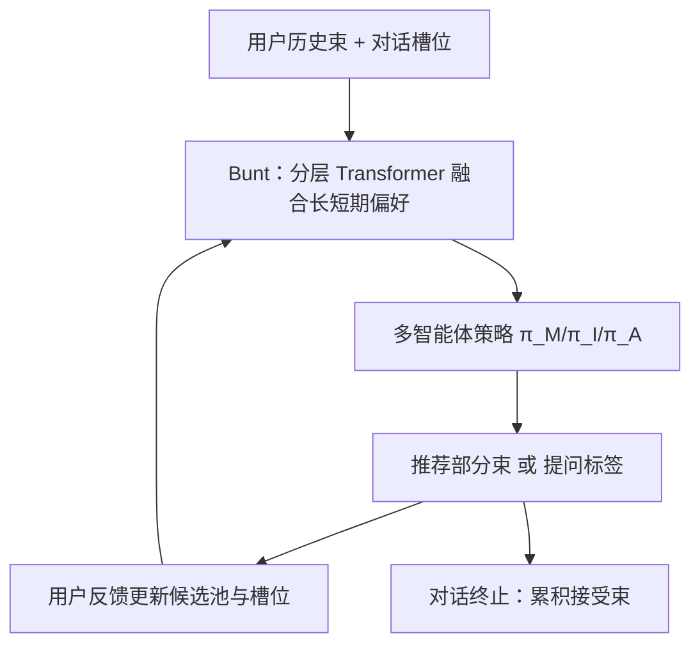

# Bundle MCR: Towards Conversational Bundle Recommendation (面向对话式束推荐)

- **会议/期刊**: RecSys 2022
- **作者与机构**: Zhankui He, Handong Zhao, Tong Yu, Sungchul Kim, Fan Du, Julian McAuley (UC San Diego & Adobe Research)
- **推荐链路定位**: 多轮对话式端到端召回与生成
- **研究方向**: 对话推荐与智能体仿真 / 强化学习与动态探索推荐
- **论文原文**: [论文原文链接](https://arxiv.org/abs/2207.12628v1)
- **开源代码**: [开源代码仓库链接](https://github.com/AaronHeee/Bundle-MCR)

## TL;DR (1分钟核心速览)

本文针对束推荐(如服饰套装)的两个痛点——用户-束交互极度稀疏和捆绑组合输出空间爆炸——首次将多轮对话推荐(MCR)拓展至束场景，提出 **Bundle MCR** 任务。作者将其形式化为多智能体 MDP，并设计 Bunt 模型统一完成用户建模、推荐/提问双动作决策与反馈处理；采用离线多完形任务预训练 + 在线 PPO 微调两阶段策略。在 Steam/MovieLens/Clothing/iFashion 四个数据集的模拟用户 Leave-One-Out 协议下，Bunt-Learn 将 Steam F1 从最优基线的 0.752 提升至 **0.822**(+9.3%)，MovieLens F1 从 0.149 提升至 **0.275**(+84.6%)。

## Background & Motivation (背景与核心矛盾)

- **主流范式**: 现有束推荐分为判别式方法(把束视为广义"物品"做排序，如 BBPR、DAM、BGCN)与生成式方法(端到端生成新束，如 BGN、PoG、BYOB)，均为"一次性推荐"——用户仅能对完整束做一次反馈，交互随即结束。
- **前人局限**: (1) **信息稀疏**：用户-束交互比用户-物品少一个量级，单次交互无法持续收集偏好；(2) **输出空间爆炸**：在指数级的物品组合空间中直接预测正确束远比单物品推荐困难。
- **核心洞察 (Key Insight)**: 多轮对话推荐(MCR)已证明通过询问标签(品类/属性)并逐轮处理反馈可有效收窄候选空间；但由于既有 MCR 仅面向单物品，其**模型架构与问题策略均无法直接迁移至束上下文**——需同时处理束感知偏好建模、多物品反馈与多槽位提问。
- **本文切入点**: 提出 Bundle MCR，即在对话中完成"多物品组成束"的协作构建，用对话交互同时化解稀疏性与输出空间难题。

<figure class="paper-figure" markdown="span">
  ![图 1. 左：传统捆绑推荐、个体对话推荐与我们的对话捆绑推荐之间的用例比较。右：我们提出的 Bundle-Aware Multi-Round Conversational Recommendation（即 Bundle MCR）场景示意图，该场景将传统个体 MCR \[14, 26, 27, 53\] 扩展到捆绑设置。](../../../../assets/papers/2207.12628v1/figure_1.png)<figcaption>图 1. 左：传统捆绑推荐、个体对话推荐与我们的对话捆绑推荐之间的用例比较。右：我们提出的 Bundle-Aware Multi-Round Conversational Recommendation（即 Bundle MCR）场景示意图，该场景将传统个体 MCR [14, 26, 27, 53] 扩展到捆绑设置。</figcaption>
</figure>

## Method (核心方法设计)

### 1. 整体框架 (Overall Architecture)

Bundle MCR 引入**槽位 (slot)** 概念：束由 $K$个槽位$X^{(t)}$构成，系统每轮选择"推荐"或"提问"，推荐时输出$K$个物品组成部分束$\mathcal{B}_u^{(t)}$，提问时按槽位输出$K$个属性。用户对每个物品/属性给出接受、忽略或拒绝，系统据此更新短期上下文、候选池与槽位。模型将一轮对话拆解为**用户建模 → 咨询 → 反馈处理**三阶段，各智能体共享 Bunt 编码的束感知对话状态。两阶段训练：离线完形预训练让 Bunt 学会"该推什么、该问什么"，在线 RL 微调让$\pi_M,\pi_I,\pi_A$ 在模拟用户交互中精化决策。

### 2. 关键设计拆解 (Key Designs)

**创新设计一：束感知分层用户建模与槽位化状态编码**。前人多用 FM 编码用户-物品交互，既无法刻画束内物品关系也无法建模多槽位上下文。Bunt 先用**两级 Transformer**：内层编码束内物品集合并均值池化为 $\mathbf{B}_n=\text{AVG}(\text{TRM}_{\text{item}}(\mathcal{B}_n))$，外层编码历史束序列得长期偏好$\mathbf{E}_u=\text{TRM}_{\text{bundle}}(\{\mathbf{B}_1,\dots\})$；短期上下文$\mathbf{E}^{(t)}_{I,u},\mathbf{E}^{(t)}_{A,u}$经嵌入层后在第$l$层与长期偏好交叉融合：$\tilde{\mathbf{O}}^{l-1}=\text{LN}(\mathbf{O}^{l-1}\oplus\mathbf{E}^{(t)}_{A,u}\mathbf{W}^{l-1})$。**物理直觉**：槽位注意力让模型感知"哪些槽位已填、哪些待补"，从而支持部分束生成与差异化提问。

**创新设计二：多智能体策略与两级奖励**。将决策拆为两步：$\pi_M$先在"推荐/提问"二值动作上决策，再由$\pi_I$(物品) 或$\pi_A$(属性) 按槽位输出，避免单一策略在稀疏奖励下无从学习。动作概率为$P_M(a|\bar{\mathbf{S}}_u)= \beta\cdot\pi'_M(\cdot|\bar{\mathbf{S}})+\allowbreak (1-\beta)\cdot\pi''_M(\cdot|\mathbf{O}^L_x)$，$\beta$由 MLP 门控学习。**两级奖励**：低级奖励$r_{Ix}=\mathbb{I}[\hat{i}_x=i_x^*]$直接反馈给$\pi_I,\pi_A$；高级奖励$r_M$ 仅在会话结束时按最终 F1/Acc 计算，缓解长程稀疏奖励。

**创新设计三：两阶段训练与推理效率**。离线阶段以多完形任务同时预训练推荐、问答与管理：$\mathcal{L}_{\text{offline}}=\mathcal{L}_{\text{rec}}+\lambda\mathcal{L}_{\text{ask}}$，其中$\mathcal{L}_{\text{ask}}=\mathcal{L}_{\text{cate}}+\mathcal{L}_{\text{attr}}+\mathcal{L}_{\text{conv}}$。$\mathcal{L}_{\text{rec}}$为物品多类分类，$\mathcal{L}_{\text{ask}}$对属性用加权多标签交叉熵防热偏，$\mathcal{L}_{\text{conv}}$训练$\pi''_M$判断"是否推荐"。在线阶段**冻结 Bunt 主干**，仅用 PPO 在模拟用户环境中微调$\pi_M,\pi_I,\pi_A$，离线动作空间庞大导致的冷启动问题被有效规避。

## Experimental Setup & Evaluation Protocol (实验设置与评估协议)

- **数据集与预处理**:

| 数据集 | #Users | #Items | #Bundles | #Cats | #Attrs | #Inter | 稀疏度说明 |
| :--- | :---: | :---: | :---: | :---: | :---: | :---: | :---: |
| Steam | 13,260 | 2,819 | 229 | 21 | 327 | 261,241 | 过滤交互<2束用户 |
| MovieLens | 46,322 | 5,899 | 851,361 | 19 | 190 | 3,997,583 | 同秒评分聚为一束 |
| Clothing | 19,065 | 25,408 | 79,610 | 668 | 4,027 | 285,391 | 过滤交互≤3次 |
| iFashion | 340,762 | 68,921 | 5,593,387 | 61 | 4,264 | 21,552,716 | **10-core** 过滤 |

- **数据划分与防穿越 (Splitting Strategy)**: `Leave-One-Out`——每用户随机保留 $N-1$ 束，最后一个束按 6:2:2 依次作在线训练、验证与测试。
- **排名评测协议 (Ranking Protocol)**: 因束为目标组合，采用多标签生成评价（Precision/Recall/F1/Accuracy），由**模拟用户**交互评估；模拟器仅接受与目标束一致的物品/标签，显式拒绝仅当标签与目标束无关联时发生；最大会话轮数 $T=10$。
- **对比基线与超参设置**: 三组基线——(a) 传统束推荐 (Freq/BBPR/BGN/PoG/BYOB)；(b) 适配到 Bundle MCR 的个体 MCR (FM-All/FM-Learn/EAR\*/SCPR\*)；(c) 简单束实现 (Bunt-One-Shot/BYOB-All/BGN-All/Bunt-All)。Bunt 超参 $d=32$、$K=2$、$\lambda=0.1$、masking 比例$\rho=0.5$，各方法 3 次随机种子取均值 ± 标准误。

## Key Experimental Results (实验关键数据)

### 1. 主实验对比 (Main Results)

各数据集 F1 / Accuracy（均值 ± 标准误，最佳加粗）：

| Method | Steam F1 | Steam Acc | ML F1 | ML Acc | Cloth. F1 | Cloth. Acc | iFash. F1 | iFash. Acc |
| :--- | :---: | :---: | :---: | :---: | :---: | :---: | :---: | :---: |
| FM-All | .239 | .138 | .031 | .017 | .005 | .003 | .010 | .005 |
| FM-Learn | .382 | .239 | .055 | .031 | .008 | .004 | .012 | .006 |
| EAR* | .282 | .166 | .053 | .029 | .014 | .008 | .020 | .010 |
| SCPR* | .262 | .151 | .063 | .032 | .018 | .009 | .019 | .010 |
| BYOB-All | .463 | .323 | .034 | .018 | .003 | .002 | .008 | .004 |
| BGN-All | .702 | .567 | .109 | .070 | .013 | .008 | .016 | .010 |
| Bunt-All | .752 | .632 | .149 | .096 | .012 | .008 | .021 | .014 |
| **Bunt-Learn** | **.822** | **.727** | **.275** | **.181** | **.021** | **.015** | **.025** | **.017** |
| Improv.% | +9.3% | +15.0% | +84.6% | +88.5% | +16.7% | +66.7% | +19.0% | +21.4% |

### 2. 消融实验 (Ablation Study)

Steam/MovieLens 上 F1 的消融对比：

| 配置 | Steam F1 | ML F1 | 说明 |
| :--- | :---: | :---: | :--- |
| (a) Bunt-Learn | .822 | .275 | 完整模型 |
| (b) w/o 长期偏好 | .701 | .148 | 去 $\mathbf{E}_u$ |
| (c) w/o 短期标签 | .787 | .165 | 去 $\mathbf{E}^{(t)}_{A,u}$ |
| (d) w/o 短期物品 | .330 | .084 | 去 $\mathbf{E}^{(t)}_{I,u}$ |
| (e) 用 FM 替换 $\pi_I$ | .382 | .032 | 验证 Bunt 主干 |
| (f) w/o 在线微调 $\pi_M$| .765 | .210 | 冻结$\pi_M$ |
| (g) w/o 在线微调 $\pi_I$| .817 | .268 | 冻结$\pi_I$ |
| (h) w/o 在线微调 $\pi_{A,C}$ | .811 | .257 | — |
| (i) w/o 全部在线微调 | .753 | .206 | — |
| (j) w/o 离线预训练 $\pi_M$ | .807 | .258 | — |
| (k) w/o 离线预训练 $\pi_I$ | .056 | .008 | **断崖式下降** |
| (m) w/o 全部预训练 | .003 | .001 | 完全失效 |

### 3. 关键实验发现 (Key Findings)

1. **说话比不说话有用，但须配合正确时机**：Bunt-All (仅推荐不提问) F1=.752，引入提问与多轮反馈后 Bunt-Learn 提升至 .822；然而曲线显示 Bunt-All 在**前几轮**更优，Bunt-Learn 在 MovieLens 需 $t=6$ 后才反超——说明对话机制需消耗一定轮次"热身"，长会话收益更高。
2. **越稀疏、物品空间越大，对话机制收益越显著**：MovieLens 的准确率相对提升 88.5%，远超 Steam 的 15.0%，这印证了 MCR 通过逐轮收窄候选池对高难度数据集尤其关键；同时 Bunt-Learn 在 iFashion 的召回略低于 Bunt-All（因部分轮次用于提问），但 F1 仍由 .021 提升至 .025。
3. **离线预训练是绝对前提，在线微调是非必须的精化**：移除全部预训练后性能崩至 .003（随机级别），而移除全部在线微调仅下降约 7–25%；其中 $\pi_I$对预训练最敏感（.822→.056），$\pi_M$ 对在线微调最敏感（.822→.765），说明会话管理难以从静态数据学习，而物品生成高度依赖大动作空间上的预训练。

## Highlights & Limitations (亮点、对比与审稿批判)

- **与代表作对比 (vs. Prior Work)**: (1) 相比 BBPR/BGN/PoG 等一次性束推荐，Bundle MCR 首次允许用户对部分束逐物品反馈，从根本上缓解了束推荐交互稀疏问题；(2) 相比 EAR/SCPR/UNICORN 等单物品 MCR，本文通过槽位设计首次支持**多物品同一轮推荐/提问**，Bunt 替换 FM 主干后 Steam Acc 由 .239 飙升至 .727。
- **可迁移亮点**: (1) **多完形预训练 + RL 微调**的两阶段范式可迁移到任何动作空间庞大的对话式决策任务；(2) **槽位级注意力状态编码**可复用于多物品联合检索与部分生成式推荐。
- **审稿级局限批判**: (1) 评估完全依赖**模拟用户**（人类评估仅 1000 对 MTurk 主观对比，规模有限），模拟器对不确定反馈仅"忽略"的处理可能高估对话机制的收益；(2) 槽位数 $K$固定为 2 且最大轮数$T=10$，真实场景中束大小变化与长会话下的推理延迟、状态膨胀未充分讨论；(3) 提问空间限于类别/属性标签，**自由文本与物品间关系(替代/互补)**尚未纳入，束内约束的处理仍简化为"黑名单"式过滤。

## Rating (四维评分)

- **方法创新性 (Novelty)**: ⭐⭐⭐⭐ （首次将 MCR 拓展到束推荐，槽位化状态 + 多智能体 MDP 建模 + 束感知两阶段训练，机制组合新颖但各组件本身不算颠覆）
- **评估协议与实验扎实度 (Protocol & Experiments)**: ⭐⭐⭐⭐ （4 个公开数据集 + 完整基线 + 3 种子 + MTurk 人类评估，但模拟器设定偏理想，人类评估仅 388 有效票）
- **写作与数学规范度 (Clarity & Rigor)**: ⭐⭐⭐⭐ （状态/动作/奖励定义清晰，离线/在线算法伪代码完整，符号体系统一；部分公式下标符号略显冗余）
- **工业落地与复现价值 (Industrial & Practical Value)**: ⭐⭐⭐⭐ （代码已开源、Stable-Baselines PPO 直接复用，但多智能体 RL 在真实用户环境中的冷启动与安全探索仍是上线瓶颈）

