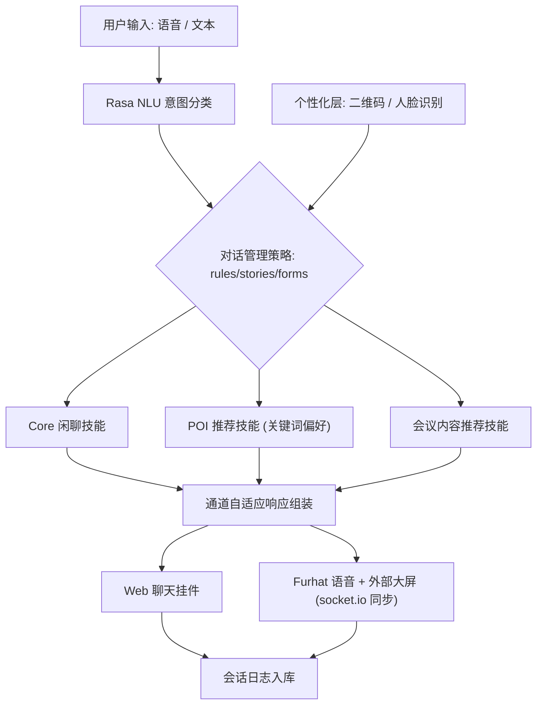

# DAGFiNN: A Conversational Conference Assistant (DAGFiNN：会议对话助手)

- **会议/期刊**: RecSys 2022 (Demo Track, 6 pages)
- **作者与机构**: Ivica Kostric, Krisztian Balog 等 13 人，University of Stavanger (挪威)，由多个学生团队按组件分工完成
- **推荐链路定位**: 端到端对话式交互（对话层 + 规则式候选筛选，无独立精排模型）
- **研究方向**: 对话推荐与智能体仿真 / 多模态推荐
- **论文原文**: [https://arxiv.org/abs/2211.16281v1](https://arxiv.org/abs/2211.16281v1)
- **开源代码**: 文中声明开源于 https://dagfinn.ai （未提供独立 Git 仓库链接，按检测结果记为空）

## TL;DR (1分钟核心速览)

本文是一篇**系统演示论文**而非算法论文：它针对"会议现场信息台"这一真实场景，指出已有 CRS 多局限于"单模态 + 单领域 + 纯文本界面"，提出 DAGFiNN——一个基于开源 Rasa 框架、技能模块化可插拔、同时支持网页聊天与 Furhat 社交机器人（含外部同步大屏）的开源多域多模态对话助手，覆盖 POI 推荐、会议议程推荐、出行问询与闲聊。系统以"多轮关键词偏好启发 + 高分候选筛选"实现个性化，并在 ECIR'22 现场作为数字接待员实测：大部分会话仅持续 **3–6 轮**，Core 闲聊技能触发最多，POI 推荐反馈最为积极。**注意：论文没有任何离线排名指标（无 Recall/NDCG）、没有对比基线、没有用户满意度量表数值**，所谓"评估"仅为现场日志的对话长度与技能触发分布统计。

## Background & Motivation (背景与核心矛盾)

- **主流范式**: 对话推荐（CRS）研究集中于基于问题的偏好启发、多轮推荐策略、NLU/NLG 与用户模拟，绝大多数工作以**纯文本为唯一模态、只覆盖单一领域**，且以离线模拟用户为主要验证方式。
- **前人局限之一（体验层面）**: 真实会议现场的信息台需要同时回答"哪里吃饭""怎么去机场""下一场讲什么"，单领域纯文本系统无法在一个会话内跨域切换，也无法通过地图/屏幕等富媒体传达方位信息。
- **前人局限之二（系统层面）**: 现有开源 CRS 原型（CRSLab、Macaw 为通用框架，VoteGoat、IAI MovieBot 限定电影域）均不支持跨多种用户界面（Web / 实体机器人）的富多模态交互与响应通道自适应。
- **核心洞察 (Key Insight)**: 会议助手的关键难点不在推荐算法精度，而在**"对话能力 + 多域知识 + 个性化记忆 + 多模态呈现"四者的一体化集成**；而工程上可通过"技能模块化 + 通道抽象"使新增领域与新增界面互不干扰。
- **本文切入点**: 用 Rasa 作为对话管理与技能调度的统一后端，把每个领域打包为独立 skill，前端仅负责通道渲染，从而在同一会话状态下同时驱动网页与机器人。

## Method (核心方法设计)

### 1. 整体框架 (Overall Architecture)

系统采用 client–server 架构。服务端以 Rasa 为内核：先做意图分类，再由对话管理策略调用对应技能（Core / POI / Conference Content）生成回复；技能训练数据由 rules、stories、forms 三档复杂度混合构成。客户端有两类：Rasa 自带的 JavaScript 网页聊天挂件，以及用 Kotlin 编写、经 socket.io 连接自定义 connector 的 Furhat 机器人技能；外部大屏复用同一 socket.io 通道，从而与机器人语音对话**状态同步**。个性化层在会话开启前完成身份绑定（扫描胸牌二维码或经授权后的人脸识别），使后续轮次可携带用户身份。回复在生成端即按 channel 定制：Web 端返回文本卡片/链接，机器人端返回语音 + 屏幕富媒体（如地图指路）。整个闭环无离线训练式排序模型，推荐由规则筛选 + 评分阈值决定，推理开销为每轮对候选集合的一次线性扫描。

### 2. 关键设计拆解 (Key Designs)

1. **技能模块化与三态对话数据（可插拔的多域扩展）**：痛点是"加一个新领域就要重训整个对话系统"。DAGFiNN 把每个领域封装为独立 skill，用 rules 覆盖高频确定性意图（问候、日程查询），用 stories 描述多轮路径，用 forms 做槽位填充式偏好收集；新增领域只需注册 intent 与 skill，不改动对话管理主干。这种"规则优先、学习兜底"的分层让系统在 6 页篇幅内即可支撑两域 + 闲聊，代价是泛化能力受限于人工枚举的意图空间。

2. **liked/disliked 关键词对的多轮偏好收敛（轻量偏好启发）**：POI 技能不建立用户向量，而是把偏好表示为两个显式关键词集合（喜欢/不喜欢），每轮据用户话语增删关键词并在候选集上重排。其筛选逻辑可归纳为：
$\hat{s}(i)=\sum_{k\in\mathcal{L}_u} w_k\,\mathbb{I}[k\in\mathcal{K}_i]-\lambda\sum_{k\in\mathcal{D}_u} w_k\,\mathbb{I}[k\in\mathcal{K}_i],\quad i^\star=\arg\max_{i\in\mathcal{C}_{c},\ \text{rating}(i)\ge\tau}\hat{s}(i)$其中$\mathcal{K}_i$为条目$i$的标签集合（类别、价位、菜系等），$\mathcal{C}_c$为当前类目候选，$\tau$为评分门槛。之所以有效：关键词是**可解释、可撤销**的，用户说"其实我不喜欢吵闹的酒吧"即可直接删除一个词，避免了隐式向量在短会话中无法收敛的问题；$\tau$ 保证推荐始终落在"高分条目"子集内，抑制冷门噪声。该式为本笔记对文中规则逻辑的形式化归纳，原文以规则代码实现。

3. **训练目标与推理开销**：系统**不存在推荐侧的损失函数**，唯一被"训练"的是 Rasa 的意图分类器（DIET）与对话策略，目标为标准意图分类交叉熵；推荐环节为免训练的规则打分 + 阈值过滤。负采样、hard negative 等概念在此不适用。在线推理每轮成本为 $O(|\mathcal{C}_c|\cdot|\mathcal{K}_i|)$，无 ANN 索引需求；瓶颈不在算力而在 ASR 延迟与机器人语音合成。

## Experimental Setup & Evaluation Protocol (实验设置与评估协议)

- **数据与知识源**（本文无交互数据集，仅两类条目库）：

| 条目库 | 规模/来源 | 字段 | 场景说明 |
| :--- | :---: | :--- | :--- |
| POI 库 | 从 TripAdvisor 与 Google 抓取后**人工清洗**为手工维护数据库 | 名称、类别（餐厅/酒吧/博物馆/公园）、价位、地址、评分 | 会址周边"去哪吃/去哪逛/怎么去" |
| 会议内容库 | 抓取自会议官网 | 议程、keynote/tutorial/workshop/session、讲者、时间、房间 | "推荐我听哪场""下一场是什么" |

- **数据划分与防穿越**: 不适用。系统无训练/测试划分，全部条目为在线服务时的实时知识库，无所谓"未来交互泄漏"。
- **排名评测协议**: **不存在 Full-Ranking 或 Sampled Ranking**，也无 Recall@K / NDCG@K / MRR。评估退化为**现场部署后的日志统计**：会话长度分布、各技能触发轮次分布，以及非结构化的口头/文字反馈。
- **对比基线与超参设置**: 无任何基线对比、无显著性检验；亦未报告 embedding 维度、学习率等超参（因为不存在排序模型）。可作为对照的仅是同期的 CRSLab / Macaw / VoteGoat / IAI MovieBot 四个开源系统，但论文仅做**定性能力对比**（是否支持多域、是否支持多 UI、是否支持多模态），未做任何数值比较。

### 现场研究（Field Study，替代主实验）

| 观测维度 | 结果 | 说明 |
| :--- | :--- | :--- |
| 部署场景 | ECIR'22 国际会议数字接待员 | 网页 + 现场 Furhat 机器人 |
| 会话长度分布 | 峰值集中在 **3–6 轮** | 短会话为主，长尾存在但稀疏 |
| 技能触发占比 | **Core（问候/告别/闲聊）最高**，其后为 POI、会议内容 | 每段会话几乎都含 Core 意图 |
| 用户反馈 | 整体正面，**POI 推荐尤其受好评** | 为定性描述，未给满意度分数 |
| 典型越界请求 | "去哪游泳""我想看峡湾" | 暴露人工意图覆盖不足 |
| 交互动机偏移 | 部分用户更愿与机器人社交闲聊而非查询信息 | 具身界面改变了使用目的 |

## Key Experimental Results (实验关键数据)

### 1. 主实验对比 (Main Results)

原文**未提供任何带指标的定量对比表**，故此处以"能力矩阵"替代传统主实验表（依据原文第 2 节定性描述整理，非数值结果）：

| 系统 | 多领域 | 多 UI | 富多模态 | 开源 |
| :--- | :---: | :---: | :---: | :---: |
| CRSLab / Macaw（通用框架） | 部分 | 否 | 否 | 是 |
| VoteGoat / IAI MovieBot | 否（限电影） | 否 | 否 | 是 |
| **DAGFiNN（本文）** | **是（POI + 会议 + 闲聊，可插拔）** | **是（Web + Furhat）** | **是（语音 + 屏幕 + 人脸）** | **是** |

### 2. 消融实验 (Ablation Study)

论文**不含消融实验**（组件均为工程模块，无"w/o 模块"重训设定）。可识别的功能性退化路径仅有一条：关闭个性化层（不扫二维码/不作人脸识别）后，系统仍可完成单轮推荐，但跨会话记忆与基于身份的定制回复完全失效——这一依赖性在文中被明确表述为"Knowing the user's identity allows for additional features in the future"，即当前个性化仍是**预留位而非已兑现能力**。

### 3. 关键实验发现 (Key Findings)

1. **短会话是会议场景的硬约束**：会话长度峰值落在 3–6 轮，意味着偏好启发必须在 1–2 轮内收敛；本文用 liked/disliked 关键词对正是为这一预算服务，任何需要 5 轮以上向量式偏好学习的 CRS 方法在该场景下都会被用户提前放弃。
2. **触发频率与信息价值倒挂**：Core 闲聊技能触发最多（因每段会话都含问候/告别），但其信息增量最低；真正承载推荐价值的 POI 与会议技能实际对话预算被显著压缩，说明"意图占比"不能作为技能重要性的代理指标。
3. **具身界面重塑用户目标**：现场观察显示部分用户面对 Furhat 时更倾向社交闲聊而非信息获取，且会提出"去哪游泳""想看峡湾"等库外请求，暴露人工意图枚举的天花板——这是纯文本 CRS 离线评测中完全不可见的失效模式。

## Highlights & Limitations (亮点、对比与审稿批判)

- **与代表作对比 (vs. Prior Work)**: 相比 CRSLab / Macaw 这类"提供算法与数据接口"的通用框架，DAGFiNN 的贡献在于**打通了从对话管理到实体机器人渲染的完整链路**；相比 VoteGoat / IAI MovieBot 的单域纯文本形态，它把"多域技能注册"与"通道自适应响应"抽象成可复用工程范式。但在推荐算法层面，它明显弱于任何一篇基于学习式排序的 CRS 工作——推荐本质是加权关键词过滤 + 评分阈值。
- **可迁移亮点**: (i) "channel-specific response" 设计——同一语义结果按界面能力（文本卡片 vs 语音+大屏）分别渲染，可直接迁移到 App/小程序/车机多端推荐；(ii) 用**显式可撤销关键词集合**做短会话偏好表示，比隐向量更适合 3–6 轮的极短交互预算。
- **审稿级局限批判**: (i) **评估严重不足**：无离线指标、无基线、无样本量与满意度量表，仅给分布图与定性描述，"overwhelmingly positive feedback"缺乏可复核证据，结论强度接近 demo 视频；(ii) **算法天花板与硬件耦合**：推荐完全依赖人工意图与标签枚举，越界请求即失效，且 Furhat + 外部大屏 + 人脸识别（需 GDPR 授权）使复现高度依赖特定硬件与合规流程，跨场景迁移成本被低估。

## Rating (四维评分)

- **方法创新性 (Novelty)**: ⭐⭐⭐ （作为首个开源多域多模态 CRS 系统集成有工程新意，但推荐算法本身是规则化关键词过滤，无理论或谱分析支撑）
- **评估协议与实验扎实度 (Protocol & Experiments)**: ⭐⭐ （无离线排名指标、无基线、无消融、无显著性检验，仅有单次会议现场日志分布与定性反馈）
- **写作与数学规范度 (Clarity & Rigor)**: ⭐⭐⭐⭐ （6 页内把架构、技能、通道与部署讲得干净清楚，图 1–3 与组件职责划分无歧义；代价是全文几乎不含公式与形式化定义）
- **工业落地与复现价值 (Industrial & Practical Value)**: ⭐⭐⭐ （Rasa + socket.io 的模块化技能与通道抽象可直接复用，开源亦加分；但强依赖 Furhat 硬件与人工意图维护，长期运维成本高）

