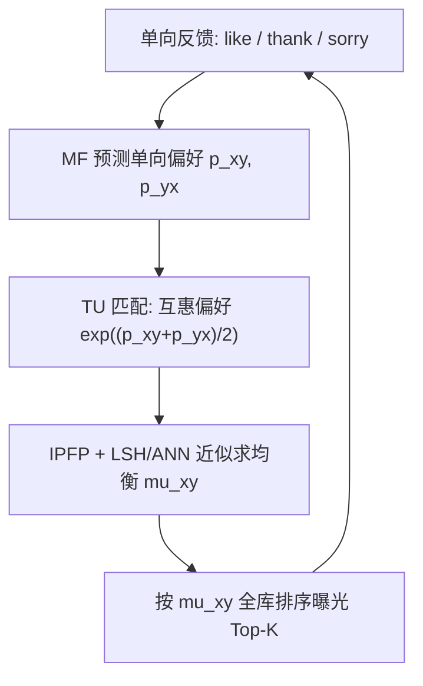
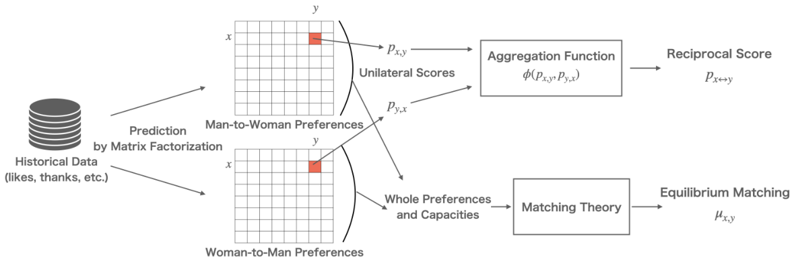

# Matching Theory-based Recommender Systems in Online Dating (在线婚恋中的匹配理论推荐系统)

- **会议/期刊**: RecSys 2022 (Industrial Talk Poster)
- **作者与机构**: Yoji Tomita, Riku Togashi, Daisuke Moriwaki (CyberAgent, Inc.)
- **推荐链路定位**: 召回（双向候选生成与排序）
- **研究方向**: 协同过滤与双塔召回 / 去偏公平、可信隐私与工业架构
- **论文原文**: [https://arxiv.org/abs/2208.11384v1](https://arxiv.org/abs/2208.11384v1)
- **开源代码**: 暂未开源

## TL;DR (1分钟核心速览)

在线婚恋是典型的**互惠推荐 (RRS)**：单向偏好高不代表对方会回应，且热门用户的"承接容量"有限。本文指出传统"单向打分 + 融合函数"范式只建模互惠、不建模容量，导致 like/match 极度向头部集中；作者把 Choo-Siow 可转移效用 (TU) 匹配引入 RRS，在 Gumbel 误差假设下得到"互惠偏好 × 容量因子"的闭式均衡得分，并用 IPFP + LSH/ANN 近似把 $O(|X||Y|(d+T))$ 的全库计算压到可上线水平，已在日本婚恋平台 tapple（700 万+ 注册用户）进入替换融合模块的工程实施阶段。原文为工业演讲海报，**未提供离线基准实验与线上 A/B 数字**。

## Background & Motivation (背景与核心矛盾)

- **主流范式**: 先按标准推荐（内容式或 CF）预测单向偏好 $p_{x,y},p_{y,x}\in[0,1]$，再用聚合函数$\phi$融合出双向分$p_{x\leftrightarrow y}=\phi(p_{x,y},p_{y,x})$，常见$\phi$ 为调和平均、算术/几何平均、交叉比、秩乘逆等。
- **前人局限之一（容量缺失）**: 所有 $\phi$ 都只刻画"互相喜欢程度"，完全忽略用户的**处理容量**。少数 superstar 收到海量 like，无法逐一筛选，整体匹配效率与体验被拖垮。
- **前人局限之二（粒度粗）**: 唯一相关的 Chen et al. (2021) 先按属性把用户切成互斥组、用 OLS 学组级偏好再做 TU 匹配，虽便宜但**同组用户得到完全相同的推荐列表**，丧失个体级匹配。
- **核心洞察 (Key Insight)**: TU 匹配的均衡条件天然同时包含"互惠价值"和"单身选项价值"（即容量），故容量项无需人工设计即从均衡方程中涌现。
- **本文切入点**: 保留 MF 的个体级单向偏好预测，把融合步骤整体替换为 TU 均衡求解，并用近似算法解决千万级用户的 $|X||Y|$ 瓶颈。

## Method (核心方法设计)

### 1. 整体框架 (Overall Architecture)

用户浏览候选卡片并给出 like/nope，被 like 者可回 thank（成匹配）或 sorry（拒绝）。系统用这些单向历史反馈训练 MF 得到 $p_{x,y}$与$p_{y,x}$；随后不再是简单$\phi$融合，而是将全部单向偏好送入 TU 匹配模块，通过 IPFP 迭代求出使男女两侧需求一致的均衡匹配矩阵$\mu$；最终按$\mu_{x,y}$ 对候选全库排序并展示 Top-K。用户新的 like/thank 行为回流为 MF 增量训练样本，形成"打分—均衡—曝光—反馈"闭环。工程上以 LSH/ANN 近似 IPFP 中对全库用户求和的项。

<figure class="paper-figure" markdown="span">
  <figcaption>图2：互惠得分计算的直观说明。细节见第4节。</figcaption>
</figure>

### 2. 关键设计拆解 (Key Designs)

1. **TU 匹配互惠得分（把容量写进打分）**：设转移 $\tau_{x,y}$在匹配时发生，效用$u_{x,y}=p_{x,y}+\epsilon_{x,y}-\tau_{x,y}$、$u_{y,x}=p_{y,x}+\epsilon_{y,x}+\tau_{x,y}$，未匹配效用为$\epsilon_{x,0},\epsilon_{y,0}$。假设误差服从标准 Gumbel，则均衡需求满足
$\mu_{x,y}=\exp\!\left(\frac{p_{x,y}+p_{y,x}}{2}\right)\sqrt{\mu_{x,0}}\sqrt{\mu_{y,0}}$，
配合 $\sum_{y}\mu_{x,y}+\mu_{x,0}=1$与对侧对称约束，均衡可由凸优化唯一求出。直觉：$\exp(\cdot)$项是互惠吸引力，$\sqrt{\mu_{x,0}}\sqrt{\mu_{y,0}}$项是双方"放弃单身"的机会成本，越热门的用户$\mu_{\cdot,0}$ 越小，得分被自动打折，从而抑制头部垄断。
2. **IPFP 闭式迭代（可规模化求解）**：令 $\tilde p_{x\leftrightarrow y}=\exp\!\left(\frac{p_{x,y}+p_{y,x}}{2}\right)$，交替更新两侧单身概率
$\sqrt{\mu_{x,0}}\leftarrow\sqrt{\sqrt{1-\left(\tfrac12\sum_{y}\tilde p_{x\leftrightarrow y}\sqrt{\mu_{y,0}}\right)^{2}}-\tfrac12\sum_{y}\tilde p_{x\leftrightarrow y}\sqrt{\mu_{y,0}}}$，
$\sqrt{\mu_{y,0}}$同理对称更新。该式无需梯度、单调收敛，避免了在$|X|\times|Y|$ 上做通用凸优化。
3. **训练目标、负采样与推理效率**：单向偏好由 MF 在 like/thank 隐式反馈上训练（论文未给出具体损失与负采样细节，属海报省略项）；核心开销在推理侧——直接实现需 $O(|X||Y|(d+T))$（$d$为 MF 维度，$T$为 IPFP 迭代数）并需常驻$|X|\times|Y|$打分矩阵，作为对比 iALS 单步仅$O\big((Nd^{2}+(|X|+|Y|)d^{3})T\big)$，因$N\ll|X|+|Y|$而可负担。作者用 LSH 与 ANN 近似 IPFP 中的全库求和，把单步复杂度降到$O(|X||Y|)$，并免除全矩阵存储。

## Experimental Setup & Evaluation Protocol (实验设置与评估协议)

- **数据集与预处理**: 本文为工业实践海报，**不含公开数据集与离线实验**；载体为日本婚恋平台 tapple（注册用户 700 万+， heterosexual matching 设定），反馈为 like/nope 与 thank/sorry 两级信号。

| 数据/场景 | 规模 | 交互类型 | 稀疏度 | 说明 |
| :--- | :---: | :---: | :---: | :--- |
| tapple 线上平台 | 700 万+ 注册用户 | like / nope / thank / sorry | 未披露 | 男女两侧互惠匹配，每人均有容量上限 |
| 公开基准 | — | — | — | 原文未使用任何公开数据集 |

- **数据划分与防穿越 (Splitting Strategy)**: 原文未报告（海报未涉及离线训练/测试切分）。
- **排名评测协议 (Ranking Protocol)**: 未报告离线 Full-Ranking 或 Sampled Ranking；作者主张采用**线上实验 + 结构估计 (structural estimation)**，并特别指出互惠场景中用户互相影响、**明显违反 SUTVA**，常规 A/B 的设计需重新裁剪。
- **对比基线与超参设置**: 定性对比三类——传统融合式 RRS（多种 $\phi$）、Chen et al. (2021) 的分组 TU 匹配、以及本文 MTRS；Embedding 维度$d$、$T$ 与显著性检验均未披露。

## Key Experimental Results (实验关键数据)

### 1. 主实验对比 (Main Results)

原文无性能数字，下表整理论文给出的**方法性质与可行性对比**（非精度指标）：

| 方法 | 互惠偏好建模 | 容量约束 | 个体级粒度 | 单步复杂度 | 全库打分矩阵 |
| :--- | :---: | :---: | :---: | :---: | :---: |
| 融合式 RRS（harmonic/geometric mean 等） | ✔ | ✘ | ✔ | $O(Nd^{2})$ 级 | 不需要 |
| Chen et al. (2021) 分组 TU + OLS | ✔ | ✔ | ✘（组内同质） | 随组数下降 | 组级矩阵 |
| **MTRS (本文)** | ✔ | ✔ | ✔ | $O(|X||Y|(d+T))$→ 近似$O(|X||Y|)$/步 | 需近似规避 |

### 2. 消融实验 (Ablation Study)

论文未提供消融实验。可形式化理解的"组件消融"仅有：去掉容量项 $\sqrt{\mu_{x,0}}\sqrt{\mu_{y,0}}$即退化为以$\exp\!\big(\frac{p_{x,y}+p_{y,x}}{2}\big)$ 排序的纯互惠融合模型；去掉 MF 个体偏好改用组级 OLS 即退化为 Chen et al. (2021)。

### 3. 关键实验发现 (Key Findings)

1. **容量项的缺失是头部垄断的机制性原因**：融合函数 $\phi$输出的排序与$\mu_{\cdot,0}$无关，热门用户被反复曝光直至无法响应；引入$\sqrt{\mu_{x,0}}\sqrt{\mu_{y,0}}$ 后同一互惠偏好下"越忙的用户得分越低"，从打分层面而非后处理层面缓解 like/match 集中。
2. **粒度与可扩展性存在明确权衡**：分组 TU 把成本压到组级但牺牲个体差异；本文坚持 MF 个体偏好 + 均衡近似，在保持个体级推荐的同时把主导开销从"全库矩阵 + 迭代求解"转为"单步 $O(|X||Y|)$ 的近似求和"。
3. **互惠场景的评估协议本身是未解问题**：由于用户行为相互耦合、SUTVA 失效，作者明确将结构估计与定制化在线实验列为必要后续，这意味着该方向短期内难以用常规离线指标定论。

## Highlights & Limitations (亮点、对比与审稿批判)

- **与代表作对比 (vs. Prior Work)**: 相比 Pizzato et al. / Xia et al. 的融合式 RRS，本文首次把"承接容量"内生进打分而非依赖重排；相比 Chen et al. (2021) 的组级 TU 匹配，本文保留个体级 MF 偏好并以近似算法换取可扩展性；相比标准 CF 召回，本文的输出是**双边均衡匹配概率**而非单边点击概率，目标函数语义不同。
- **可迁移亮点**: ①"互惠分 × 双方单身概率"这一乘性容量折扣可直接迁移到招聘、互助问答、创作者-品牌撮合等双边市场召回；②用 LSH/ANN 近似 IPFP 中全库求和，是均衡类模型上线的通用降复杂度套路。
- **审稿级局限批判**: ①**完全缺失定量评估**——没有离线指标、没有线上 A/B、没有延迟实测，"缓解集中"仅是机制论证而非实证；②复杂度仍含 $|X||Y|$ 项且依赖近似，误差界未分析，热门品类下的 ANN 召回率下降可能扭曲均衡解；③海报回避了 Gumbel 误差与可转移效用（金钱/礼物转移在婚恋场景语义存疑）的建模合理性讨论，也未处理性别比例失衡下的稳定性。

## Rating (四维评分)

- **方法创新性 (Novelty)**: ⭐⭐⭐⭐ （把 TU 匹配的容量机制内生化进互惠打分，闭式均衡解形式优雅，是 RRS 范式的实质性替换而非调参）
- **评估协议与实验扎实度 (Protocol & Experiments)**: ⭐⭐ （无任何离线或线上定量结果，仅给出复杂度与性质对比，SUTVA 问题被提出但未解决）
- **写作与数学规范度 (Clarity & Rigor)**: ⭐⭐⭐⭐ （均衡推导与 IPFP 更新式交代清楚、符号统一，但损失函数、超参与近似误差界均省略）
- **工业落地与复现价值 (Industrial & Practical Value)**: ⭐⭐⭐ （有 700 万用户真实平台与明确上线路径，但无开源代码、无延迟数据，复现需自行补齐 MF 训练与 ANN 近似细节）

