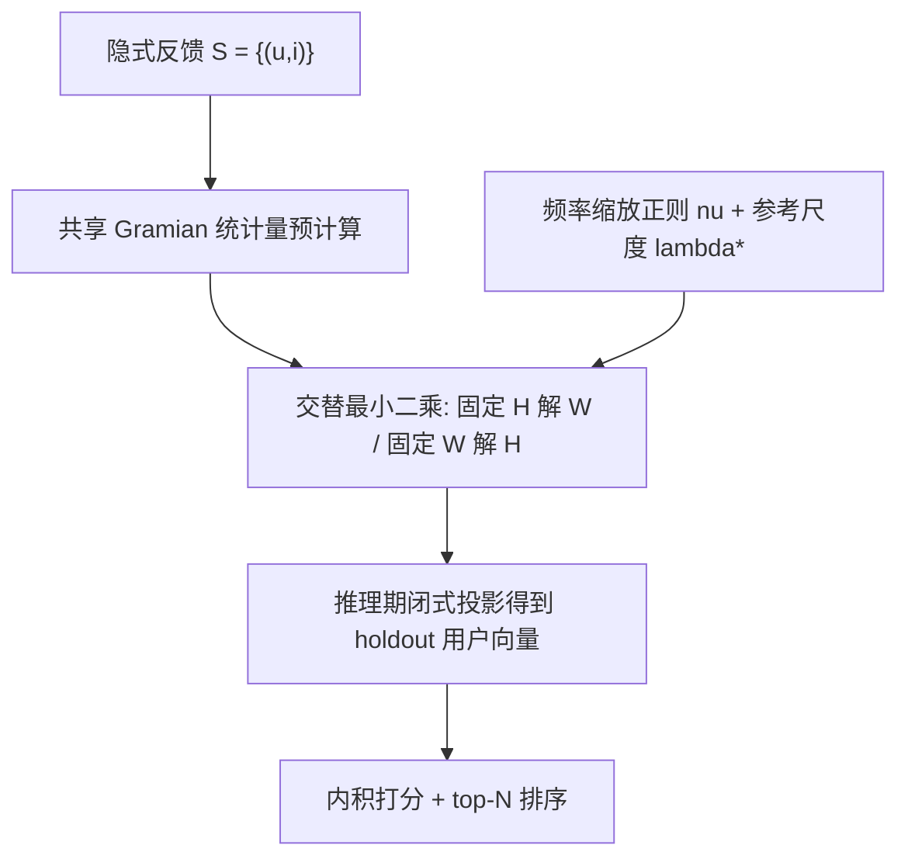

# Revisiting the Performance of iALS on Item Recommendation Benchmarks (重访 iALS 在物品推荐基准上的性能)

- **会议/期刊**: RecSys 2022
- **作者与机构**: Steffen Rendle, Walid Krichene, Li Zhang (Google Research), Yehuda Koren (Google Haifa)
- **推荐链路定位**: 召回（矩阵分解双塔内积检索）
- **研究方向**: 协同过滤与双塔召回 / 工业评测基准与可复现性
- **论文原文**: [arXiv:2110.14037](https://arxiv.org/abs/2110.14037v1)
- **开源代码**: [dawenl/vae_cf](https://github.com/dawenl/vae_cf)（另见文中 google-research/ials）

## TL;DR (1分钟核心速览)

本文反驳「iALS 精度已落后于 VAE/EASE 类模型」这一被多组复现的共识，指出症结在超参调优而非模型本身。作者给出一套可操作配方：频率缩放正则 $\nu$、参考尺度归一化$\lambda^*$、超大嵌入维度与按$1/\sqrt{d}$ 缩放初始化。在 ML20M/MSD 的全库排序和 ML1M/Pinterest 的 1:100 采样排序四个基准上，iALS 相对自身旧报告 Recall@20 提升 **9.7%**（0.360→0.395）与 **46.4%**（0.211→0.309），并在至少一半指标上优于全部已发表方法。

## Background & Motivation (背景与核心矛盾)

- **主流范式**: 隐式反馈 top-N 推荐长期由 Mult-VAE / RecVAE / RaCT 等物品自编码器与 EASE / SLIM 等线性物品相似度模型主导；iALS（WRMF）仅作为「高效但精度平平」的 baseline 被引用。
- **前人局限**: 其一，多个独立课题组（Liang 等、Dacrema 等复现研究）在同一协议下复现出 iALS 的低分（ML20M R@20=0.360、MSD R@20=0.211），并被当成「矩阵分解不如自编码器」的证据；其二，这些工作普遍使用现成的自动超参搜索，而 iALS 的 6 个超参强耦合，自动搜索极易落在次优区域。
- **核心洞察 (Key Insight)**: 作者观察到，iALS 的三项损失 $\mathcal{L}_S$、$\mathcal{L}_I$、$R$的相对量级决定解的质量，而正则项尺度本身随$\nu$漂移，所以同一套搜索网格无法覆盖所有$\nu$ 的“好区域”；此外该模型的正确工作点是**大维度 + 强正则**，而非小维度保守配置。
- **本文切入点**: 不改模型结构，只给出一套「先看损失分量诊断 → 解耦 $\nu$与$\lambda$ → 逐层倍增维度」的人工调参流程，并严格复用他人划分与指标做对照。

## Method (核心方法设计)

### 1. 整体框架 (Overall Architecture)

本文无新网络结构，产出是一套围绕 iALS 的**调参方法论**：输入为用户-物品隐式正样本集 $S$，用共享 Gramian 统计量做交替最小二乘（固定$H$解$W$、反之亦然），正则强度由频率缩放指数$\nu$与参考尺度归一化后的$\lambda^*$共同控制；训练中实时绘制$\mathcal{L}_S/\mathcal{L}_I/R$判断当前参数是否越界；推理阶段对训练期不可见的 holdout 用户，用闭式最小二乘投影直接解出用户向量（视作物品侧 CF 的推理步骤），再对内积做 top-N 排序。整个闭环的关键在于“搜索空间的解耦”（$\nu$与$\lambda$、维度与正则分开调），而非任何新增算子。

### 2. 关键设计拆解 (Key Designs)

1. **频率缩放正则化 (Frequency-Scaled Regularization, $\nu$)**：痛点在于 SGD 的逐样本更新隐含地对高频用户/物品施加更强收缩，而原生 ALS 的正则与频次无关，导致热门侧过拟合。作者引入指数$\nu$ 将其显式化：

$$\mathcal{R}(W,H)=\lambda\Big(\sum_{u\in\mathcal{U}}(|I(u)|+\alpha_0|\mathcal{I}|)^{\nu}\|w_u\|^2+\sum_{i\in\mathcal{I}}(|U(i)|+\alpha_0|\mathcal{U}|)^{\nu}\|h_i\|^2\Big)$$

当 $\nu=0$退化为原生 ALS，$\nu=1$等价于 SGD 的频次加权。直觉是「热门物品需要更强的先验收缩」，实验中最优恒为$\nu=1$，且维度越大其收益越明显——$\nu=0$时质量提前饱和，$\nu=1$ 时继续放大维度仍有增益。

2. **正则参考尺度归一化 ($\lambda^*$) 与维度递增搜索**：痛点在于$\lambda$与$\nu$强耦合，换一次$\nu$就要重搜一整片$\lambda$区域，自动网格搜索因此失效。作者用常数因子把任意$\nu$下的$\lambda$折算到参考尺度$\nu^*$ 上：

$$\lambda=\lambda^{*}\frac{\sum_i(|U(i)|+\alpha_0|\mathcal{U}|)^{\nu^{*}}+\sum_u(|I(u)|+\alpha_0|\mathcal{I}|)^{\nu^{*}}}{\sum_i(|U(i)|+\alpha_0|\mathcal{U}|)^{\nu}+\sum_u(|I(u)|+\alpha_0|\mathcal{I}|)^{\nu}}$$

该变换不引入新自由度、不影响最终解，仅让不同 $\nu$的最优$\lambda^*$落在同一区间，使单次网格搜索即可复用（见图 1）。配套策略是先在$d=128$上粗定$\alpha_0$与$\lambda^*$，再逐次倍增$d$，每轮只微调正则，直到收益饱和。

3. **训练目标、负采样与推理效率**：总损失为 $\mathcal{L}=\sum_{(u,i)\in S}(\hat{y}_{ui}-1)^2+\alpha_0\sum_{u\in\mathcal{U}}\sum_{i\in\mathcal{I}}\hat{y}_{ui}^2+\lambda(\|W\|_F^2+\|H\|_F^2)$，即用**全库伪负样本**（权重$\alpha_0$）替代采样负例，天然免负采样；Gramian 技巧把复杂度降到$O(d^2|S|+d^3(|\mathcal{U}|+|\mathcal{I}|))$，与$|\mathcal{U}||\mathcal{I}|$无关。初始化按$\sigma=\sigma^{*}/\sqrt{d}$缩放（$\sigma^{*}=0.1$）以保持初始预测方差与$d$无关。大维度下采用 block solver（block=128，推理时重复 8 次块更新），ML20M$d=2048$ 单机多线程每 epoch 约 1 分钟。

## Experimental Setup & Evaluation Protocol (实验设置与评估协议)

- **数据集与预处理**: 四个公开基准，未额外做 k-core 过滤，仅沿用原论文的划分：

| 数据集 | #Users | #Items | #Interactions | 稀疏度 | 特征/场景说明 |
| :--- | :---: | :---: | :---: | :---: | :--- |
| ML20M | 136,677 | 20,108 | 10.0M | 99.996% | 电影隐式反馈，物品自编码器基准 |
| MSD | 571,355 | 41,140 | 33.6M | 99.999% | 音乐收听，高秩结构 |
| ML1M | 6,040 | 3,706 | 1.0M | 95.5% | 电影隐式化，NCF 基准 |
| Pinterest | 55,187 | 9,916 | 1.4M | 99.7% | 图像社交兴趣板 |

- **数据划分与防穿越 (Splitting Strategy)**: ML20M/MSD 采用**留出用户划分**——ML20M 的 10,000 名、MSD 的 50,000 名用户整体移出训练集；评测时给每个 holdout 用户 80% 历史作为输入、剩余 20% 作为目标，训练集不含这些用户任何交互（严格防穿越，用户向量靠闭式投影在推理期生成）。ML1M/Pinterest 采用 **Leave-One-Out**（每人留最后一个正样本）。
- **排名评测协议 (Ranking Protocol)**: ML20M/MSD 为**无偏 Full-Ranking**（对全库未交互物品排序，指标 Recall@20/50、NDCG@100）；ML1M/Pinterest 为**采样排序**，每例 1 正 + 100 随机负（1:100），指标 HR@10、NDCG@10。所有质量数字重复 10 次取均值。
- **对比基线与超参设置**: 基线含 Mult-VAE、Mult-DAE、CDAE、RecVAE、H+Vamp(Gated)、RaCT、EASE、SLIM、LambdaNet、WARP、NeuMF、eALS、SGD-MF、Popularity。iALS 超参（均 $\nu=1,\sigma^*=0.1$）：ML20M$d=2048,\lambda=0.003,\alpha_0=0.1,T=16$；MSD$d=8192,\lambda=0.002,\alpha_0=0.02,T=16$；ML1M$d=192,\lambda=0.007,\alpha_0=0.3,T=12$；Pinterest$d=192,\lambda=0.02,\alpha_0=0.007,T=16$（后两者为与 NCF 公平对齐而限制维度）。

## Key Experimental Results (实验关键数据)

### 1. 主实验对比 (Main Results)

全库排序基准（ML20M / MSD，加粗为该列最优）：

| 方法 | ML20M R@20 | ML20M R@50 | ML20M N@100 | MSD R@20 | MSD R@50 | MSD N@100 |
| :--- | :---: | :---: | :---: | :---: | :---: | :---: |
| RecVAE | **0.414** | **0.553** | 0.442 | 0.276 | 0.374 | 0.326 |
| H+Vamp (Gated) | 0.413 | 0.551 | **0.445** | — | — | — |
| EASE | 0.391 | 0.521 | 0.420 | **0.333** | **0.428** | **0.389** |
| Mult-VAE | 0.395 | 0.537 | 0.426 | 0.266 | 0.364 | 0.316 |
| Mult-DAE | 0.387 | 0.524 | 0.419 | 0.266 | 0.363 | 0.313 |
| SLIM | 0.370 | 0.495 | 0.401 | — | — | — |
| **iALS (本文)** | 0.395 | 0.532 | 0.425 | 0.309 | 0.415 | 0.368 |
| iALS (旧报告) | 0.360 | 0.498 | 0.386 | 0.211 | 0.312 | 0.257 |
| Improv. (vs 旧 iALS) | **+9.7%** | **+6.8%** | **+10.1%** | **+46.4%** | **+33.0%** | **+43.2%** |

采样排序基准（1 正 : 100 负）：

| 方法 | ML1M HR@10 | ML1M N@10 | Pinterest HR@10 | Pinterest N@10 |
| :--- | :---: | :---: | :---: | :---: |
| **iALS (本文)** | **0.730** | **0.453** | **0.892** | 0.577 |
| NeuMF | 0.730 | 0.447 | 0.877 | 0.552 |
| SGD-MF | 0.729 | 0.452 | 0.890 | **0.579** |
| Mult-DAE | 0.722 | 0.446 | 0.886 | 0.580 |
| EASE | 0.719 | 0.449 | 0.868 | 0.560 |
| SLIM | 0.716 | 0.447 | 0.868 | 0.560 |
| iALS (旧报告) | 0.711 | 0.438 | 0.876 | 0.559 |
| eALS | 0.704 | 0.435 | 0.871 | 0.538 |

### 2. 消融/超参敏感性 (Hyperparameter Study)

原文无标准模块消融，作者用维度扫描与正则变体做等价归因：

| 配置 | ML20M R@20 | MSD R@20 | 说明 |
| :--- | :---: | :---: | :--- |
| iALS + 旧调参（基线） | 0.360 | 0.211 | 前人多组复现值 |
| $\nu=0$（无频率缩放正则） | 与旧值同量级 | 同量级 | 维度增大后质量提前饱和 |
| $\nu=1$+$\lambda^*$ 归一化 | 0.395 | 0.309 | 大维度下仍持续增益 |
| 小维度 $d=64$/$d=256$ | >0.360 | >0.211 | 仅靠调参即超越旧报告 |
| $d=512$/$d=1024$ | 超 EASE (0.391) | 超 Mult-VAE (0.266) | 容量开始兑现 |
| 最大维度 $d=2048$/$d=8192$ | **0.395** | **0.309** | 最终配置，MSD 在 4096 后趋饱和 |
| MSD $d=8192$ 仅 4 epoch | — | 0.305 | 收敛极快，长训收益边际 |

### 3. 关键实验发现 (Key Findings)

- **调参收益 > 建模收益**：在完全相同的划分与指标下，仅靠超参配方就把 ML20M/MSD 的 Recall@20 从 0.360/0.211 抬到 0.395/0.309（+9.7%/+46.4%），后者甚至超过 ML20M 上被引为 SOTA 的 Mult-VAE 同分水平，说明此前“矩阵分解衰退”的结论是评测伪影。
- **维度是最被低估的超参**：MSD 上 $d$从 256 增至 8192 使 R@20 从「仅超旧 iALS」升至 0.309，逼近 EASE 的 0.333；ML20M 在$d\ge1024$ 后饱和。作者据此推断 MSD 数据本身近似高秩，小维度必然欠拟合，这也解释了旧工作为何在该集上差距最大（0.211 vs 0.333）。
- **$\nu=1$与$\lambda^*$归一化是“解锁大维度”的前提**：$\nu=0$时质量随维度提前饱和，$\nu=1$时继续倍增维度仍有增益；同时$\lambda^*$归一化让跨$\nu$ 的网格搜索从 6 维耦合退化为一维扫描，是复现性提升的工程关键。

## Highlights & Limitations (亮点、对比与审稿批判)

- **与代表作对比 (vs. Prior Work)**: 与 Mult-VAE/RecVAE 类工作相比，本文不引入任何新网络，而是证明同一目标（平方损失）在正确调参下即可匹敌甚至反超生成式模型；与 EASE 相比，二者共享平方损失，但 iALS 在 ML1M/Pinterest 上全面胜出、在 MSD 上仅次之，且模型规模线性于物品数（EASE 为 $|\mathcal{I}|^2$ 稠密矩阵）；与 Dacrema 等的复现研究相比，本文给出的不是“质疑”，而是可直接落地的调参指导。
- **可迁移亮点**: ① $\sigma=\sigma^*/\sqrt{d}$的初始化缩放，使表征方差与维度解耦，可迁移到任意大维度双塔模型；② 用$\mathcal{L}_S/\mathcal{L}_I/R$ 三项量级是否同阶来诊断隐式反馈训练是否越界，比只看验证指标更早暴露问题。
- **审稿级局限批判**: ① 结论完全建立在人工逐层调参上，缺少可自动化的替代方案，对工业级大规模超参空间的适用性存疑；② 全部评测为离线指标，未给出线上收益或时延—质量权衡，且 ML1M/Pinterest 的 1:100 采样排序已被作者自己在 KDD'20 指出与真实 top-N 不一致；③ 大维度带来模型体积与内存膨胀（MSD $d=8192$ 即约 3.4 亿参数），原文未讨论部署成本。

## Rating (四维评分)

- **方法创新性 (Novelty)**: ⭐⭐⭐ （无新模型，核心增量是频率缩放正则的指数化推广与 $\lambda$ 参考尺度归一化，属“工程洞察型”贡献，但确实揭示了大维度+强正则这一反直觉工作点）
- **评估协议与实验扎实度 (Protocol & Experiments)**: ⭐⭐⭐⭐ （四个公开基准、10 次重复取均值、严格复用他人划分且不通融 holdout 用户；但缺显著性检验，采样排序协议的局限由作者自认）
- **写作与数学规范度 (Clarity & Rigor)**: ⭐⭐⭐⭐⭐ （损失三分量拆解清晰，$\nu$与$\lambda^*$ 的耦合/解耦关系有公式与图示双重佐证，调参流程可直接复现）
- **工业落地与复现价值 (Industrial & Practical Value)**: ⭐⭐⭐⭐ （Gramian 免采样、$O(d^2|S|)$ 复杂度、闭式用户投影与线性模型规模极具工程价值；扣分项是依赖人工调参与大维度内存开销）

