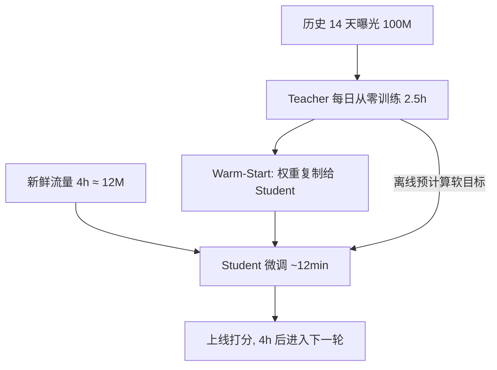
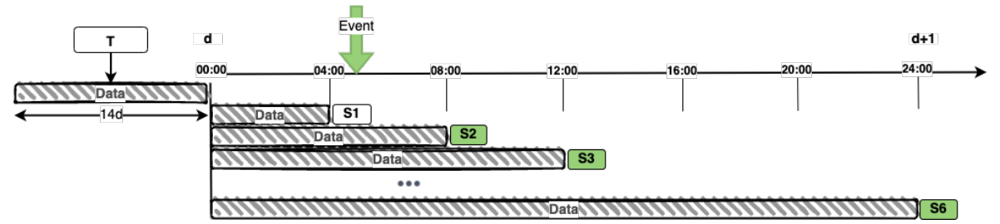
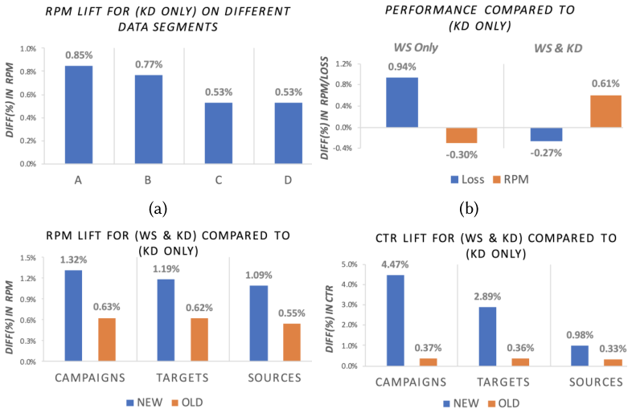

# An Incremental Learning framework for Large-scale CTR Prediction (面向大规模 CTR 预估的增量学习框架)

- **会议/期刊**: RecSys 2022 (Sixteenth ACM Conference on Recommender Systems, Seattle)
- **作者与机构**: Petros Katsileros, Nikiforos Mandilaras, Dimitrios Mallis, Vassilis Pitsikalis, Stavros Theodorakis (DeepLab, Greece), Gil Chamiel (Taboola, Israel)
- **推荐链路定位**: 精排 (CTR 预估) 的模型训练/部署范式
- **研究方向**: CTR/CVR 预估与特征交叉 / 去偏公平、可信隐私与工业架构
- **论文原文**: [https://arxiv.org/abs/2209.00458v1](https://arxiv.org/abs/2209.00458v1)
- **开源代码**: 暂未开源

## TL;DR (1分钟核心速览)

针对工业 CTR 模型"每天从零训练数小时、无法跟上新趋势"的痛点，本文提出 Warm-Start（沿用已部署模型权重初始化）+ 同尺寸 teacher-student 知识蒸馏（防灾难性遗忘）的增量学习框架：学生只在最近数小时的新鲜样本（约 12M）上微调。训练耗时 12.5 分钟 vs. 教师 2.5 小时，即 12.5× 提速；在 Taboola 生产流量 4 个主要数据段、约 6 个月 A/B 中 RPM 相对提升 0.53%–0.85%，完整框架相对 KD-only 基线再提升 0.61% RPM，新引入 item 上 CTR 与 RPM 同升。

## Background & Motivation (背景与核心矛盾)

- **主流范式**: 超参数化 DNN 在两周历史曝光数据（约 100M 样本）上从零训练，每个模型需 2–3 小时；Taboola 每天按语言/类目/出版商等切分训练上百个模型。
- **前人局限**: ① 训练—上线延迟使模型"陈旧"，季节性与新 item/新事件带来的分布漂移无法被历史数据覆盖，预测精度随延迟显著衰减；② 上百模型全量重训的算力成本与部署节奏（每日一次）被锁死，无法做到小时级迭代。
- **核心洞察 (Key Insight)**: 瓶颈不在"训得更久"，而在"初始点更优 + 旧知识可被压缩进少量新样本的训练过程"。KD 在本文不是模型压缩手段（teacher 与 student 同尺寸），而是充当**隐式正则项**：让学生在被新数据拉偏时仍匹配教师的软目标，从而保留旧分布知识。
- **本文切入点**: Warm-Start 保证"快"，teacher-student 蒸馏保证"不忘"，两者叠加使小时级新鲜数据微调成为可能。

## Method (核心方法设计)

### 1. 整体框架 (Overall Architecture)

Teacher 每天在 14 天历史数据（约 100M 曝光）上从零训练一次，作为"知识锚点"；随后以 4 小时为周期（每天 6 轮）产出学生：学生权重直接从当前 teacher 复制（Warm-Start），仅用最近 4 小时流入的约 12M 新鲜样本做 fine-tune，同时以教师软目标作为辅助监督。由于软目标在数据预处理阶段离线预计算，在线训练开销几乎为零。新学生不回灌历史数据、不做多轮全量迭代，训练约 12 分钟即可上线，从而在一次热点事件出现数小时内即被捕捉（图 1）。

<figure class="paper-figure" markdown="span">
  <figcaption>图1. 所提出框架的示意图。单个教师模型（T）通过Warm-Start和KD对多个学生模型（S1-S6）进行初始化与正则化。我们的框架支持新模型的快速部署。注意，新事件（绿色箭头标记）可在仅数小时后从后续学生模型中快速捕获。</figcaption>
</figure>

### 2. 关键设计拆解 (Key Designs)

1. **Warm-Start：把"训练起点"而非"训练数据"作为知识载体**：全量重训的代价来自随机初始化后需大量迭代重建特征统计。做法是 $\theta_S^{(0)} \leftarrow \theta_T$，让 embedding 与稠密层直接继承已收敛的表示；只有因新 item 新增、teacher 中不存在的类别 embedding 行无法映射，才以随机初始化从零学习（这是框架唯一的冷启动口子）。直觉上，初始化越接近最优点，fine-tune 所需步数与所需样本量同步下降，这正是 12.5× 加速的来源。

2. **同尺寸 Teacher-Student 蒸馏：用软目标对抗灾难性遗忘**：仅 Warm-Start + 新鲜数据微调会把参数推离旧分布（学生只见过 4 小时数据），产生 RPM regret。本文沿用 Hinton 式 KD 但去掉"压缩"目的，teacher/student 同宽，损失为

$$\mathcal{L}_{S}=\mathcal{L}_{CE}\left(y,\hat{y}_{S}\right)+\alpha \cdot \mathcal{L}_{CE}\left(\hat{y}_{T}^{(T)},\hat{y}_{S}\right),\quad \hat{y}_{T}^{(T)}=\mathrm{softmax}\left(\mathbf{z}_{T}/T\right)$$

其中 $\alpha$控制旧知识约束强度、$T$ 为温度（软化教师分布，暴露类间相对概率）。关键差异在于：原始 KD 假设 teacher/student 同分布，而此处教师代表"过去 14 天"、学生代表"最近 4 小时"，软目标因此起到跨时间分布的正则/蒸馏作用，把旧分布信息以相对概率形式注入新模型。

3. **训练目标、负采样与推理效率**：总损失即上式（CTR 二分类交叉熵，样本级负样本即未点击曝光，无额外负采样设计）；教师软目标离线预算，学生端只做一次前向 + 一次反向，单轮约 12 分钟 / 12M 样本；推理阶段学生与普通 CTR 模型完全相同，无额外参数、无额外延迟（同尺寸保证线上打分成本不变）。

## Experimental Setup & Evaluation Protocol (实验设置与评估协议)

- **数据集与预处理**: 本文为工业系统论文，**不使用公开离线数据集**，全部评测在 Taboola 生产流量上以在线 A/B 完成；训练语料为曝光日志（14 天约 100M / 新鲜 4 小时约 12M）。由于无公开数据，`5-core` 等过滤与稀疏度统计未报告：

| 数据来源 | 规模 | 时间窗 | 用途 |
| :--- | :---: | :---: | :--- |
| 历史曝光日志 | ≈100M | 14 天 | Teacher 从零训练 |
| 新鲜曝光日志 | ≈12M（随时段递增） | 4 小时 | Student 微调 |
| 线上流量切分 | 4 个主要业务数据段 | ≈6 个月 + ≈2 个月 | A/B 指标评测 |

- **数据划分与防穿越 (Splitting Strategy)**: 采用**全局时间戳切分**——学生只用训练时刻之前数小时的数据，教师用此前 14 天，天然避免未来信息泄漏；无随机比例划分。
- **排名评测协议 (Ranking Protocol)**: 非排序类离线评测，而是**线上流量随机分桶 A/B**，指标为业务级 RPM（Revenue Per Mille）、CTR 与 Log-Loss，按"新 item / 旧 item"、"新 campaign / 新 source"分桶统计。未报告 AUC/GAUC 等离线排序指标，也未给出置信区间或显著性检验。
- **对比基线与超参设置**: 基线为 ① 生产基线（no WS, no KD，全量从零训练）；② KD-only（从零训练 + 蒸馏，随后成为默认生产配置）；③ WS-only（热启动 + 新鲜数据微调，无蒸馏）。温度 $T$与权重$\alpha$ 的具体取值未在论文中披露。

## Key Experimental Results (实验关键数据)

### 1. 主实验对比 (Main Results)

原文以图 2(a)(b) 呈现 lift 曲线，未给逐段数值表；下表汇总文中明确给出的区间与单点数值（相对各自基线）：

| 配置 | 训练样本 | 训练耗时 | 部署频率 | RPM 变化 | Log-Loss |
| :--- | :---: | :---: | :---: | :---: | :---: |
| 生产基线 (no WS/KD) | 100M / 14 天 | ≈2.5 h | 每日 1 次 | — | — |
| KD-only（从零 + 蒸馏） | 100M / 14 天 | ≈2.5 h | 每日 1 次 | **+0.53% ~ +0.85%**（4 段一致） | 下降 |
| WS-only（热启动微调） | ≈12M / 4 h | ≈12 min | 6 次/天 | **负向（RPM regret）** | **上升** |
| **WS & KD（本文完整）** | ≈12M / 4 h | ≈12 min | 6 次/天 | **+0.61%**（≈2 个月 A/B，vs. KD-only） | 下降 |

（加速比：2.5 h → 12 min，约 **12.5×**；新内容侧的 RPM/CTR 提升见原文图 2(c)(d)，仅以曲线呈现，未给具体百分点。）

<figure class="paper-figure" markdown="span">
  <figcaption>图2. 所提出框架的评估。(a) 在四个主要数据段上，（仅KD）相对于（无WS或KD）基线的RPM提升；(b) 我们完整的增量学习流程（WS &amp; KD）与简单微调变体（仅WS）的性能比较；(c,d) （WS &amp; KD）在“新”和“旧”内容上的RPM和CTR提升。</figcaption>
</figure>

### 2. 消融实验 (Ablation Study)

| 消融配置 | 旧知识保持 | RPM | Log-Loss | 新 item CTR |
| :--- | :--- | :---: | :---: | :---: |
| no WS, no KD（全量重训） | 完整 | 基线 | 基线 | 基线 |
| WS-only | 部分丢失（仅靠初始化） | ↓（regret） | ↑ | 未见增益 |
| KD-only | 完整（但模型陈旧） | ↑ 0.53%–0.85% | ↓ | 有限 |
| **WS & KD** | 完整且新鲜 | **↑ 0.61%**（vs. KD-only） | **最低** | **显著↑** |

### 3. 关键实验发现 (Key Findings)

1. **Warm-Start 单独使用是负收益**：WS-only 在 RPM 上出现 regret、Log-Loss 上升，说明"用 4 小时数据微调一个已收敛模型"若无软目标约束，等价于在分布漂移下过拟合新鲜流量、冲刷旧知识；这直接证明本文收益并非来自"少训练"，而是来自"初始化 + 蒸馏"的组合。
2. **蒸馏本身即有效，与新鲜度正交**：KD-only 仍在 14 天全量数据上从零训练，却在四个主要业务段稳定取得 +0.53%–0.85% RPM，说明同尺寸 soft-target 正则在大规模稀疏特征 CTR 场景自带泛化收益；叠加 WS 后再取 +0.61%（vs. KD-only），两部分增益可叠加。
3. **新鲜度收益集中在新内容长尾上**：在"新 item / 新 campaign / 新 source"分桶上，WS & KD 的 RPM 与 CTR 双双领先 KD-only，验证 4 小时级迭代的核心价值在于新兴趋势的即时捕捉，而非对成熟头部流量的进一步拟合。

## Highlights & Limitations (亮点、对比与审稿批判)

- **与代表作对比 (vs. Prior Work)**: ① 与 Hinton KD 相比，本文放弃"大教师→小学生"的压缩设定，改为同尺寸、跨时间分布的教师，把蒸馏从压缩工具转为**抗遗忘正则**；② 与 iCaRL/LwF 等增量学习工作相比，本文不做 exemplar replay（不回放历史样本），仅靠初始化 + 软目标，因而更适合百模型/天的大规模流式工业场景；③ 与常规"更长历史窗口重训"的工业 CTR 实践相比，本文把成本从"数据维度"（100M→12M，8×）与"时间维度"（2.5h→12min）同时压缩。
- **可迁移亮点**: ① 教师软目标**离线预计算**并随数据管道下发，使蒸馏在训练侧近乎零成本，这是让 KD 能挂进小时级流水线的关键工程技巧；② 对增量出现的新类别只用"新增 embedding 行随机初始化、其余全继承"的差分式热启动，可直接迁移到任何带大稀疏 embedding 表的召回/精排模型。
- **审稿级局限批判**: ① 评估完全依赖线上 A/B，缺少离线复现协议、无公开数据、无显著性检验与置信区间，且 4 段 RPM lift 仅以曲线呈现（0.53%–0.85% 为文字区间），可复现性弱；② 关键超参（温度 $T$、蒸馏权重$\alpha$、4 小时窗口长度）敏感性未做分析，也未讨论教师—学生同尺寸带来的训练内存开销与"教师自身漂移"风险；③ 未与 replay-based 增量学习或周期性全量重训的混合策略对比，缺少收益/成本帕累托视角。

## Rating (四维评分)

- **方法创新性 (Novelty)**: ⭐⭐ （Warm-Start 与 KD 均为成熟技术，"同尺寸教师 + 跨时间软目标抗遗忘"属组合式工程创新，理论刻画与谱分析缺失）
- **评估协议与实验扎实度 (Protocol & Experiments)**: ⭐⭐⭐ （约 6 个月 + 2 个月的线上 A/B、4 个业务段、新/旧内容分桶较有说服力，但无离线基准、无显著性检验、数值披露不完整）
- **写作与数学规范度 (Clarity & Rigor)**: ⭐⭐⭐ （5 页短文结构清晰、损失定义与流水线时序交代到位，但超参、软目标温度与工程细节大量留白）
- **工业落地与复现价值 (Industrial & Practical Value)**: ⭐⭐⭐⭐⭐ （已作为 Taboola 默认生产配置全量上线，12.5× 提速与 0.61% RPM 增益经真实流量验证，离线软目标预计算的工程范式极易被广告/内容推荐系统复用）

