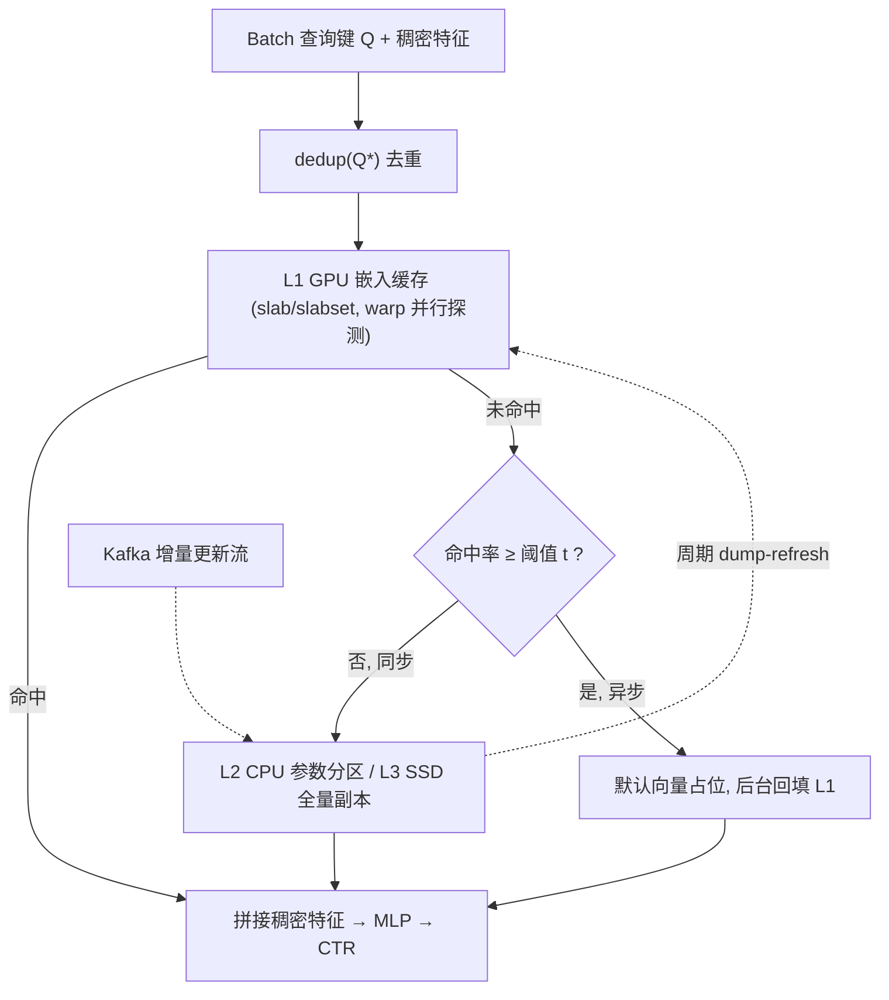

# A GPU-specialized Inference Parameter Server for Large-Scale Deep Recommendation Models (面向大规模深度推荐模型的 GPU 专用推理参数服务器)

- **会议/期刊**: RecSys 2022 (16th ACM Conference on Recommender Systems)
- **作者与机构**: Yingcan Wei, Matthias Langer, Fan Yu, Minseok Lee, Kingsley Liu, Jerry Shi, Joey Wang（NVIDIA）
- **推荐链路定位**: 在线推理服务（精排 DLRM 的 Embedding Lookup 端到端）
- **研究方向**: 工业级全链路架构 / CTR 预估与特征交叉
- **论文原文**: [https://arxiv.org/abs/2210.08804v1](https://arxiv.org/abs/2210.08804v1)
- **开源代码**: [triton-inference-server/hugectr_backend](https://github.com/triton-inference-server/hugectr_backend)（另有 [server](https://github.com/triton-inference-server/server)）

## TL;DR (1分钟核心速览)

现代 DLRM 的嵌入表动辄数十 GB 至 TB 级，远超单卡显存，工业界普遍把 Embedding Lookup 甩给 CPU 参数服务器，于是 CPU↔GPU 带宽成为在线推理唯一瓶颈、GPU 算力大量空转。本文提出 HugeCTR 层次化参数服务器 HPS：利用嵌入键访问的幂律局部性，在 GPU 内构建 warp 对齐的动态嵌入缓存，并以 CPU 内存（并行哈希 / Redis）与本地 SSD（RocksDB）作二级、三级兜底。在 Criteo 1TB 与 650 GB 合成集上，端到端吞吐相对 PyTorch CPU 基线加速 5–62×（随 batch 增大），8 卡 8 实例并发再获 7.2× QPS 提升。

## Background & Motivation (背景与核心矛盾)

- **主流范式**: DLRM 把稀疏 ID 特征经嵌入表 $T_j=\langle K_j,E_j\rangle$查表成$d$ 维稠密向量，与稠密特征拼接后送入 MLP/Transformer 预测 CTR；训练侧已有成熟的分布式 GPU 参数服务器。
- **前人局限 1**: 在线推理 batch 很小但嵌入表极大，显存装不下，于是现有服务框架把查表整体搬到 CPU，只把稠密层留在 GPU——GPU 显存带宽优势被彻底放弃，CPU-GPU 总线成了主瓶颈，且 GPU 侧资源闲置。
- **前人局限 2**: 在线训练要求"分钟级"增量更新，全量参数下发会带来部署延迟与一致性、带宽压力；高可用还要求每个服务实例都留一份完整模型副本，成本被放大。
- **核心洞察 (Key Insight)**: 真实推荐数据集的键访问近似服从幂律 $p(x)\propto x^{-\alpha}$（Criteo 实测$\alpha\approx1.2$，合成集中约 95% 的查表只落在 10% 的嵌入上），键空间可分为 frequent / stochastic / rare 三类，其中"高频集"往往只有几千条——把这一小撮热嵌入常驻 GPU 就足以让 GPU 参与查表。
- **本文切入点**: 不做模型压缩、不重训网络，而是用"GPU 缓存 + 层次化存储 + 异步刷新"的系统设计把幂律局部性直接兑现为延迟收益。

## Method (核心方法设计)

### 1. 整体框架 (Overall Architecture)

一次推理请求到达后，HPS 先对 batch 内的查询键做去重 $Q^*=\mathrm{dedup}(Q)$（批量拼样本后重复键极多），再把$Q^*$哈希映射进 GPU 嵌入缓存（L1）并行查表；未命中的键写入 missing 队列，依据当前命中率与阈值$t$ 的关系决定"同步阻塞拉取"还是"异步懒插入"，缺失向量先以可配置默认值占位。缺失键依次回落到 CPU 内存参数分区（L2，并行哈希或 Redis 集群）与本地 SSD 的 RocksDB 全量副本（L3）。查回的向量异步回填 L1，同时 L2 按访问时间戳做淘汰。在线训练侧通过 Kafka 消息队列把增量更新推给各推理节点，节点按周期 dump 现有缓存键、回查 L2/L3、再整批下载刷新 L1。

### 2. 关键设计拆解 (Key Designs)

1. **Warp 对齐的 GPU 嵌入缓存数据模型**：GPU 缓存若按普通哈希表实现，线性探测会引发严重分支与访存发散，吞吐被拖垮。HPS 用三层结构 slot / slab / slabset：32 个 slot 组成一个 slab（正好对应一个 warp 的 32 个 lane，一线程一槽），若干 slab 打包成 slabset（N-way 组相联）。键先经 $s=\mathrm{slabsetHasher}(q)\boldsymbol{o}d|S|$定位组，再用$n_0=\mathrm{slabHasher}(q)\boldsymbol{o}d|s|$选择组内起始 slab 做线性探测，命中则用 shuffle/ballot 做寄存器级 warp 内通信来判定位置，避免分支。组大小在 Ampere 上经验取 2（过大增延迟、过小增冲突）；每个 slabset 仅授予单个 warp 排他锁，天然线程安全，且 slabset 数量（百万级）远多于 warp 数（千级），锁竞争可忽略。淘汰策略为 LRU：$\text{slot}\leftarrow\arg\min_{u\in s}\text{counter}_u$，命中即刷新计数器为全局迭代号$g$。
2. **命中率阈值驱动的同步/异步双模插入**：若每次 miss 都同步回源，在线服务会被 I/O 抖动击穿。HPS 先算 $\text{hitRate}=1-|ws_{\text{missing}}|/N$（$N$为缓存总容量），当$\text{hitRate}<t$时同步回源并插入（仅出现在预热期或模型刷新后），当$\text{hitRate}\ge t$ 时立即返回用户可配置的默认嵌入、把真实向量入队后台插入——这正是"用极小精度损失换稳定尾延迟"的工程折中，实测命中率 >0.9 时预测精度曲线与同步模式几乎重合。
3. **在线更新与缓存刷新链路（训练→推理最终一致）**：训练节点把每个 epoch 的增量按嵌入表切分写入 Kafka；推理节点按 VDB 分区订阅（节点故障时订阅可漂移），后台惰性消费以保证有序且最终一致，并允许限速以压住对在线推理的冲击。GPU 缓存不直接吃 Kafka 流（会造成不可预测的 GPU 负载尖峰），而是周期性 dump 键 → 回查 L2/L3 → 整批 H2D 刷新，实测 40 GB 缓存刷新仅 200 ms、持续带宽约 199 GB/s，dump 开销 1.19 ms 可忽略。全流程无需停机，等价于线上"持续训练—持续生效"。稀疏索引项的回源复杂度是摊销 $O(1)$，单键成本由显存带宽而非总线带宽决定，这是相对 CPU PS 的根本性差异。

## Experimental Setup & Evaluation Protocol (实验设置与评估协议)

- **数据集与预处理**: 本文为系统论文，评测对象是"已训练好的模型 + 其嵌入表"，不在数据集上做 5-core 过滤或排序评测。

| 数据集 | #Users/#Items | 嵌入表规模 | 特征维度 | 场景说明 |
| :--- | :---: | :---: | :---: | :--- |
| Criteo 1TB (公开) | — (特征级) | ~90 GB | 13 dense + 26 sparse, $d=128$ | 广告点击日志，工业级稀疏度 |
| MovieLens (公开) | — (特征级) | ~20 MB | 3 sparse（含 1 个 multi-hot） | 小表、验证低延迟场景 |
| Synthetic A (合成) | — | 650 GB | 幂律 $\alpha=1.2$ | 95% 查表命中 10% 键，模拟 Criteo 放大版 |
| Synthetic B (合成) | — | 81 GB | 9 dense + 130 sparse | 类别特征远多于 Criteo，模拟稠密层重负载 |

- **数据划分与防穿越**: 不适用（无训练/测试划分）；评测关注 **warm-up 阶段**（缓存逐步填满）与 **stable 阶段**（命中率饱和）两段曲线，避免用冷启动瞬时延迟掩盖稳态表现。
- **排名评测协议**: 不适用。替代协议为 Triton `perf_analyzer` 压测的 **端到端平均每 batch 延迟（µs/ms）**、**吞吐（samples/s）**、**QPS（batches/s）**，辅以 **缓存命中率** 与 **CTR 预测精度 ("correct"/total)**。
- **对比基线与超参**: 主基线为 PyTorch CPU（嵌入表与稠密层均在 CPU）与 TensorFlow GPU 方案（模型 15.6 GB）；硬件为 DGX A100（2×EPYC 7742、2 TB 内存、8×A100 80 GB、NVSwitch、CX6 IB）。默认配置：GPU 缓存占比 0.5（Criteo）/0.05（合成 A）、命中率阈值 0.8、每卡 1 实例、VDB 16 分区；batch 从 32 扫到 131,072。

## Key Experimental Results (实验关键数据)

### 1. 主实验对比 (Main Results)

| 系统 / 配置 | Batch=2,048 吞吐 | 峰值吞吐 | 相对 PyTorch CPU | 说明 |
| :--- | :---: | :---: | :---: | :--- |
| PyTorch CPU（Criteo 90 GB） | 0.2 M samples/s（饱和） | 0.2 M | 1× | CPU 全量驻留，GPU 闲置 |
| TensorFlow GPU（15.6 GB 模型） | 1.43 M | — | — | 仅小表可入显存 |
| **HPS（Criteo 1TB）** | **~3.36 M** | **6.4 M**（bs=131k） | **5×–62×** | 62× 见 bs=131,072，5× 见小 batch |
| **HPS vs TF-GPU** | **2.35×** | — | — | 同 batch 下吞吐优势 |
| **HPS 8 实例 / 8 GPU** | — | — | **QPS 7.2×** | 单卡 4 实例后 QPS 反降（资源争用） |
| HPS on MovieLens | 延迟 **<1 ms** | 命中率 ~98.5% | — | T4/A30/A100 均满足 |

### 2. 消融实验 (Ablation Study)

| 配置变体 | 关键指标 | 结论 |
| :--- | :--- | :--- |
| GPU 缓存占比 5% vs 1%（合成 A） | 命中率 76% vs 70%，平均延迟仅 +5% | 层次兜底可吸收缓存缩水 |
| 输入局部性放大（amplified, 5% 缓存） | 命中率 →100%，延迟比合成 A **低 23%** | 幂律强度直接决定收益上限 |
| 阈值 $t=0$（全异步）/ 0.5 / 1.0（全同步） | 异步预热即稳；同步预热期延迟显著抬高；0.5 兼顾 | 阈值是延迟-命中率调节旋钮 |
| 10% EC + 45% Redis vs 20% EC + 40% Redis | 前者吞吐更高 | L2 扩容可替代 L1 扩容 |
| 5% EC+20% Redis → +5% CPU 内存（合成 A） | 477 k → **591 k** samples/s（**1.24×**） | 模型越大，层次架构收益越明显 |
| 仅 RocksDB(PDB) 作二级 vs 加 Redis(VDB) | 插入带宽 52.1 vs 162.0 MB/s @10 GB | SSD 只作兜底、不可当热缓存 |

### 3. 关键实验发现 (Key Findings)

1. **收益与 batch 强正相关**：小 batch 下加速约 5×（受限于 launch 与固定开销），batch 推到 131,072 时达 62×、6.4 M samples/s，说明 HPS 真正兑现的是"GPU 显存带宽"而非"GPU 算力"，大 batch 才能摊薄查表 H2D 与核函数开销。
2. **缓存只占 5% 显存即可拿到 70% 命中率、延迟仅比 1%→5% 多 5% 的边际差异极小**，但命中率跨过 90% 后延迟再降 23%，并且命中率 >0.9 时异步插入的预测精度与同步模式几乎重合——量化了"默认向量占位"的精度代价可忽略这一关键工程假设。
3. **层次存储的边际收益随模型膨胀而放大**：合成 A 上仅增加 5% CPU 内存就换来 1.24× 端到端吞吐，而 40 GB GPU 缓存整批刷新只需 200 ms（~199 GB/s），使在线更新对推理性能的扰动可忽略，这是纯 CPU PS 方案无法复现的伸缩曲线。

## Highlights & Limitations (亮点、对比与审稿批判)

- **与代表作对比 (vs. Prior Work)**: 相比传统 CPU 参数服务器（以及 PyTorch/TF-Serving 的 "GPU 只跑稠密层" 拆分式部署），HPS 首次把 **warp 级 GPU 缓存** 做成参数服务器的一级存储；相比通用 GPU 数据库/OLTP 加速工作，它专门针对推荐键访问的幂律分布设计组相联与 LRU 语义，并对"部分参数驻留 GPU"这一特有的一致性问题给出了异步刷新方案。
- **可迁移亮点**: (1) "32 slot = 1 warp = 1 slab" 的显存数据布局 + 寄存器级 ballot/shuffle 判定，可迁移到任何 GPU 侧的 ANN/ID 特征查表（如双塔召回在线打分、序列特征 KV 取数）；(2) 命中率阈值切换同步/异步回源的双模策略，是把"尾延迟 SLA"写进缓存系统的通用范式。
- **审稿级局限批判**: (1) 收益完全建立在幂律局部性假设上，对**新物品/新用户密集的冷启动流量**或长尾突发（热搜式漂移）缺少分桶实验，命中率崩塌时的降级路径只靠 PDB 回源，最坏延迟未量化；(2) 缺少与 EmbeddingBag/量化压缩、GPU 直连存储（GPUDirect Storage）、NVLink 远端显存池等替代方案的对比，且 Triton/T4/A30/A100 之外的硬件与多租户干扰未评估，泛化性证据偏弱。

## Rating (四维评分)

- **方法创新性 (Novelty)**: ⭐⭐⭐⭐ （把幂律局部性转化为 warp 组相联缓存 + 三级层次存储的系统级原创设计，非算法新意但工程洞察扎实）
- **评估协议与实验扎实度 (Protocol & Experiments)**: ⭐⭐⭐⭐ （4 个数据集 × 多 batch × 单/多卡 × 3 种 GPU 的压测很完整，阈值/cache 比例/存储组合敏感性齐备；但无真实线上 A/B 与冷启动流量分桶，属系统压测而非推荐效果评测）
- **写作与数学规范度 (Clarity & Rigor)**: ⭐⭐⭐⭐ （层次架构、四个缓存 API 伪代码与刷新时序标注清晰；符号偏描述性、缺少延迟/命中率的解析建模与复杂度推导）
- **工业落地与复现价值 (Industrial & Practical Value)**: ⭐⭐⭐⭐⭐ （NVIDIA Merlin/HugeCTR 组件已开源并挂载 Triton backend，200 ms 刷新 40 GB 缓存的数字直接可用于线上容量规划）

