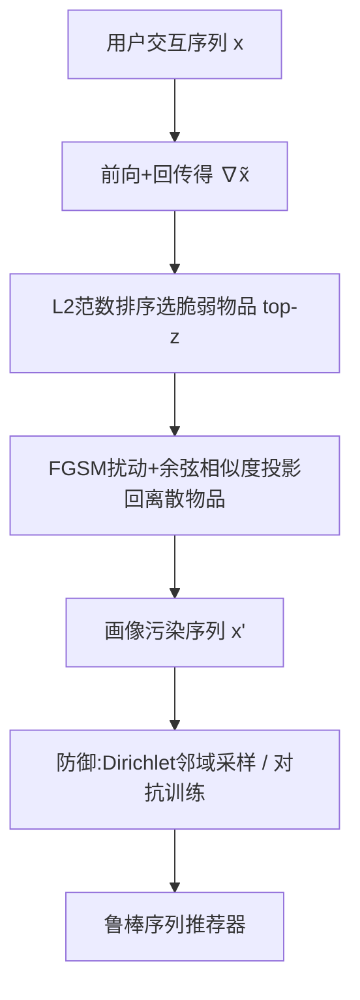
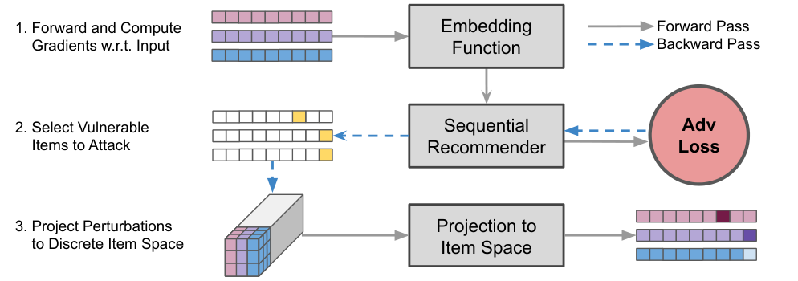

# Defending Substitution-Based Profile Pollution Attacks on Sequential Recommenders（防御序列推荐器上的替换式画像污染攻击）

- **会议/期刊**: RecSys 2022
- **作者与机构**: Zhenrui Yue, Huimin Zeng, Ziyi Kou, Lanyu Shang, Dong Wang (University of Illinois Urbana-Champaign)
- **推荐链路定位**: 召回 / 输入序列层（用户画像污染）
- **研究方向**: 去偏公平可信隐私与工业架构 / 序列推荐
- **论文原文**: [https://arxiv.org/abs/2207.11237v1](https://arxiv.org/abs/2207.11237v1)
- **开源代码**: [https://github.com/Yueeeeeeee/RecSys-Substitution-Defense](https://github.com/Yueeeeeeee/RecSys-Substitution-Defense)

## TL;DR (1分钟核心速览)

序列推荐器易受**替换式画像污染**攻击：攻击者仅替换用户历史中少量物品（受 Hamming 与余弦相似约束），即可在 untargeted 场景令 NDCG@10 暴跌超 50%、在 targeted 场景令目标物品曝光翻倍。本文先给出梯度引导的替换攻击算法（梯度重要性选靶 + FGSM 扰动 + 离散投影），再提出 **Dirichlet 邻域采样** 与 **混合表征对抗训练** 两种防御：在 5 数据集 × 4 模型上，前者将攻击引起的 NDCG@10 波动平均压低 28.5%，后者达 34.4%，且不损干净性能。

## Background & Motivation (背景与核心矛盾)

- **主流范式**: RNN/Transformer 序列推荐（NARM、SASRec、BERT4Rec、Locker）以用户交互序列为输入，建模兴趣演化并预测下一物品。
- **前人局限**: ① 现有画像污染攻击多为协同过滤场景设计，"注入"式（insert）扰动无法直接搬运至序列输入；② 序列推荐与 NLP 词替换攻击同构，但物品空间巨大且**无同义词**，NLP 的迭代同义词搜索效率不可接受；③ 之前工作几乎不讨论针对 profile pollution 的**防御**。
- **核心洞察 (Key Insight)**: 攻击者只需沿模型梯度方向、在约束邻域内替换**梯度范数最大**的少量物品，即可最大程度误导模型；反之，若训练时让模型见过"凸包内随机组合"与"最坏线性组合"的物品表征，就能显著收窄误分类区域。
- **本文切入点**: 用梯度引导的替换攻击先证明序列推荐器的脆弱，再用邻域随机增广（Dirichlet）与最坏情况对抗训练双管齐下提升鲁棒性。

## Method (核心方法设计)

### 1. 整体框架 (Overall Architecture)

攻击分三步闭环：对干净序列前向传播并按对抗损失回传梯度 → 以梯度 L2 范数排序选出至多 $z$个脆弱物品 → 依据扰动后嵌入的余弦相似度约束，把连续扰动投影回离散物品空间得到污染序列$\boldsymbol{x}'$。防御端在训练阶段替换部分输入物品：Dirichlet 采样在**多跳邻域凸包**内随机生成增强嵌入，混合表征对抗训练则用 one-hot 编码 + 梯度上升搜索**最坏线性组合**，使模型在含扰动的虚拟序列上优化。两者均在训练时完成、推理零额外开销。

<figure class="paper-figure" markdown="span">
  <figcaption>图1. 所提出的画像污染攻击。我们首先对干净输入序列进行前向传播，并基于对抗损失计算关于输入的梯度。然后，计算重要性分数以选择输入序列中的易受攻击物品。最后一步，基于余弦相似度将所选物品的连续扰动投影到离散物品空间。</figcaption>
</figure>

### 2. 关键设计拆解 (Key Designs)

1. **梯度引导替换攻击 (Delta: 把注入攻击推广到全序列替换)**：物品空间大且无同义词，穷举不可行。针对 untargeted/targeted 分别最大化/最小化交叉熵，并在 Hamming≤$z$、CosSim≥$\tau$约束下，用 FGSM 在嵌入空间施加$-\text{sign}(\nabla)$ 扰动后投影回物品；物理直觉是沿梯度最陡方向找"最近的可替换攻击物品"。
$\boldsymbol{x}'=\arg\max_{\boldsymbol{x}}\mathcal{L}(\boldsymbol{f}(\boldsymbol{x}),y)\ \text{s.t.}\ (\text{Hamming}(\boldsymbol{x},\boldsymbol{x}')\le z,\ \text{CosSim}(x_i,x_i')\ge\tau).$2. **Dirichlet 邻域采样 (Delta: 用凸包+Dirichlet 替代"无同义词"问题)**：序列推荐的物品缺少天然同义词。先按余弦相似度连边构造 1-hop 邻居并扩展 2-hop 邻域，得到每个物品的凸包采样空间；再从 Dirichlet 分布采样权重$\boldsymbol{\eta}_i$构造增强嵌入。$\alpha$控制采样偏向顶点（小$\alpha$）或凸包中心（大$\alpha$），使模型在各种局部扰动下都见到近似样本。
$\boldsymbol{f}_e(\boldsymbol{\eta}_i)=\sum_{j=1}^{|\mathcal{C}_i|}\eta_{i,j}\,\boldsymbol{f}_e(c_{i,j}),\quad \boldsymbol{\eta}_i\sim\text{Dirichlet}(\alpha_1,\dots,\alpha_{|\mathcal{C}_i|}).$3. **混合表征对抗训练 (Delta: 从随机采样到最坏情况搜索)**：Dirichlet 采样不针对最坏情况。将物品以 one-hot$\boldsymbol{\eta}_i\in\mathbb{R}^{|\mathcal{I}|}$ 表示，对其做梯度上升直接搜索最坏线性组合，再裁剪非负并归一化到概率单纯形：
$\boldsymbol{\eta}_i\leftarrow\frac{\text{Clip}_{[0,\infty]}\!\left(\boldsymbol{\eta}_i+\epsilon\,\nabla_{\boldsymbol{\eta}_i}\mathcal{L}(\boldsymbol{f}_m(\tilde{\boldsymbol{x}}),y)/\|\nabla_{\boldsymbol{\eta}_i}\mathcal{L}\|,0,1\right)}{\text{Sum}(\cdot)}.$
其价值在于把鲁棒性从"局部邻域"外推到"更大凸包"，从而进一步压缩误分类区域。

4. **训练目标、负采样与推理开销**：整体为 min-max 目标 $\min_{\boldsymbol{f}}\mathbb{E}_{(\boldsymbol{x},y)\sim\mathcal{X}}[\max_{\boldsymbol{x}'}\mathcal{L}(\boldsymbol{f}(\boldsymbol{x}'),y)]$；攻击与防御均在训练内完成，推理阶段与原始序列推荐器相同、无额外延迟。训练采样沿用 SASRec/BERT4Rec 的 1:100 采样负例协议。

## Experimental Setup & Evaluation Protocol (实验设置与评估协议)

- **数据集与预处理**（全部 `5-core` 过滤，按 [30,36] 预处理）：

| 数据集 | #Users | #Items | 平均序列长度 | 稀疏度 | 场景 |
| :--- | :---: | :---: | :---: | :---: | :--- |
| Beauty | 22,363 | 12,101 | 9 | 99.9% | 稀疏电商 |
| ML-1M | 6,040 | 3,416 | 165 | 95.2% | 稠密电影 |
| ML-20M | 138,493 | 18,345 | 144 | 99.2% | 大规模电影 |
| LastFM | 988 | 57,638 | 9,739 | 83.1% | 超长音乐序列 |
| Steam | 334,289 | 12,012 | 13 | 99.9% | 游戏 |

- **数据划分与防穿越**: 采用 `Leave-One-Out`，每条序列最后两个物品分别做验证/测试，其余为训练。
- **排名评测协议**: 沿用 [15,30] 的 sampled ranking（1 正例 + 100 负例采样排序），指标 `NDCG@10` 与 `Recall@10`；targeted 攻击在流行度分层中各取 15 个目标物品取平均。
- **对比基线与超参**: 攻击基线为 SimAlter（同约束下的近邻替换）；推荐器为 NARM、SASRec、BERT4Rec、Locker；嵌入维度按原论文；攻击 $z=2$（ML-1M）/$z=1$（其余），$\tau=0.5$，防御替换比例$p=0.5$，对抗训练步长$\epsilon\in[0.01,1.0]$、每迭代 3 次上升。

## Key Experimental Results (实验关键数据)

### 1. 主实验对比 (Main Results)

**攻击有效性**（以 SASRec 为代表性模型，N@10；U 越低越好，T 越高越好）：

| Dataset | Clean N@10 | SimAlter-U↓ | Ours-U↓ | SimAlter-T↑ | Ours-T↑ |
| :--- | :---: | :---: | :---: | :---: | :---: |
| Beauty | 0.325 | 0.320 | **0.185** | 0.184 | **0.187** |
| ML-1M | 0.546 | 0.545 | **0.144** | 0.109 | **0.236** |
| ML-20M | 0.762 | 0.760 | **0.640** | 0.124 | **0.139** |
| LastFM | 0.679 | 0.680 | **0.589** | 0.145 | **0.191** |
| Steam | 0.599 | 0.591 | **0.407** | 0.161 | **0.179** |

在 ML-1M 上 untargeted 攻击使 N@10 由 0.546 降至 0.144（降幅 73.6%），targeted 攻击将目标物品 NDCG 由 0.109 抬升至 0.236（相对 SimAlter +116%）。

### 2. 消融实验 (防御方法对比，SASRec，ΔN@10)

| Dataset | Before-U Δ | Dirichlet-U Δ | AdvTrain-U Δ | Before-T Δ | Dirichlet-T Δ | AdvTrain-T Δ |
| :--- | :---: | :---: | :---: | :---: | :---: | :---: |
| Beauty | -0.140 | -0.127 | **-0.093** | 0.115 | 0.089 | **0.061** |
| ML-1M | -0.402 | -0.299 | **-0.228** | 0.144 | 0.097 | **0.080** |
| ML-20M | -0.122 | -0.091 | **-0.067** | 0.035 | 0.023 | **0.021** |
| LastFM | -0.090 | -0.038 | **-0.031** | 0.088 | **0.027** | 0.041 |
| Steam | -0.192 | -0.122 | **-0.120** | 0.086 | **0.044** | 0.050 |

Δ 绝对值为 0 表示完全免疫攻击；表中"Before"即无防御基线，Dirichlet/AdvTrain 为两种防御。

### 3. 关键实验发现 (Key Findings)

- **攻击极其廉价且致命**：仅替换 1–2 个物品即可造成超 50% 性能崩塌（ML-1M SASRec 降 73.6%）；稠密数据集（LastFM）天然更稳健，untargeted 仅降 9.5%，稀疏 Beauty 却降 37.5%。
- **防御规律清晰**：AdvTrain 在 40 个场景中 30 个最优，untargeted 平均降幅 34.4%、Dirichlet 28.5%；但 targeted 下 LastFM/Steam 上 Dirichlet 反超（0.027/0.044 vs 0.041/0.050），说明随机邻域采样对"目标放大"更有效。
- **流行度与架构是鲁棒性分水岭**：热门物品最脆弱（攻击前 ΔN@10=0.182）也最难防御（降幅仅 27.0%，中/尾部为 58.2%/73.8%）；Locker（masked training）在 untargeted 下平均 Δ 仅 27.4%，优于 NARM 的 33.6%，说明全局注意力 + autoencoding 有助于鲁棒。

## Highlights & Limitations (亮点、对比与审稿批判)

- **与代表作对比 (vs. Prior Work)**: 相较 SimAlter（近邻替换、无全序列约束优化）与 NLP 同义词攻击（依赖外部同义词库），本文首次把梯度引导的替换攻击用于序列推荐召回输入，并首次给出针对性防御；相较标准对抗训练（随机扰动），混合表征对抗训练显式搜索最坏线性组合，鲁棒性外推更强。
- **可迁移亮点**: ① "凸包 + Dirichlet"邻域增广是无需同义词的通用增强范式，可迁移到模态缺失或冷启动物品表征；② one-hot 混合表征 + 梯度上升的最坏情况搜索，可迁移到任何 embedding lookup 类推荐模型做鲁棒训练。
- **审稿级局限批判**: ① 攻击/防御均在**白盒**假设下评测，真实场景模型不可及，攻击可得性被高估；② Dirichlet 的 $\alpha$取值与多跳邻域构造依赖经验（$k=10$ 更新），超参敏感且无敏感性分析；③ 对抗训练每迭代多次前/回传，训练开销明显高于采样法，论文未给出训练耗时对比。

## Rating (四维评分)

- **方法创新性 (Novelty)**: ⭐⭐⭐⭐ （首个面向序列推荐召回输入的替换式污染攻击+防御对，Dirichlet 邻域采样与混合表征对抗训练机制新颖且有几何直觉支撑）
- **评估协议与实验扎实度 (Protocol & Experiments)**: ⭐⭐⭐⭐ （5 数据集 × 4 架构覆盖稀疏/稠密/长序列，攻击与防御双表完整，流行度分层分析到位，但白盒假设与缺失显著性检验略减分）
- **写作与数学规范度 (Clarity & Rigor)**: ⭐⭐⭐⭐ （攻击三步算法、Dirichlet 采样与对抗训练公式推导清晰，符号统一，min-max 目标定义规范）
- **工业落地与复现价值 (Industrial & Practical Value)**: ⭐⭐⭐⭐ （代码开源，防御仅训练期开销、推理零延迟，可直接接入现有序列推荐训练管线；白盒假设限制真实部署，需先解决黑盒迁移）

