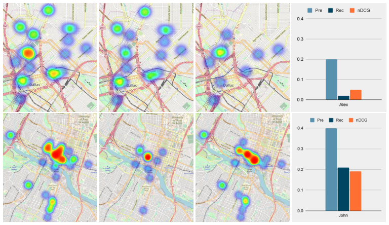
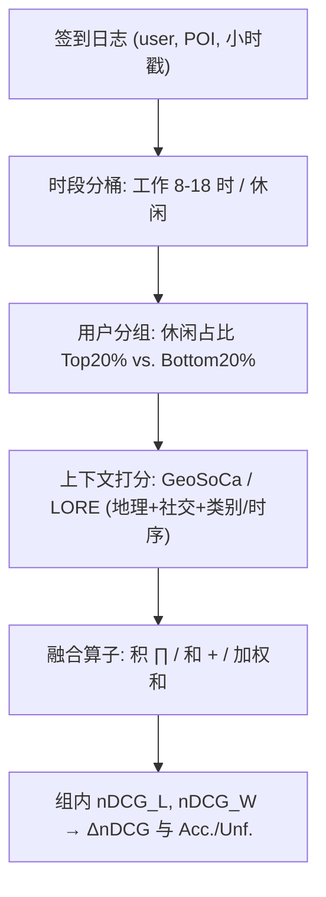
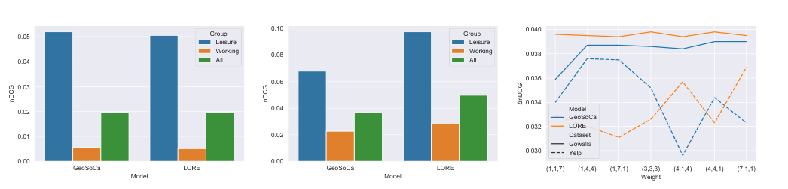

# Exploring the Impact of Temporal Bias in Point-of-Interest Recommendation (探究兴趣点推荐中的时间偏差影响)

- **会议/期刊**: RecSys 2022（Short Paper, 9 页）
- **作者与机构**: Hossein A. Rahmani (UCL)、Mohammadmehdi Naghiaei (USC)、Ali Tourani (Univ. of Luxembourg)、Yashar Deldjoo (Polytechnic Univ. of Bari)
- **推荐链路定位**: 精排 / 排序打分（上下文感知 POI 打分函数）
- **研究方向**: 去偏公平与可信推荐 / 时空轨迹与 POI 推荐
- **论文原文**: [https://arxiv.org/abs/2207.11609v1](https://arxiv.org/abs/2207.11609v1)
- **开源代码**: [https://github.com/rahmanidashti/ContextsFair](https://github.com/rahmanidashti/ContextsFair)

## TL;DR (1分钟核心速览)

本文指出 POI 推荐中一个被忽视的**域内公平维度——时间偏差**：用户的签到时段（8:00–18:00 工作时段 vs. 其余休闲时段）分布高度不均，而主流上下文感知模型（GeoSoCa、LORE）对此系统性偏向。作者按休闲签到比例把用户切为前后 20% 两组，在 Gowalla/Yelp 上以逐用户 7:2:1 时间切分 + 全库未交互排序评测，发现休闲组 nDCG@10 达 0.0679，工作组仅 0.0226（ΔnDCG=0.0453，约 3 倍质量差）；改用和式或加权和融合可将 ΔnDCG 相对降低 14.8%–42.6%。

## Background & Motivation (背景与核心矛盾)

- **主流范式**: POI 推荐普遍把地理、社交、类别、时序等上下文因子以**乘积规则**融合成单一打分 $F^G_{up}\cdot F^S_{up}\cdot F^C_{up}$（GeoSoCa）或$F^K_{up}\cdot F^U_{up}\cdot F^T_{up}$（LORE），并以整体 nDCG/Pre/Rec 作为唯一验收标准。
- **前人局限**: ①现有公平性研究几乎只用人口属性（性别、年龄）或交互量（活跃度、流行度）划分群体，属于“通用公平”，无法刻画 POI 场景特有的**时空行为差异**；②乘积融合对任一因子接近 0 的样本产生“连乘塌缩”，使时序偏好弱的群体被打分压制，而整体指标掩盖了该差异。
- **核心洞察 (Key Insight)**: 签到时刻分布严重右偏（集中于午后与傍晚）；用户画像越大，工作时段签到比例越高、休闲时段比例越低（负相关），说明时序偏好并非噪声而是稳定的用户属性。图 1 给出强动机：Alex 与 John 签到量（891 vs. 938）几乎相同，但前者集中于工作时段，二者获得的推荐质量截然相反。
- **本文切入点**: 不做新模型，而是构造**时间敏感的用户分组 + 组间 ΔnDCG 公平度量**，并把融合算子本身当作可调的去偏杠杆（积 → 和/加权和）。

<figure class="paper-figure" markdown="span">
  <figcaption>图1. Gowalla数据集中两个典型用户的时空活动中心。Alex与John的签到次数相同，但签到模式不同，获得的推荐质量也存在差异。</figcaption>
</figure>

## Method (核心方法设计)

### 1. 整体框架 (Overall Architecture)

本文是一篇**诊断式（diagnostic）研究**：先从原始签到日志中抽取小时戳，按 $[8{:}00,18{:}00)$ 划为工作时段、其余为休闲时段；再以每用户休闲签到占比排序，取头部 20% 为 leisure-focused、尾部 20% 为 working-focused（Gowalla 各 1,125 人，两组签到量 273,610 vs. 246,373、平均流行度 0.552 vs. 0.535、活跃度 242.99 vs. 218.80，**属性几乎同分布，仅时序行为不同**，从而排除“活跃度混杂”解释）。随后在两组上分别跑 GeoSoCa/LORE 的打分排序，计算组内 nDCG 与组间差，最后通过替换融合算子（积/和/加权和）扫描“精度—公平”权衡曲线。

### 2. 关键设计拆解 (Key Designs)

1. **域内时间公平度量（ΔnDCG）**：痛点是整体 nDCG 无法暴露组间落差。定义为 $\Delta\text{nDCG}=\text{nDCG}_{L}-\text{nDCG}_{W}$（$L$休闲组、$W$工作组），并配一个“性价比”指标$\text{Acc./Unf.}=\text{nDCG}_{\text{all}}/\Delta\text{nDCG}$。其直觉是：单看 ΔnDCG 会奖励“把所有人一起做差”的模型，除以整体精度后才能真正区分“既准又均”的方案。

2. **多项式回归上下文融合（把融合算子参数化）**：痛点在于乘积规则是**硬约束的极端特例**，不可调。作者将三种上下文 $c_1,c_2,c_3$ 统一写成
$\text{POIRec}(u,p)=\lambda_1c_1+\lambda_2c_2+\lambda_3c_3+\lambda_{12}c_1c_2+\lambda_{13}c_1c_3+\lambda_{23}c_2c_3+\lambda_{123}c_1c_2c_3$其中积规则对应$\lambda_{123}=1$、其余$\lambda=0$；和规则对应$\lambda_1=\lambda_2=\lambda_3=1$、其余为 0；加权和则学习$\lambda$ 以同时优化精度与公平。物理直觉：加法把弱因子“抬起来”，避免乘积对稀疏/弱时序偏好用户的二次惩罚。

3. **训练目标、负采样与推理开销**：本文**无训练损失、无负采样**（GeoSoCa/LORE 为基于概率/相似度的非参数打分器），推理为对全库未交互 POI 逐一打分排序，开销与候选数线性相关；加权和版本仅额外引入 3 个全局标量，在线成本可忽略。

## Experimental Setup & Evaluation Protocol (实验设置与评估协议)

- **数据集与预处理**: Gowalla 剔除签到 < 15 的冷用户与访问 < 10 的 POI；Yelp 剔除访问 < 10 的用户与 POI。

| 数据集 | #Users | #Items(POI) | #Interactions | 稀疏度/密度 | 特征/场景说明 |
| :--- | :---: | :---: | :---: | :---: | :--- |
| Gowalla | 5,628 | 31,803 | 620,683 (378,968 unique) | 0.0034 | 含 46,001 社交边，无类别 |
| Yelp | 7,135 | 16,621 | 1,137,521 (285,608 unique) | 0.0095 | 46,778 社交边，595 类别，10 个都市圈 |

- **数据划分与防穿越 (Splitting Strategy)**: **逐用户时序切分**——最早 70% 签到作训练、最近 20% 作测试、中间 10% 作验证，杜绝未来信息泄漏；两组的划分独立进行，保证组内评测不共享正样本。
- **排名评测协议 (Ranking Protocol)**: **Full-Ranking**（对全部未交互 POI 打分排序，无负采样）；指标 Pre@N、Rec@N、nDCG@N，$N\in\{10,20\}$，公平指标 ΔnDCG 与 Acc./Unf.。
- **对比基线与超参设置**: 2 个高引用上下文感知 SOTA——GeoSoCa（地理+社交+类别）与 LORE（地理+社交+时序），各配 3 种融合规则（$\prod$、$+$、加权和），加权和采用**全局共享**权重$\lambda$，在$(1,1,7)\to(7,1,1)$ 网格上扫描；未报告显著性检验。

## Key Experimental Results (实验关键数据)

### 1. 主实验对比 (Main Results)

Gowalla / Yelp，nDCG@10（$L$休闲组、$W$ 工作组），粗体为同模型内 ΔnDCG 最优：

| 数据集 | 模型 | 融合 | nDCG@10 | nDCG$_L$| nDCG$_W$ | ΔnDCG↓ | %Δ | Acc./Unf.↑ |
| :--- | :--- | :---: | :---: | :---: | :---: | :---: | :---: | :---: |
| Gowalla | GeoSoCa | $\prod$ | 0.0368 | 0.0679 | 0.0226 | 0.0453 | — | 0.8123 |
| Gowalla | GeoSoCa | $+$ | 0.0354 | 0.0610 | 0.0224 | 0.0386 | 14.79 | 0.9170 |
| Gowalla | GeoSoCa | 加权和 | 0.0339 | 0.0579 | 0.0220 | **0.0359** | **20.75** | **0.9442** |
| Gowalla | LORE | $\prod$ | 0.0498 | 0.0973 | 0.0287 | 0.0686 | — | 0.7259 |
| Gowalla | LORE | $+$ | 0.0363 | 0.0624 | 0.0226 | 0.0398 | 41.98 | 0.9120 |
| Gowalla | LORE | 加权和 | 0.0373 | 0.0632 | 0.0238 | **0.0394** | **42.56** | **0.9467** |
| Yelp | GeoSoCa | $\prod$ | 0.0196 | 0.0519 | 0.0056 | 0.0463 | — | 0.4233 |
| Yelp | GeoSoCa | $+$ | 0.0173 | 0.0422 | 0.0070 | 0.0352 | 23.97 | 0.4914 |
| Yelp | GeoSoCa | 加权和 | 0.0157 | 0.0367 | 0.0071 | **0.0296** | **36.06** | **0.5304** |
| Yelp | LORE | $\prod$ | 0.0196 | 0.0505 | 0.0051 | 0.0454 | — | 0.4317 |
| Yelp | LORE | $+$ | 0.0169 | 0.0395 | 0.0069 | 0.0326 | 28.19 | 0.5184 |
| Yelp | LORE | 加权和 | 0.0159 | 0.0377 | 0.0066 | **0.0311** | **31.49** | 0.5112 |

<figure class="paper-figure" markdown="span">
  <figcaption>图3. 上下文感知推荐的不公平性分析。图3a和图3b展示了不同用户组间的nDCG@10值，图3c展示了融合权重对休闲用户组与工作用户组nDCG@10差异的影响。</figcaption>
</figure>

### 2. 消融实验 (Ablation Study)

以“融合算子”作为唯一变量（其它上下文因子与打分流程不变），量化公平增益与精度代价（nDCG@10）：

| 移除/替换 | 数据集 | 精度 $\Delta$(nDCG) | 公平$\Delta$(ΔnDCG) | 净效果 (Acc./Unf.) |
| :--- | :--- | :---: | :---: | :---: |
| $\prod\to+$(GeoSoCa) | Gowalla |$-$3.8% |$-$14.8% | 0.8123 → 0.9170 |
| $\prod\to+$(LORE) | Gowalla |$-$27.1% |$-$42.0% | 0.7259 → 0.9120 |
| $\prod\to$加权和 (GeoSoCa) | Yelp |$-$19.9% |$-$36.1% | 0.4233 → 0.5304 |
| $\prod\to$加权和 (LORE) | Yelp |$-$18.9% |$-$31.5% | 0.4317 → 0.5112 |
| w/o 权重扫描 (固定 $\lambda{=}1$) | 两数据集 | — | 波动显著 | Yelp 波动幅度 > Gowalla |

### 3. 关键实验发现 (Key Findings)

1. **时间不公平是结构性的，不是活跃度混杂**：两组签到量（273,610 vs. 246,373）与流行度消费（0.552 vs. 0.535）几乎等价，但 GeoSoCa/LORE 在 Gowalla 上给休闲组 0.0679、工作组仅 0.0226，约 3 倍落差；Yelp 上更极端（0.0519 vs. 0.0056，接近 9 倍），说明该偏差源于时序偏好本身而非样本量。
2. **乘积融合是偏差放大器，和式融合是“廉价去偏”**：仅把 $\prod$换成$+$，LORE 在 Gowalla 上 ΔnDCG 从 0.0686 降到 0.0398（−42%），代价是整体 nDCG 掉 27%；而 GeoSoCa 只付 3.8% 精度就换来 14.8% 公平增益，Acc./Unf. 从 0.8123 升到 0.9170——说明“精度—公平”权衡强烈依赖模型本身对上下文因子的敏感度。
3. **融合权重是可行的公平旋钮，但最优权重不可跨数据集迁移**：在 $(1,1,7)\to(7,1,1)$ 扫描中，权重可显著改变 ΔnDCG，Yelp 的响应幅度远大于 Gowalla，且最优值随数据集漂移，提示全局权重需按数据集/业务重标定（作者将用户级局部权重留作未来工作）。

## Highlights & Limitations (亮点、对比与审稿批判)

- **与代表作对比 (vs. Prior Work)**: 相较 Rahmani 等对签到时空模式的行为学分析，本文把“模式差异”推进到“推荐质量差异”并给出可复现度量；相较通用组公平工作（按性别/年龄/活跃度分组），本文提出**域内（in-domain）时间公平**，且证明分组属性与活跃度解耦；相较 GeoSoCa/LORE 原文只报整体精度，本文首次揭示其连乘融合的组间惩罚效应。
- **可迁移亮点**: ①“属性近似同分布、仅目标行为不同”的**受控分组法**可迁移到任意推荐场景的公平诊断（如长短会话、昼夜活跃）；②把融合算子写成多项式回归并做 $\lambda$ 网格扫描，是一种零训练成本的“后处理式”去偏手段，可直接用于已有的多因子打分系统。
- **审稿级局限批判**: ①仅 2 个非深度学习打分器、2 个数据集，未覆盖神经 POI 模型（如 STAN、HG-Rec）与更细的时段粒度，且**未报告显著性检验**，ΔnDCG 的稳定性存疑；②“休闲组更优”的因果归因未做交叉验证（如按活跃度分层后再比较），且加权和权重为全局标量、缺乏用户级个性化，精度代价（LORE 掉 27%）在工业场景中难以接受。

## Rating (四维评分)

- **方法创新性 (Novelty)**: ⭐⭐⭐ （以时段划分域内公平组并提出 ΔnDCG/Acc.-Unf. 双指标与融合算子参数化视角，问题定义新颖但技术增量偏诊断性）
- **评估协议与实验扎实度 (Protocol & Experiments)**: ⭐⭐ （逐用户 7:2:1 时序切分与 Full-Ranking 规范，但仅 2 模型 2 数据集、无显著性检验、无长尾/稀疏分桶分析）
- **写作与数学规范度 (Clarity & Rigor)**: ⭐⭐⭐ （多项式融合定义清晰、动机图有说服力，但正文数值与表 3 的组别标注存在错位，公式推导近乎为零）
- **工业落地与复现价值 (Industrial & Practical Value)**: ⭐⭐⭐ （代码开源、去偏仅需替换融合算子与 3 个标量，落地成本极低；但精度代价与权重不可迁移限制了直接上线）

