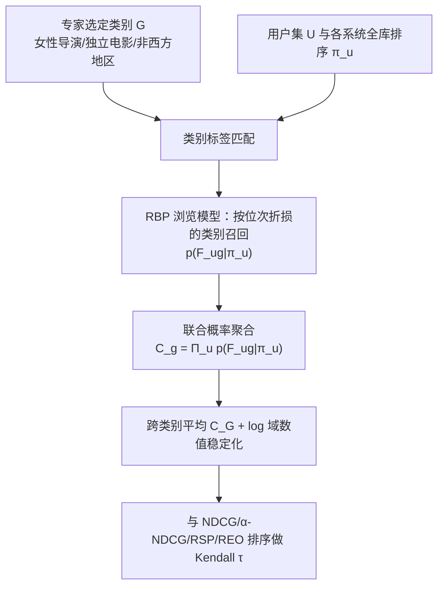
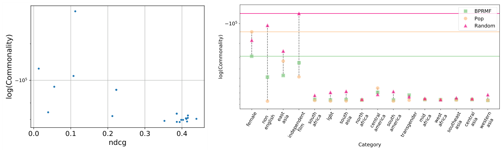

# Measuring Commonality in Recommendation of Cultural Content: Recommender Systems to Enhance Cultural Citizenship (衡量文化内容推荐中的共性：以推荐系统助力文化公民权)

- **会议/期刊**: RecSys 2022 (16th ACM Conference on Recommender Systems, short paper)
- **作者与机构**: Andres Ferraro、Gustavo Ferreira、Fernando Diaz (McGill University / Mila)、Georgina Born (UCL) —— CS 与社会科学/人文学跨学科合作
- **推荐链路定位**: 重排/离线系统级评估（不改变模型，定义群体级评价目标）
- **研究方向**: 去偏公平、可信隐私与工业架构 / 社交与群组推荐（群体共识）
- **论文原文**: [https://arxiv.org/abs/2208.01696v1](https://arxiv.org/abs/2208.01696v1)
- **开源代码**: 暂未开源

## TL;DR (1分钟核心速览)

现有推荐评估以**个体效用**为中心（NDCG、precision），无法刻画推荐系统对一个**用户群体整体**施加的文化影响：多样性/公平性指标只做列表内或分组平价，不回答"是否所有用户都共同接触到了某类被扶持的文化内容"。本文提出 **commonality（共性）**：以 RBP 浏览模型估计各用户对专家选定类别 $g$（女性导演、独立电影、非西方国家电影等）的熟悉度，再取**全体用户的联合概率**$C_g(\pi)=\prod_{u}p(F_{u,g}\mid\pi_u)$。在 MovieLens-1M 上对 20 个系统排序做 meta-evaluation，共性同 NDCG ($\tau=-0.4476$)、α-NDCG ($\tau=-0.5333$) 显著负相关，与公平性 RSP/REO **不相关**，证明其捕获了现有指标缺失的群体级"共享多样性"维度。

## Background & Motivation (背景与核心矛盾)

- **主流范式**: 学术与工业界一致收敛到"个性化"范式，以 NDCG/precision/CTR 等**用户级效用**为目标，并以留存、订阅等商业指标校验。
- **前人局限之一**: 多样性指标（α-NDCG、ERR-IA）本质仍是**列表内（list-level）** 且带相关性加权的"多样性"，取值受个体相关性约束，无法反映跨用户的聚合曝光分布。
- **前人局限之二**: 公平性指标（RSP/REO）做的是**分组平价**，预设一个"应匹配的目标分布"，衡量的是群体间差距大小，而非"人人是否都获得了该类文化经验"；且干预通常停留在个体用户层面。
- **核心洞察 (Key Insight)**: 文化内容的推荐具有**累积性与群体性**外部效应——公共媒体（PSM）理论中的"普遍可及性（universality of address）+ 内容多样性"共同构成"文化公民权"，其度量必须是**共享（shared）** 的，而非人均（per-capita）的。
- **本文切入点**: 把"曝光"从个体统计提升为**联合概率**，用"任一用户掉队即惩罚"的保守形式，直接量化群体是否共同熟悉被扶持类别。

## Method (核心方法设计)

### 1. 整体框架 (Overall Architecture)

输入是**已训练好的推荐系统给出的全库排序** $\pi_u$、物品的类别标签，以及由领域专家（而非纯统计规则）指定的被扶持类别集合$\mathcal{G}$。对每个用户、每个类别，先用 rank-biased precision 浏览模型计算"浏览完列表后对类别$g$的熟悉度"，得到逐用户边缘概率；再沿用户维取**联合概率**得到该系统的$C_g$；最后对类别取均值得$C_{\mathcal{G}}$（实际在 log 域计算以抗下溢）。整个过程**不训练任何模型**，是纯粹的离线系统级评价，同一套 runs 再按 NDCG/α-NDCG/RSP/REO 排序做 Kendall$\tau$ 的相关性检验（meta-evaluation）。

### 2. 关键设计拆解 (Key Designs)

1. **联合概率式共性 (Joint-Probability Commonality)**：痛点是所有既有指标都是边缘统计，"人均曝光高"可能是"少数人看很多、多数人看不到"造成的假象；本文改为对类别 $g$ 取全体用户熟悉事件的联合概率
$$C_g(\pi) = p(F_{1,g},\dots,F_{m,g}\mid\pi)=\prod_{u\in\mathcal{U}} p(F_{u,g}\mid\pi_u)$$
任一用户的 $p(F_{u,g}\mid\pi_u)$ 偏低即整体崩塌。直觉上这是一个**最差用户敏感的保守聚合**，恰好对应"共享文化经验不允许有系统性缺席者"的规范诉求，也因此在数值上会把系统的系统性欠曝光放大暴露出来。

2. **RBP 式 familiarity 估计 (Rank-Biased Recall)**：痛点是 `hit@k` 二值命中忽略位置与饱和。本文以浏览停止概率加权类别召回：
$$p(F_{u,g}\mid\pi_u)=\sum_{i=1}^{n}p(i)\,R(\pi_u,i,g),\qquad p(i)=(1-\gamma)\gamma^{i-1}$$
$R(\pi_u,i,g)$为截断$i$时类别$g$ 的召回，随列表增长而饱和，从而**阻止长列表刷分**；指数折损使靠前位置权重更高，符合"用户只看前若干条"的浏览现实。

3. **专家驱动的类别集与 log 域聚合**：相对 Mehrotra 等纯粹按统计低频自动挑选类别，本文坚持由电影领域专家指定 $\mathcal{G}$（女性导演、独立电影、非英语、LGBT/transgender、南美/中南非/南亚/东亚等地区），保证被度量对象与"多元文化经验"的规范目标一致；跨类别取$C_{\mathcal{G}}=\mathbb{E}_{g\in\mathcal{G}}[C_g]$，并在 log 域累加避免联合概率下溢。

4. **训练目标、负采样与推理开销**：本文**无训练损失、无负采样**，不改变任何现有模型；评估复杂度为 $O(|\mathcal{U}|\cdot|\pi|)$ 的类别标签匹配与累加，在线推理开销为零，成本仅在离线批量评测与类别元数据维护。

## Experimental Setup & Evaluation Protocol (实验设置与评估协议)

- **数据集与预处理**: 采用 MovieLens-1M，并用 TMDB 元数据扩充出品国、导演性别、原始语言与关键词；评分 4/5 视为相关（二元化）。类别由人工校验关键词可靠性后构造。

| 数据集 | #Users | #Items | #Interactions | 密度 | 特征/场景说明 |
| :--- | :---: | :---: | :---: | :---: | :--- |
| MovieLens-1M (+TMDB 元数据) | 6,040 | 3,900 | 1,000,209 | ≈4.25% | 电影文化内容；含导演性别、出品国、语言、关键词类别标签 |

- **数据划分与防穿越 (Splitting Strategy)**: 本文**不重新训练、不重新划分**，直接复用 Valcarce 等可复现性研究中为 20 余个电影推荐算法预生成的排序（含 BPRMF、SVD、Popularity、Random 等），原始按用户划分训练/测试，测试集未交互物品构成候选。
- **排名评测协议 (Ranking Protocol)**: 对各系统输出的**全库候选完整排序**打分（非采样负例排序），共性维度上按 RBP 折损累积到整个列表；指标层面属 **Full-Ranking** 语义下的列表曝光度量。
- **对比基线与超参设置**: 效用类 NDCG、RR；多样性类 α-NDCG、ERR-IA；公平类 RSP（统计平价）、REO（机会均等）。显著性以 $p<0.05$标注；Kendall$\tau$以"每个系统 run"为样本点计算。原文未报告$\gamma$ 与截断长度的具体取值，属可复现性缺口。

## Key Experimental Results (实验关键数据)

### 1. 主实验对比 (Main Results)

以"共性"给出的 run 排序为基准，与各指标排序做 Kendall $\tau$（$N\approx20$个 run，** 表示$p<0.05$）：

| 指标族 | 基线指标 | Kendall $\tau$ vs. Commonality | 显著性 | 关系解读 |
| :--- | :--- | :---: | :---: | :--- |
| 效用 | NDCG | **-0.4476** | ** | 中等负相关 |
| 效用 | RR | **-0.5048** | ** | 中等负相关 |
| 多样性 | α-NDCG | **-0.5333** | ** | 最强负相关 |
| 多样性 | ERR-IA | **-0.5143** | ** | 中等负相关 |
| 公平性 | REO | +0.2316 | n.s. | 无显著关系 |
| 公平性 | RSP | +0.1053 | n.s. | 无显著关系 |

**System-level 对比（图 1a / 1b）**：NDCG 最高的 **BPRMF** 共性极低；NDCG 最低的 **Random** 共性反而显著更高；共性最高的 **SVD** 效用偏低。分类别看，Popularity 在 `female`、`north africa` 上共性最高，Random 在除 `south america` 外几乎所有类别上最优。

<figure class="paper-figure" markdown="span">
  <figcaption>图1：共性的表现。1a 跨类别的平均 NDCG 与平均共性的散点图。每个点表示一次推荐系统运行。1b 基于随机、流行度和 BPRMF 模型的推荐在各分类上的共性值。水平线表示跨类别的平均共性。</figcaption>
</figure>

### 2. 消融实验 (Ablation Study)

原文未提供数值消融，仅在设计层面讨论了若干可替代选择；下表如实汇总其定性判断：

| 设计选择 | 替代方案 | 观测/推断影响 | 是否量化 |
| :--- | :--- | :--- | :--- |
| 联合概率 $\prod_u p(F_{u,g})$| 跨用户均值$\mathbb{E}_u[p(F_{u,g})]$ | 均值会掩盖系统性欠曝光，联合式被"最差用户"主导 | 定性 |
| RBP 折损召回 | 二值 `hit@k` | 二值忽略位次与饱和，易被长列表刷分 | 定性 |
| 专家指定类别 $\mathcal{G}$ | 统计低频类别自动选取 | 统计法可能选出与"多元文化经验"目标不符的内容 | 定性 |
| log 域聚合 | 直接连乘 | 直接连乘在 6,040 用户规模下严重下溢 | 定性（作者明确承认数值不稳） |

### 3. 关键实验发现 (Key Findings)

1. **效用与共性存在系统性冲突**：$\tau(\text{NDCG})=-0.4476$、$\tau(\text{RR})=-0.5048$（均$p<0.05$），且 NDCG 冠军 BPRMF 恰是共性最低的系统之一——说明**按现有开发流程选模型，会成体系地牺牲群体共享的文化经验**，不是偶发噪声。
2. **多样性指标不能替代共性**：$\tau(\alpha\text{-NDCG})=-0.5333$ 是全部指标中最强的负相关，因为 α-NDCG/ERR-IA 仍是"效用导向的列表内多样性"，与群体级共同曝光方向相反；这直接反驳了"已有 diversity 指标即可覆盖文化目标"的常见辩护。
3. **公平性与共性正交而非冗余**：REO（+0.2316）与 RSP（+0.1053）均不显著，说明"分组平价"与"人人共享"是两个独立维度；一个系统可能分组差距很小，却依然没有任何一类被扶持内容真正触达全体用户。

## Highlights & Limitations (亮点、对比与审稿批判)

- **与代表作对比 (vs. Prior Work)**: 相比 **α-NDCG/ERR-IA**（列表内、相关性加权的多样性），共性跨用户聚合且不依赖个体相关性；相比 **RSP/REO**（向预设目标分布做分组平价），共性不假设目标分布，只问"是否全体共同熟悉"；相比 **Mehrotra 等的校准/统计欠曝光方法**，共性用专家类别替代统计低频，使度量与规范性目标对齐。
- **可迁移亮点**: ①「联合概率 + 最差用户敏感」的聚合算子可直接移植到长尾物品扶持、区域内容覆盖、创作者曝光均衡等任何**群体级 exposure 目标**；②RBP 折损的类别召回是一个廉价、可解释的通用曝光度量，可用于离线大盘监控而非仅论文指标。
- **审稿级局限批判**: ①评估面过窄——单数据集（ML-1M）、复用他人预计算的 20 个 run、未报告任何 per-run 指标数值与 $\gamma$/截断超参，实质只有$\tau$ 与散点图，可复现性弱且无消融；②联合概率在类别数增多时会被单个最差类别指数级主导，跨类别算术平均在 log 域下定义不自洽；③仅度量"曝光/熟悉度"，不度量实际消费与长期文化效应，也未给出任何**优化共性**的算法或线上 A/B 验证——作者自己将其列为 future work。

## Rating (四维评分)

- **方法创新性 (Novelty)**: ⭐⭐⭐⭐ （以联合概率刻画群体"共享文化经验"并用 PSM 规范理论支撑，问题定义与度量形式都属新类，但数学结构本身朴素）
- **评估协议与实验扎实度 (Protocol & Experiments)**: ⭐⭐⭐ （20 个 run 的 meta-evaluation 与显著性检验思路正确，但仅单数据集、无数值表、无消融、超参缺失）
- **写作与数学规范度 (Clarity & Rigor)**: ⭐⭐⭐⭐ （指标定义、符号与两段式推导清晰严谨，跨学科论证完整；familiarity 模型与 log 稳定化处理略显随意）
- **工业落地与复现价值 (Industrial & Practical Value)**: ⭐⭐⭐ （无需改动模型即可作为群体级评估看板接入，但联合概率数值不稳、类别标签依赖外部元数据，落地需工程加固）

