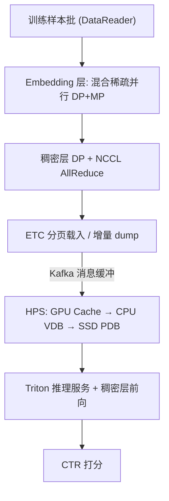
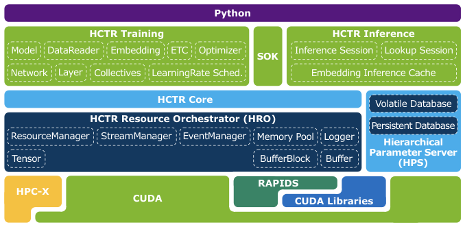
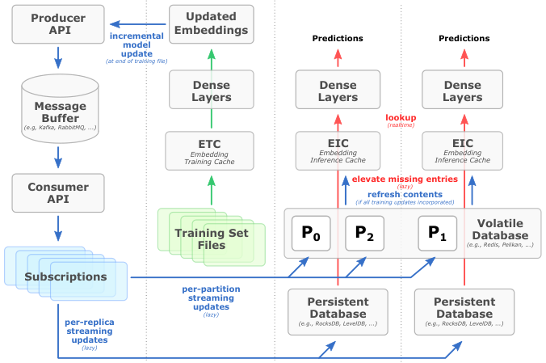

# Merlin HugeCTR: GPU-accelerated Recommender System Training and Inference（GPU 加速的推荐系统训练与推理框架）

- **会议/期刊**: RecSys 2022（16th ACM Conference on Recommender Systems，4 页工业系统短文）
- **作者与机构**: Joey Wang、Yingcan Wei、Minseok Lee、Matthias Langer 等 12 人，NVIDIA 开发者技术组（APAC）
- **推荐链路定位**: 精排（CTR/CVR 预估）的训练引擎 + 在线推理服务底座
- **研究方向**: 去偏公平、可信隐私与工业架构 / CTR 预估与特征交叉
- **论文原文**: [https://arxiv.org/abs/2210.08803v1](https://arxiv.org/abs/2210.08803v1)
- **开源代码**: 暂未提供（论文声明其为 NVIDIA Merlin 生态中的开源组件 HugeCTR）

## TL;DR (1分钟核心速览)

本文针对工业 CTR 模型中“TB 级稀疏 embedding 装不进显存、CPU 参数服务器带宽受限、在线推理端到端延迟过高”这一系统级痛点，提出 GPU 加速的一体化框架 Merlin HugeCTR：以 **Hybrid Sparse Embedding（DP+MP 混合并行）**、**Embedding Training Cache（ETC，超越显存上限的增量训练）** 与 **三级分层参数服务器 HPS（HBM→CPU→SSD + Kafka 增量同步）** 为核心。在 MLPerf v1.0 DLRM 训练任务上，单台 DGX A100（8×A100）相对 4×4-socket CPU 节点上的 PyTorch 最高取得 **24.6×** 加速；配合 HPS+Triton 的在线推理相对 CPU 基线取得 **5~62×**（依赖 batch size）加速。需注意本文为系统短文，只报告吞吐/延迟，不报告排序精度。

## Background & Motivation (背景与核心矛盾)

- **主流范式**: 工业精排普遍采用 DLRM/DeepFM/DCN/WDL 等“稀疏 embedding 查表 + 稠密 MLP 特征交叉”结构，训练侧依赖 CPU Parameter Server（如 TensorFlow PS、XDL）做分布式 embedding 更新。
- **前人局限一（容量与通信）**: 稀疏侧参数量可达 TB 级，远超单卡 80GB 显存；CPU PS 需反复经 PCIe 拉取/推送 embedding 梯度，通信成为吞吐瓶颈，GPU 算力空转。
- **前人局限二（训练—推理割裂）**: 离线全量训练与在线低延迟服务使用两套参数存储，模型更新需停机或全量重灌，无法支撑在线学习与分钟级增量生效；同时稠密层 GPU 利用率在推理小 batch 下极低。
- **核心洞察 (Key Insight)**: 推荐模型的稀疏 embedding 访问呈极强**长尾 + 局部性**——少数热特征贡献绝大多数查表流量，长尾特征极少命中却占据绝大多数存储。因此“热特征常驻 GPU、冷特征分片跨卡/跨层”可在容量与延迟间取得远优于单一 PS 的折衷。
- **本文切入点**: 把参数服务器“GPU 化 + 分层化”，用混合并行解决训练容量、用三级缓存解决推理延迟、用消息队列解决在线更新，形成训练到推理的闭环。

## Method (核心方法设计)

### 1. 整体框架 (Overall Architecture)

框架分两条链路共享同一套 embedding 存储抽象。**训练侧**：DataReader 流式读批 → Embedding（按特征频次路由到本地 DP 缓存或跨 GPU 分片 MP 表）→ 稠密网络层（DP 复制，NCCL 做梯度 all-reduce）→ ETC 按需把 embedding 分页载入 GPU，支持 staged-PS（扩展到全部节点主机内存）与 cached-PS（扩展到 SSD/NFS），并可实时把增量 embedding 下推推理侧。**推理侧**：Triton 加载模型，Embedding Inference Cache 命中 HBM，未命中则依次回退到 VDB（Redis/Pelikan）与 PDB（RocksDB/LevelDB）；训练节点经 Kafka Message Buffer 广播增量，推理节点订阅后异步刷新缓存。全流程以混合精度（FP16 存储 + TensorCore 计算）压降显存与带宽。

<figure class="paper-figure" markdown="span">
  <figcaption>图 1：HugeCTR 架构</figcaption>
</figure>

### 2. 关键设计拆解 (Key Designs)

1. **混合稀疏 Embedding（Hybrid Sparse Embedding）**：痛点是大表装不下、小表跨卡通信浪费。本文按频次把特征二分：高频特征留在本卡缓存走 DP，低频特征按哈希分片到全部 GPU 走 MP，仅对需要交换的向量做 all-to-all：
$\mathbf{e}_f=\mathcal{C}_{g}[f]\ \text{if } f\in\mathcal{H};\qquad \mathbf{e}_f=\mathcal{T}_{\pi(h(f))}[h(f)]\ \text{otherwise}$其中$\pi(\cdot)$为分片映射、$\mathcal{H}$ 为热集合。直觉是让通信量与“冷特征比例”而非“表规模”成正比，因而在长尾分布下近似零通信，同时保留突破单卡容量的能力。论文另提供 Localized Slot（整表驻单卡，slot 内 multi-hot 归约无需通信）与 Distributed Slot（纯 MP）两种退化形态适配不同表规模。

2. **三级分层参数服务器 HPS + 在线更新**：痛点是小 batch 推理时 GPU 等内存、长尾 embedding 反复换入换出。HPS 构造 GPU HBM / 分布式 CPU 内存 / 本地 SSD 三级存储，并用“缺失条目提升（lazy elevate）+ 内容刷新（refresh）”与稠密层计算重叠；缓存收益可写为
$L=(1-H)\cdot L_{\text{VDB}}+H\cdot L_{\text{HBM}},\qquad H=\frac{1}{|\mathcal{Q}|}\sum_{q\in\mathcal{Q}}\mathbb{I}\left[q\in\mathcal{C}_{\text{GPU}}\right]$即端到端延迟由命中率$H$ 主导，故采用动态插入 + 异步刷新维持高命中率；PDB 则为极端长尾条目兜底，保证精度不因缓存淘汰而损失。在线更新经 Kafka 的 Message Producer/Source API 按 embedding 表分队列序列化下发，推理副本订阅后写本地 VDB/PDB 分片，GPU 缓存按可配置周期轮询刷新。

<figure class="paper-figure" markdown="span">
  <figcaption>图 2：HugeCTR 模型部署中的通用数据流。</figcaption>
</figure>

3. **训练目标、混合精度与推理开销**：训练仍为标准 CTR 二分类交叉熵 $\mathcal{L}=-\frac{1}{N}\sum_{i}\left[y_i\log\hat{y}_i+(1-y_i)\log(1-\hat{y}_i)\right]$，无额外负采样设计（工业曝光日志天然提供负例）；系统侧创新在于参数以 FP16 压缩存储、TensorCore 计算并保留 FP32 主权重。推理侧经 ONNX 导出 + Triton 部署，开销瓶颈从“CPU 参数拉取”转移到“GPU 缓存命中率与 all-to-all 带宽”，随 batch size 增大摊薄固定开销，故加速比在 5~62× 区间随 batch 单调上升。

## Experimental Setup & Evaluation Protocol (实验设置与评估协议)

- **数据集与预处理**: 本文为 4 页工业系统短文，**未披露数据集统计、过滤规则与特征字段**；训练对比沿用 MLPerf v1.0 DLRM 任务定义（业界该任务使用 Criteo Terabyte 点击日志、在固定质量阈值下比较吞吐），推理对比为论文所述“主流推荐模型”相对 CPU 基线实现的内部基准。

| 评测场景 | 本方配置 | 对照基线 | 核心指标 |
| :--- | :--- | :--- | :--- |
| MLPerf v1.0 DLRM 训练 | 1×DGX A100（8×A100） | PyTorch @ 4×4-socket CPU（4×4×28 核） | 训练吞吐加速比 |
| 多节点扩展训练 | 多节点 HugeCTR（稀疏 MP + 稠密 DP） | 单节点 HugeCTR | 近线性扩展 |
| 在线推理（HPS） | GPU 三级缓存 + Triton | 同模型 CPU 基线实现 | 端到端延迟/加速比 |

- **数据划分与防穿越 (Splitting Strategy)**: 未涉及离线排序评测，无 LOO / 比例划分 / 时间戳切分设定；训练为流式按文件增量读取，ETC 支持“训练文件结束即增量更新”。
- **排名评测协议 (Ranking Protocol)**: **无排序评测**——不报告 Recall/NDCG/AUC，仅报告吞吐（samples/s）与端到端延迟（ms），属纯系统性能协议而非推荐质量协议。
- **对比基线与超参设置**: 基线为 PyTorch（CPU 节点）与 CPU 参数服务器实现；Embedding 维度 $d$、层数等超参沿用各模型默认配置，论文未给出显著性检验（系统基准通常报告多次运行中位数）。

## Key Experimental Results (实验关键数据)

### 1. 主实验对比 (Main Results)

| 场景 | 本方 | 基线 | 加速比 | 备注 |
| :--- | :--- | :--- | :---: | :--- |
| DLRM 训练（MLPerf v1.0） | HugeCTR, 8×A100 | PyTorch, 16×28 核 CPU | **24.6×** | 单 DGX A100 节点即达成 |
| 多节点训练扩展 | 多节点（稀疏 MP 跨节点） | 单节点 | 进一步提升 | 定性描述，未给曲线 |
| 在线推理（大 batch） | HPS + Triton | CPU 基线 | **62×** | batch size 依赖 |
| 在线推理（小 batch） | HPS + Triton | CPU 基线 | **5×** | 固定开销占比高 |

### 2. 消融实验 (Ablation Study)

原文未提供消融表格，仅有各机制适用边界的定性对照，整理如下（非数值消融）：

| 机制/配置 | 容量上限 | 通信需求 | 适用场景 |
| :--- | :--- | :--- | :--- |
| Localized Slot（整表驻卡） | ≤ 单卡显存 | multi-hot 归约零通信 | 单表可装下的中小特征 |
| Distributed Slot（纯 MP） | 随 GPU 数线性增长 | 随 GPU 数线性增长 | 超大单表 |
| Hybrid Sparse（本文） | 全集群显存之和 | 与冷特征比例成正比 | 长尾工业大表（默认推荐） |
| 无 ETC | ≤ 640GB（8×80GB） | — | 中等规模离线训练 |
| 有 ETC（staged/cached-PS） | 主机内存之和 / 磁盘容量 | 分页 I/O | TB 级 + 在线增量训练 |
| 单级 GPU 缓存 | 受显存限制 | 频繁换入换出 | 短尾、高 QPS 热特征 |
| 三级 HPS | 近似无限（SSD 兜底） | 分层回退 | 极端长尾 + 低延迟 |

### 3. 关键实验发现 (Key Findings)

1. **收益主要来自稀疏侧而非稠密侧**：24.6× 的整体加速是在“GPU 做 embedding MP/DP + CPU 只做数据供给”的重构下取得的，说明该 workload 的瓶颈是参数搬运而非 MLP 矩阵乘，稠密层优化边际收益有限。
2. **推理加速强烈依赖 batch size（5×→62×，约 12 倍跨度）**：说明 HPS 的收益本质是“批量聚合摊薄分层回退延迟 + 提升 GPU 利用率”，低 QPS、低延迟硬约束场景下单请求收益有限，需靠缓存命中率而非并行度取胜。
3. **容量解耦带来的是可用性而非精度**：ETC 把可训练规模从 8×80GB=640GB 的硬上限推到主机内存/磁盘级别，且 PDB 保留全量参数，使得“缓存淘汰”不会转化为长尾 item 的精度损失——这是分层缓存能安全用于线上的前提。

## Highlights & Limitations (亮点、对比与审稿批判)

- **与代表作对比 (vs. Prior Work)**: 相较 TensorFlow Parameter Server / XDL 等 CPU 中心方案，本文把 PS 下沉到 GPU 并做频次分层，通信量由表规模解耦为冷特征比例；相较 Merlin 生态早期仅覆盖训练的 HugeCTR，本文补齐 ETC + HPS + Triton 部署，形成训练—推理—在线更新的闭环；相较纯框架层 DLRM 实现，其价值在工程拓扑调度而非模型结构创新。
- **可迁移亮点**: ① “热/冷特征分层 + 分片哈希”的存储抽象可直接迁移到生成式推荐的超大 semantic ID 码本查表与 item embedding 在线服务；② ETC 的 staged-PS/cached-PS 双模式为流式增量训练提供了可复用的容量伸缩范式。
- **审稿级局限批判**: ① 全文无公开数据集、无 AUC/GAUC 等质量指标，也无“精度—吞吐”折衷曲线，读者无法判断加速是否以精度为代价；② 强绑定 NVIDIA 硬件栈（A100/NCCL/Triton/HPS），缓存命中率、all-to-all 带宽随节点规模的增长曲线缺失，跨厂商可复现性差；③ 4 页短文缺少与同期 GPU 训练框架的横向对比与超参敏感性分析。

## Rating (四维评分)

- **方法创新性 (Novelty)**: ⭐⭐⭐ （混合稀疏并行与三级缓存均为系统级工程创新，思想清晰但缺乏新算法/理论分析）
- **评估协议与实验扎实度 (Protocol & Experiments)**: ⭐⭐ （仅 MLPerf 吞吐与内部延迟基准，无公开数据、无消融数值、无精度指标与显著性检验）
- **写作与数学规范度 (Clarity & Rigor)**: ⭐⭐⭐ （架构与数据流描述清楚，但公式极少、缺少复杂度与命中率—延迟的量化建模）
- **工业落地与复现价值 (Industrial & Practical Value)**: ⭐⭐⭐⭐ （直击 TB 级 embedding 与在线低延迟两大真实痛点，MLPerf 24.6× 与推理 5~62× 具备直接参考价值，但复现受硬件生态限制）

