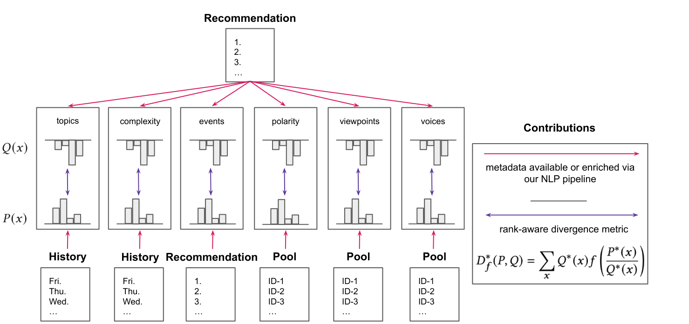
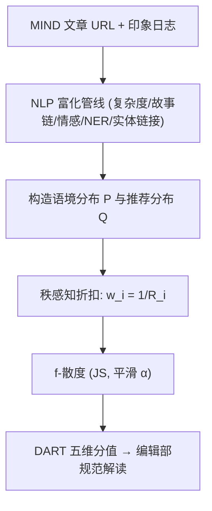

# RADio: Rank-Aware Divergence Metrics to Measure Normative Diversity in News Recommendations (秩感知散度度量新闻推荐中的规范性多样性)

- **会议/期刊**: RecSys 2022（Full Paper，Best Paper Runner Up）
- **作者与机构**: Sanne Vrijenhoek、Gabriel Bénédict（共同一作）、Mateo Gutierrez Granada、Daan Odijk、Maarten de Rijke；阿姆斯特丹大学 IViR / 阿姆斯特丹大学 & RTL Nederland
- **推荐链路定位**: 重排（列表级评估与重排目标）
- **研究方向**: 去偏公平、可信隐私与工业架构 / 序列与会话推荐
- **论文原文**: [https://arxiv.org/abs/2209.13520v2](https://arxiv.org/abs/2209.13520v2)
- **开源代码**: [https://github.com/svrijenhoek/RADio](https://github.com/svrijenhoek/RADio)

## TL;DR (1分钟核心速览)

新闻推荐长期用 ILD/余弦距离刻画"描述性多样性"，既无法表达编辑部规范（自由/参与/审议/批判民主模型），又给出量纲不一、忽视排序位置的点估计。本文提出 RADio：把多样性统一为「推荐分布 $Q$与语境分布$P$的秩感知 f-散度」，以$\sqrt{D_{\mathrm{JS}}}$保证$[0,1]$ 有界且满足度量三公理。在 MIND（≈1M 用户 / 15.2M 印象日志）上对 4 个新闻神经推荐器与 2 个朴素基线做五维 DART 评估，揭示"随机基线在所有规范性指标上分歧最高、神经模型 NDCG 高 40% 但校准分歧显著更低"的张力。

## Background & Motivation (背景与核心矛盾)

- **主流范式**: 推荐多样性被定义为"相似性的反面"，常用 ILD（列表内两两平均距离）、novelty、coverage 等描述性指标，距离函数多为 BOW/词向量的余弦距离。
- **前人局限**: 其一，描述性指标与社会科学"媒介多样性"概念几乎无重叠，无法对应新闻编辑部的规范目标；其二，先前 DART 指标的取值域各异（Activation $[-1,1]$、Calibration$[0,\infty]$），既不可跨模型比较，也把推荐当作无序集合、完全忽略用户对列表下端的观察概率衰减。
- **核心洞察 (Key Insight)**: Loecherbach 等指出跨领域"多样性"的概念与操作化几乎不重叠；而排序位置决定曝光——新闻场景下用户滚动意愿更低（稀疏性偏置），因此折扣应比 NDCG 更陡。
- **本文切入点**: 用一套统一、有界、可微的秩感知 f-散度替换五种异质指标，使规范性目标成为可计算、可解释的"分布偏移量"。

<figure class="paper-figure" markdown="span">
  <figcaption>图 1：在新闻推荐背景下比较离散多样性分布。首先，在新闻数据集中收集元数据，或通过我们的 NLP 流程检索（红色）。随后通过秩感知散度指标（紫色）比较该元数据的离散分布。推荐集 𝑄 与上下文文章 𝑃 通过秩感知 f-Divergence 进行比较。</figcaption>
</figure>

## Method (核心方法设计)

### 1. 整体框架 (Overall Architecture)

RADio 是一条"元数据富化 → 分布构造 → 散度打分"的评估流水线：先用 5 步 NLP 管线（Flesch-Kincaid 可读性、TF-IDF 故事链聚类、TextBlob 情感、spaCy 命名实体识别、Wikidata 实体链接）为 MIND 文章补充主题/复杂度/事件链/情感/政治行动者/少数声音标签；再针对每个规范性概念确定语境分布 $P$（用户阅读历史、其他用户推荐、全量供给池$S$）与推荐分布$Q$（列表$R$）；最后以秩感知 JS 散度输出$[0,1]$ 内的单一分值，并按民主模型（表 1）解释"高分歧是否为好"。

### 2. 关键设计拆解 (Key Designs)

1. **统一 f-散度与零概率平滑**：痛点是各指标量纲不可比、类别缺失会导致 $\log 0$或人为置零。作者取$D_f(P,Q)=\sum_x Q(x) f\!\left(\frac{P(x)}{Q(x)}\right)$，具体选$f_{\mathrm{JS}}$（JS 散度，$\log_2$底，$0\le D_{\mathrm{JS}}\le 1$，且$\sqrt{D_{\mathrm{JS}}}$满足同一性/对称性/三角不等式），并做双向平滑$\tilde{Q}=(1-\alpha)Q+\alpha P,\ \tilde{P}=(1-\alpha)P+\alpha Q$后归一化。直觉：JS 的对称有界性消除了 KL 的偏斜与不可比，平滑则保证$P$ 中缺类时指标不被伪置零。
2. **秩感知折扣（MRR 式而非 NDCG 式）**：痛点是 ILD 类指标把推荐视为集合，忽略位置曝光。作者把列表转为加权分布 $Q^*(x)=\frac{\sum_{i} w_{R_i}\mathbb{I}[i\in x]}{\sum_i w_{R_i}}$，取$w_{R_i}=1/R_i$，得到$D^*_f(P,Q)=\sum_x Q^*(x) f\!\left(\frac{P^*(x)}{Q^*(x)}\right)$。选择 MRR 权重而非$1/\log_2(R_i+1)$ 的直觉是：新闻首页缺乏明确 query 意图、用户下滚意愿更弱，需要更重的衰减以贴合稀疏曝光。
3. **五种规范性概念的统一实例化与推理开销**：Calibration 比较 $P^*(c|H)$（历史，越近权重越高）与$Q^*(c|R)$；Fragmentation 比较不同用户的$P^*(e|R_u)$与$Q^*(e|R_v)$（$O(|U|^2)$不可行，故随机采样用户对）；Activation / Representation / Alternative Voices 分别以情感强度分箱、政治行动者出现、少数/多数声音对比供给池$S$。单对$\{P,Q\}$计算复杂度为$O(|\mathcal{X}|)$，本质是离线评估，不引入在线服务开销。

## Experimental Setup & Evaluation Protocol (实验设置与评估协议)

- **数据集与预处理**: MIND（MSN News，2019-10-12 至 11-22 的印象日志），文章元数据由作者自建 NLP 管线富化，非数据集自带。

| 数据集 | #Users | #Items | #Interactions | 稀疏度/密度 | 特征/场景说明 |
| :--- | :---: | :---: | :---: | :---: | :--- |
| MIND (large) | ≈1M（匿名采样） | ≈161k 文章 | ≈15.2M impression logs | 极高稀疏 | 新闻印象日志 + 阅读历史；含大量 soft news |

- **数据划分与防穿越 (Splitting Strategy)**: 无传统训练/测试切分——本文是**评估框架**，直接复用 MIND 官方已训练模型；候选集为原始 impression log（一次推理循环），NDCG 采用 MIND 原文报告值。
- **排名评测协议 (Ranking Protocol)**: 属于**候选集内排序（impression-level Sampled Ranking）**，非全库 Full-Ranking；默认设置 rank-aware JS @N（无截断），并做 @1/@2/@5/@10/@20/@N 敏感性；置信区间在 $\{P,Q\}$ 对上配对估计（不跨随机种子，以避免多维 CI）。
- **对比基线与超参设置**: 4 个新闻神经推荐器 LSTUR / NAML / NPA / NRMS + 2 个朴素基线（Most Popular、Random）；平滑系数 $\alpha$ 取接近 0 的小值；无嵌入维度调参（模型未重训）。

## Key Experimental Results (实验关键数据)

### 1. 主实验对比 (Main Results)

默认设置：秩感知 JS @N（数值越高=分歧越大，但"高是否更好"取决于所选民主模型，见原文表 1）。

| 算法 | Calib.(topic) | Calib.(complexity) | Fragment. | Activation | Representation | Alt. voices | NDCG |
| :--- | :---: | :---: | :---: | :---: | :---: | :---: | :---: |
| LSTUR | 0.5847 | 0.3632 | **0.9046** | 0.1819 | 0.1261 | 0.0409 | 0.4134 |
| NAML | 0.5709 | 0.3593 | 0.8836 | 0.1842 | 0.1230 | 0.0384 | 0.4091 |
| NPA | 0.5838 | 0.3619 | 0.8979 | 0.1841 | **0.1359** | 0.0390 | 0.4068 |
| NRMS | 0.5662 | 0.3548 | 0.8872 | 0.1794 | 0.1278 | 0.0362 | **0.4163** (+41.2% vs. Random) |
| Most Popular | 0.6526 | 0.3477 | 0.8923 | 0.1949 | 0.1268 | 0.0342 | 0.2750 |
| Random | **0.6636** | **0.3981** | **0.9439** | **0.2715** | **0.2578** | **0.0698** | 0.2949 |

### 2. 消融实验 (Ablation Study)

（原文以敏感性分析形式呈现，数值为图 2–4 的分布统计，故以方向性符号表示相对基线设置的变化）

| 变体 | Calib.(topic) 分布形态 | Fragmentation 区分度 | 结论 |
| :--- | :--- | :--- | :--- |
| 默认：JS + 秩感知 @N | 近似对称、居中 | neural vs. pop 可分 | 主设置 |
| 换 KL 散度 | 明显左偏（集中于低分歧） | neural 与 random 对比度下降 | JS 更优 |
| 去掉秩感知 | 中位数下移 | LSTUR 与 Most Popular 分布几乎重合 | 秩感知带来区分度 |
| 截断 @1/@2/@5 | 分歧随截断单调上升 | — | 折扣对浅层更敏感 |
| 截断 @10 / @20 / @N | 约 @10 后趋于稳定 | @20≈@N（MIND 候选常 ≤20） | 10 位后信息饱和 |

### 3. 关键实验发现 (Key Findings)

1. **准确率与规范多样性呈系统性张力**：NRMS 取得最高 NDCG 0.4163（较 Random 高约 41%），但其 Calibration(topic) 仅 0.5662，比 Random 的 0.6636 低约 14.7%，即神经模型更"贴合"用户历史分布，同质化更强——这正是编辑规范需要额外监控的部分。
2. **个性化并未造成极端"碎片化"**：四个神经模型的 Fragmentation 集中在 0.8836–0.9046，显著低于 Random 的 0.9439，说明 MIND 上的个性化推荐仍共享相当比例的公共事件链，但 LSTUR 最高（0.9046）提示其公共 sphere 贡献最弱。
3. **指标可解释性取决于元数据可得性**：依赖数据集原生主题的 Calibration 在各模型间呈现清晰分层（0.5662–0.6636，跨度约 0.10），而依赖自建 NLP 推断的 Representation（0.1230–0.2578）与 Alternative Voices（0.0342–0.0698）绝对量级小、模型间差异被压缩，反映富化管线的误差会直接稀释指标的判别力。

## Highlights & Limitations (亮点、对比与审稿批判)

- **与代表作对比 (vs. Prior Work)**: 相较 Vrijenhoek 等的前作 DART，本文把五个量纲各异的指标统一为一个有界 f-散度实例并首次引入秩感知；相较 Steck 的 Calibrated Recommendation，本文不限于"用户历史校准"单一概念，而把 $P$ 泛化到他人推荐与全局供给池，从而覆盖"跨用户"多样性；相较 ILD，本文提供分布级（而非点估计）偏移量与可跨模型比较的尺度。
- **可迁移亮点**: ① 用 $\sqrt{D_{\mathrm{JS}}}$作为"有界、满足三公理的分布距离"可直接迁移到曝光公平、流行度偏置、多模态属性多样性等任意"目标分布 vs. 实际曝光分布"的评测；② MRR 式重折扣 + 平滑$\alpha$ 的组合，是把任意离线指标改造为"位置敏感且数值稳定"的通用配方。
- **审稿级局限批判**: ① f-散度对类别间的序关系无感知（极左与极右政党被视作等距的两个 one-hot 桶），连续量（复杂度、情感）必须人为分箱，边界附近的近似值可能落入不同桶；② 富化管线无 ground truth，Representation/Alternative Voices 的效度无法验证，且 MIND 含大量 soft news 而 DART 主要面向 hard news，结论的外部效度受限；③ Fragmentation 通过随机采样用户对近似 $O(|U|^2)$ 的全对比较，采样方差与最优样本量未做理论分析。

## Rating (四维评分)

- **方法创新性 (Novelty)**: ⭐⭐⭐⭐ （把规范性多样性重构为统一的秩感知 f-散度，理论上以 $\sqrt{D_{\mathrm{JS}}}$ 保证度量公理与有界性，虽非全新数学工具但类比迁移巧妙）
- **评估协议与实验扎实度 (Protocol & Experiments)**: ⭐⭐⭐⭐ （6 个推荐器 × 5 概念 × KL/JS × 有无秩感知 × 6 种截断的完整敏感性网格，含 95% CI；但仅单数据集、仅 impression 候选集、无人工效度校验）
- **写作与数学规范度 (Clarity & Rigor)**: ⭐⭐⭐⭐⭐ （从 KL→对称化→上界→f-散度→秩加权的推导链条清晰，全部符号与 $P/Q$ 语义逐条定义，并明确区分"高分歧≠好"的解释规则）
- **工业落地与复现价值 (Industrial & Practical Value)**: ⭐⭐⭐⭐ （代码与富化管线全开源，离线 $O(|\mathcal{X}|)$ 打分易于接入编辑后台看板；但需自建 NLP 管线且缺中文/多语适配，落地成本主要在元数据侧）

