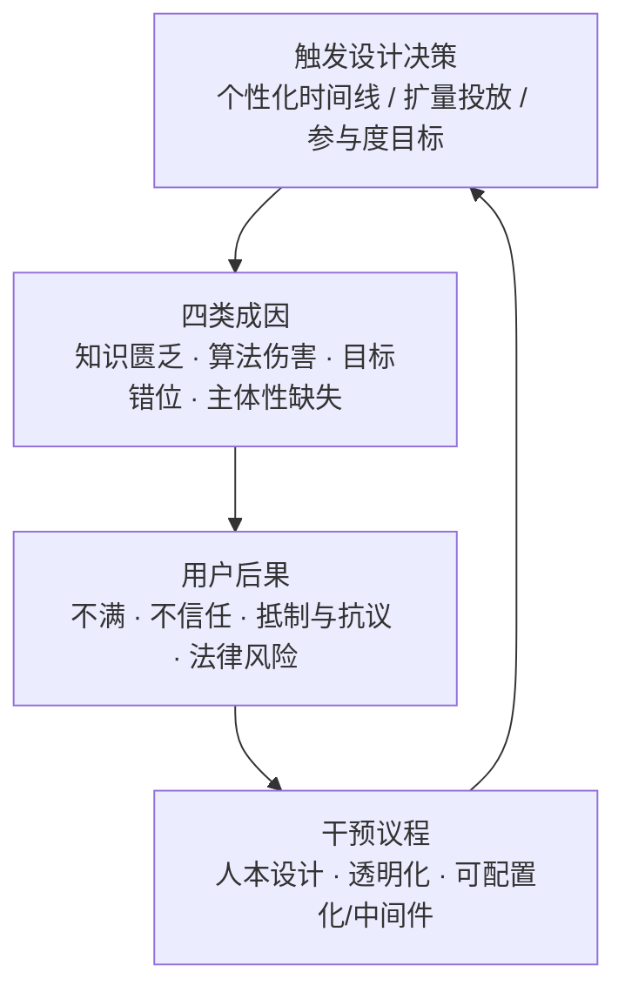

# Recommender Systems and Algorithmic Hate (推荐系统与算法厌恶)

- **会议/期刊**: RecSys 2022 (Late Breaking Results / Short Paper)
- **作者与机构**: Jessie J. Smith, Lucia Jayne, Robin Burke — University of Colorado, Boulder
- **推荐链路定位**: 全链路设计治理（不针对某一排序阶段，而是对整条推荐管线的社会后果建模）
- **研究方向**: 去偏公平与可信推荐 / 社交与群组推荐
- **论文原文**: [https://arxiv.org/abs/2209.02159v1](https://arxiv.org/abs/2209.02159v1)
- **开源代码**: 暂未开源（HCI/立场类论文，无代码与数据集）

## TL;DR (1分钟核心速览)

本文是一篇**立场与议程型（agenda-setting）论文**，不做模型。作者指出：个性化推荐的真实失效不止是准确率不达标，而是用户对“算法”产生的厌恶、不信任与公开抵制（algorithmic hate）。通过 Twitter、Instagram、Facebook、TikTok、Spotify、英国 A-level 等案例，归纳出四类成因——算法知识匮乏、表征性/分配性算法伤害、用户与多利益方目标错位、用户主体性与控制感缺失，并据此提出人本设计、透明化、可配置化三条研究议程。**全文无数据集、无指标、无基线**，其贡献在于问题分类学与研究方向标定，而非定量收益。

## Background & Motivation (背景与核心矛盾)

- **主流范式**: 自 2009 年 Facebook 将时间线交由算法策展起，主流平台以“预测相关性 + 提升参与度”作为个性化 feed 的统一目标，RecSys 学界亦长期以离线精度（NDCG/Recall）为唯一进步标尺。
- **前人局限**: 既有工作（如对算法负面感知的综述）描述了用户对算法的负面态度，但未专门刻画**推荐系统**这一载体；同时学界因离线实验成本低，逐渐放弃真实用户研究，用模拟用户替代真人，导致“系统伤害用户”的机制被排除在研究视野之外。
- **核心矛盾一**: 用户把由特征抽取、召回、重排、风控等异构子系统拼成的复杂管线，笼统理解为单数的“the algorithm”——认知粒度与系统复杂度严重不匹配。
- **核心矛盾二**: 系统目标（停留时长、点击率）与用户目标（心理健康、信息自主）在多方利益（广告主、创作者、平台）博弈下必然错位，而**对齐度提升 ≠ 满意度提升**。
- **核心洞察 (Key Insight)**: 算法厌恶主要是**设计决策的非预期后果**，而非用户非理性；且「伤害」本身不必然引发厌恶——用户必须先具备一定算法认知，才能识别自己受害，故“无知”是其他三类成因的放大器。
- **本文切入点**: 用案例研究建立“成因—后果—干预”的映射表，把 RecSys 的研究目标从“更准”扩展到“更被接受”。

## Method (核心方法设计)

### 1. 整体框架 (Overall Architecture)

本文的“方法”是一条定性分析链：以公开事件与既有实证研究为输入，抽取**触发性的设计决策**（如时间线由倒序改为个性化、Lookalike 扩量、按完成率降权）；将其归入四类成因（知识匮乏、算法伤害、目标错位、主体性缺失）；再映射到用户侧负性后果（不满、抵制、街头抗议、法律和解）与平台侧后果（留存下降、监管风险）；最后由后果反向推导可干预的设计变量，形成三条研究议程——人本推荐系统设计、透明化、可配置化与“中间件”式的前端算法市场。全篇不涉及训练、推理或损失函数，输出是一张研究方向路线图。

### 2. 关键设计拆解 (Key Designs)

1. **四因失效链诊断框架（论文最核心的增量）**：前人只描述“用户讨厌算法”这一现象；本文将其拆成可归责的设计变量。笔记侧可形式化为 $H \approx g\big(\Delta K,\; \text{Harm}_{\text{alloc/rep}},\; \Delta G,\; 1-\text{Agency}\big)$，其中$\Delta K$为用户算法认知与系统实际复杂度之差，$\Delta G$为系统目标与用户目标之偏差。其直觉是：$\Delta K$是**门控项**——若用户不知道自己被伤害或目标被背离,后三项不产生厌恶；一旦$\Delta K$ 收窄，伤害与错位才会转化为显性敌意。
2. **透明化的双刃边界（反直觉结论）**：常规假设是“解释越多越信任”。作者指出若解释暴露了用户本就反感的设计（如纯粹的参与度最大化），透明化会触发 **algorithmic aversion**，即用户知晓缺陷后直接弃用。因此有效条件不是“解释清楚”，而是“系统设计本身与用户预期相容”，即透明化必须与人本重设计**配对**，否则适得其反。
3. **可配置化与“中间件”治理**：针对主体性缺失，作者提出增加推荐可配置性（用户自选偏好），但指出其内在矛盾——配置需要足够信息又不能造成信息过载，本质是在“系统替用户预测”与“用户自己声明”之间找平衡；更强方案是政策强制的 middleware：前端策展算法市场化，用户可切换提供商。论文亦坦言平台无自愿让渡控制权的动机，故该路径依赖监管而非技术。

**关于目标函数与效率**：本文无损失函数、无负采样、无推理开销分析——这正是其体裁属性（Late Breaking Results 立场文）而非疏漏。

## Experimental Setup & Evaluation Protocol (实验设置与评估协议)

- **数据集与预处理**: **无**。本文不使用任何推荐数据集，未做 `5-core` 过滤，亦无用户/物品统计表；证据来源为公开新闻报道、平台公告、诉讼文书与既有 HCI/社科实证研究。
- **数据划分与防穿越**: 不适用（无训练/测试划分）。
- **排名评测协议**: 不适用（无 Full-Ranking / Sampled Ranking，无 NDCG/Recall/HR 指标）。
- **对比基线与超参**: 无 SOTA 基线对照，无 Embedding 维度 $d$、无显著性检验；其“对照物”是概念层面的既有算法负面态度研究。

**证据表（替代主实验表，为论文案例的整理）**：

| 案例平台 | 触发设计决策 | 成因归类 | 观测后果 |
| :--- | :--- | :--- | :--- |
| Twitter (2016) | 倒序时间线 → 个性化 feed | 主体性缺失 / 知情不足 | #RIPTwitter 话题抵制 |
| Instagram (2017) | 引入算法排序 feed | 主体性缺失 | #RIPInstagram 情绪化反弹 |
| Facebook (2022) | Lookalike Audience 广告扩量 | 分配性伤害（歧视） | 与美国 DOJ 和解、违反公平住房法 |
| TikTok (2020) | 内容发现降权（shadow-ban） | 表征性 + 分配性伤害 | 就 LGBTQIA+ 内容受限公开道歉 |
| Spotify | 流行度偏置 | 分配性伤害（供给方） | 新艺人曝光机会受损 |
| 新闻信息流 | 参与度优化 | 目标错位 | 垃圾新闻曝光上升约 3% |
| TikTok | 停留/完播最大化 | 目标错位 | 用户自述成瘾，与心理健康负相关 |
| 英国 A-level (2020) | 成绩标准化算法 | 知识匮乏 / 不透明 | 街头抗议（“#FuckTheAlgorithm”） |

## Key Experimental Results (实验关键数据)

### 1. 主实验对比 (Main Results)

**不存在**。论文未报告任何模型对比；任何“Improv.%”数字在此文中均无从产生。读者应将其视为**问题定义与议程论文**，其价值需由后续工作（如可配置推荐、解释对信任的因果效应）来定量验证。

### 2. 消融实验 (Ablation Study)

**不存在**。无组件级 `w/o ...` 分析。概念上可类比的“消融”是作者对单一成因的反事实讨论：例如若移除 $\Delta K$（提升算法素养），分配性伤害仍会存在但**不再转化为显性厌恶**；若移除主体性缺失而保留目标错位，则不满仍会以“被操纵感”形式出现。

### 3. 关键实验发现 (Key Findings)

1. **“算法伤害”与“算法厌恶”之间存在认知门控**：TikTok 的 LGBTQIA+ 创作者遭遇降权与 Spotify 长尾音乐人遭遇流行度偏置，均属客观伤害；但只有前者（创作者能通过播放数据直接观测到限流）演化为公开冲突与平台道歉，说明伤害的**可观测性**决定了它是否升级为厌恶。
2. **目标错位的边际收益会反噬留存**：新闻场景下参与度优化仅带来约 **3%** 的垃圾新闻曝光增量，却足以引发对“算法操纵”的广泛指控；TikTok 的“被理解感”与成瘾、低自尊、学业下降统计相关——同一优化目标在短期指标上为正、在长期用户价值上为负。
3. **透明化不是单调增益**：作者援引 algorithmic aversion 证据指出，当解释揭示的设计本身不为用户接受时，披露会降低使用意愿；这意味着“可解释推荐”的收益必须以设计对齐为前提，否则解释研究可能产生负向外部性。

## Highlights & Limitations (亮点、对比与审稿批判)

- **与代表作对比 (vs. Prior Work)**: 与以精度为轴的推荐公平性/去偏工作（如流行度去偏、双边公平再排序）相比，本文不优化任何可计算目标，而把“公平”上移到**感知与关系层**；与既有 algorithmic aversion / folk theory 文献相比，其增量是把分析对象从“泛算法”收窄到**个性化推荐管线**，并给出 RecSys 社区可承接的具体议程。相较典型的 RecSys 长文，它缺少可复现实验，因此更像一篇有清晰骨架的 workshop 宣言。
- **可迁移亮点**: ①“$\Delta K$ 门控”思路可直接迁移到可解释推荐的评测设计——解释的价值应在**低认知用户子群**上单独度量，而非全库平均；②把“伤害可观测性”作为去偏干预的优先级排序依据，可用于决定先修哪一类公平性问题（可被用户察觉的先修）。
- **审稿级局限批判**: ①证据高度依赖二手新闻与选择性案例，存在**幸存者偏差与确认偏差**，缺乏对“未引发厌恶的同类伤害”的反例采样；②三条议程（人本设计、透明化、可配置化）均无操作化定义与度量方案，也未讨论其工程代价——如可配置化带来的偏好稀疏、冷启动与配置疲劳，middleware 方案的延迟与多提供商一致性成本，均被略过；③对 $\Delta G$（目标错位）仅做定性归因，未给出可优化的多目标形式化，难以直接嵌入现有 MTL/重排框架。

## Rating (四维评分)

- **方法创新性 (Novelty)**: ⭐⭐⭐ （四因分类学与“认知门控”洞察有概念价值，但缺乏新算子或理论推导，属框架性贡献）
- **评估协议与实验扎实度 (Protocol & Experiments)**: ⭐⭐ （无数据集、无划分协议、无基线与显著性检验，证据为案例汇编，可复现性低）
- **写作与数学规范度 (Clarity & Rigor)**: ⭐⭐⭐⭐ （术语定义清晰、成因归类自洽、案例与结论对应紧凑；但无形式化模型，论证以叙事为主）
- **工业落地与复现价值 (Industrial & Practical Value)**: ⭐⭐⭐ （对平台治理与可解释/可配置功能设计有直接启发，尤其“透明化需与重设计配对”的警示；但无代码、无可部署组件，落地需自行工程化）

