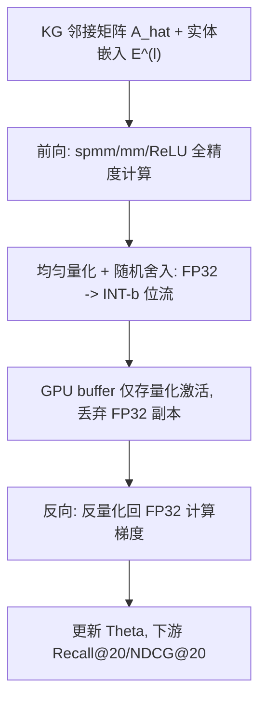
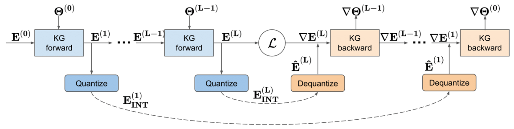

# TinyKG: Memory-Efficient Training Framework for Knowledge Graph Neural Recommender Systems (面向知识图谱神经推荐系统的显存高效训练框架)

- **会议/期刊**: RecSys 2022
- **作者与机构**: Huiyuan Chen, Xiaoting Li, Chin-Chia Michael Yeh, Yan Zheng, Hao Yang（Visa Research）；Kaixiong Zhou, Xia Hu（Rice University）
- **推荐链路定位**: 召回（KGNN 训练基础设施，前向/反向激活存储层，不改推理）
- **研究方向**: 图神经网络与知识图谱推荐 / 工业级架构与评测基准
- **论文原文**: [https://arxiv.org/abs/2212.04540v1](https://arxiv.org/abs/2212.04540v1)
- **开源代码**: 暂未开源

## TL;DR (1分钟核心速览)

KGNN 的显存瓶颈不在参数（$O(Ld^2)$）而在逐层缓存的前向激活图（$O(LNd)$），主流解法是多 GPU 分布式（如 SMORE），难以部署到显存受限设备。TinyKG 不改动任何 KGNN 架构，仅把前向激活用均匀量化+随机舍入压成 INT2 位流写入 GPU buffer，反向时反量化回 FP32 算梯度，并证明该量化无偏、方差有界（$\propto dR^2/4B^2$）。在 Amazon-book / ML-20M / Yelp2018 的全库排序 Recall@20 上，INT2 使激活内存降 7.1–7.6×，精度仅损失 1.26–1.43%，时间开销约 +25%。

## Background & Motivation (背景与核心矛盾)

- **主流范式**: KGNN（KGAT/KGNN-LS/KGIN）靠多跳消息传递聚合 KG 邻居，捕获高阶邻近性缓解稀疏与冷启动，是图推荐 SOTA 主力。
- **前人局限**: ① 自动微分引擎必须缓存 $L$层所有中间激活（$\mathbf{H}^{(l)},\mathbf{J}^{(l)},\mathbf{E}^{(l)}$）以计算反向梯度，显存随图规模线性爆炸；② 单跳分布式框架（DGL-KE/PBG）无法处理多跳跨分区的消息传递，而 SMORE 类多 GPU 方案延迟高、难上内存受限设备。
- **核心洞察 (Key Insight)**: 参数与邻接矩阵 $\hat{\mathbf{A}}$的占用可忽略，激活图才是主导项；而 KGNN 普遍很浅（$L\le4$）且消息传递本身对噪声容忍度高，故低比特激活带来的梯度方差累积远小于深层 CNN。
- **本文切入点**: 把"激活压缩训练 (ACT)"引入 KGNN——只压缩"存储"，前向仍全精度计算，从而以极小精度代价换取显存。

## Method (核心方法设计)

### 1. 整体框架 (Overall Architecture)

TinyKG 是一个即插即用的训练包装器：前向传播用全精度 $\mathbf{E}^{(l)}$正常做 `spmm` 与线性变换，每层算完后立即对该层激活做$b$-bit 均匀量化，用低位位流覆盖原 FP32 buffer 并释放全精度副本；反向传播时按层逆序反量化出$\hat{\mathbf{E}}^{(l)}$，在 FP32 下完成梯度计算。由于只改 buffer 的存取例程、不改网络算子，任何遵循消息传递范式的 KGNN 均可由模型转换器自动替换；推理阶段与基线完全一致（无任何精度损失）。

<figure class="paper-figure" markdown="span">
  <figcaption>图 1. 所提出的 TinyKG 的流程，其中我们将全精度激活图 {E(1), · · · , E(𝐿)} 量化为数值精度更低的值 {E(1)</figcaption>
</figure>

### 2. 关键设计拆解 (Key Designs)

1. **无偏均匀量化 + 随机舍入（Stochastic Rounding）**：若用最近舍入（NR），量化误差是系统性偏置，多层复合后梯度方向被持续拉偏。TinyKG 采用 $B=2^b-1$个均匀桶，量化$\mathbf{e}^{INT}=\lfloor(\mathbf{e}-Z)/(R/B)\rceil$、反量化$\hat{\mathbf{e}}=\frac{R}{B}\mathbf{e}^{INT}+Z$，其中$R=\max(\mathbf{e})-\min(\mathbf{e})$、$Z=\min(\mathbf{e})$；关键的$\lfloor x\rceil$以概率$x-\lfloor x\rfloor$上取整、否则下取整，于是$\mathbb{E}[\hat{\mathbf{e}}]=\mathbf{e}$、$\mathrm{Var}[\hat{\mathbf{e}}]\le dR^2/(4B^2)$。直觉：随机舍入把确定性截断误差转成零均值噪声，反向梯度期望不变，只是方差随$1/B^2$收缩，故$b$ 可以压到极低。
2. **误差传播上界与"为何 KGNN 尤其耐压"**：由压缩上下文引入的梯度方差满足 $\mathrm{Var}[\hat{\nabla}\Theta^{(l)}]=\mathrm{Var}[\nabla\Theta^{(l)}]+\sum_{m=l}^{L}\mathbb{E}[\mathrm{Var}[G_\Theta^{(l\sim m)}(\hat{\nabla}\mathbf{E}^{(m)},\hat{\mathbf{C}}^{(m)})\mid\hat{\nabla}\mathbf{E}^{(m)}]]$，即误差随层数累加。KGNN 深度通常$\le 4$（受过度平滑限制），且已有工作表明注入噪声可缓解过平滑，双重因素使 INT2 甚至 INT1 在图上仍然可用——而同样比特在 ResNet 上会掉点 6% 以上。
3. **训练目标、负采样与推理效率**：损失函数完全沿用被包装的 backbone（BPR / 标签平滑正则等），TinyKG 不引入任何新超参；负采样策略（每正样本配 1 个负样本的均匀采样）亦不变。额外开销仅来自量化/反量化 kernel，实测单 epoch 慢 17%–25%（INT2），但换来 7× 激活内存，可换更大 batch 或更深模型；推理零开销。

## Experimental Setup & Evaluation Protocol (实验设置与评估协议)

- **数据集与预处理**: 采用 `10-core` 过滤（用户与物品均至少 10 次交互），MovieLens-20M 将评分 >3 转成隐式反馈；KG 侧沿用 KGAT/KGIN 公开的三元组构建方式，通过 item–entity 对齐合并。

| 数据集 | #Users | #Items | #Interactions | KG #Entities / #Relations / #Triples | 场景说明 |
| :--- | :---: | :---: | :---: | :---: | :--- |
| Amazon-book | 70,679 | 24,915 | 847,733 | 88,572 / 39 / 2,557,746 | 图书，最稀疏 |
| MovieLens-20M | 138,159 | 16,954 | 13,501,622 | 102,569 / 32 / 499,474 | 电影，最稠密 |
| Yelp2018 | 45,919 | 45,538 | 1,185,068 | 90,961 / 42 / 1,853,704 | 本地生活 |

- **数据划分与防穿越 (Splitting Strategy)**: 比例划分——每用户随机 80% 交互作训练、20% 作测试，训练集内再随机取 10% 作验证集调参（沿用 KGAT/KGIN 设定，非时间戳切分）。
- **排名评测协议 (Ranking Protocol)**: 无偏 `Full-Ranking`——测试时把该用户训练集中未出现的全部物品作为候选，全库打分排序，指标为 Recall@20 与 NDCG@20，对测试集所有用户取平均。
- **对比基线与超参设置**: 三个 SOTA backbone（KGAT、KGNN-LS、KGIN）在 FP32 / INT8 / INT4 / INT2 / INT1 五档下对比；统一 $d=64$、$L=3$、batch=1024、lr=$10^{-3}$、Adam；所有结果取 10 次随机试验的均值±标准差；硬件为单卡 NVIDIA P100（16 GB）。

## Key Experimental Results (实验关键数据)

### 1. 主实验对比 (Main Results)

Amazon-book 上各 backbone 在不同存储精度下的表现（括号为相对 FP32 的跌幅，指标均为 %）：

| 模型 | 指标 | FP32 | INT8 | INT4 | INT2 (Δ) | INT1 (Δ) |
| :--- | :--- | :---: | :---: | :---: | :---: | :---: |
| KGAT | Recall@20 | **14.85** | 14.81 | 14.78 | 14.66 (−1.28%) | 14.08 (−5.19%) |
| KGAT | NDCG@20 | **8.12** | 8.10 | 8.08 | 7.98 (−1.72%) | 7.65 (−5.79%) |
| KGNN | Recall@20 | **13.64** | 13.61 | 13.58 | 13.46 (−1.32%) | 12.91 (−5.35%) |
| KGNN | NDCG@20 | **5.71** | 5.70 | 5.67 | 5.62 (−1.58%) | 5.39 (−5.60%) |
| KGIN | Recall@20 | **16.89** | 16.85 | 16.82 | 16.65 (−1.42%) | 15.97 (−5.45%) |
| KGIN | NDCG@20 | **9.16** | 9.14 | 9.10 | 8.99 (−1.86%) | 8.63 (−5.78%) |

ML-20M 与 Yelp2018 上趋势一致（KGIN INT2：24.14 vs 24.58、7.67 vs 7.79），且 INT8 的精度损失均 <0.3%。

### 2. 消融实验 (Ablation Study)

Amazon-book 上内存/时间/精度三角权衡与舍入策略消融：

| 配置 | 激活内存 MB (KGAT/KGNN/KGIN) | 压缩比 | 单 epoch 耗时增幅 | Recall@20 (KGAT, SR) | Recall@20 (KGAT, NR) |
| :--- | :---: | :---: | :---: | :---: | :---: |
| FP32 | 1117.1 / 1358.6 / 1274.3 | 1× | — | **14.85** | **14.85** |
| INT8 | 503.5 / 845.3 / 674.0 | 2.2× / 1.6× / 1.9× | +54.7% / +54.1% / +38.4% | 14.81 | 10.04 (−32.4%) |
| INT4 | 377.5 / 495.2 / 457.6 | 3.0× / 2.7× / 2.8× | +34.4% / +36.3% / +24.4% | 14.78 | 不收敛 |
| INT2 | 157.3 / 187.9 / 168.2 | 7.1× / 7.2× / 7.6× | +25.0% / +25.0% / +17.7% | 14.66 | 不收敛 |
| INT1 | 112.3 / 132.5 / 119.2 | 10.0× / 10.2× / 10.6× | +20.0% / +11.2% / +8.4% | 14.08 | 不收敛 |

### 3. 关键实验发现 (Key Findings)

1. **INT2 是"甜点"，但甜点来自随机舍入而非比特数本身**：INT2 下 KGAT 激活内存 1117→157 MB（7.1×）、Recall 仅 −1.26%，而同样内存预算下改用最近舍入，INT4 即从 14.85 崩到 10.04（−32%）、INT2 直接不收敛——证明无偏性是低比特可用的必要条件，而非"低比特本身够好"。
2. **KGNN 比 CNN 更耐压，误差累积受深度而非比特数主导**：INT1（10×压缩）在三个 KGNN 上仍只掉 5.0–5.8%，而文献中 ResNet 在 INT2 即掉 6% 以上；对比例 $d/B^2$（$d$ 从 32 扫到 128，固定 INT2）的敏感性实验显示精度几乎平坦，佐证"层数浅 + 噪声正则缓解过平滑"的解释。
3. **收益是内存换时间，不是纯赚**：INT8 内存只省 1.6–2.2× 却付出最高 54.7% 的时间代价（反量化 kernel 固定开销占比高）；INT2 的 +17.7%~+25% 时间与 7× 内存相比才是工程上真正划算的取舍点。

## Highlights & Limitations (亮点、对比与审稿批判)

- **与代表作对比 (vs. Prior Work)**: 与 SMORE（多 GPU 共享内存分布式训练）是**正交**关系——SMORE 解决参数跨卡切分，TinyKG 解决单卡激活占用，二者可叠加；与梯度检查点 (checkpointing) 相比不重算前向、无额外计算放大，与 CPU-offload swapping 相比不依赖大主机内存；与量化感知训练 (QAT) 相比不需要低比特 CUDA 算子且不改变推理数值。
- **可迁移亮点**: ① 把"只压缩存储、计算仍全精度"的 ACT 范式套到任意 GNN 训练器；② ReLU 只存 1-bit 符号位 $\mathbb{I}_{x>0}$ 这一实现技巧可直接复用到其他激活算子。
- **审稿级局限批判**: ① 全文没有一次"用省下的显存换更大 batch/更深模型从而真正提升精度或吞吐"的端到端实验，只有"内存-时间-精度"三点权衡，说服力打折；② 评估仅 3 个数据集、固定 $d=64$与$L=3$、随机 80/20 划分（非时间切分）、无显著性检验，且未给出 code，复现性与工业上线证据链偏弱。

## Rating (四维评分)

- **方法创新性 (Novelty)**: ⭐⭐⭐⭐ （首次将激活压缩训练引入 KGNN，并给出无偏性/方差上界的严格证明与"浅层图网络更耐噪"的物理解释，虽属跨领域迁移但迁移得干净）
- **评估协议与实验扎实度 (Protocol & Experiments)**: ⭐⭐⭐ （采用无偏 Full-Ranking 与 10 次试验均值±方差，消融覆盖比特数、$d/B^2$、舍入方式；但数据集仅 3 个、缺时间切分与显著性检验）
- **写作与数学规范度 (Clarity & Rigor)**: ⭐⭐⭐⭐ （Proposition 1 与梯度方差公式推导完整、附录给全证明，内存复杂度 $O(Ld^2)$vs$O(LNd)$ 的分析直观清楚）
- **工业落地与复现价值 (Industrial & Practical Value)**: ⭐⭐⭐⭐ （架构无关、模型转换器自动替换、可与分布式/AMP 叠加，7× 显存换 25% 时间对显存受限部署极有吸引力；但未开源且未验证真实线上吞吐）

