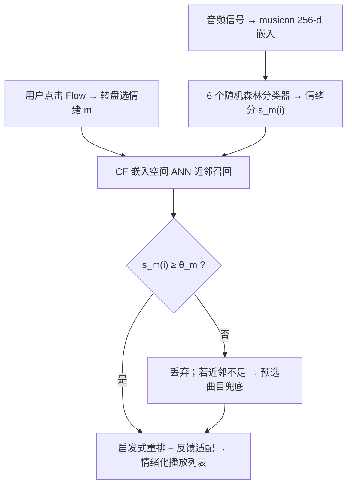
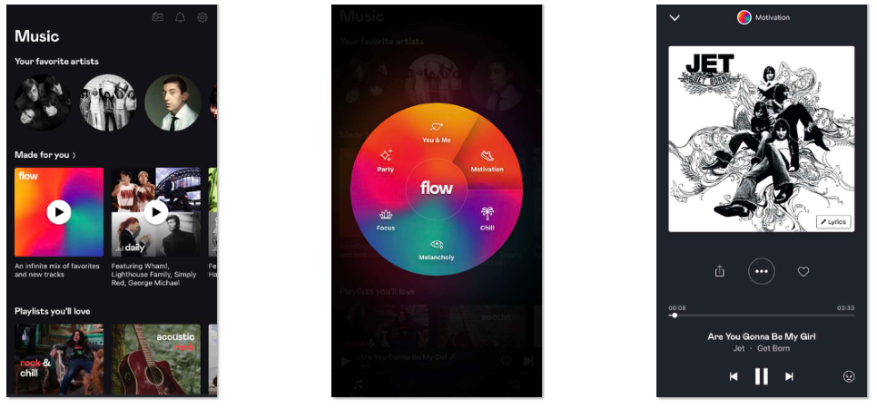
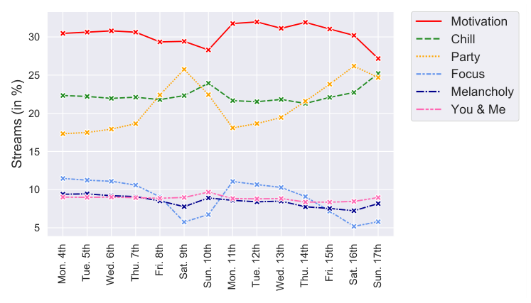

# Flow Moods: Recommending Music by Moods on Deezer (Deezer 上的情绪化音乐推荐)

- **会议/期刊**: RecSys 2022（Industry Paper，5 页短文）
- **作者与机构**: Théo Bontempelli, Benjamin Chapus, François Rigaud, Mathieu Morlon, Marin Lorant, Guillaume Salha-Galvan（Deezer，法国）
- **推荐链路定位**: 召回（情绪条件化的候选过滤与重排）
- **研究方向**: 多模态推荐（音频内容理解） / 冷启动与长尾兜底
- **论文原文**: [https://arxiv.org/abs/2207.11229v1](https://arxiv.org/abs/2207.11229v1)
- **开源代码**: 暂未开源（工业系统，内部实现细节因保密省略）

## TL;DR (1分钟核心速览)

Deezer 的 Flow 只做纯协同过滤式电台推荐，忽略了用户"当下心情"，导致同一首歌在专注与派对场景下体验错位。Flow Moods 让用户在六类情绪转盘（Chill/Focus/Melancholy/Motivation/Party/You & Me）上先声明上下文，再用专业策展标注训练的 256 维 musicnn 音频嵌入 + 6 个随机森林分类器为全库打情绪分，在 CF 向量检索结果上做情绪硬过滤并配备兜底。系统 2021 年 10 月全球上线，日服千万级用户；两周线上日志显示 Motivation 恒为最高流量情绪、Party 在周末显著抬升。

## Background & Motivation (背景与核心矛盾)

- **主流范式**: Flow 采用隐因子协同过滤，在统一的 user–song 嵌入空间中取近邻歌曲，再用内部启发式重排、结合点赞/跳过/屏蔽反馈做自适应调整。
- **前人局限 (矛盾一)**: 纯 CF 只建模"用户整体品味"，无法表达同一用户跨情境的偏好漂移——喜欢工作时听舒缓音乐的人，在周五派对场景下并不想听到它。
- **前人局限 (矛盾二)**: 用户若想纠正这类错配，只能用点赞/跳过/排除物品等弱反馈，既费力又滞后，反馈信号与"当前心情"并不对齐，难以反向约束召回。
- **核心洞察 (Key Insight)**: 用户心智状态会在很大程度上决定同一推荐被感知的方式，因此**上下文应先于推荐被显式采集**，而不是试图从隐式反馈中反推。
- **本文切入点**: 用一次轻量的情绪显式选择（交互式转盘）换取一个强约束条件，把"情绪"变成候选集上的硬过滤算子；并用音频内容模型把少量专家标注放大到百万级曲库。

## Method (核心方法设计)

### 1. 整体框架 (Overall Architecture)

系统分三层闭环：（1）**上下文采集层**——用户在 Flow 入口点击后，于转盘上六选一（点转盘中心则退回不带情绪的常规 Flow），这一交互同时充当后续标注数据的天然来源；（2）**内容打分层**——策展专家对数千首歌做 "情绪/非情绪" 人工二分类标注，作为 ground truth 训练集；每首歌由 VGG-like 的 musicnn 音频标注网络从原始音频信号编码为 256 维向量，再送入 6 个独立随机森林二分类器，输出 0–1 的情绪分；（3）**检索过滤层**——CF 嵌入的近邻检索（Faiss + Golang 服务，用户–歌曲空间内 ANN 取近邻）之上叠加情绪分阈值过滤，再经内部启发式重排与反馈适配，输出无限流式播放列表。

<figure class="paper-figure" markdown="span">
  <figcaption>图1. Deezer移动应用上Flow Moods的界面。用户点击首页的Flow按钮后（左），可在交互式转盘上选择一种心情（中）。这会生成针对该心情的个性化歌曲播放列表（右），其计算方式如第2.2节所述。注：点击转盘中心将启动忽略心情的“常规”Flow算法，如第2.1节所述。</figcaption>
</figure>

### 2. 关键设计拆解 (Key Designs)

1. **情绪作为显式上下文接口（Mood as First-Class Context）**：痛点是从隐式反馈反推场景几乎不可解；本文把问题前移为用户侧一次零成本选择，将推荐目标改写为条件分布 $p(i \mid u, m)$，其中$m \in \{\text{Chill},\dots,\text{You \& Me}\}$。直觉上，显式声明把"多义的用户向量"沿情绪轴切开，等价于对用户做一次免费的软聚类降噪。注意其"mood"定义被刻意放宽，同时涵盖情绪与与之绑定的活动（如 Motivation≈健身），从而提升类目覆盖率与可理解性。

2. **专家标注 + 音频内容模型的情绪打分放大器（Annotation Distillation to Audio）**：全库人工标注不可行，故先用策展人标注的 "m / not m" 样本训练 6 个随机森林，输入为音频嵌入：

$$s_m(i) = f_m(\mathbf{e}_i^{\text{audio}}) \in [0,1], \quad \mathbf{e}_i^{\text{audio}} = \text{musicnn}(i) \in \mathbb{R}^{256}$$

无需歌词、无需文本元数据，仅靠声学特征（节奏、音色、能量）即可泛化到百万级未标注曲目；一首歌可同时获得多个高情绪分，符合"一首歌可既 Chill 又 Melancholy"的现实，也避免了互斥多分类的标签噪声。音频侧建模的另一好处是对新歌/长尾歌天然友好——不依赖交互量。

3. **情绪硬过滤 + 兜底机制的召回改写与推理开销**：最终候选集是两个条件的交集（CF 近邻阈值 $\delta$与情绪阈值$\theta_m$）：

$$\mathcal{C}_u^{(m)} = \{\, i \in \mathcal{I} : \langle \mathbf{u}_u, \mathbf{v}_i \rangle \ge \delta \ \wedge\ s_m(i) \ge \theta_m \,\}$$

本质是把情绪分当作**召回阶段的门控**而非精排特征，实现代价极低（一次布尔过滤）；当用户在对应情绪下嵌入近邻不足（新用户、小众情绪）时触发 fallback，直接下发预选曲目集合，保证永不空列表。工程上，歌曲侧数据（情绪分、嵌入、元数据）每日导出到 Cassandra、每周随分类器版本更新；在线服务跑 Kubernetes，播放列表生成在 Scala 服务内完成，ANN 检索由 Go 应用封装 Faiss 承担。总训练目标即 6 个独立二分类器的监督损失之和（原文未给出正则/采样细节，属保密范畴），推理阶段无额外模型前向。

## Experimental Setup & Evaluation Protocol (实验设置与评估协议)

- **数据集与预处理**: 本文**未使用公开学术数据集，也未报告离线指标**。数据侧构成为：Deezer 生产环境（9000 万曲目、1600 万活跃用户、180 国）；训练信号为策展专家人工标注的数千首跨流派/跨国歌曲；评估信号为上线后真实流量日志。

| 数据/场景 | 规模与说明 | 用途 |
| :--- | :--- | :--- |
| Deezer 曲库 | 约 90M tracks / 16M 活跃用户 | 服务对象与打分覆盖范围 |
| 专家标注集 | 数千首，六情绪 × 正/负标签 | 6 个随机森林的训练集（ground truth） |
| 线上流量日志 | 2022-04-04 至 04-17，共 14 天 | 情绪类别日度流量分布分析 |
| 入口门槛 | 至少 16 首收藏歌曲/艺人方可使用 Flow | 用户侧准入与冷启动边界 |

- **数据划分与防穿越 (Splitting Strategy)**: 无学术意义的划分；无监督训练/测试切分报告。工业上采用"标注集训练 → 全库推断 → 每周模型版本滚动更新"，需警惕的是**标注集与推断曲库的分布漂移**（新曲目、新流派）会造成情绪分校准随时间衰减，论文未做该漂移的量化。
- **排名评测协议 (Ranking Protocol)**: **无离线 Full-Ranking 或 Sampled Ranking 评测**，也无 NDCG/Recall/Precision 报告。替代评估为线上指标（Flow 渗透率 = 通过 Flow 听歌的用户占比，数值因保密省略）与情绪类别流量占比的时序分析，属**弱对照的单臂观测**，缺乏 A/B 分流与显著性检验报告。
- **对比基线与超参设置**: 无可比基线（唯一"对照"是上线前的常规 Flow 及其历史渗透率）。关键超参为各情绪阈值 $\theta_m$与近邻阈值$\delta$、兜底触发条件；广播层面的设计参数为音频嵌入维度$d=256$、6 个 RF 分类器、6 类情绪固定词表。均未做敏感性分析。

## Key Experimental Results (实验关键数据)

### 1. 主实验对比 (Main Results)

原文**不存在学术主实验表**，下表如实汇总其唯一可得的定量/定性上线观测（数值未披露者以方向性描述代替，不作任何虚构填充）：

| 观测对象 | 常规 Flow（上线前） | Flow Moods（2021-10 上线后） | 备注 |
| :--- | :---: | :---: | :--- |
| Flow 渗透率（听歌用户占比） | 基线 | 观测到提升（数值保密） | 内部指标，无 A/B 区间 |
| 情绪选择入口 | 不存在 | 转盘六选一 + 中心回退常规 Flow | 移动端 2021-10，桌面端 2022-03 |
| 最高流量情绪 | — | Motivation（两周内持续居首） | 日度分布稳定 |
| 周末效应 | — | Party 在周五与周末显著上升 | 反复出现于更长周期 |
| 工作日效应 | — | Focus 在工作日更高 | 与"办公场景"直觉一致 |
| 周日效应 | — | Chill 在周日略高 | 幅度最小 |

<figure class="paper-figure" markdown="span">
  <figcaption>图2. 按Flow Moods类别划分的每日播放量分布（2022年4月4日至17日）。</figcaption>
</figure>

### 2. 消融实验 (Ablation Study)

原文未开展消融实验（工业系统，无法对已上线组件做受控移除）。下表为基于系统描述的**定性必要性归因**，供复现者参考，非论文实测：

| 移除组件 | 预期后果 | 依据 |
| :--- | :--- | :--- |
| 专家标注训练集 | RF 分类器无监督信号，情绪分退化为随机门控 | 分类器仅在标注样本上训练 |
| 音频内容打分（仅用元数据/标签） | 长尾与新歌无法获得情绪分，过滤后候选急剧收缩 | 全库人工标注不可行 |
| 情绪硬过滤 $\theta_m$ | 退化为常规 Flow，"错时推荐"问题回归 | 这是唯一条件化算子 |
| Fallback 预选集合 | 小众情绪/新用户出现空列表，直接损伤渗透率 | 无兜底时候选可为空集 |

### 3. 关键实验发现 (Key Findings)

1. **情绪是高频且稳定的用户意图维度**：上线后 Motivation 在 2022-04-04 至 04-17 的 14 天里持续占据最高流量份额，说明"健身/激励"类活动型情绪比纯情绪标签更贴近真实使用频次，验证了作者把 mood 定义放宽到活动的决策。
2. **情绪分布呈现清晰的周期结构**：Party 在周五与周末系统性抬升、Focus 在工作日更高、Chill 在周日略高，三类信号的相位差异说明情绪选择并非随机噪声，而是与作息强相关的可预测上下文——这为后续"按时段预热/预取"的工程优化提供了直接依据。
3. **渗透率提升与候选收缩的张力需被关注**：Flow 渗透率上升的同时，情绪硬过滤会显著压缩候选池，其代价被 fallback 预选曲目掩盖而非消除；论文未披露兜底触发比例，因此"提升究竟来自情绪匹配还是来自更强的头部曲目重复曝光"无法从现有证据中分离。

## Highlights & Limitations (亮点、对比与审稿批判)

- **与代表作对比 (vs. Prior Work)**: 相比 SGL/SimGCL 一类在**表征层**做增广去噪的工作，本文在**接口层**引入上下文，思路更接近上下文感知推荐（CAMF/情境感知）而非表示学习；相比 musicnn 原论文的纯音频标注任务，本文的关键增量不在模型，而在"少量专家标注 → 全库情绪分 → 召回门控"的蒸馏式闭环；相比同期 LLM4Rec 的语义增强路线，其优势是零推理延迟、可解释、可运营。
- **可迁移亮点**: （1）**"专家小样本 + 内容模型放大 + 硬门控"**三段式范式可直接迁移到短视频调性、电商场景标签（如礼物/办公）等需要全库语义标签的任务；（2）把用户的一次显式选择当作**免费且高精度的训练/评估信号**，可用于后续标注闭环与分层评估。
- **审稿级局限批判**: （1）**评估近乎不可复现**：无离线指标、无基线、无 A/B 与显著性检验，渗透率数值全部省略，结论只能停留在"方向正确"；（2）**门控式设计的精度与多样性代价未被讨论**：情绪分由 6 个独立 RF 输出，阈值 $\theta_m$ 与正负标注比例强相关，论文既未给阈值敏感性，也未报告过滤后候选池规模、覆盖率与头部集中度变化；（3）音频单模态（无歌词、无元数据）对"Melancholy/You & Me"这类语义强依赖标签的判别力存疑，作者自己也在结论中把这列为未来工作。

## Rating (四维评分)

- **方法创新性 (Novelty)**: ⭐⭐⭐ （无新模型与新理论，创新在于把情绪上下文作为召回门控的工业系统设计与标注蒸馏闭环）
- **评估协议与实验扎实度 (Protocol & Experiments)**: ⭐⭐ （无离线实验、无基线、无 A/B 与显著性检验，关键数值保密，仅有两周流量分布的描述性分析）
- **写作与数学规范度 (Clarity & Rigor)**: ⭐⭐⭐⭐ （5 页内把动机、系统三层结构、部署栈表达到位，术语与情绪定义清晰；但刻意省略输入数据与算法细节，公式层面几乎无形式化）
- **工业落地与复现价值 (Industrial & Practical Value)**: ⭐⭐⭐⭐⭐ （千万级用户真实上线、Cassandra/K8s/Scala/Faiss 全链路可借鉴，是"低成本上下文条件化"极佳的工程范本；但无开源代码，复现需自行重建标注与分类器）

