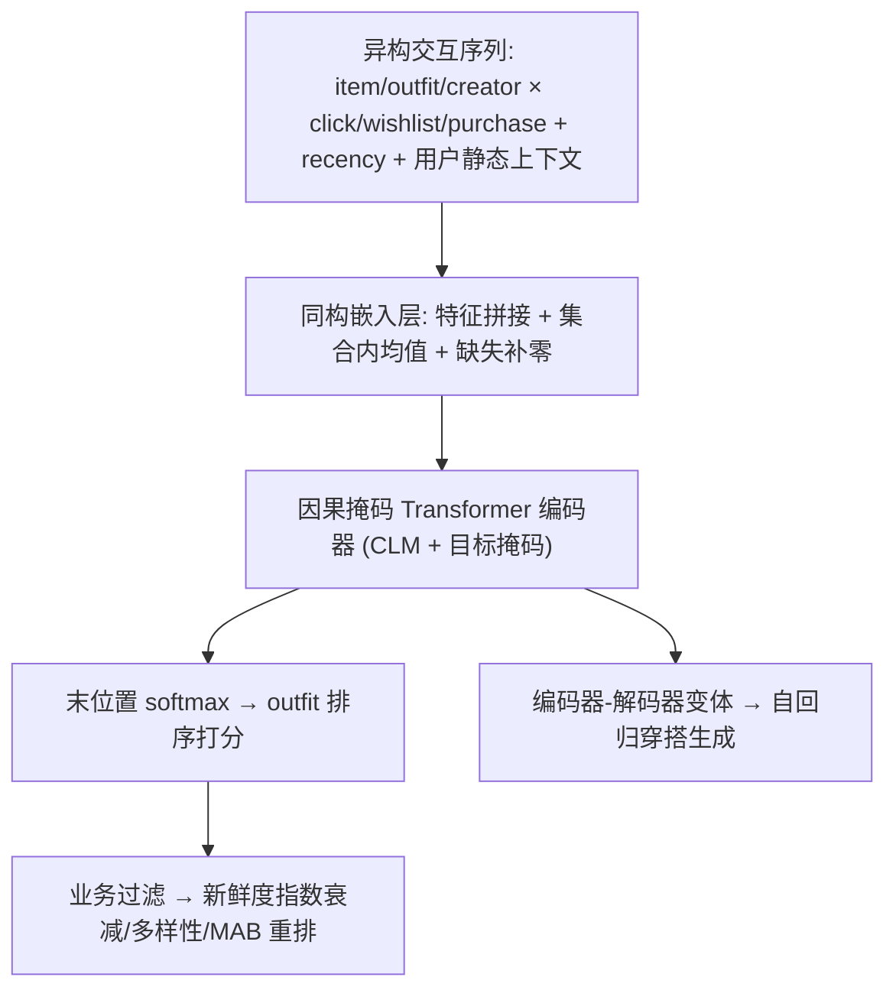
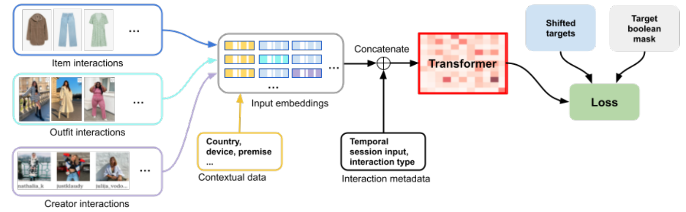

# Reusable Self-Attention Recommender Systems in Fashion Industry Applications (面向时尚工业场景的可复用自注意力推荐系统)

- **会议/期刊**: RecSys 2022（Sixteenth ACM Conference on Recommender Systems，4 页工业实践短文 / talk paper）
- **作者与机构**: Marjan Celikik, Jacek Wasilewski, Ana Peleteiro Ramallo（Zalando SE, Berlin）
- **推荐链路定位**: 精排 + 重排（同一模型复用至会话召回式打分与端到端生成式穿搭）
- **研究方向**: 多模态推荐（视觉-文本-品类异构元数据融合）/ 冷启动与长尾推荐
- **论文原文**: [https://arxiv.org/abs/2301.06777v1](https://arxiv.org/abs/2301.06777v1)
- **开源代码**: 暂未开源

## TL;DR (1分钟核心速览)

针对“每个触点各建一套端到端系统”导致的维护爆炸与反馈回路放大偏置，Zalando 提出**一个可配置的 Transformer 推荐骨架**：把 item / outfit / creator 三类实体、click / wishlist / purchase 三类交互压进**结构同构的嵌入空间**，用**目标布尔掩码**让多源序列只对 outfit 目标算损失，并用**离散化交互新鲜度**隐式建模 session 以区分长短期兴趣。评估完全在**线上真实流量 A/B**（非离线 Full-Ranking）上进行：outfit 目录页全量互动 **+28.5%**、style preview **+23.9%**、Get-the-look 冷启动 **+109.4% / 存量 +130.6%**，算法穿搭（AFC）留存 **+11.20%**；同流量下 p99 延迟约降一半、吞吐约提升 3 倍。

## Background & Motivation (背景与核心矛盾)

- **主流范式**：时尚灵感场景（图 1）被拆成穿搭目录排序、风格预览轮播、会话内“Get-the-look”、算法时尚伴侣 AFC 等多条链路，各自维护一套 LTR / kNN / Siamese 系统；学术侧则以标准化数据集上的离线指标验证 self-attention 推荐。
- **前人局限**：其一，多数自注意力推荐工作只用单一用例、单一交互类型，**丢弃了 item 与用户异构元数据**，而深度推荐恰恰只在特征丰富时才发挥上限；其二，各触点独立建模使训练集被人为切碎，且模型反复学习自己前一天的曝光结果，**放大流行度偏置与展示偏置（feedback loop）**。
- **核心洞察 (Key Insight)**：不同用例所需的“信号”其实是同一份用户旅程数据的不同切片——只要实体被映射到同一嵌入结构，一个编码器就能同时服务长期偏好排序与短期会话意图；而**缺失交互的冷启动用户也可借同序列内其他实体类型（item/creator）或静态上下文补全**。
- **本文切入点**：以“实体-类型解耦的输入层 + 因果语言模型训练 + 目标掩码”替代多套专用模型，并把过滤/重排业务逻辑外置到可配置后端。

## Method (核心方法设计)

### 1. 整体框架 (Overall Architecture)

输入是一条异构交互序列，每步记录 `(实体, 交互类型, 时间戳)`，实体可为 outfit（一**组** item）、单个 item 或 creator（一**组** outfit）。所有实体经同一套拼接逻辑变成等维向量，与离散化 recency、1-hot 交互特征、用户静态上下文嵌入一起送入**因果掩码 Transformer 编码器**，以 CLM（下一实体预测）方式训练；末位置隐状态经 softmax 在全库 outfit 上打分，交给业务过滤（规则/库存）与重排（新鲜度指数衰减、多样性、MAB 探索）。同一份序列数据另训练**编码器-解码器变体**（编码器吃 outfit 之前的交互，解码器自回归输出该 outfit 内的 item 序列）用于个性化穿搭生成。

<figure class="paper-figure" markdown="span">
  <figcaption>图 2：模型概览：模型在不同交互实体与类型上训练，这些实体与类型被转换为结构相同的嵌入。时序会话与交互数据直接拼接到已学习的嵌入上。使用掩码以仅考虑特定实体类型（如穿搭）的目标输出。</figcaption>
</figure>

### 2. 关键设计拆解 (Key Designs)

1. **异构实体同构化（Set-as-Entity Embedding）**：痛点是 outfit 是 item 集合、creator 是 outfit 集合，若各建塔则无法共享参数与序列。做法是对每个类别特征 $f\in\mathcal{F}$ 在集合内取均值，并对缺失特征补零后拼接：

$$\mathbf{e}_x=\big\Vert_{f\in\mathcal{F}}\Big(\frac{1}{|\mathcal{I}_x|}\sum_{i\in\mathcal{I}_x}\mathbf{v}_{f,i}\Big)\oplus\mathbf{1}(t_x)\oplus\mathbf{u}$$

其中 $\mathbf{1}(t_x)$为交互类型 1-hot、$\mathbf{u}$ 为用户静态上下文（置于序列首部，服务全冷启动用户）。直觉：均值聚合使“单 item”退化为“单元素 outfit”，用一个算子吃掉三种粒度，天然获得跨实体迁移与冷启动补全能力。

2. **目标掩码 + 新鲜度会话建模**：痛点一是多源序列若全位置算损失会把 creator 点击误当穿搭偏好，痛点二是兴趣跨 session 剧烈漂移。做法是引入目标指示 $\mathbb{I}[y_x\in\mathcal{O}]$ 只保留 outfit 目标，并把 recency 直接拼进实体向量而非单列位置编码：

$$\mathcal{L}=-\sum_{x\in\mathcal{S}}\mathbb{I}[y_x\in\mathcal{O}]\log\frac{\exp(\mathbf{h}_{x-1}^{\top}\mathbf{v}_{y_x})}{\sum_{y\in\mathcal{O}}\exp(\mathbf{h}_{x-1}^{\top}\mathbf{v}_{y})},\qquad r_x=\big\lfloor (T_{\text{serve}}-t_x)/86400\big\rfloor$$

注意力因此可自行用 $r_x$ 选出“当天同 session”的邻居，等价于软性会话切分而无需显式 session id；作者报告忽略该结构会显著掉点。

3. **生成式穿搭的共享编码器与训练/推理同构部署**：生成任务把“被交互 outfit 内的 item 序列”作为解码器监督，迫使模型学到**时尚兼容性（compatibility）**而非单纯共现：$p(o_{1:m}\mid\mathcal{S}_{<x})=\prod_{j=1}^{m}p(o_j\mid\mathcal{S}_{<x},o_{<j})$。工程上把实体特征映射与模型放在同一服务、只传原始交互 id，避免集合展开导致的网络放大，并使训练/推理特征逻辑完全一致。

4. **训练目标与推理开销**：排序侧对比 softmax、BPR、top-1、BCE，仅 softmax 有效（其余在强异构特征下不收敛到可用水平）；负样本为**全库 softmax（免显式负采样）**。推理为单次前向 + 末位置打分，相对 TF-Ranking 基线 p99 约减半、同流量吞吐约 3×（后者因扩展性问题每请求仅能重排 1000 件）。

## Experimental Setup & Evaluation Protocol (实验设置与评估协议)

- **数据集与预处理**：本文**不使用公开离线数据集**，全部实验为 Zalando 生产流量在线 A/B；训练数据为日更的用户旅程异构交互日志（无 5-core 过滤，无交互用户靠静态上下文兜底）。

| 数据源 | 实体类型 | 交互类型 | 更新频率 | 场景说明 |
| :--- | :---: | :---: | :---: | :--- |
| Zalando 生产日志 | outfit / item / creator | click / wishlist / purchase | 日更（含实时流） | 穿搭目录、风格预览、Get-the-look、AFC 生成 |
| 用户静态上下文 | 用户画像特征 | — | 日更 | 解决零交互全冷启动 |

- **数据划分与防穿越 (Splitting Strategy)**：未报告离线划分；线上采用时间因果的训练/服务错位，并对序列施加因果掩码保证不看未来交互。
- **排名评测协议 (Ranking Protocol)**：无离线 Full-Ranking / Sampled Ranking 指标；线上指标为**用户互动率（engagement）与留存（retention）**，并按 `Cold-start / Existing / All` 三档用户分层切分报告。
- **对比基线与超参设置**：排序侧基线为 TF-Ranking 的 LTR 与 CNN-embedding kNN；生成侧基线为 Siamese Nets。Embedding 维度 $d$、层数、学习率等**均未披露**，亦未报告显著性检验（$p$ 值）。

## Key Experimental Results (实验关键数据)

### 1. 主实验对比 (Main Results)

表 1：三触点线上 A/B（相对基线互动提升，正值为本文模型更优）

| 触点 | 基线 | Cold-start | Existing | All |
| :--- | :--- | :---: | :---: | :---: |
| Outfit catalog | LTR (TF-Ranking) | **+42.0%** | **+27.0%** | **+28.5%** |
| Style preview carousel | LTR | **+39.7%** | **+23.1%** | **+23.9%** |
| Get-the-look (会话内) | CNN-kNN | **+109.4%** | **+130.6%** | **+130.4%** |

表 2：AFC 算法穿搭生成线上 A/B（Transformer vs. Siamese Nets）

| 对照设置 | Engagement | Retention |
| :--- | :---: | :---: |
| (1) Transformer vs. SN | **+5.79%** | **+11.20%** |
| (2) Transformer+单嵌入快回退 vs. Transformer+SN | **+1.54%** | **+4.9%** |

### 2. 消融实验 (Ablation Study)

原文未设标准离线消融，仅有零散设计选项对照，汇总如下：

| 变体 / 设计选择 | 相对表现 | 说明 |
| :--- | :---: | :--- |
| 末位置 softmax | 最优（作者称显著） | 唯一可用 |
| BPR / top-1 / BCE | 更差 | 在异构强特征下失效 |
| 去掉 session/recency 结构 | 掉点（未给数值） | 作者明确观察到负向 |
| 加入指数年龄衰减重排 | 相关性不掉、新内容占比升 | 缓解流行度偏置 |
| 模型内置特征处理（同构部署） | p99 约 −50%、吞吐约 3× | vs. TF-Ranking 服务架构 |

### 3. 关键实验发现 (Key Findings)

1. **收益与“信号丰度”正相关而非与模型容量相关**：会话内 Get-the-look 上 CNN-kNN 被拉开 **+130.6%**（存量用户），远高于目录页 LTR 的 +27.0%——说明短序列、强实时场景中原有 kNN 最缺上下文，自注意力把整条 session 变成特征后收益最大。
2. **统一建模对冷启动是结构性红利**：三个触点冷启动档提升分别为 +42.0% / +39.7% / +109.4%，与存量档同量级甚至更高，印证“借同序列的 item/creator 交互 + 静态上下文”能替代专用冷启动模型；而生成任务上加入快回退模型后，边际增益从 +11.20% 留存降至 +4.9%，暴露了**生成式方案对库存过滤导致的欠供给（undersupply）极度敏感**。
3. **复用性本身即指标**：单一骨架替换三套系统后仍全面正向，且工程侧以 3× 吞吐与一半 p99 支撑“每请求可重排全库”而非仅 1000 件，说明**训练数据合并带来的去反馈回路效应**可能与模型结构贡献同量级。

## Highlights & Limitations (亮点、对比与审稿批判)

- **与代表作对比 (vs. Prior Work)**：相较 BERT4Rec/SASRec 类单用例序列模型，本文的关键差异不在注意力算子，而在**多实体（item/outfit/creator）× 多交互类型的同构化与目标掩码**；相较 Siamese/度量学习式穿搭兼容模型，本文用“被交互 outfit 的 item 序列”做解码监督，把兼容性学习内嵌进同一序列生成框架；相较 TF-Ranking 的 LTR 流水线，差异在于特征处理与模型同服务部署带来的数量级延迟改善。
- **可迁移亮点**：①“集合实体 → 特征均值 + 缺失补零 + 类型 1-hot”的同构嵌入，可直接迁移到图文电商的“商品-套装-店铺”多粒度建模；②用**离散化 recency 作为特征而非位置编码**来软切 session，是实现成本极低的长短期兴趣分离技巧。
- **审稿级局限批判**：其一，作为 4 页 talk paper，**完全缺失离线基准与公开数据**，无 Embedding 维度、层数、显著性检验与置信区间，A/B 仅给相对提升，无法排除流量分配与新奇效应干扰，复现性极低；其二，模型是**重型实时序列服务**（日更实体映射 + 自回归生成逐件等待），p99 减半仅是相对基线，绝对延迟与成本未披露，并且穿搭生成严重依赖库存回退策略——一旦业务规则收紧，生成式收益（+11.2% 留存 → +4.9%）即大幅缩水，泛化边界实际上由供给侧决定。

## Rating (四维评分)

- **方法创新性 (Novelty)**: ⭐⭐⭐ （注意力算子无新意，创新在“异构实体同构嵌入 + 目标掩码 + recency 软会话”的系统级组合，工程洞察强于理论贡献）
- **评估协议与实验扎实度 (Protocol & Experiments)**: ⭐⭐ （仅线上 A/B、分层切分设计合理，但无离线 Full-Ranking 基准、无显著性检验、无超参与消融数值，关键设计对比多为定性描述）
- **写作与数学规范度 (Clarity & Rigor)**: ⭐⭐⭐ （四页内讲清架构与部署取舍，公式极简且缺符号表，兼容性/生成目标未形式化定义，属实践报告体例）
- **工业落地与复现价值 (Industrial & Practical Value)**: ⭐⭐⭐⭐⭐ （真实生产三触点全面正向 + 留存 30% 量级收益 + 3× 吞吐 / 半 p99 的部署证据，对工业架构设计极具参考价值；但代码未开源）

