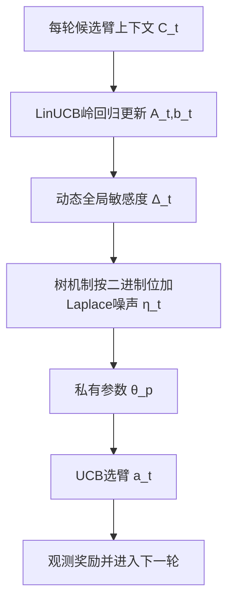
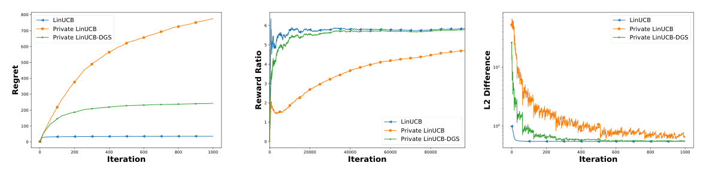

# Dynamic Global Sensitivity for Differentially Private Contextual Bandits (动态全局敏感度驱动的差分隐私上下文Bandit)

- **会议/期刊**: RecSys 2022
- **作者与机构**: Huazheng Wang, David Zhao, Hongning Wang；Oregon State University / University of Virginia
- **推荐链路定位**: 在线探索与排序策略（Contextual Bandit 交互推荐）
- **研究方向**: 强化学习与动态探索推荐 / 去偏公平、可信隐私
- **论文原文**: [https://arxiv.org/abs/2208.14555v1](https://arxiv.org/abs/2208.14555v1)
- **开源代码**: 暂未开源

## TL;DR (1分钟核心速览)

针对隐私Contextual Bandit中“对奖励/上下文加噪需恒定敏感度、噪声过大”的痛点，本文观察到LinUCB参数随在线更新收敛后，单条奖励扰动对参数的影响递减，提出动态全局敏感度分析，并配合树机制直接对模型参数注入Laplace噪声。理论上以$(\epsilon,\delta)$-DP将隐私附加Regret降至$\tilde O(\log T\sqrt{T}/\epsilon)$；合成数据与LastFM上，同$\epsilon=2$时Regret和参数估计均显著优于Private LinUCB，并贴近非隐私LinUCB。

## Background & Motivation (背景与核心矛盾)

- **主流范式**: LinUCB用岭回归估计$\hat{\theta}_t=A_t^{-1}b_t$，再以UCB选臂；隐私Bandit多对$b_t=\sum_i \mathbf{x}_{a_i}r_i$或上下文加噪。
- **前人局限**: 既有方法假设$b_t$的全局敏感度为常数，导致每轮注入恒定噪声；且未利用Bandit模型随$t$收敛、后期对奖励扰动更不敏感的性质。
- **核心洞察 (Key Insight)**: 模型收敛使相同奖励变化对$\hat{\theta}_t$的影响变小，因此全局敏感度可随时间收缩，后期只需更少噪声即可维持同等隐私。
- **本文切入点**: 直接对$\hat{\theta}_t$做动态全局敏感度分析，并用树机制按时间尺度分配噪声，减少隐私带来的效用损失。

## Method (核心方法设计)

### 1. 整体框架 (Overall Architecture)

每轮接收候选臂上下文$C_t$，先用历史交互做岭回归更新$A_t,b_t$；随后根据当前时刻的动态敏感度$\Delta_t$，通过树机制生成Laplace噪声$\eta_t$并加到参数上，得到私有参数$\hat{\theta}^p_t$；最后用私有UCB分数选臂并观测奖励。核心闭环是“收敛→敏感度下降→噪声下降→Regret下降”，不改变LinUCB的在线决策结构。

### 2. 关键设计拆解 (Key Designs)

1. **动态全局敏感度（Dynamic Global Sensitivity）**：前人卡在$b_t$敏感度恒定；本文证明当上下文满足i.i.d.且$\mathbb{E}[XX^\top]$满秩时，对相邻奖励序列有$\Delta_t\le 2L/\lambda'\le 32L/(\lambda_0 t)$（$t>32\log(1/\delta)/\lambda_0$）。直觉是$A_t$最小特征值随$t$增长，逆矩阵对单点奖励变化的放大效应递减，故后期可少加噪。
2. **动态敏感度树机制（Tree-based Mechanism）**：将参数更新视为部分和，按$t$的二进制位加噪：$\eta_t=\sum_{b_i=1}\mathrm{Lap}(\Delta_{t-2^i+1}/\epsilon')$，其中$\epsilon'=\epsilon/\log_2 T$、$\delta'=\delta/\log_2 T$。因$\Delta$随$t$下降，噪声规模约为$O(L\log T\sqrt{\log t\log(1/\zeta)}/(t\epsilon))$，显著小于恒定敏感度方案。
3. **训练目标、负采样与推理效率**：无显式训练损失，采用岭回归闭式更新+UCB推理；LastFM每轮候选含1个正反馈+24个随机零反馈，合成数据每轮10臂。每轮树机制仅$O(\log T)$次噪声采样，无需存树；隐私附加Regret为$\tilde O(\log T\sqrt{T}/\epsilon)$，优于Private LinUCB的$\tilde O(\log^{2.5}T\sqrt{T}/\epsilon)$。

## Experimental Setup & Evaluation Protocol (实验设置与评估协议)

- **数据集与预处理**:

| 数据集 | #Users | #Items | #Interactions | 稀疏度/密度 | 特征/场景说明 |
| :--- | :---: | :---: | :---: | :---: | :--- |
| Synthetic | - | 1000臂 | 1000轮 | - | $d=10$，每轮10臂，奖励噪声$\sigma=0.5$ |
| LastFM | 1,892 | 17,632 | 图1b约$8\times10^4$轮 | 极稀疏 | 6,036 tags→PCA 25维；候选25（1正+24零） |

- **数据划分与防穿越**: 在线序列决策，无Leave-One-Out/比例划分；每轮仅用历史交互更新，天然避免未来信息穿越。
- **排名评测协议**: 非Full-Ranking/非采样排序，而是候选臂集上的在线选臂；合成数据报累计Regret（越低越好），LastFM报相对随机策略的累计Reward Ratio（越高越好）。
- **对比基线与超参**: 原文仅3个算法：LinUCB、Private LinUCB、Private LinUCB-DGS；默认$\epsilon=2,\delta=0.1$，并测试$\epsilon\in\{0.5,1,2,5\}$；无显著性检验与更多SOTA基线。

## Key Experimental Results (实验关键数据)

### 1. 主实验对比 (Main Results)

原文仅给曲线未列表格；下表数值为图1终点近似读图，仅用于趋势判断。

| 方法 | 合成Regret@1k | LastFM Reward Ratio | 参数L2误差 | 奖励翻转后臂变化 |
| :--- | :---: | :---: | :---: | :---: |
| LinUCB（非隐私） | **≈600** | **最高** | **最低** | 最多 |
| Private LinUCB | ≈800 | 最低 | 振荡最大 | 均值相近、方差大 |
| Private LinUCB-DGS | **≈650（私有最优）** | 次高 | 收敛更快 | **更少且稳定** |

DGS vs Private LinUCB的Regret近似改善约$(800-650)/800\approx18.8\%$；LastFM上DGS的Reward Ratio明显高于Private LinUCB并接近非隐私LinUCB。

<figure class="paper-figure" markdown="span">
  <figcaption>图 1：在模拟和真实数据集上的遗憾与参数估计质量。</figcaption>
</figure>

### 2. 消融实验 (Ablation Study)

原文无组件消融，以下为隐私预算与敏感度机制分析。

| 分析设置 | 结果 |
| :--- | :--- |
| $\epsilon=0.5/1/2/5$| Regret随$\epsilon$增大而下降；$\epsilon$越小噪声越大、Regret越高 |
| 合成数据翻转$t=0/100/200$ | 越晚翻转奖励，选臂变化越少；DGS变化少于LinUCB |
| LastFM翻转$t=0/1000/2000$ | 同上；Private LinUCB方差更大，DGS更稳定 |

### 3. 关键实验发现 (Key Findings)

- 同$\epsilon=2$下，DGS在合成数据$T=1000$时Regret约650、Private LinUCB约800，降幅约18.8%，且图1c显示其参数误差收敛更快、振荡更小，直接验证“收敛→敏感度下降→少噪声”的机制。
- LastFM稀疏真实数据上，DGS的Reward Ratio高于Private LinUCB并贴近非隐私LinUCB，说明动态敏感度并非仅适配合成分布。
- $\epsilon$从0.5增至5时Regret持续下降，且奖励翻转越晚、选臂变化越少，分别验证隐私-效用权衡与动态敏感度的时序收缩性质。

## Highlights & Limitations (亮点、对比与审稿批判)

- **与代表作对比 (vs. Prior Work)**: Neel & Roth对$b_t$加恒定敏感度噪声，附加Regret为$\tilde O(\log^{2.5}T\sqrt{T}/\epsilon)$；本文直接对$\hat{\theta}_t$加动态敏感度噪声，降至$\tilde O(\log T\sqrt{T}/\epsilon)$。Shariff & Sheffet保护上下文+奖励的联合DP，本文聚焦奖励隐私；Pichapati等做维度自适应DP-SGD，未利用Bandit收敛性。
- **可迁移亮点**: “收敛感知的敏感度收缩+树机制”可迁移到在线凸优化、逻辑Bandit等在线学习；直接扰动模型参数并利用DP后处理不变性，是比扰动输入更省噪声的通用技巧。
- **审稿级局限批判**: 依赖上下文i.i.d.且$\mathbb{E}[XX^\top]$满秩的Assumption 1，否则需高斯扰动上下文且Regret变大；仅给gap-independent上界，DP线性Bandit下界仍开放；实验规模小、无开源代码/线上A/B/显著性检验，且需预知$L,\lambda_0$，工程调参敏感。

## Rating (四维评分)

- **方法创新性 (Novelty)**: ⭐⭐⭐⭐ （首次把Bandit模型收敛性转化为动态全局敏感度，理论机制清晰）
- **评估协议与实验扎实度 (Protocol & Experiments)**: ⭐⭐⭐ （合成+LastFM验证充分，但仅3个基线、无显著性检验与组件消融）
- **写作与数学规范度 (Clarity & Rigor)**: ⭐⭐⭐⭐ （Lemma/Theorem链条完整，隐私与Regret证明较严谨，部分符号与读图数值需补充）
- **工业落地与复现价值 (Industrial & Practical Value)**: ⭐⭐⭐ （树机制开销低、易嵌入LinUCB，但无开源代码且依赖强假设与隐私参数调优）

