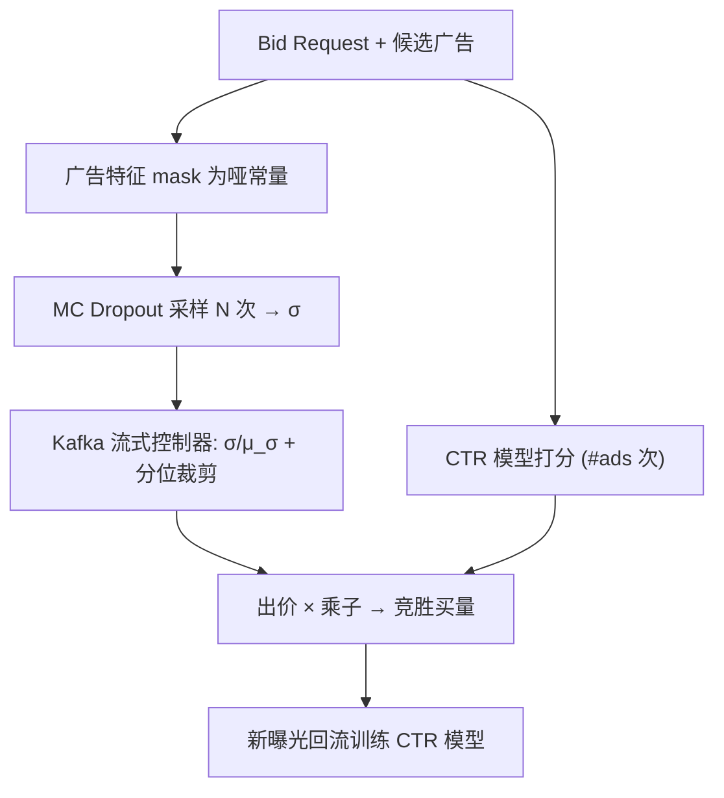

# Exploration with Model Uncertainty at Extreme Scale in Real-Time Bidding (实时竞价中超大规模下的模型不确定性探索)

- **会议/期刊**: RecSys 2022 (Industry Track, 短文 3 页)
- **作者与机构**: Jan Hartman, Davorin Kopič（Zemanta, an Outbrain company，斯洛文尼亚卢布尔雅那）
- **推荐链路定位**: 召回/出价决策（DSP 供给侧流量筛选与竞价）
- **研究方向**: 强化学习与动态探索推荐 / 去偏公平与工业架构
- **论文原文**: [https://arxiv.org/abs/2208.01951v1](https://arxiv.org/abs/2208.01951v1)
- **开源代码**: 暂未开源

## TL;DR (1分钟核心速览)

RTB 中 CTR 模型只用"自己竞胜买下的曝光"训练，形成反馈回路：模型不熟悉的供给（publisher/流量）打分差 $\to$出价低$\to$买不到$\to$永远学不会。本文提出用 MC Dropout 的**请求级预测不确定性**驱动探索：mask 掉广告特征后对同一请求采样$N$ 次估计不确定度，经 Kafka 流式控制器转成出价乘子（不确定性高则加价）。线上 A/B（数天、每组数亿曝光）相对无探索对照组 Revenue **+5.0%**、CTR **+9.6%**，离线 AUC **+0.24%**、LogLoss **-0.26%**，全面优于"等量随机加价"探索组。

## Background & Motivation (背景与核心矛盾)

- **主流范式**: DSP 侧以 DeepFM 家族模型预测 pCTR（Zemanta 每秒 6 亿次预测），pCTR 直接决定出价，模型只在自己竞胜的曝光上获得点击标签（censored data）。
- **前人局限**: ① 反馈回路自我强化，长尾供给永远得不到曝光，模型在这些区域持续欠拟合；② 简单计数法（"某 publisher 需 $N$ 次曝光"）需对每一维探索空间手工设阈值，维度爆炸且与模型知识无耦合。
- **核心洞察 (Key Insight)**: 模型在某供给上的**预测方差**恰是其"知识盲区"的连续、多维、与模型同步演化的代理指标——高方差即应多买。
- **本文切入点**: 以 MC Dropout 的预测标准差作为探索信号，把不确定度映射为出价乘子，并用流式控制器约束探索成本，使"多花的钱"可控且能回收为模型增益。

## Method (核心方法设计)

### 1. 整体框架 (Overall Architecture)

每个 bid request 到达后，CTR 模型先对全部候选广告正常打分（#ads 次前向）；同时将广告侧特征整体替换为哑常量，只保留请求侧特征，在开启 dropout 的推理模式下重复前向 $N$次，得到该请求的预测分布与标准差$\sigma$。$\sigma$与请求维度统计量写入 Kafka，控制器按近几分钟的滑动统计把$\sigma$ 归一化为出价乘子并做分位数裁剪，最终出价乘以该乘子；被加价买回的曝光回流训练集，闭环更新模型。

### 2. 关键设计拆解 (Key Designs)

1. **请求级 MC Dropout 不确定度（把 $O(\#ads \cdot N)$压到$O(\#ads + N)$）**：若对每个 (请求, 广告) 对都做$N$ 次采样，算力不可承受。作者只在请求级估计：广告特征置为哑常量后采样，得
$\sigma=\sqrt{\frac{1}{N}\sum_{n=1}^{N}\left(\hat{y}_n-\bar{y}\right)^2},\quad \bar{y}=\frac{1}{N}\sum_{n=1}^{N}\hat{y}_n$即每请求只多$N$ 次前向。直觉上"供给不确定性"本就与广告无关，请求级聚合既省算力又把供需两侧探索解耦。

2. **不确定性→出价乘子的流式控制器（防探索预算失控）**：直接按 $\sigma$ 加价会在流量突变时烧钱。控制器在 Kafka 上维护多维（如 publisher/site 维度）不确定度统计，取近几分钟均值做归一化
$\text{modifier}=\sigma/\mu_{\sigma},\ \text{clipped to }[m_{\min},m_{\max}]$并对过高/过低分位的请求直接过滤（不探索）。可调参数为探索流量占比、分位阈值与乘子上下界，共同控制 explore-exploit 比例；出价变为$b=\text{pCTR}\times\text{value}\times\text{modifier}$，保证 CPC 约束不被破坏。

3. **训练目标、负采样与推理开销**：CTR 模型仍以 log loss 训练（$\mathcal{L}=-\frac{1}{|\mathcal{D}|}\sum y\log\hat{y}+(1-y)\log(1-\hat{y})$），无额外探索损失、无负采样环节（全曝光样本）。推理侧仅增加$N$ 次小 batch 前向，落在 ~100ms 延迟预算内；A/B 中三个模型各自只在自己买的数据上训练，避免跨模型数据泄漏。

## Experimental Setup & Evaluation Protocol (实验设置与评估协议)

- **数据与场景**: 无公开数据集，全部为 Zemanta DSP 生产流量（百万级 bid request/秒，测试用其子集；每组模型购买数亿曝光，连续数天）。

| 实验组 | 探索信号 | 加价分布 | 训练数据来源 |
| :--- | :---: | :---: | :--- |
| Control | 无显式探索 | — | 仅自身竞胜曝光 |
| Uncertainty | 请求级 MC Dropout $\sigma$ | 与 Random 组匹配 | 仅自身竞胜曝光 |
| Random | 随机乘子 | 与 Uncertainty 分布对齐 | 仅自身竞胜曝光 |

- **数据划分与防穿越**: 线上 A/B 期间实时训练；线上结束后用**时间切分**的后续新流量做离线评估（模型未见该段数据），杜绝穿越。
- **评测协议**: 线上业务 KPI（Revenue、CTR，且须满足 CPC 成本约束）+ 离线全量 AUC / Log Loss；两探索组加价幅度分布对齐，保证"探索预算"可比。
- **对比基线与超参**: 无学术界 SOTA 基线，对照为无探索与随机探索；所有组共享同一特征集、超参与初始权重，$N$（MC 采样次数）与乘子上下界、探索占比为手工设定。

## Key Experimental Results (实验关键数据)

### 1. 主实验对比 (Main Results)

相对 Control 组的**相对变化**（Revenue/CTR 为线上 A/B，AUC/LogLoss 为离线新流量）：

| 组别 | Revenue ↑ | CTR ↑ | AUC ↑ | Log Loss ↓ |
| :--- | :---: | :---: | :---: | :---: |
| Control（无探索） | 0.0% | 0.0% | 0.0% | 0.0% |
| **Uncertainty（本文）** | **+5.0%** | **+9.6%** | **+0.24%** | **-0.26%** |
| Random（等量随机加价） | +3.2% | -2.3% | +0.19% | +0.8% |
| Improv.（Uncertainty vs Random） | +1.8 pt | +11.9 pt | +0.05 pt | -1.06 pt |

### 2. 消融实验 (Ablation Study)

论文未做模块级消融，仅以"替换探索信号"作为事实上的消融（3 页短文，其余组件如控制器、mask 策略均无对照）：

| 配置 | 探索信号来源 | Revenue | CTR | AUC | 结论 |
| :--- | :--- | :---: | :---: | :---: | :--- |
| Full（本文） | 模型 $\sigma$ | +5.0% | +9.6% | +0.24% | 业务与模型双赢 |
| w/o uncertainty | 随机乘子 | +3.2% | -2.3% | +0.19% | 只买到量，未买到知识 |
| w/o exploration | 无 | 基线 | 基线 | 基线 | 回路固化 |

### 3. 关键实验发现 (Key Findings)

1. **Revenue 提升不等于模型变好**：Random 组靠盲目加价也拿到 +3.2% Revenue，但 CTR 反降 2.3%、LogLoss 恶化 0.8%，说明它买的是低质曝光；只有 Uncertainty 组在 Revenue 之外同时改善 AUC（+0.24%）与 LogLoss（-0.26%），证明增益来自知识而非单纯放量。
2. **不确定度本身可作为"探索有效性"的自检指标**：在离线新流量上，Uncertainty 模型平均不确定度比 Random 模型低 **14%**，即探索确实填补了盲区，可作为无需标签的在线监控信号。
3. **探索成本可控**：通过分布对齐加价幅度、并对极端分位请求过滤，Uncertainty 组在满足 CPC 约束前提下取得最高 CTR（+9.6%），说明"定向加价"比"均匀加价"的资金效率更高。

## Highlights & Limitations (亮点、对比与审稿批判)

- **与代表作对比 (vs. Prior Work)**: 相较计数式覆盖探索（需逐维手设阈值）与 Thompson Sampling/Bandit 类方法（需维护每臂后验，维度爆炸），本文用单一深度模型的 MC Dropout 方差实现**免建模、多维联合**的探索信号；相较 MC Dropout 的常规用法（逐样本估计），本文的 mask 技巧把成本降到与候选广告数无关。
- **可迁移亮点**: ① "请求级 mask + 少样本前向"的成本压缩技巧，可直接迁移到召回/粗排阶段对新内容、新场景的不确定性打分；② 用滑动均值归一化把原始不确定度转成有界乘子，是任何线上探索系统控制预算的通用工程范式。
- **审稿级局限批判**: ① 仅 3 页，无公开数据集与可复现离线基准，无显著性检验，AUC 提升 0.24% 在数亿样本下虽可能显著但未给置信区间；② 未与其他不确定性估计方法（深度集成、贝叶斯最后一层、分位数回归）对比，也未做 $N$、探索占比、乘子上下界的敏感度分析；③ 供给端 censored data 下探索收益的因果归因仅靠分布对齐近似，需求侧（广告）探索留作未来工作。

## Rating (四维评分)

- **方法创新性 (Novelty)**: ⭐⭐⭐ （思路朴素——MC Dropout 方差即探索信号，但"请求级 mask 降复杂度"与"乘子控制器"是真正可落地的工程增量，缺乏理论/遗憾界分析）
- **评估协议与实验扎实度 (Protocol & Experiments)**: ⭐⭐⭐ （生产环境 A/B + 时间切分离线验证、三组对照设计严谨且防泄漏，但无公开数据、无显著性检验、无模块级消融）
- **写作与数学规范度 (Clarity & Rigor)**: ⭐⭐⭐⭐ （3 页内把动机、算力约束与工程细节讲得很清楚，公式极简；但对 $N$ 取值、控制器统计窗口等关键超参缺失）
- **工业落地与复现价值 (Industrial & Practical Value)**: ⭐⭐⭐⭐ （百万 QPS、百毫秒延迟约束下的真实部署经验与"探索自检指标"极具参考价值，可惜未开源代码与配置）

