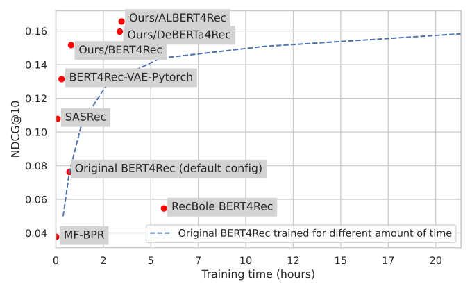
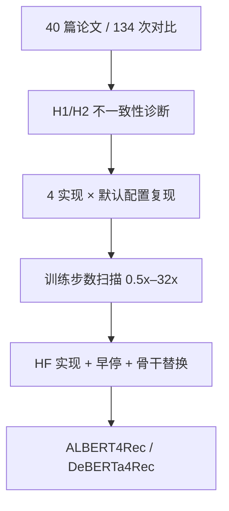
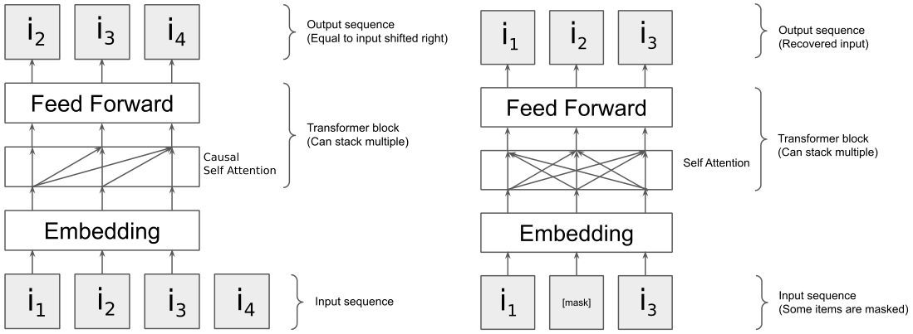

# A Systematic Review and Replicability Study of BERT4Rec for Sequential Recommendation (BERT4Rec 用于序列推荐：系统性综述与可复现性研究)

- **会议/期刊**: RecSys 2022（Reproducibility Track）
- **作者与机构**: Aleksandr Petrov, Craig Macdonald（University of Glasgow）
- **推荐链路定位**: 召回 / 端到端序列建模（Next-Item Prediction）
- **研究方向**: 序列与会话推荐 / 评测基准与工业级可复现架构
- **论文原文**: [arXiv:2207.07483](https://arxiv.org/abs/2207.07483v1)
- **开源代码**: [asash/bert4rec_repro](https://github.com/asash/bert4rec_repro)

## TL;DR (1分钟核心速览)

BERT4Rec 长期被当作序列推荐 SOTA 基线，但后续文献对其是否优于 SASRec 结论严重撕裂。本文系统综述 40 篇同行评议论文的 134 次对比，发现 SASRec 胜或平局占 36%；进而定位根因——**原始实现默认 40 万步训练约等于欠拟合**，需要 15–30 倍训练时长才能复现原文指标（ML-1M 采样 NDCG@10 从 42 分钟延至 21 小时）。作者基于 Hugging Face 给出高效实现，4 个数据集中 3 个默认配置即可复现，训练时间最多省 95%，且用 ALBERT 替换骨干在 ML-1M 全库排序上带来 +9.2% NDCG@10。

## Background & Motivation (背景与核心矛盾)

- **主流范式**: SASRec 用因果（单向）自注意力 + 右移序列预测；BERT4Rec 改用双向自注意力 + 条目掩码（item masking）恢复被 `[mask]` 覆盖的条目，理论上可从单条序列生成 $\binom{n}{k}$ 个训练样本，样本利用率更高。
- **前人局限**: 原文报告 BERT4Rec 在 4 个数据集、6 个指标上全面胜过 SASRec（Beauty +14.02%、ML-1M +10.32% NDCG@10）；但后续工作给出截然相反的数字，如 Qiu et al. 在 ML-1M 上报告 **-47.01%**，Zhou et al. 在 Beauty 上报告 **-5.73%**。同一模型同一数据集，结论方向相反。
- **核心洞察 (Key Insight)**: 作者怀疑问题不在模型而在"训练是否收敛"。BERT4Rec 的掩码任务与 next-item 目标只是松散相关，收敛曲线更平缓；若沿用仓库默认训练步数（40 万步 / 400 epochs），基线实际处于**欠拟合状态**，被后续论文当作"强基线"反复引用，污染了整个子方向的比较结论。
- **本文切入点**: 用"系统性综述 + 多实现复现 + 训练时长扫描"三件套把争论述定位到工程配置层面，再用 Hugging Face 生态给出低成本可复现替代方案。

<figure class="paper-figure" markdown="span">
  <figcaption>图 1：在 MovieLens-1M 数据集上，比较四种 BERT4Rec 实现（原始版、RecBole、BERT4Rec-VAE-Pytorch、Ours/BERT4Rec）与两个基线模型（MF-BPR、SASRec）以及两个更先进的基于 Transformer 的模型（Ours/ALBERT4Rec、Ours/DeBERTa4Rec）。所有点均表示采用默认配置的模型。虚线表示原始 BERT4Rec 实现经过不同训练时长训练后的 NDCG@10。</figcaption>
</figure>

## Method (核心方法设计)

### 1. 整体框架 (Overall Architecture)

本文不是提出新打分函数，而是构建一条"证据链"：先用文献计量界定现象（H1 结论不一致、H2 同数据集内亦不可复现），再横评 4 个开源实现（Original/RecBole/BERT4Rec-VAE/自研 HF 版）在各自默认配置下的表现，接着对原始实现做 0.5×–32× 训练步数扫描以验证欠拟合假设，最后以 HF `AutoModel` 为可插拔骨干，把 BERT 换成 DeBERTa/ALBERT 验证实现的可扩展性；训练侧统一改为基于验证损失的早停（patience=200 epochs），推理侧沿用序列末位追加 `[mask]`、对全库条目打分。

### 2. 关键设计拆解 (Key Designs)

1. **可复现性判定准则（±5% 相对容差）**：原文只给单一测量值，无法做配对 t 检验；作者依据同类深度模型跨随机种子指标标准差可达 2.65% 的经验，定义 $\;|\hat{m}-m_{\text{rep}}|/m_{\text{rep}}\le 5\%\;$ 即视为复现成功。该准则是全文所有"复现/未复现"结论的判据，避免了单点数值比较的任意性。
2. **训练充分性诊断（把超参问题变成可测量问题）**：固定模型与数据，仅扫描训练步数 $T\in[200\text{K},12.8\text{M}]$，观测$T$与采样 NDCG@10 的单调关系。若曲线在$T$ 增大数倍后仍显著爬升，则默认配置必然欠拟合。物理直觉是：掩码重建任务的梯度信号弱于自回归似然，需要更多步数才能把条目嵌入与位置嵌入拉开区分度。
3. **训练目标、负采样与推理效率**：训练侧为掩码重建的交叉熵 $\mathcal{L}=-\sum_{m\in\mathcal{M}}\log P(i_m\mid s_{\setminus\mathcal{M}})$，无显式负采样（softmax 覆盖全物品库）；评估侧保留原文的**流行度采样**（1 正 + 100 负）以便对齐，同时补充**无偏全库排序**。推理时对序列追加 `[mask]`，一次前向即可输出全库打分；HF 实现的收敛加速主要来自 TensorFlow v2 的静态图/算子融合与早停，而非模型改动。

<figure class="paper-figure" markdown="span">
  <figcaption>图 2：SASRec 与 BERT4Rec 的架构。SASRec 使用因果（单向）自注意力，而 BERT4Rec 使用常规（双向）自注意力。SASRec 旨在预测右移后的输入序列，而 BERT4Rec 恢复被掩码的条目。</figcaption>
</figure>

## Experimental Setup & Evaluation Protocol (实验设置与评估协议)

- **数据集与预处理**（严格沿用原文仓库的 `5-core` 过滤版本）：

| 数据集 | #Users | #Items | #Interactions | 稀疏度/密度 | 特征/场景说明 |
| :--- | :---: | :---: | :---: | :---: | :--- |
| ML-1M | 6,040 | 3,416 | 999,611 | 0.9515 | 长序列电影评分，平均长度 165.49 |
| Steam | 281,428 | 13,044 | 3,488,885 | 0.9990 | 极稀疏游戏购买，平均长度 12.40 |
| Beauty | 40,226 | 54,542 | 353,962 | 0.9998 | 最短序列电商，平均长度 8.79 |
| ML-20M | 138,493 | 26,744 | 20,000,263 | 0.9946 | 大规模长序列，平均长度 144.41 |

- **数据划分与防穿越**: `Leave-One-Out`——每用户最后 1 次交互为测试集，倒数第 2 次在随机抽取的 2048 名用户上作验证集，其余为训练集；无时间戳切分，属协议内标准做法。
- **排名评测协议**: 双轨并行。轨道 A 为 **Sampled Ranking（1 正 + 100 流行度采样负例）**，仅用于与原文报告值对表；轨道 B 为 **Full-Ranking 全库未交互排序**，用于所有新模型间比较。文中明确指出两轨会给出相反结论（RecBole 在 Steam 采样 R@10 比 MF-BPR 差 33%，全库 R@10 却好 86%）。
- **对比基线与超参设置**: MF-BPR（LightFM，128 维）、SASRec（序列长 50、嵌入 50、2 层）、4 种 BERT4Rec 实现（默认配置：嵌入 64、2 层、2 头、掩码率 0.2，序列长 50/100/200 视数据集而定）。显著性采用双侧配对 t 检验 + Bonferroni 多重校正，$p<0.05$。

## Key Experimental Results (实验关键数据)

### 1. 主实验对比 (Main Results)

全库排序（Unsampled），训练时长单位为秒（ML-1M）：

| Model | ML-1M R@10 | ML-1M N@10 | Steam R@10 | Steam N@10 | Time |
| :--- | :---: | :---: | :---: | :---: | :---: |
| MF-BPR | 0.0740 | 0.0377 | 0.0398 | 0.0207 | 58 |
| SASRec | 0.1993 | 0.1078 | 0.1198 | 0.0482 | 316 |
| BERT4Rec (Original) | 0.1518 | 0.0806 | 0.0737 | 0.0375 | 2,665 |
| BERT4Rec (RecBole) | 0.1061 | 0.0546 | 0.0744 | 0.0377 | 20,499 |
| BERT4Rec-VAE | 0.2394 | 0.1314 | 0.1237 | 0.0526 | 1,085 |
| Ours (HF, BERT) | 0.2584 | 0.1392 | **0.1361** | **0.0734** | 3,679 |
| Ours (longer seq) | **0.2821** | **0.1516** | – | – | 2,889 |
| Improv. vs SASRec | +41.5% | +40.6% | +13.6% | +52.3% | – |

采样协议下与原文报告值的对齐度：Ours 在 ML-1M（R@10 0.6865 vs 0.6970，-1.51%）、Steam（0.3978 vs 0.4013，-0.87%）、ML-20M 达标；**Beauty 全面失败**（最好者 BERT4Rec-VAE 0.2339 vs 0.3025，-22.68%）。

### 2. 消融实验 (Ablation Study)

此处"消融"体现为对实现/训练/骨干三个因素的逐项剥离：

| 变体 | ML-1M R@10 | ML-1M N@10 | 相对原始默认 |
| :--- | :---: | :---: | :---: |
| Original，默认 40 万步 | 0.1518 | 0.0806 | – |
| Original，11 小时（≈15×） | 采样复现达标 | – | 采样 R@10 达标 |
| Original，21.3 小时（≈30×） | – | 采样复现达标 | 全库 N@10 +51.8% |
| Ours / BERT4Rec | 0.2584 | 0.1392 | +70.0% / +72.7% |
| Ours / DeBERTa4Rec | 0.2900 | 0.1590 | +3.0% / +2.3%（不显著） |
| Ours / ALBERT4Rec | **0.3000** | **0.1650** | **+6.4% / +9.2%**（显著） |

### 3. 关键实验发现 (Key Findings)

1. **文献层面的不一致是真实存在的，而非个别噪声**：134 次对比中 BERT4Rec 胜 86 次（64%）、SASRec 胜 32 次（24%）、平局 16 次（12%），且分布强烈依赖数据集——Steam/ML-20M 上 88% 胜率，Sports 仅 17%、Toys 为 0%。
2. **欠拟合是主因，而非模型本身弱**：原始实现默认配置在 ML-1M 全库 NDCG@10 仅为充分训练后的 48.2%（0.0806 vs 0.1516），需延长至 21.3 小时才收敛；文献中 5 篇报告 BERT4Rec 基线低于本文充分训练值 10%–53%（如 Qiu et al. 0.132，-53.1%），其"超越 BERT4Rec"的结论很可能建立在欠拟合基线之上。
3. **换骨干比调结构更划算**：ALBERT4Rec 在不改动序列建模逻辑的前提下取得 ML-1M 全库 R@10 0.300 / N@10 0.165，超过文献中 DuoRec（0.294）与 NOVA-BERT（0.286），而训练耗时仍比原始实现充分收敛少 85% 以上；反观 DeBERTa4Rec 提升不显著且耗时 12,114 秒，性价比低。

## Highlights & Limitations (亮点、对比与审稿批判)

- **与代表作对比 (vs. Prior Work)**: Dacrema et al. 揭示深度学习推荐基线配置过弱，但仅针对简单 MF；本文把同样的批判精确落到一个高影响力 Transformer 模型上，并用 30× 训练时长扫描给出**可测量的因果证据**。相较 Krichene et al. 关于采样指标失真的通用论述，本文用 RecBole 在 Steam 上"采样 -33% / 全库 +86%"的具体反例完成了落地验证。
- **可迁移亮点**: (1) 用"训练步数—指标"扫描曲线判定某基线是否被系统性欠拟合，可直接复用于任何以开源仓库默认配置作对比的论文；(2) 把 HF `AutoModel` 作为可插拔骨干，更换注意力变体只需改一行配置，为大模型时代轻量序列推荐骨干选型提供低成本实验范式。
- **审稿级局限批判**: (1) **Beauty 数据集彻底复现失败且解释不足**，作者仅归因于"小数据集方差大 + 采样评估"，未做多随机种子分布分析，削弱了 ±5% 容差的普适性；(2) 综述口径未做元分析，仅按"全指标胜出才算胜"计数，对指标间冲突的加权方式敏感，且仅覆盖 2022-03 前的引用；(3) ALBERT4Rec 的 SOTA 结论来自与文献报告值的**跨论文比对**而非同环境重跑，作者自己也承认需直接统计检验确认。

## Rating (四维评分)

- **方法创新性 (Novelty)**: ⭐⭐⭐ （无新打分范式，创新在于把"可复现性"转化为可测量的训练充分性问题，并产出两个骨干替换变体）
- **评估协议与实验扎实度 (Protocol & Experiments)**: ⭐⭐⭐⭐⭐ （40 篇综述 + 4 实现横评 + 双轨指标 + Bonferroni 校正 + 32× 训练扫描，证据链完整且自我批判）
- **写作与数学规范度 (Clarity & Rigor)**: ⭐⭐⭐⭐ （图表与判定准则交代清晰，公式极简；Beauty 失败原因的分析深度略欠）
- **工业落地与复现价值 (Industrial & Practical Value)**: ⭐⭐⭐⭐⭐ （代码全开源，单卡即可复现，训练时间最多省 95%，可直接替换现有序列召回基线）

