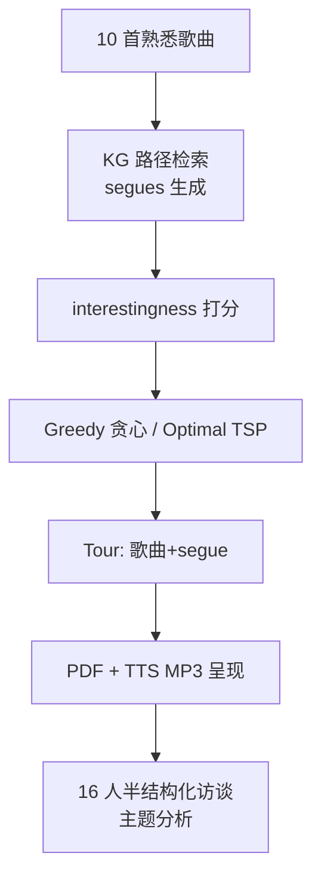
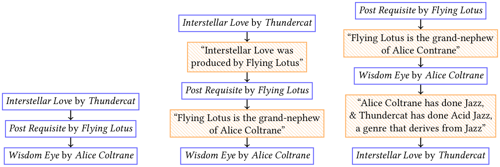

# A User-Centered Investigation of Personal Music Tours (个人音乐 Tour 的用户中心研究)

- **会议/期刊**: RecSys 2022
- **作者与机构**: Giovanni Gabbolini, Derek Bridge — Insight Centre for Data Analytics, University College Cork
- **推荐链路定位**: 重排 / 端到端序列生成（Tour 生成）
- **研究方向**: 序列与会话推荐 / 用户中心评估
- **论文原文**: [https://arxiv.org/abs/2208.07807v1](https://arxiv.org/abs/2208.07807v1)
- **开源代码**: [https://github.com/GiovanniGabbolini/play-it-again-](https://github.com/GiovanniGabbolini/play-it-again-)

## TL;DR (1分钟核心速览)

音乐流媒体中播放列表仅平铺罗列歌曲，难以承载用户对歌曲背景信息的诉求；Tour 用 segue（解释相邻歌曲关联的短文本）穿插歌曲，已被证明在合适语境下优于播放列表。本文首次对 Greedy 与 Optimal 两种 Tour 生成算法做用户中心评估：16 名被试通过半结构化访谈，在自选 10 首熟悉歌曲上比较两种算法，并配合 PDF + TTS 音频呈现。结果显示 Greedy 生成的 Tour 更受偏好（9 vs 5），且 segue 多样性（14/16 认可）、歌曲编排与熟悉度是三大关键属性。

## Background & Motivation (背景与核心矛盾)

- **主流范式**: 音乐流媒体以播放列表为主，常按音频（BPM）或网页相似度排序；Tour 用 segue 穿插歌曲，模拟电台节目，满足用户获取歌曲背景知识的需求。
- **前人局限**: 现有仅两篇 Tour 工作——[3] 只推荐 segue 且假定歌曲顺序已定，segue 重要性权重靠人工设定；[9] 同时推荐歌曲顺序与 segue 以最大化 segue 有趣度，但仅做离线实验，未做用户验证，且歌曲集合被视为给定，未考虑真实推荐中的选歌与用户感知。
- **核心洞察 (Key Insight)**: 算法优化的 `interestingness` 函数只部分刻画人类感知（基于罕见性与简洁性），且列表有趣度不能简单相加——用户还会考虑 segue 多样性、歌曲编排、熟悉度与先验知识。
- **本文切入点**: 首次对 Greedy 与 Optimal 做用户中心半结构化访谈评估，识别 Tour 属性、好坏标准并给出可落地的改进建议。

## Method (核心方法设计)

### 1. 整体框架 (Overall Architecture)

给定用户提供的 10 首熟悉歌曲，算法在知识图谱（MusicBrainz + Wikidata，30 种节点类型 / 205 种边类型）中检索歌曲间路径并翻译为 segue 文本，用 interestingness 函数为 segue 打分；随后由 Greedy（贪心选择下一首最有趣 segue 的歌曲）或 Optimal（归约为 TSP 求最优排列）生成 Tour。研究侧则将 Tour 渲染为 PDF + TTS 合成 MP3（15 秒歌曲预览 + 语音 segue，约 7 分钟），以被试内设计让 16 名受访者在同一坐谈中比较两种算法并做主题分析。

<figure class="paper-figure" markdown="span">
  <figcaption>图1. 一个包含三首歌的播放列表（a），以及由 Optimal（b）和 Greedy（c）推荐的两个三首歌的巡回。阴影框包含过渡段；空白框包含歌曲。</figcaption>
</figure>

### 2. 关键设计拆解 (Key Designs)

1. **Tour 目标形式化与两种求解器**：Tour 目标为最大化平均 segue 有趣度：$U_{tour}=\frac{1}{|S|-1}\sum_{i=1}^{|S|-1}\text{interestingness}(s_i,s_{i+1})$。Greedy 逐步贪心：$s_{t+1}=\arg\max_{s\in S\setminus\{s_1,\dots,s_t\}}\text{interestingness}(s_t,s)$；Optimal 将排列问题归约为 TSP 并最优求解。两者均不显式优化 segue 多样性或歌曲编排，这为后文用户不满埋下伏笔。
2. **知识图谱驱动的 segue 生成与有趣度**：segue 由 KG 中两首歌之间的路径翻译而成，覆盖流派、地点、日期、唱片公司、艺人关系等主题；interestingness 基于路径罕见性与简洁性（越罕见越短越有趣），该度量在 [7] 中经用户实验验证与人类感知正相关，但只部分刻画“有趣”。
3. **用户中心评估协议**：被试内设计（每人都看 Greedy 与 Optimal 两种 Tour），左右顺序随机化，算法名称隐藏；PDF 与 MP3 双通道呈现；访谈问题覆盖 Tour 属性、质量、概念价值与改进四主题；对 11 小时视频（44k 词转写）做 Braun & Clarke 主题分析，编码由一名作者独立完成、作者间验证。（注：论文为定性研究，无标准训练损失 / 负采样。）

## Experimental Setup & Evaluation Protocol (实验设置与评估协议)

- **数据集与预处理**: 无传统交互数据集，KG 统计与访谈对象如下表：

| 资源 | 规模 | 说明 |
| :--- | :---: | :--- |
| 知识图谱 | 30 节点类型 / 205 边类型 | MusicBrainz + Wikidata，覆盖流派/地点/日期/厂牌/艺人关系 |
| 受访者 | 16 人 | 15 学生 + 1 毕业生，英语母语，15/16 为流媒体用户 |
| 每人输入 | 10 首熟悉歌曲 | 来自不同艺人，以减少疲劳 |
| 访谈素材 | 11 小时视频 / 44k 词 | 人均 42 分钟，TTS + 15 秒预览约 7 分钟 |
| 分析 | 主题分析 | Braun & Clarke 流程，四主题 |

- **数据划分与防穿越 (Splitting Strategy)**: 不适用（定性研究）。每位受访者用自己提供的 10 首歌生成 Tour，算法不接触受访者历史。
- **排名评测协议 (Ranking Protocol)**: 非 Full-Ranking / Sampled Ranking；采用被试内两两比较 + 开放问题，主要指标为“偏好某算法的受访者计数”。
- **对比基线与超参设置**: 仅比较 Greedy 与 Optimal（[9] 的第三个算法 Hill-Climbing 因离线结果与 Optimal 近似而被省略）；无显著性检验（样本 16，统计功效受限，作者明确承认）。

## Key Experimental Results (实验关键数据)

### 1. 主实验对比 (Main Results)

表 1（受访者计数，N=16，加粗为多数偏好）：

| 属性 | Greedy > Optimal | Greedy < Optimal | 相近 | N/A |
| :--- | :---: | :---: | :---: | :---: |
| Segue 上下偏置 | **7** | 0 | 0 | 9 |
| Segue 多样性 | **9** | 1 | 4 | 2 |
| Segue 叙事性 | 0 | **6** | 4 | 6 |
| 歌曲编排 | 5 | **6** | 1 | 4 |
| Segue 有趣度 | **9** | 5 | 2 | 0 |
| Tour 整体质量 | **9** | 5 | 1 | 1 |

### 2. 消融实验 (Ablation Study)

定性研究无标准消融；作者以“属性重要性”的受访者计数作为间接消融：

| 属性 | 认为重要的受访者数 | 结论 |
| :--- | :---: | :--- |
| Segue 多样性 | **14/16** | 强正向 |
| 歌曲编排 | 8/16 重要，6/16 不重要 | 分歧，但为偏好原因之一 |
| Segue 叙事性 | 3/16 | 弱正向 |
| 熟悉度（UF-Tour 欢迎度） | **10/16** | 正向 |

### 3. 关键实验发现 (Key Findings)

1. **Greedy 胜在多样性而非目标函数**：Optimal 理论上最大化有趣度之和，但 9 名受访者认为 Greedy 的 segue 更有趣、9 名认为整体 Tour 更好。归因是 Greedy 生成的 segue 有趣度标准差更大（离线结果），话题更分散，从而多样性更高——说明“列表有趣度 ≠ 逐条有趣度相加”。
2. **多样性是最强属性，叙事性被否定**：14/16 认为 segue 多样性重要，而仅 3/16 支持叙事性，理由是叙事性常与低多样性耦合，且歌曲会打断文本流。这直接挑战了“segue 应串联成故事”的直觉设计。
3. **熟悉度决定 Tour 接受度**：10/16 欢迎“熟悉+不熟悉”混合的 UF-Tour，但 0 人欢迎全不熟悉的 U-Tour；受访者明确表示陌生歌曲间的 segue 失去意义，熟悉歌曲是“锚点”。同时，流派类 segue 被 6 名受访者点名无趣，传记类（获奖、出生地、演出）更受青睐。

## Highlights & Limitations (亮点、对比与审稿批判)

- **与代表作对比 (vs. Prior Work)**: [3] 只做 segue 且顺序固定、权重人工设定；[9] 同时优化顺序与 segue 但仅离线评估；本文首次把用户感知带回 Tour 研究，发现离线最优 ≠ 用户最优。
- **可迁移亮点**: (1) “离线目标最优 ≠ 用户偏好”的教训可迁移到任何列表生成 / 重排任务；(2) “熟悉 + 陌生”混合策略提升探索接受度，可迁移到序列推荐与冷启动；(3) 双通道（视觉 + 听觉）呈现方法可复用于多模态推荐评估。
- **审稿级局限批判**: (1) 样本仅 16 名爱尔兰大学生，便利抽样，统计功效弱，无显著性检验；(2) 未与播放列表基线对比，Tour 是否优于播放列表仅有间接推断；(3) 访谈中受访者可能受“实验者期望”影响，作者虽尝试缓解但无法证明有效。

## Rating (四维评分)

- **方法创新性 (Novelty)**: ⭐⭐⭐⭐ （首次对 Tour 生成算法做用户中心评估，发现离线有趣度最大化与用户偏好背离）
- **评估协议与实验扎实度 (Protocol & Experiments)**: ⭐⭐⭐ （被试内设计 + 主题分析扎实，但样本小、无显著性检验、缺播放列表对照）
- **写作与数学规范度 (Clarity & Rigor)**: ⭐⭐⭐⭐ （问题定义与 RQ 清晰，定性结果组织良好；但缺少对 interestingness 函数的深入理论分析）
- **工业落地与复现价值 (Industrial & Practical Value)**: ⭐⭐⭐⭐ （代码开源、KG 构建可复现，改进建议可直接指导流媒体 Tour 功能设计）

