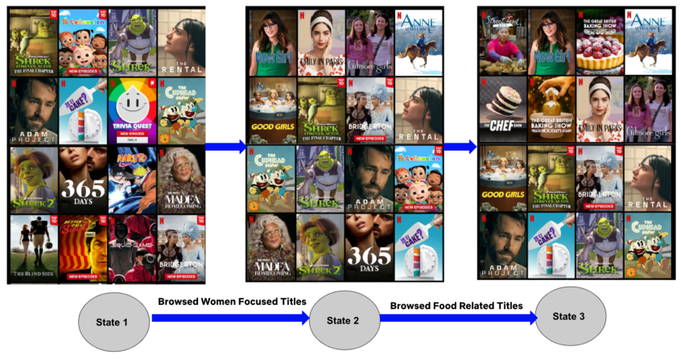
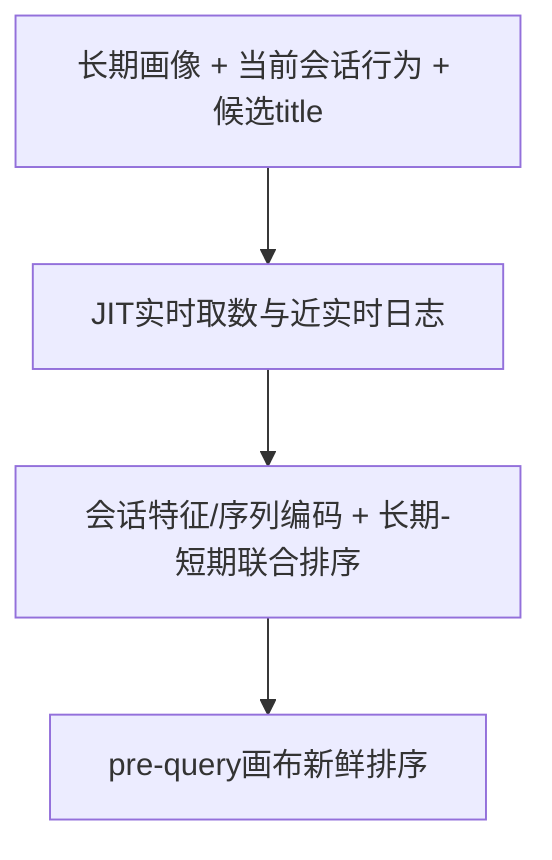

# Augmenting Netflix Search with In-Session Adapted Recommendations（用会话内自适应推荐增强Netflix搜索）

- **会议/期刊**: RecSys 2022
- **作者与机构**: Moumita Bhattacharya, Sudarshan Lamkhede; Netflix Research, USA
- **推荐链路定位**: 搜索预查询画布排序/重排（端到端会话自适应）
- **研究方向**: 序列与会话推荐 / 冷启动与长尾推荐
- **论文原文**: [https://arxiv.org/abs/2206.02254v1](https://arxiv.org/abs/2206.02254v1)
- **开源代码**: 暂未开源

## TL;DR (1分钟核心速览)

本文针对流媒体搜索“预查询”场景：用户在输入query前，系统需根据其长期画像与当前session的浏览行为预测“此刻想看什么”。作者提出端到端in-session adapted推荐系统，用JIT实时请求、近实时日志和联合长期/短期排序模型生成新鲜推荐。工业离线排序指标相对当前生产模型提升6% relative，但未披露数据集、绝对值、基线细节与显著性。

## Background & Motivation (背景与核心矛盾)

- **主流范式**: 搜索pre-query画布通常依赖长期观看画像与相似用户行为；会话推荐则用RNN/Attention建模用户序列。
- **前人局限**: 其一，预查询阶段没有显式query，必须在用户输入前预测fetch/find/explore意图；其二，长期画像无法反映当前session的瞬时兴趣，例如平时看真人秀、本次却想看韩国恐怖片。
- **核心洞察 (Key Insight)**: 当前session内的正向浏览信号（如genre、title交互）可近似“in-the-moment intent”；与长期偏好联合可避免短视推荐和流行度集中，并改善历史不足用户的冷启动。
- **本文切入点**: 在Netflix搜索pre-query生产系统上，构建实时取数、不缓存、近实时日志的端到端排序系统，并对比人工会话特征与raw sequence模型。
<figure class="paper-figure" markdown="span">
  <figcaption>图 2. 由会话内自适应模型为 Netflix 上的查询前画布生成的推荐示例。该模型可改善用户冷启动。我们在开发端到端会话内自适应时面临若干挑战</figcaption>
</figure>
图 2：会话内自适应模型在Netflix pre-query画布上的示例推荐。

## Method (核心方法设计)

### 1. 整体框架 (Overall Architecture)

输入包括用户长期画像、当前session及过去几个session的浏览交互、候选title特征。系统在用户即将看到画布时触发JIT服务调用，聚合近实时会话日志，避免使用缓存结果；排序模型将会话特征或序列编码与长期偏好联合，输出pre-query画布的新鲜排序。工程闭环为：客户端实时请求 $\to$服务端聚合会话信号$\to$排序模型打分$\to$ 返回当次推荐。该设计把“实时性”与“建模”耦合：推荐新鲜度由请求时机保证，个性化由长期-短期联合目标保证。

### 2. 关键设计拆解 (Key Designs)

1. **会话内实时特征（In-Session Adaptation）**：长期画像更新滞后，无法捕捉当下意图；本文将当前session的正向交互编码为会话上下文 $\mathbf{c}_s=\phi(\mathcal{S}_s)$，并与用户长期表征$\mathbf{h}_u$、候选特征$\mathbf{x}_{u,i}$联合打分$s_{u,i}=f_\theta(\mathbf{h}_u,\mathbf{c}_s,\mathbf{x}_{u,i})$。直觉是近期正向信号直接反映“此刻想看什么”。
2. **长期-短期联合排序（Joint Long-Short Term Ranking）**：只用短期信号会myopic、重复曝光少数热门title并造成集中效应；本文以多任务/联合目标平衡长期与短期，概念化损失为 $\mathcal{L}=\lambda\mathcal{L}_{\text{long}}+(1-\lambda)\mathcal{L}_{\text{short}}$，短期序列编码$\mathbf{h}_s=\mathrm{SeqEnc}(\mathcal{S}_s)$，候选分$\hat{y}_{u,i}=g(\mathbf{h}_u,\mathbf{h}_s,\mathbf{x}_{u,i})$。这既保留个性化，又照顾无历史会话。
3. **原始序列与推理约束**：人工特征可能遗漏信号，作者进一步尝试RNN、LSTM、bi-LSTM、Transformer建模当前及过去几个session的raw sequence。但实时不缓存使runtime复杂度受严格限制；当前session浏览信号极稀疏，需专门处理稀疏特征。原文未披露总损失细节、负采样策略与推理开销。

## Experimental Setup & Evaluation Protocol (实验设置与评估协议)

- **数据集与预处理**: 原文为工业系统概述，未提供公开数据集统计、过滤方式或特征维度。

| 数据集 | #Users | #Items | #Interactions | 稀疏度/密度 | 特征/场景说明 |
| :--- | :---: | :---: | :---: | :---: | :--- |
| Netflix内部搜索日志 | 未披露 | 未披露 | 未披露 | 未披露 | 搜索pre-query画布；当前/过去few sessions浏览交互 |

- **数据划分与防穿越 (Splitting Strategy)**: 未披露；采用工业离线评估，与当前生产pre-query模型对比，非标准学术划分。
- **排名评测协议 (Ranking Protocol)**: 未披露是`Full-Ranking`还是`Sampled Ranking`；原文仅称“offline ranking metrics”相对提升6%，未给指标名、候选规模与显著性检验。
- **对比基线与超参设置**: 基线为当前生产pre-query ranker；模型演进包括engineered in-session features与raw-sequence RNN/LSTM/bi-LSTM/Transformer变体。Embedding维度、训练超参与显著性标准均未披露。

## Key Experimental Results (实验关键数据)

### 1. 主实验对比 (Main Results)

原文未提供常规学术主实验表，也未列出5–8个公开SOTA基线；下表仅汇总文中唯一量化结论。

| 模型/系统 | 会话信号使用 | 离线排序指标 | Improv. | 原文报告 |
| :--- | :--- | :---: | :---: | :--- |
| 当前生产pre-query模型 | 长期画像为主 | 基线 | 0% | 作为对照 |
| **In-session adapted（特征工程）** | 当前session genre/title等 | 未披露绝对值 | **+6% relative** | 文中唯一量化提升 |
| Raw-sequence变体（RNN/LSTM/bi-LSTM/Transformer） | 当前及过去few sessions原始序列 | 未披露 | 未披露 | 仅说明探索，无数值 |

### 2. 消融实验 (Ablation Study)

原文未报告严格`w/o ...`消融；下表为作者给出的模型演进路径，不能等同于消融数值。

| 变体/组件 | 改动 | 目的 | 原文结果 |
| :--- | :--- | :--- | :--- |
| Long-term only（生产基线） | 无session信号 | 长期偏好排序 | 0% |
| + engineered session features | 加入当前session交互特征 | 捕捉瞬时意图 | +6% relative |
| + raw sequence encoder | RNN/LSTM/bi-LSTM/Transformer | 挖掘人工特征遗漏信号 | 未报告数值 |
| 联合长期+短期目标 | 多任务/联合优化 | 防短视与流行度集中 | 仅定性讨论 |

### 3. 关键实验发现 (Key Findings)

1. **6% relative提升说明当前session信号在pre-query有效**，但由于绝对值、指标名和显著性未披露，无法判断其统计稳健性与跨人群收益。
2. **短期信号必须与长期偏好联合**：原文明确指出只优化短期会造成少数热门title重复曝光与集中效应，且无历史浏览的session更依赖长期信息与冷启动能力。
3. **实时性是比模型复杂度更硬的约束**：不缓存导致请求数、超时风险与基础设施成本上升，并限制runtime模型复杂度；稀疏session特征进一步增加建模难度。

## Highlights & Limitations (亮点、对比与审稿批判)

- **与代表作对比 (vs. Prior Work)**: Wu et al. [10]已证明within-session导航可用于实时适配排序；Liu et al. [7]用短期Attention联合长期偏好；常规session-based RNN/Attention侧重序列建模。本文差异在于聚焦Netflix搜索pre-query生产画布，强调JIT取数、日志与不缓存工程闭环。
- **可迁移亮点**: 用JIT实时请求替代缓存以获取最新session信号；将“预查询”建模为隐式意图预测任务，并以联合长期-短期目标避免myopic推荐。
- **审稿级局限批判**: 其一，作为5页工业talk paper，无公开数据、划分协议、超参与显著性，6% relative难以复现验证；其二，实时不缓存会提高延迟与成本，动态排序也降低可解释性与可调试性，稀疏会话特征处理未展开。

## Rating (四维评分)

- **方法创新性 (Novelty)**: ⭐⭐⭐ （系统整合与实时工程有新意，算法增量有限）
- **评估协议与实验扎实度 (Protocol & Experiments)**: ⭐⭐ （仅单一相对数字，无公开数据、划分/打分协议、显著性与严格消融）
- **写作与数学规范度 (Clarity & Rigor)**: ⭐⭐⭐ （工业视角清晰，但无公式定义、复杂度与训练细节）
- **工业落地与复现价值 (Industrial & Practical Value)**: ⭐⭐⭐⭐⭐ （Netflix生产落地，JIT/日志/不缓存经验可直接借鉴）

