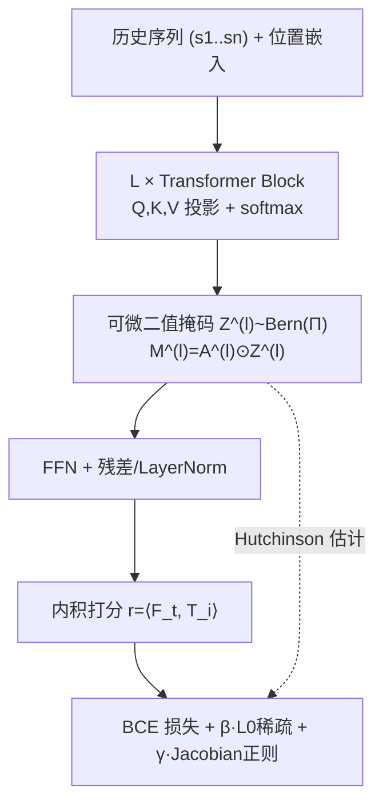

# Denoising Self-attentive Sequential Recommendation (去噪自注意力序列推荐)

- **会议/期刊**: RecSys 2022
- **作者与机构**: Huiyuan Chen, Yusan Lin, Menghai Pan, Lan Wang, Chin-Chia Michael Yeh, Xiaoting Li, Yan Zheng, Fei Wang, Hao Yang（Visa Research）
- **推荐链路定位**: 召回（Next-Item 序列召回）
- **研究方向**: 序列与会话推荐 / 自监督、对比学习与交互去噪
- **论文原文**: [https://arxiv.org/abs/2212.04120v1](https://arxiv.org/abs/2212.04120v1)
- **开源代码**: 暂未开源

## TL;DR (1分钟核心速览)

隐式反馈序列里大量点击与真实偏好无关，而 SASRec/BERT4Rec 的 softmax 全注意力会给每个 item 都分配非零 credit，等价于把噪声喂进 item-item 依赖。本文提出 **Rec-Denoiser**：在每层自注意力上挂可微二值掩码 $Z^{(l)}$做数据驱动的稀疏剪枝，用 ARM 无偏低方差估计器解决$L_0$不可导问题，再加 Jacobian 范数正则强制 Transformer 块局部 Lipschitz 平滑。作为**即插即用插件**，在 5 个数据集、Leave-One-Out + 1 正 100 负采样排序协议下，对四个骨干一致带来 5.05%–19.55% 相对提升（$p<10^{-6}$）。

## Background & Motivation (背景与核心矛盾)

- **主流范式**: 以 SASRec 为代表的单向/双向自注意力序列推荐，用 ${\rm softmax}(QK^{\top}/\sqrt{d})V$ 建模任意位置 item 对的长程依赖，配合 BCE + 单负采样训练。
- **前人局限**: ① 全注意力分布稠密，对无关 item 也赋权，稠密 credit 稀释了真实信号并破坏可解释性；② 固定稀疏模式（Sparse Transformer / Longformer / BigBird）无法适配输入，且需大量工程；③ LayerDrop / DropHead 一类随机丢弃是"能丢就丢"，与模型是否真的允许丢弃无关，易过度剪枝。
- **核心洞察 (Key Insight)**: 现实中一条序列引出的下一件商品只依赖其**子集**（如父/母交替为儿女购买），因此注意力矩阵本应天然稀疏；同时点积注意力**不是 Lipschitz 连续**的，输入微扰即可放大输出误差，仅靠稀疏化不够，还需谱正则。
- **本文切入点**: 不改 Transformer 主体结构，只改注意力分布——用可学习的硬 0/1 掩码把无关注意力压到精确为零，并对 Transformer 块加 Jacobian 正则提鲁棒性。

## Method (核心方法设计)

### 1. 整体框架 (Overall Architecture)

输入用户最近 $n$个 item 的 order-aware 嵌入$\hat{E}=E+P$，逐层送入$L$个 Transformer 块；每个自注意力层在 softmax 之后与一个 Bernoulli 采样得到的二值掩码逐元素相乘，得到稀疏注意力$M^{(l)}$再乘$V^{(l)}$，随后接 FFN、残差与 LayerNorm。训练时掩码参数$\Phi$与模型参数$\Theta$联合端到端优化（ARM 估计器 + 稀疏正则$\beta$），同时对每层 Transformer 块加 Jacobian 范数正则（权重$\gamma$）。推理时用$E[Z]=\sigma(\Phi)$作掩码，并把$\le 0.5$ 的位置硬截断为 0，保证推理阶段注意力真正稀疏、前向更快。

### 2. 关键设计拆解 (Key Designs)

1. **可微二值注意力掩码（把"小权重"变成"精确零"）**：痛点在于 softmax 对所有 item 恒正，噪声项永远拿到残余 credit。做法是为第 $l$层引入$Z^{(l)}\in\{0,1\}^{n\times n}$，改写为$A^{(l)}={\rm softmax}(Q^{(l)}K^{(l)\top}/\sqrt{d})$、$M^{(l)}=A^{(l)}\odot Z^{(l)}$、${\rm Attention}=M^{(l)}V^{(l)}$，并以$R_M=\sum_{l=1}^{L}\|Z^{(l)}\|_0$ 驱动稀疏。直觉：硬掩码给出**严格零**的注意力而非"接近零"，噪声 item 从计算图中被真正切断，可解释性与剪枝效果同时成立。

2. **ARM 无偏低方差梯度估计（让离散掩码可反传）**：$L_0$几乎处处零梯度，且$Z^{(l)}$有$2^{n^2}$个状态、方差爆炸。作者令$Z^{(l)}_{u,v}\sim{\rm Bern}(\Pi^{(l)}_{u,v})$、$\Pi^{(l)}_{u,v}=g(\Phi^{(l)}_{u,v})=\sigma(\Phi^{(l)}_{u,v})$使正则项连续可导，BCE 项则用 ARM 双前向无偏估计：$\nabla^{\rm ARM}_{\Phi}\mathcal{L}=\mathbb{E}_{U}\big[(\mathcal{L}_{\rm BCE}(\mathbb{I}[U>g(-\Phi)],\Theta)-\mathcal{L}_{\rm BCE}(\mathbb{I}[U<g(\Phi)],\Theta))(U-\tfrac12)\big]+\beta\nabla_{\Phi}g(\Phi)$；单前向的 AR 变体则用$\mathcal{L}_{\rm BCE}(\mathbb{I}[U<g(\Phi)],\Theta)(1-2U)$。直觉：反对称的$(U-\tfrac12)$ 配对采样形成 antithetic 抵消，实现无偏且低方差。

3. **Jacobian 谱正则（补上 Lipschitz 缺口）**：由一阶泰勒展开 $\|f_i(x+\epsilon)-f_i(x)\|\approx\|J_i^{\top}\epsilon\|_2\le\|J_i^{\top}\|_2\|\epsilon\|_2$，对每层块加$R_J=\sum_{l}\|J^{(l)}\|_F^2$，并用 Hutchinson 恒等式$\|J\|_F^2={\rm Tr}(JJ^{\top})=\mathbb{E}_{\eta\sim\mathcal{N}(0,I_n)}\|\eta^{\top}J\|_F^2$ 以随机投影高效估计梯度，不显著增加训练开销。

- **训练目标、负采样与推理效率**: 总损失 $\mathcal{L}_{\rm Rec\text{-}Denoiser}=\mathcal{L}_{\rm BCE}+\beta R_M+\gamma R_J$，负采样沿用 SASRec 的每个正样本配 1 个均匀负样本（无 in-batch/hard negative）；掩码用 ARM 需 2 次前向、AR 需 1 次，因$L=2$ 故开销可控；推理阶段稀疏注意力反而降低前向 FLOPs。

## Experimental Setup & Evaluation Protocol (实验设置与评估协议)

- **数据集与预处理**: 5 个公开数据集，未显式做 $k$-core 过滤（沿用 SASRec/TiSASRec 的预处理脚本）：

| 数据集 | #Users | #Items | #Interactions | 平均长度 | 场景说明 |
| :--- | :---: | :---: | :---: | :---: | :--- |
| MovieLens | 6,040 | 3,416 | 0.987M | 163.5 | 稠密电影评分 |
| Beauty | 51,369 | 19,369 | 0.225M | 4.39 | 极稀疏美妆评论 |
| Games | 30,935 | 12,111 | 0.2M | 6.46 | 电子游戏评论 |
| Movies&TV | 40,928 | 37,564 | 1.05M | 25.55 | 影视评论 |
| Steam | 114,796 | 8,648 | 0.87M | 7.58 | 游戏平台行为 |

- **数据划分与防穿越 (Splitting Strategy)**: `Leave-One-Out`——每用户最后 1 个 item 作测试、倒数第 2 个作验证、其余作训练，严格按时间序，无未来交互泄漏。
- **排名评测协议 (Ranking Protocol)**: **`Sampled Ranking`**，每用户随机采 100 个未交互负样本与 1 个 ground-truth 组成 101 候选排序，报告 Hit@10 与 NDCG@10，**非 Full-Ranking 全库排序**。
- **对比基线与超参设置**: 通用序列模型 FPMC / GRU4Rec / Caser / SASRec / BERT4Rec / TiSASRec / SSE-PT，以及稀疏 Transformer 类 Sparse Transformer、$\alpha$-entmax（用于噪声实验）；嵌入维度在$\{10,\dots,50\}$搜索，$L=2$、$H=2$，稠密集$n=50$、稀疏集$n=25$，$\beta,\gamma\in\{10^{-1},\dots,10^{-5}\}$，Rec-Denoiser 与骨干共享超参；显著性检验$p<10^{-6}$。

## Key Experimental Results (实验关键数据)

### 1. 主实验对比 (Main Results)

| Model | ML Hit@10 | ML NDCG@10 | Beauty Hit@10 | Beauty NDCG@10 | Steam Hit@10 | Steam NDCG@10 |
| :--- | :---: | :---: | :---: | :---: | :---: | :---: |
| FPMC | 0.7478 | 0.4889 | 0.2810 | 0.1792 | 0.6012 | 0.4084 |
| GRU4Rec | 0.5582 | 0.3383 | 0.2123 | 0.1205 | 0.4184 | 0.2687 |
| Caser | 0.7213 | 0.4672 | 0.2670 | 0.1531 | 0.7137 | 0.4810 |
| SASRec | 0.7434 | 0.5012 | 0.4345 | 0.2765 | 0.7723 | 0.5514 |
| **SASRec+Denoiser** | **0.7980** | **0.5610** | **0.4783** | **0.3025** | **0.8345** | **0.5946** |
| &nbsp;&nbsp;Improv.% | +7.34 | +11.93 | +10.08 | +9.40 | +5.05 | +7.83 |
| BERT4Rec | 0.7549 | 0.5245 | 0.4528 | 0.3013 | 0.7901 | 0.5641 |
| **BERT4Rec+Denoiser** | **0.8045** | **0.5814** | **0.4883** | **0.3348** | **0.8410** | **0.6223** |
| &nbsp;&nbsp;Improv.% | +6.57 | +10.85 | +7.84 | +11.12 | +6.45 | +10.32 |
| TiSASRec | 0.7365 | 0.5164 | 0.4532 | 0.2911 | 0.7704 | 0.5517 |
| **TiSASRec+Denoiser** | 0.7954 | 0.5582 | **0.4962** | **0.3312** | **0.8414** | **0.6320** |
| &nbsp;&nbsp;Improv.% | +7.80 | +8.10 | +9.49 | +13.78 | +9.22 | +14.56 |
| SSE-PT | 0.7413 | 0.5041 | 0.4326 | 0.2731 | 0.7641 | 0.5703 |
| **SSE-PT+Denoiser** | 0.8010 | 0.5712 | 0.4952 | 0.3265 | 0.8310 | 0.6133 |
| &nbsp;&nbsp;Improv.% | +8.01 | +13.31 | +14.47 | +19.55 | +8.76 | +13.51 |

（Games / Movies&TV 上趋势一致，相对提升区间 7.63%–17.68% 与 7.93%–15.79%。）

### 2. 消融实验 (Ablation Study)

原文未给出逐组件（仅掩码 / 仅 Jacobian）的数值消融表，组件贡献主要以噪声注入曲线（图 2）与超参敏感性（图 3、图 4）呈现，故此处按"变体对比"整理：

| 变体 | 稀疏化机制 | 关键观察 |
| :--- | :--- | :--- |
| 骨干（$Z\equiv 1,\beta=\gamma=0$） | 全注意力 | 各数据集均为下界，退化为 SASRec/BERT4Rec 原版 |
| **Rec-Denoiser (mask + Jacobian)** | 可学习二值掩码 | 全部 5 数据集、4 骨干上最优，$p<10^{-6}$ |
| AR 估计器（单次前向） | 可学习掩码（高方差） | 优于 $\alpha$-entmax，弱于 ARM |
| ARM 估计器（双次前向） | 可学习掩码（无偏低方差） | 0–25% 合成噪声下 Hit@10 退化最缓 |
| $\alpha$-entmax | 替换 softmax，单参数$\alpha$| 噪声比升高时$\alpha$ 易被过训，掉点明显 |
| Sparse Transformer | 固定稀疏 schema | Beauty/Games 等短序列上结果不稳定 |

### 3. 关键实验发现 (Key Findings)

1. **增益与骨干正交互不冲突**：四种骨干的排序关系（SSE-PT < TiSASRec < SASRec < BERT4Rec）在加插件后完全保持，说明提升来自注意力分布的净化而非容量堆叠；其中 Beauty 上 SSE-PT+Denoiser 拿到 19.55% NDCG@10 的最大相对增益，稀疏域获益最多。
2. **鲁棒性来自"数据驱动稀疏"而非固定模式**：训练集注入 0%→25% 均匀替换噪声后，所有模型单调退化，但 Denoiser（ARM）退化斜率最小，且始终优于 $\alpha$-entmax 与 Sparse Transformer——后者分别受制于单一温度参数$\alpha$ 与固定 schema 的自适应性缺失。
3. **序列越长、掩码越值钱**：图 3 显示 $n$从 20 增到 80 时，SASRec-Denoiser 相对 SASRec 的差距持续扩大（长序列含噪概率更高，可剪枝空间更大）；图 4 显示$\beta=0.01$、$\gamma=10^{-3}$时为最优，且在$\{10^{-5},\dots,10^{-1}\}$ 全域曲线平坦，说明对两个正则系数不敏感、调参代价低。

## Highlights & Limitations (亮点、对比与审稿批判)

- **与代表作对比 (vs. Prior Work)**: 相比 SASRec/BERT4Rec 的稠密 softmax 注意力，本文不换架构只换分布，得到硬零注意力；相比 $\alpha$-entmax 这类 sparsemax 变体，用$n^2$个独立可学掩码替代单一$\alpha$，表达能力更强；相比 Sparse Transformer / Longformer 的预定义稀疏模式与 LayerDrop/DropHead 的随机丢弃，本文的剪枝由下游 BCE 直接驱动，不会过度激进。
- **可迁移亮点**: ① "可微二值掩码 + ARM 估计器"可平移到任意注意力模块（多模态融合层、GNN 消息传递边掩码、特征交叉位掩码）；② Jacobian 谱正则作为通用 Lipschitz 约束，可用于图推荐邻居聚合与序列模型的抗噪训练。
- **审稿级局限批判**: ① 评测采用 1 正 100 负的 **Sampled Ranking**，未做 Full-Ranking 全库排序，噪声鲁棒性的结论也可能在无偏协议下变化；② 无开源代码、无线上 A/B，且仅 5 个公开数据集；③ ARM 每次更新需两次前向，$L$增大时训练成本线性上升，推理端的$0.5$ 硬截断阈值未做敏感性分析，稀疏度与精度存在潜在权衡。

## Rating (四维评分)

- **方法创新性 (Novelty)**: ⭐⭐⭐⭐ （把"序列去噪"规约为注意力二值稀疏化，$L_0$ + ARM 无偏估计 + Jacobian Lipschitz 约束的三件套组合在序列推荐中属首次系统化，理论动机清晰）
- **评估协议与实验扎实度 (Protocol & Experiments)**: ⭐⭐⭐ （5 个数据集、4 个骨干、$p<10^{-6}$ 显著性充分，但仅 1:100 采样排序、无 Full-Ranking 与逐组件数值消融，说服力打折）
- **写作与数学规范度 (Clarity & Rigor)**: ⭐⭐⭐⭐ （掩码重参数化、ARM/AR 推导与 Hutchinson 估计交代完整，复杂度分析到位；推理期 $E[Z]$ 硬截断的近似误差讨论略简）
- **工业落地与复现价值 (Industrial & Practical Value)**: ⭐⭐⭐ （插件式设计易接入现有 Transformer 召回，推理更稀疏更快；但无开源、ARM 双前向带来训练成本，需在深栈模型上再验证）

