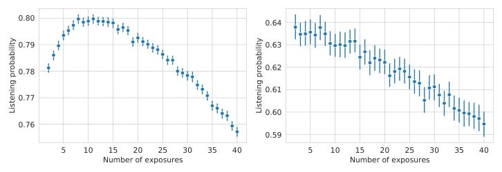
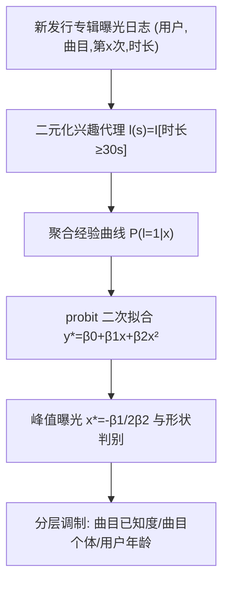
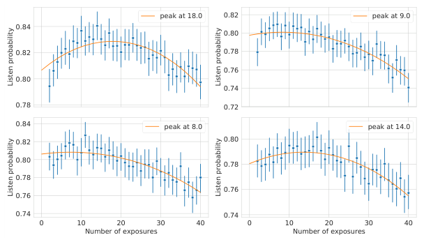

# Discovery Dynamics: Leveraging Repeated Exposure for User and Music Characterization (发现动力学：利用重复曝光刻画用户与音乐)

- **会议/期刊**: RecSys 2022 (16th ACM Conference on Recommender Systems)
- **作者与机构**: Bruno Sguerra, Viet-Anh Tran, Romain Hennequin（Deezer Research, France）
- **推荐链路定位**: 召回/曝光策略（对"是否重复推荐同一曲目"与"曝光几次"的策略层研究），非精排模型
- **研究方向**: 序列与会话推荐 / 强化学习与动态探索推荐
- **论文原文**: [https://arxiv.org/abs/2210.16226v1](https://arxiv.org/abs/2210.16226v1)
- **开源代码**: 暂未开源

## TL;DR (1分钟核心速览)

本文不造推荐模型，而是用工业级行为日志回答一个被序列推荐忽视的问题：**用户对新歌的兴趣随曝光次数如何演化**。作者取某头部流媒体平台 7 张同日发行专辑的 125K 用户、9M+ 条曝光记录（每对用户-曲目截断至 40 次曝光），以"收听时长 ≥30s"作为兴趣代理，用 probit 二次模型 $y^{*}=\beta_0+\beta_1x+\beta_2x^{2}$拟合，得到显著的正斜率 + 负二次项（$p<0.001$），兴趣在第 12 次曝光达峰后衰减——即心理学中的 mere exposure 倒 U 型曲线；而 30 张 25 年前经典摇滚专辑的对照数据不存在上升段（峰值外推至$-32$）。由此，曲线峰值位置成为曲目熟悉度与用户探索性的可计算表征。

## Background & Motivation (背景与核心矛盾)

- **主流范式**: 音乐推荐的序列/会话模型普遍假设"一次交互即一次偏好表达"，把重复收听视为噪声或简单流行度信号；重复消费建模（Benson、Anderson 的 recency+quality 再消费模型、ACT-R 记忆激活）只刻画衰减，不刻画"先升后降"。
- **前人局限**: 其一，心理学 20 余年积累的 mere exposure 结论（Bornstein 元分析、Berlyne 双因子模型）在推荐系统中仅被当作"避免过度曝光"的定性约束，缺大规模实证；其二，协同过滤/序列模型无法解释为何同一用户对同一曲目的第 3 次曝光比第 10 次更可能被完整收听。
- **核心洞察 (Key Insight)**: Berlyne 双因子模型（habituation 熟悉度增益 vs. tedium 厌倦衰减）叠加必然产生倒 U 型；而流媒体平台每天产生海量"新歌首次曝光序列"，恰好是检验该曲线的天然实验场——**曝光次数本身就是一个被长期忽略的隐变量**。
- **本文切入点**: 用真实发行窗口（2021-11-19 同批 7 张专辑 + 2 个月观测期）压低"用户早已听过"的混淆，把曝光序数 $x$ 直接放进回归，量化曲线形状。

<figure class="paper-figure" markdown="span">
  <figcaption>图 1. 左：新发行专辑消费中，随曝光次数变化的聚合收听概率及95%置信区间。右：著名（因而为人所知）的摇滚专辑随曝光次数变化的聚合收听概率及95%置信区间。</figcaption>
</figure>

## Method (核心方法设计)

### 1. 整体框架 (Overall Architecture)

这是一项**测量型（measurement）研究**，流程为：选定"用户此前未知"的新发行曲目集 → 按用户-曲目对抽取曝光序列，记录第 $x$次曝光的收听行为 → 用 30 秒阈值二值化兴趣代理 → 聚合$P(l(s)=1\mid x)$画经验曲线 → 用 probit 二次模型拟合潜在兴趣、估计峰值曝光$x^{\star}$→ 再按"曲目已知度""曲目个体""用户年龄段"三层分层，观察曲线形状如何被调制。最终产物不是打分器，而是一组可解释的表征量（峰值位置$\approx$熟悉度，峰值幅度$\approx$ 探索性），为后续"曝光预算/重复推荐"策略提供依据。

### 2. 关键设计拆解 (Key Designs)

1. **兴趣的可观测代理与倒 U 形状判别（二值化 + probit）**：兴趣不可观测，作者用行业内广泛采用的 30s 付费阈值定义 $l(s)=\mathbb{I}[t_{\text{listen}}(s)\ge 30\text{s}]$，理由是不感兴趣的用户不会停留超过 30 秒。因因变量为二值，无法像 Montoya 元分析那样直接做二次 OLS，故引入潜变量模型：$P(l(s)=1\mid x)=\Phi(y^{*})$，$y^{*}=\beta_0+\beta_1x+\beta_2x^{2}+\epsilon$，$\epsilon\sim\mathcal{N}(0,1)$。形状判据与心理学文献完全对齐：$\hat\beta_1>0$且$\hat\beta_2<0$即倒 U 型；峰值$x^{\star}=-\hat\beta_1/(2\hat\beta_2)$。直觉是"兴趣越过硬阈值才产生收听，阈值本身带高斯噪声"，从而把序数曝光转成可估的连续潜变量。

2. **以曲线峰值作为熟悉度/探索性的可计算表征**：同一专辑（Adele《30》）的不同曲目，其 fan base 相同、个体差异被压到最小，若峰值仍显著不同，则差异只能来自"曲目与用户既有品味图式的距离"。于是 $x^{\star}_s=-\hat\beta_{1,s}/(2\hat\beta_{2,s})$成为一个**无需内容特征、纯行为驱动的曲目熟悉度代理**：峰值早（8–9 次）说明用户上手即熟，峰值晚（18 次）说明需要"学习"；对照的经典摇滚专辑拟合出$x^{\star}\approx-32$（曲线外无峰、单调下降），正是因为 habituation 项缺席、只剩 tedium 项——这构成曲线的"零假设"校验。

<figure class="paper-figure" markdown="span">
  <figcaption>图 2. 四条曲目随曝光次数变化的聚合收听概率，以及拟合probit模型时每次曝光的估计收听概率。</figcaption>
</figure>

3. **训练/估计与开销**：无神经网络、无负采样。参数 $(\beta_0,\beta_1,\beta_2)$由极大似然（MLE）估计，全样本系数$p<0.001$；全流程为一次性离线统计，$O(N)$复杂度（$N\approx9\text{M}$ 行曝光），在线服务成本为零。模型刻意不做精确拟合（作者自承二次函数无法刻画非对称曲线），只借用其符号与顶点做**形状与峰位的粗粒度估计**，属于"低容量高可解释"的取舍。

## Experimental Setup & Evaluation Protocol (实验设置与评估协议)

- **数据集与预处理**: 关键过滤是"**用户-曲目对必须累计达到 40 次曝光**"（超出部分丢弃），以覆盖 Bornstein 元分析中 10–50 次（均值 20.95）的曝光区间；同时以发行日为锚点，降低"用户此前已知该曲"的概率。

| 数据集 | #Users | #Items | #Interactions | 稀疏度/密度 | 特征/场景说明 |
| :--- | :---: | :---: | :---: | :---: | :--- |
| 新发行集（主） | 125K | 124 曲（7 张专辑） | 9M+ 曝光行 | 每对用户-曲目 40 次曝光 | 2021-11-19 同日发行，法式说唱/R&B/国际流行，2 个月窗口 |
| 经典摇滚对照集 | 19K | 360 曲（30 张专辑） | — | 同上口径 | 发行 ≥25 年（Beatles / Pink Floyd / Nirvana 等），用于构造"无 habituation"对照 |

- **数据划分与防穿越 (Splitting Strategy)**: 不使用 Leave-One-Out / 比例划分 / 时间戳切分。样本按**曝光序数 $x$对齐**（第$x$次曝光在所有用户-曲目对上做横截面聚合），并明确排除$x=1$（首次收听多出于好奇，不代表真实兴趣），仅分析$x\ge2$。这是一种"**事件时间对齐**"而非"日历时间切分"的口径。
- **排名评测协议 (Ranking Protocol)**: **无 ranking 协议**——既不做事先 Full-Ranking 全库排序，也不做 Sampled Ranking；评价指标是聚合收听概率 $P(l(s)=1\mid x)$ 与拟合系数的符号/显著性，而非 Recall@K / NDCG@K。这是本文最需注意的评估范式差异：它检验的是**行为规律的存在性与形状**，不是推荐精度。
- **对比基线与超参设置**: 原文**不含任何推荐模型基线**，对照对象是心理学文献的既有结论与"经典专辑"这一自然对照组；显著性以 MLE 系数的 $p<0.001$ 报告；无 Embedding 维度等超参概念，唯一关键超参为收听阈值 30s 与曝光截断 40 次。

## Key Experimental Results (实验关键数据)

### 1. 主实验对比 (Main Results)

由于原文为测量型研究、无基线可比，下表以**拟合系数与峰位**作为"结果"呈现（沿用原文数值）：

| 数据子集 | $\hat\beta_0$|$\hat\beta_1$(一次项) |$\hat\beta_2$(二次项) | 峰值曝光$x^{\star}$ | 曲线形状判读 |
| :--- | :---: | :---: | :---: | :---: | :--- |
| 新发行集（全体） | 0.7952 | **+0.0048** | **−0.0002** | **12** | 倒 U 型（$p<0.001$） |
| 经典摇滚对照集 | — | — | — | ≈ −32（外推） | 单调衰减，仅 tedium |
| Adele《30》曲目 A | — | + | − | 18 | 需较长"学习"期 |
| Adele《30》曲目 B | — | + | − | 9 | 上手即熟 |
| Adele《30》曲目 C | — | + | − | 8 | 上手即熟（最早峰） |
| Adele《30》曲目 D | — | + | − | 14 | 中等熟悉度 |

截距约 0.8 说明样本被"高重复收听粉丝"筛选后整体收听率偏高，这也是本文外推性的主要约束（见局限）。

### 2. 消融实验 (Ablation Study)

原文无模块级消融，作者用**分层控制**替代：逐一改变"曲目已知度 / 曲目个体 / 用户属性"，观察曲线被如何调制。

| 控制因子 | 分层方式 | 曲线变化 | 归因 |
| :--- | :--- | :--- | :--- |
| 曲目已知度 | 新发行 vs. ≥25 年经典 | 上升段**消失**，峰位外推为负 | habituation 项缺席，只余 tedium |
| 曲目个体差异 | 同专辑 4 曲（Adele《30》） | 峰位在 **8–18** 区间漂移 | 与用户品味图式的距离 $\approx$ 熟悉度 |
| 用户年龄 | 年轻 43K（≤21）/ 中 32K（21–27）/ 年长 34K（>27） | 年轻组**截距最低、峰后衰减最陡** | 探索性更强、更愿试错 |

### 3. 关键实验发现 (Key Findings)

1. **倒 U 型是可复现的强规律，而非噪声**：全体样本 $\hat\beta_1=+0.0048$、$\hat\beta_2=-0.0002$均在$p<0.001$下显著，峰值落在第 12 次曝光；同口径的经典摇滚数据却拟不出峰（$-32$），两次拟合的符号差异直接证明上升段来自"新刺激学习"而非统计假象。
2. **峰位是可迁移的低成本表征**：同一专辑、同一批用户的 4 首曲目峰位从 8 跨到 18（相差 2 倍以上），说明峰位捕捉的是曲目层面的"感知复杂度/熟悉度"，而截距（约 0.79–0.80）几乎不变——即峰位与整体人气解耦，具备独立的信息量。
3. **年龄调制幅度而非方向**：年轻组起始收听率更低但上升更猛、见顶后衰减更快，对应"高探索—快厌倦"的动态；年长组曲线更平缓，与音乐心理学中"偏好随年龄趋于稳定"的结论一致，为"按年龄/探索性分桶设置曝光预算"提供了直接依据。

## Highlights & Limitations (亮点、对比与审稿批判)

- **与代表作对比 (vs. Prior Work)**: 相比 Benson/Anderson 的再消费模型（只建 recency + quality 的单调衰减），本文补上了曲线左侧的**上升段**；相比 ACT-R 记忆激活模型（base-level activation 随重复幂律增强、随时间衰减），本文显式引入"峰后下降"这一非单调项；相比 Schedl 等纯心理学元分析，本文把 20 年实验结论搬到 9M 行工业日志上验证并给出可计算峰位。三者差异的本质是：前两者做**预测**，本文做**刻画**。
- **可迁移亮点**: (a) 以"曝光序数"作为一阶特征直接进入打分/重排模型，替代"是否交互过"的二值历史特征；(b) 用拟合峰位 $x^{\star}$ 作为 item 侧的"上手难度"侧信息，可服务冷启动与曝光预算分配（如对新曲目至少连推 2–3 次再判定不感兴趣）。
- **审稿级局限批判**: (a) **选择偏差强**：要求单曲 40 次曝光才入样，等于只保留死忠粉，截距高达 0.8，结论对普通用户的泛化性未验证；(b) **因果识别弱**：曝光由推荐系统/歌单/电台决定，曝光次数与兴趣互为因果，缺少随机化或 IV 设计；(c) **模型误设**：作者自承二次 probit 无法拟合非对称曲线，峰位估计对尾部数据敏感，且 30s 阈值把"听一半就切歌"与"完全跳过"合并；(d) 无任何策略层离线仿真或线上 A/B，因此"能改进推荐"仍属未来工作承诺。

## Rating (四维评分)

- **方法创新性 (Novelty)**: ⭐⭐⭐ （把心理学 mere exposure 大规模落地为可计算的峰位表征确有新意，但方法本体是教科书级 probit 二次回归，无新算子）
- **评估协议与实验扎实度 (Protocol & Experiments)**: ⭐⭐⭐ （9M 行日志 + 新发行/经典对照 + 年龄分层设计干净，但仅单平台、无基线、无 ranking 指标、无显著性之外的不确定性量化）
- **写作与数学规范度 (Clarity & Rigor)**: ⭐⭐⭐⭐ （潜变量模型与形状判据交代清晰、公式极简且与心理学文献严格对标，唯缺少对估计量偏差的讨论）
- **工业落地与复现价值 (Industrial & Practical Value)**: ⭐⭐⭐ （结论可直接用于曝光预算与重复推荐策略，计算成本近乎为零；但数据不可公开、代码未开源，复现需自有日志）

