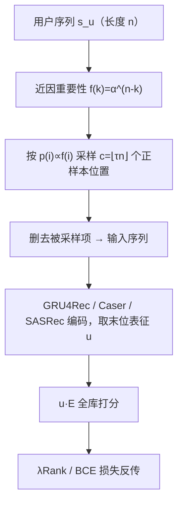

# Effective and Efficient Training for Sequential Recommendation using Recency Sampling (基于近期性序列采样的高效序列推荐训练)

- **会议/期刊**: RecSys 2022 (16th ACM Conference on Recommender Systems)
- **作者与机构**: Aleksandr Petrov, Craig Macdonald（University of Glasgow）
- **推荐链路定位**: 召回（序列召回模型的训练目标与损失函数，模型无关）
- **研究方向**: 序列与会话推荐 / 自监督与去噪表征
- **论文原文**: [https://arxiv.org/abs/2207.02643v2](https://arxiv.org/abs/2207.02643v2)
- **开源代码**: 暂未开源

## TL;DR (1分钟核心速览)

序列推荐模型（SASRec/BERT4Rec）精度高但训练极慢：序列延续（next-item）只产出极少样本且序列前段永远当不了目标，而 BERT4Rec 的 item masking 与"预测下一项"目标弱相关，需 16 小时收敛。本文提出**近期性序列采样（RSS）**：按位置重要性 $f(k)=\alpha^{n-k}$ 从整条序列中概率采样多个正样本，构造"去目标"输入序列，并以列表级 λRank 训练。在 4 个数据集、`Leave-One-Out` + `Full-Ranking` 协议下，SASRec-RSS 仅训练 1 小时即在 MovieLens-20M 上比原版 SASRec 提升 **60%** NDCG@10，比训练 16 小时的 BERT4Rec 高 **16%**，训练时间仅为其 **6%**。

## Background & Motivation (背景与核心矛盾)

- **主流范式**: GRU4Rec/Caser/SASRec 采用序列延续（sequence continuation）目标——切分序列前段作输入、后段作正样本；BERT4Rec 则用 BERT 式 item masking 重建被遮蔽项。
- **前人局限 (L1)**: 序列延续（含滑窗、shifted 逐位预测）从一条序列只能产出极少量样本，且序列前段元素**永远无机会成为目标**，且其预测时依赖位置（前 $j-1$ 项），学到的"全序重建"能力未被利用。
- **前人局限 (L2)**: item masking 的"任意位置重建"与"预测末项"任务分布不一致（弱相关），收敛慢；且解码需对每个位置输出全库分布，显存/存储开销 $O(N)$ 随物品数膨胀——Gowalla（127 万物品）预处理需 548GB，直接不可训练。
- **核心洞察 (Key Insight)**: 训练目标（构造哪些正样本）与损失函数（如何排序这些正样本）是两个可独立优化的杠杆；近因性（recency）是序列推荐的本质先验，可用作采样权重。
- **本文切入点**: 用"带近因偏置的概率采样"同时满足"任意位置可作目标"（P1）与"新交互更重要"（P2），从而在少量训练时间内兼顾样本量与任务一致性。

## Method (核心方法设计)

### 1. 整体框架 (Overall Architecture)

给定用户序列 $s_u$，先按长度确定目标个数$c=\max(1,\lfloor \tau n\rfloor)$（$\tau=0.2$，沿用 BERT4Rec），再依据位置重要性函数从全序列**有放回**采样$c$个位置作为正样本，从序列中删去这些项得到模型输入，其余保留为历史上下文；模型（GRU4Rec/Caser/SASRec，均只用最后一个位置的序列表征）对全库物品打分，用 λRank 或 BCE 计算损失并反传。由于被删项可以是任意位置，模型必须同时学会"用前文预测被删项"与"用后文上下文预测被删项"，天然覆盖了末项预测；推理时不做任何删除，仅取末位表征$ \boldsymbol{u} $与物品嵌入$\mathbf{E}$ 内积排序，开销与原模型完全一致。

### 2. 关键设计拆解 (Key Designs)

1. **近因概率采样 (Recency-based Sampling)**：为打破序列延续"前段永不成为目标"的死结，把正样本选择改为概率抽样，位置 $i$ 被选中的概率为

$$p(i)=\frac{f(i)}{\sum_{j=0}^{n-1} f(j)},\qquad f(k)=\alpha^{\,n-k},\ \alpha\in(0,1]$$

   其中 $f(k)>0$保证任意项可被选（P1），$f(k)\le f(k+1)$保证越近越易被选（P2）。$\alpha\to 0$时退化为序列延续，$\alpha=1$时退化为均匀采样（近似 matrix reconstruction/无位置信息的 masking）。直觉：采样权重把"难样本"集中到序列尾部，等价于对末尾区域做重要性采样，因此每条序列可贡献$2^n$ 量级的样本组合而无需滑动窗口截断长序列。
2. **列表级 λRank 损失（与 RSS 的耦合）**：序列延续只有一个正样本，列表级损失无用武之地；RSS 一次给出多个正样本，需要列表损失把多个正样本同时推到前列。本文用 Lambda 梯度而非目标函数梯度：

$$\lambda_i=\sum_{j\in I}|\Delta NDCG_{ij}|\cdot\frac{-\sigma}{1+e^{\sigma(s_i-s_j)}},\qquad \sigma=1$$

   即按"交换 $i,j$ 带来的 NDCG 变化量"对 pairwise logistic 梯度加权，直接优化排序指标。
3. **训练目标、负采样与推理效率**：总损失取 $\mathcal{L}=\mathcal{L}_{\lambda Rank}$（或 BCE：$-\sum_{i\in\mathcal{P}}\log\hat{y}_i-\sum_{j\in\mathcal{N}}\log(1-\hat{y}_j)$，$\mathcal{N}$为批内其余物品）；本文**不做显式负采样**（隐式反馈中非正即负，负采样与 RSS 正交，留待未来）。超参：序列截断 50、$d=64$、Adam ($lr=0.001,\beta_2=0.98$)、$\tau=0.2$、$\alpha=0.8$，所有对比模型训练时间统一限制为 1 小时（BERT4Rec 另训 16 小时作完全收敛版）。

## Experimental Setup & Evaluation Protocol (实验设置与评估协议)

- **数据集与预处理**（统一剔除交互数少于 5 的冷启动用户，即 `5-core` 过滤）：

| 数据集 | #Users | #Items | #Interactions | 平均/中位长度 | 稀疏度 | 特征/场景说明 |
| :--- | :---: | :---: | :---: | :---: | :---: | :--- |
| MovieLens-20M | 138,493 | 26,744 | 20,000,263 | 144.4 / 68 | 0.9946 | 电影评分，全部评分视为正反馈 |
| Yelp | 287,116 | 148,523 | 4,392,169 | 15.3 / 8 | 0.999897 | 商家点评 |
| Gowalla | 86,168 | 1,271,638 | 6,397,903 | 74.2 / 28 | 0.999942 | LBS 签到，物品数 > 用户数，超稀疏 |
| Booking.com | 140,746 | 34,742 | 917,729 | 6.5 / 6 | 0.999812 | 多城市旅行序列，顺序性极强 |

- **数据划分与防穿越**: `Leave-One-Out`——每用户最后 1 次交互作测试、倒数第 2 次（1024 用户）作验证，其余全部训练；按验证集 NDCG@10 选 epoch。
- **排名评测协议**: 严格 `Full-Ranking`（全库未交互物品排序，**不用采样指标**），报告 Recall@10 / NDCG@10；显著性用 paired t-test + Bonferroni 校正（$p<0.05$）。
- **对比基线与超参设置**: Popularity、MF-BPR（LightFM 实现）、SASRec-vanilla（1h）、BERT4Rec-1h、BERT4Rec-16h；实验架构为 GRU4Rec / Caser / SASRec（均取末位输出）。

## Key Experimental Results (实验关键数据)

### 1. 主实验对比 (Main Results)

**表 1：RSS 增强的 SASRec 与各基线对比（训练时间除 BERT4Rec-16h 外均 ≤1h）**

| 模型 | ML-20M R@10 | ML-20M N@10 | Yelp R@10 | Yelp N@10 | Gowalla R@10 | Gowalla N@10 | Booking R@10 | Booking N@10 |
| :--- | :---: | :---: | :---: | :---: | :---: | :---: | :---: | :---: |
| Popularity | 0.049 | 0.025 | 0.006 | 0.003 | 0.008 | 0.004 | 0.097 | 0.043 |
| MF-BPR | 0.079 | 0.040 | 0.019 | 0.009 | 0.029 | 0.018 | 0.449 | 0.279 |
| SASRec-vanilla | 0.136 | 0.067 | 0.022 | 0.011 | 0.010 | 0.005 | 0.463 | 0.270 |
| BERT4Rec-1h | 0.107 | 0.053 | 0.014 | 0.007 | N/A | N/A | 0.479 | 0.288 |
| **SASRec-RSS-BCE** | 0.189 | 0.100 | **0.027** | **0.014** | 0.009 | 0.004 | 0.518 | 0.297 |
| **SASRec-RSS-λRank** | **0.197** | **0.107** | 0.005 | 0.003 | **0.102** | **0.075** | **0.525** | **0.312** |
| BERT4Rec-16h (参考) | 0.173 | 0.092 | 0.028 | 0.014 | N/A | N/A | 0.565 | 0.354 |
| **Improv.% (vs SASRec-vanilla)** | **+44.9%** | **+59.7%** | +22.7% | +27.3% | **+920%** | **+1400%** | +13.4% | +15.6% |
| **Improv.% (vs BERT4Rec-16h)** | **+13.9%** | **+16.3%** | −3.6% | 0.0% | — | — | −7.1% | −11.9% |

Gowalla 上 BERT4Rec 因 $O(N)$ 输出显存/存储（预处理 548GB）无法训练，故留空。

### 2. 消融实验 (Ablation Study)

**表 2：训练目标 × 损失函数解耦（NDCG@10，训练时间均 1h；Cont=序列延续）**

| 架构 | ML-20M Cont+BCE | ML-20M RSS+BCE | ML-20M Cont+λRank | ML-20M RSS+λRank | Yelp Cont→RSS (BCE) | Gowalla Cont→RSS (λRank) |
| :--- | :---: | :---: | :---: | :---: | :---: | :---: |
| GRU4Rec | 0.0115 | 0.0183 | 0.0040 | **0.0839** | 0.0035→0.0049 | 0.0033→0.0067 |
| Caser | 0.0784 | 0.0995 | 0.0177 | **0.0814** | 0.0021→0.0049 | 0.0055→0.0100 |
| SASRec | 0.0850 | 0.1002 | 0.0579 | **0.1073** | 0.0076→0.0136 | 0.0478→0.0749 |

### 3. 关键实验发现 (Key Findings)

1. **RSS 与列表损失存在强耦合，而非两个独立增益**：在 MovieLens-20M 上 GRU4Rec 由 Cont+λRank 的 0.0040 跃升至 RSS+λRank 的 0.0839（$\approx$21 倍）；统计上 RSS 任务下 λRank 在 12 组对比中 8 组显著优于 BCE，而序列延续任务下 λRank 在 24 组中仅 7 组占优——原因是单一正样本无法让列表损失发挥作用，多正样本采样才释放其价值。
2. **"1 小时 > 16 小时"的效率收益可量化，但具任务依赖性**：ML-20M 上 1h 的 SASRec-RSS-λRank 比 16h BERT4Rec 高 16.3% NDCG，却只用 6% 训练时间；反之在顺序性极强的 Booking.com（多城市行程，违背 P1 假设）上，RSS 在 6 组中 3 组退化（SASRec+BCE 0.5845→0.5178 Recall），说明"序列前段可打乱作正样本"是 RSS 生效的前提。
3. **$\alpha$是鲁棒的单峰旋钮**：$\alpha\to0$精确复现序列延续结果，$\alpha=1$退化到 MF-BPR 水平（位置信息完全丢失）；Caser/SASRec 在$0.2\le\alpha\le0.9$全区间显著优于基线，GRU4Rec 因 RNN 梯度消失需$0.6\le\alpha\le0.9$，默认$\alpha=0.8$ 在三种架构上均近最优。

## Highlights & Limitations (亮点、对比与审稿批判)

- **与代表作对比 (vs. Prior Work)**: 与 SASRec（shifted 序列延续）相比，RSS 让首位物品也能成为目标且样本组合数指数级增加；与 BERT4Rec 的 item masking 相比，RSS 不引入 `[mask]` 与位置嵌入，训练/推理分布一致（避免 L2），且只需单次末位打分，故能扩展到百万级物品库；与 Caser 的滑窗增广相比，RSS 不牺牲长序列上下文（不必截断成短子序列）。
- **可迁移亮点**: ①"概率采样正样本 + 删除式输入"可作为通用自监督目标，直接套用到任何序列编码器（含 Mamba/SSM、线性注意力）上，零推理开销；②多正样本场景应优先尝试 λRank 这类指标感知梯度，而不是继续用 pointwise BCE。
- **审稿级局限批判**: ①效率优势由"固定 1 小时墙钟预算"界定，未报告 epoch/FLOPs 与收敛曲线，且 RSS 每步需对全库做 softmax/λRank，单步成本高于 Cont 的采样 softmax，公平性略偏；②只考察指数型 $f(k)$，线性等函数与负采样组合未探索，Yelp 上 λRank 反而崩到 Popularity 水平（0.005），说明损失选择仍不稳；③RSS 依赖序列位置嵌入被"擦除"的处理，无法直接用于必须给每个位置打分的 BERT4Rec，通用性受限；④未做多随机种子方差报告。

## Rating (四维评分)

- **方法创新性 (Novelty)**: ⭐⭐⭐⭐ （不改架构只改训练目标的"极简但有效"思路，把近因先验形式化为可调采样分布，与列表损失的耦合分析有洞察）
- **评估协议与实验扎实度 (Protocol & Experiments)**: ⭐⭐⭐⭐ （4 数据集 × 3 架构 × 2 损失 × 2 训练目标网格完整，坚持 Full-Ranking 并做 Bonferroni 校正，诚实报告 Booking.com 与 Yelp 的失败案例）
- **写作与数学规范度 (Clarity & Rigor)**: ⭐⭐⭐⭐ （L1/L2 缺陷与 P1/P2 设计原则一一对应，公式极简可复现；但对 λRank 的实现细节与单步开销分析略薄）
- **工业落地与复现价值 (Industrial & Practical Value)**: ⭐⭐⭐⭐⭐ （零推理开销、纯训练侧改动、1 小时可复训适配偏好漂移，对需要频繁重训的线上序列召回极具吸引力）

