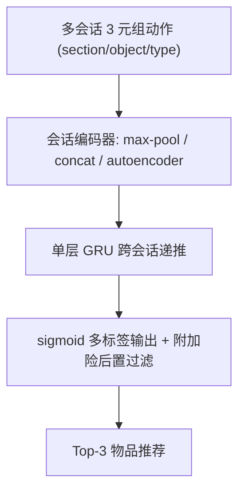
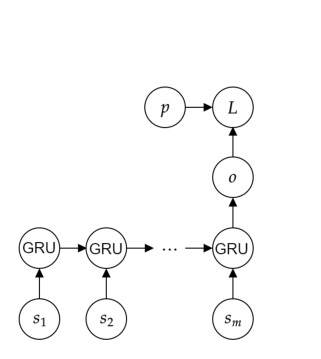

# Learning Recommendations from User Actions in the Item-poor Insurance Domain (物品稀缺的保险域中基于用户行为的推荐学习)

- **会议/期刊**: RecSys 2022
- **作者与机构**: Simone Borg Bruun, Maria Maistro, Christina Lioma（哥本哈根大学）
- **推荐链路定位**: 召回（会话级候选排序）
- **研究方向**: 序列与会话推荐 / 冷启动与长尾推荐
- **论文原文**: [https://arxiv.org/abs/2211.15360v1](https://arxiv.org/abs/2211.15360v1)
- **开源代码**: [https://github.com/simonebbruun/cross-sessions_RS](https://github.com/simonebbruun/cross-sessions_RS)（含数据集）

## TL;DR (1分钟核心速览)

针对保险域“物品极少（仅 16 个）、购买频次极低、且 75% 用户线上浏览却电话下单”导致的目标行为落在会话之外的数据稀疏难题，本文提出**跨会话（cross-sessions）RNN 推荐模型**：把用户近期多次会话中各类型行为（section/object/type 三元组）分别 max-pool 编码后按会话顺序送入单层 GRU，用多标签 BCE 预测下一次购买集合。在 44K 用户真实数据、16 物品全库 Full-Ranking 协议下，HR@3 0.8380、MRR@3 0.7093，较最强基线 SKNN_EB 分别提升 3.04% 与 4.53%。

## Background & Motivation (背景与核心矛盾)

- **主流范式**: 保险推荐依赖**人口统计学特征 + 已购组合（portfolio）**（贝叶斯网络、聚类关联规则、人口学神经网络）；而会话推荐（GRU4REC、SKNN、STAN）则依赖会话内 item 交互序列。
- **前人局限**: ① 人口学模型假设同一人群内偏好同质，无法刻画由婚育、购房、换工作等**个体生命事件驱动**的需求漂移；② 会话模型要求目标行为（next item）发生在**输入会话内部**，而保险场景中购买常在线下电话完成，与浏览会话物理分离；③ 主流模型仅使用 item-view/click，浪费了理赔、个人账户修改等大量非物品行为信号。
- **核心洞察 (Key Insight)**: 用对数尺度会话间时间直方图拟合双高斯混合模型，发现存在明显“谷底”，据此得到 **10 天不活跃阈值**——两次会话间隔 ≤10 天即视为同一任务，说明“任务级”上下文天然跨越多个会话而非单会话。
- **本文切入点**: 把预测目标从“会话内下一交互”迁移到“会话之后是否购买某物品”，输入从单会话 item 序列迁移到**多会话、多类型动作序列**。

## Method (核心方法设计)

### 1. 整体框架 (Overall Architecture)

模型以用户最近 $m\le 7$次会话为输入，每个会话是时间有序的 3 元组动作序列$a_{ij}=(c_{ij},b_{ij},d_{ij})$（动作区块 / 动作对象 / 动作类型），三者各自二值化拼接为稀疏向量。会话级编码器（max-pool、concat 或 autoencoder）把变长会话压成单一向量$s_i$，再以单层 GRU 沿会话顺序递推得到最终隐状态，经 sigmoid 逐物品输出购买概率，训练用多标签交叉熵。推理时对不可购买的附加险（用户未持有对应主险）做**后置过滤置零**，输出 top-3 列表。

### 2. 关键设计拆解 (Key Designs)

<figure class="paper-figure" markdown="span">
  <figcaption>图 2：跨会话编码架构。</figcaption>
</figure>

1. **Cross-sessions Encode（会话内池化 + 会话间递推）**：痛点是不知如何把不同长度、不同动作数的会话统一表达；做法是对会话内动作向量逐元素取最大 $s_i=\max_{\text{element}}(a_{i1},\dots,a_{in})$，再由 GRU 计算$h_i=(1-z_i)\cdot h_{i-1}+z_i\cdot \hat{h}_i$，其中$z_i=\sigma(W_z s_i+U_z h_{i-1})$ 是更新门。物理直觉：max-pool 丢弃会话内细粒度顺序噪声、保留“发生过什么”，GRU 只负责建模**会话之间的依赖**，与实验观测（打乱会话顺序仅掉 <1%）自洽。
2. **多标签预测目标与后置约束**：用户可同时购多险，故不用 GRU4REC 的 ranking loss，改为逐物品 sigmoid 与二元交叉熵 $L=-\sum_{k=1}^{K}\left[p_k\log\hat{p}_k+(1-p_k)\log(1-\hat{p}_k)\right]$，$\hat{p}_k=\sigma(o_k)$。附加险与主险的**结构依赖**通过推理期 mask 注入（$\hat{p}_k\leftarrow 0$ 若无主险），避免模型去学这条硬规则。
3. **变体与人口学混合**：Cross-sessions Concat 把所有会话拼成一条长序列（建模会话内顺序但易过拟合）；Cross-sessions Auto 用 RNN 自编码器学会话向量；混合模型把 GRU 隐状态与人口学 MLP 隐层拼接再过一层 dense，说明两类信号互补。

## Experimental Setup & Evaluation Protocol (实验设置与评估协议)

- **数据集与预处理**（商业保险公司网站，2018-10 ~ 2020-09，全量记录所有类型行为，非仅点击）：

| 数据集 | #Users | #Items | #Purchase | #Sessions | #Actions | 稀疏度/密度说明 |
| :--- | :---: | :---: | :---: | :---: | :---: | :--- |
| Insurance (本文开源) | 44,434 | 16 | 53,757 | 117,163 | 1,256,156 | 1.21 次购买/人、2.18 次会话/购买事件、10.72 动作/会话 |

- **过滤规则**: 物品与动作类别频率 <0.1% 剔除；连续重复同类动作去噪；动作数 <3 的会话丢弃；会话截断至 30 个动作（95 分位）；近期会话截断至 7 个（95 分位）；两次会话间隔 >10 天则不计入同一任务。
- **数据划分与防穿越**: 按**购买事件时间**划分，最新 10% 购买事件（及其历史会话）为测试集，其余 90% 训练；若训练样本的会话与测试会话重叠则从训练集删除（严格防泄漏）。
- **排名评测协议**: **Full-Ranking**，对全部 16 个物品按预测概率排序（附加险不合规则置零），主指标截断 $k=3$（界面最多展示 3 条；16 个物品下$k\ge10$将使各指标饱和失真），辅以$k=1..5$ 曲线；指标 HR、MRR、Precision、Recall、MAP。
- **对比基线与超参**: Random / Popular / SVD / Demographic（FFN，人口学+portfolio）/ GRU4REC / GRU4REC Concat / SKNN_E / SKNN_EB（boost 因子 0.5，30 近邻）；隐层 32–512、dropout 0.1–0.5 网格搜索，Adam + early stopping；显著性用 McNemar（HR）与 one-way ANOVA + post-hoc（$p<0.05$）。

## Key Experimental Results (实验关键数据)

### 1. 主实验对比 (Main Results)

| Model | HR@3 | Precision@3 | Recall@3 | MRR@3 | MAP@3 |
| :--- | :---: | :---: | :---: | :---: | :---: |
| Popular | 0.6217 | 0.2145 | 0.5855 | 0.4764 | 0.4540 |
| SVD | 0.6646 | 0.2372 | 0.6327 | 0.4997 | 0.4829 |
| Demographic | 0.7392 | 0.2649 | 0.7095 | 0.5620 | 0.5446 |
| GRU4REC | 0.6479 | 0.2313 | 0.6208 | 0.5443 | 0.5264 |
| GRU4REC Concat | 0.6616 | 0.2365 | 0.6362 | 0.5620 | 0.5453 |
| SKNN_E | 0.8106 | 0.2914 | 0.7848 | 0.6740 | 0.6567 |
| SKNN_EB (最强基线) | 0.8132 | 0.2922 | 0.7872 | 0.6785 | 0.6610 |
| **Cross-sessions Encode** | **0.8380** (3.04%) | **0.3030** (3.67%) | **0.8145** (3.46%) | **0.7093** (4.53%) | **0.6923** (4.73%) |
| Cross-sessions Concat | 0.8265 (1.62%) | 0.2984 (2.12%) | 0.8019 (1.87%) | 0.7051 (3.92%) | 0.6876 (4.02%) |
| Cross-sessions Auto | 0.8356 (2.74%) | 0.3024 (3.48%) | 0.8128 (3.24%) | 0.7085 (4.41%) | 0.6920 (4.69%) |
| Encode + Demographic | 0.8542 (5.03%) | 0.3103 (6.17%) | 0.8313 (5.60%) | 0.7268 (7.11%) | 0.7099 (7.41%) |

### 2. 消融实验 (Ablation Study)

去除某类动作后 Cross-sessions Encode 的性能变化（相对值）：

| 移除的动作类别 | HR@3 | ΔHR@3 | MAP@3 | ΔMAP@3 |
| :--- | :---: | :---: | :---: | :---: |
| 全量动作 | 0.8380 | — | 0.6923 | — |
| w/o object = Items | 0.7379 | −11.94% | 0.5548 | −19.86% |
| w/o section = E-commerce | 0.7526 | −10.19% | 0.5764 | −16.74% |
| w/o object = Services | 0.8032 | −4.15% | 0.6465 | −6.61% |
| w/o section = Personal account | 0.8067 | −3.73% | 0.6438 | −7.00% |
| w/o type = Start | 0.8162 | −2.60% | 0.6592 | −4.77% |
| w/o section = Claims reporting | 0.8250 | −1.55% | 0.6829 | −1.35% |
| w/o type = Complete | 0.8317 | −0.75% | 0.6861 | −0.89% |
| 打乱会话顺序（重训 5 次均值） | 0.8345 | −0.41% | 0.6880 | −0.61% |

### 3. 关键实验发现 (Key Findings)

1. **增益来自跨会话关联建模，而非时序顺序**：打乱会话顺序重训后 HR@3 仅掉 0.41%、MAP@3 仅掉 0.61%，说明优势并非 RNN 捕捉的序列依赖，而是“多次会话动作 → 具体物品购买”的**关联刻画**；会话数 1→7 时 HR@3 单调上升，也印证多会话聚合的边际价值。
2. **物品类动作与电商区块是信息密度最高的信号，且与频率无关**：仅占 19.85% 的 item 对象与 20.41% 的 e-commerce 区块被移除后 MAP@3 分别暴跌 19.86% 与 16.74%，而最高频的 services（52.19%）与 personal account（62.93%）移除仅损失 6.61% 与 7.00%——**行为语义 > 行为频次**。
3. **编码方式优于拼接，pool 优于自编码器**：Encode 比 Concat 高 3.04% vs 1.62%（相对 SKNN_EB），说明细粒度动作顺序对 Concat 是噪声（其移除 information/claims 动作反而 +0.53%/+0.27%，过拟合迹象）；Auto 编码（0.8356）略逊于 max-pool，作者归因为自编码器在仅 117K 会话上训练不足；人口学混合再获 +2% 左右 HR@3，验证两类信号互补。

## Highlights & Limitations (亮点、对比与审稿批判)

- **与代表作对比 (vs. Prior Work)**: ① 相较 Qazi 等人的贝叶斯网络/人口学模型，本文不依赖人群同质性假设，用个体会话建模偏好漂移；② 相较 GRU4REC 的“会话内 next-item”设定，本文首次把目标行为定义在**会话之外**，并支持多会话输入；③ 相较 Latifi 等综述中被证明增益有限的 session-aware 启发式（SKNN 扩展），本文以统一 RNN 编码超过 SKNN_EB 3–5%，并附带公开数据集填补该域空白。
- **可迁移亮点**: ① 用**会话间时间双峰分布 + GMM 谷底**自动估计任务切分阈值，可迁移到任何“任务跨多次会话”的场景（如大额金融/保险/家装）；② 用 max-pool 做会话内编码 + GRU 只建模会话间依赖，是一种低成本抗噪的层次化设计；③ 结构性业务规则（附加险依赖主险）在推理期 mask，而非让模型硬学。
- **审稿级局限批判**: ① 只有 16 个物品、单一公司数据，且 **无采样负例、全库仅 16 候选**，Full-Ranking 难度极低，结论难以外推到百级/千级候选场景；② 增益幅度偏小（3–5%），且未做线上 A/B（作者自陈为 future work），10 天阈值与 7 会话/30 动作截断均靠 95 分位经验设定，缺少敏感性分析；③ 混合人口学带来提升的同时引入潜在公平性/偏见风险，论文仅一笔带过。

## Rating (四维评分)

- **方法创新性 (Novelty)**: ⭐⭐⭐ （“跨会话 + 会话外目标行为 + 非物品动作”的问题重定义有价值，但模型本身是 GRU4REC 的直接改造，算子层面创新有限）
- **评估协议与实验扎实度 (Protocol & Experiments)**: ⭐⭐⭐⭐ （防穿越的按购买事件时间划分、McNemar/ANOVA 显著性检验、$k=1..5$ 曲线与三类消融齐备，但仅单数据集、候选集仅 16 个）
- **写作与数学规范度 (Clarity & Rigor)**: ⭐⭐⭐⭐ （三变体架构对比清晰、公式简洁无冗余，但未给出复杂度与推理延迟分析）
- **工业落地与复现价值 (Industrial & Practical Value)**: ⭐⭐⭐⭐ （代码与真实脱敏数据集全开源，模型轻量、可在小 GPU 上 6 小时内训完，是物品稀缺域少见的可复现基线）

