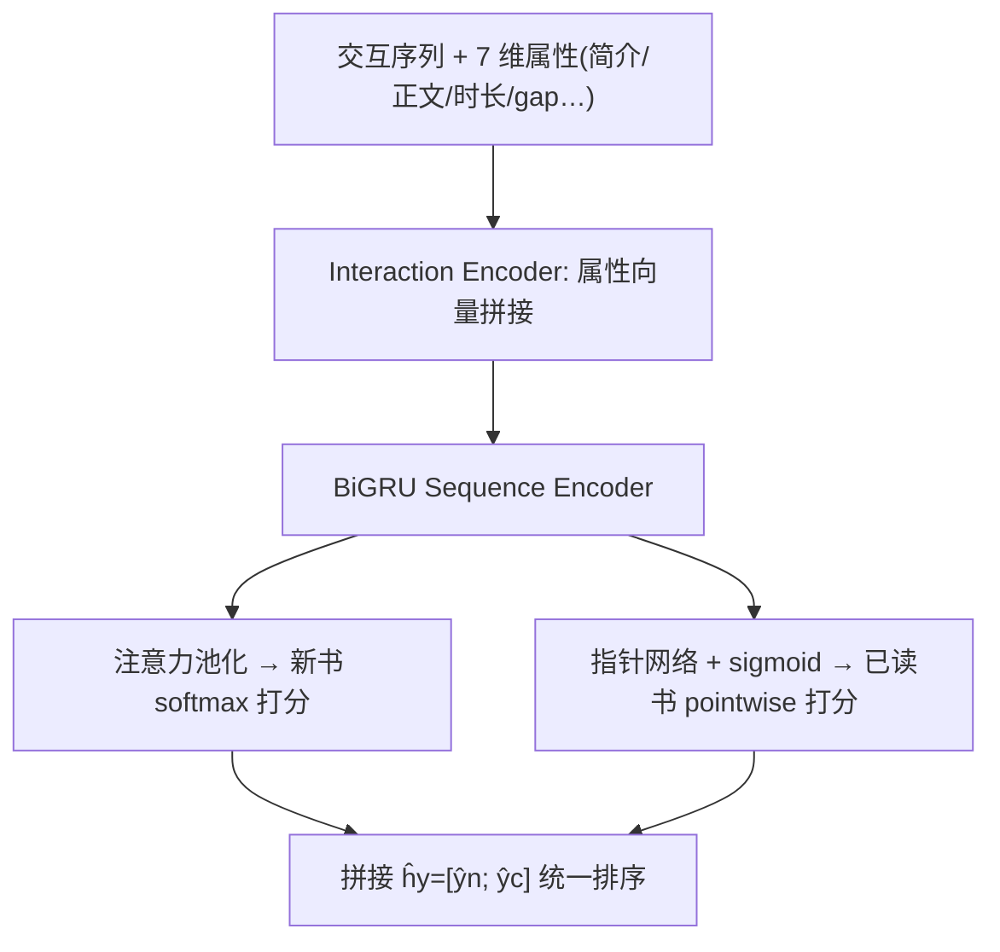

# Modeling User Repeat Consumption Behavior for Online Novel Recommendation (在线小说推荐中的用户重复消费行为建模)

- **会议/期刊**: RecSys 2022
- **作者与机构**: Yuncong Li, Cunxiang Yin, Yancheng He, Guoqiang Xu, Jing Cai (腾讯), Sheng-hua Zhong (深圳大学)
- **推荐链路定位**: 召回 / Next-Item 预测（端到端序列打分）
- **研究方向**: 序列与会话推荐 / 冷启动与长尾推荐
- **论文原文**: [https://arxiv.org/abs/2209.01963v1](https://arxiv.org/abs/2209.01963v1)
- **开源代码**: [https://github.com/l294265421/NovelNet](https://github.com/l294265421/NovelNet)

## TL;DR (1分钟核心速览)

在线小说平台的新用户（注册 7 天内）有 ~58% 的下一次交互落在**已读过的书**上，而主流 session-based 模型把每次交互压缩成一个 item ID，无法刻画"读简介→读正文→收藏"这类细粒度阅读行为。本文提出 NovelNet：用 7 个交互属性编码每次阅读，BiGRU 编码序列，同时用**注意力打分新书**与**指针网络 + pointwise 损失选已读书**，并在共享分数空间拼接排序。在自建 QQ 浏览器数据集全库排序协议下 MRR@1 47.02%，较最强基线 RepeatNet（44.93%）提升 4.65%。

## Background & Motivation (背景与核心矛盾)

- **主流范式**: 该任务被近似为 session-based next-item 推荐，代表工作 STAN/VSTAN、NARM、GRU4REC+、RepeatNet、SLIST；其中 RepeatNet、SLIST 显式区分"重复消费/新物品"两类概率。
- **前人局限一**: 这些模型的交互只含 item ID，而小说场景中"只翻简介就退出"与"连读 40 分钟"对是否回读的指示性天差地别，粗粒度表示无法区分。
- **前人局限二**: RepeatNet 类方法先用一个 gate 预测是否重复，再在两套打分器里分别归一化，两路概率不在同一尺度，无法公平混排；而原始指针网络的 softmax 只表达"已读书之间的相对次序"，当 $L=1$ 时概率恒为 1，不可解释。
- **核心洞察 (Key Insight)**: 读小说是"跨多次会话完成一本书"的长周期行为，因此重复消费的主因不是商品消耗，而是**未读完**；交互间隔（gap=0 占比 78.81%）与阅读时长分布共同支撑这一判断。
- **本文切入点**: 把"重读预测"转化为**在历史交互序列上做指针选择**，并用属性级编码 + pointwise 损失让两路分数可比。

<figure class="paper-figure" markdown="span">
  <figcaption>图 1. 每个子图均为手机屏幕截图的一部分。(1) 左侧部分为示例，说明用户与小说之间的一次交互。实线箭头表示用户从一页跳转到另一页。虚线箭头表示用户可从推荐列表页直接进入内容页。当用户从推荐列表页进入小说的某一页时，交互开始。当用户离开小说并返回推荐列表页时，交互结束；用户可从小说的任意页面离开。(2) 右侧</figcaption>
</figure>

## Method (核心方法设计)

### 1. 整体框架 (Overall Architecture)

输入是用户按时间排序的交互序列 $S_u=\{i_1,\dots,i_L\}$，每条交互附带 11 个属性（最终模型只用 7 个）。Interaction Encoder 将属性查表拼接为交互向量$\boldsymbol{r}_l$；Sequence Encoder（BiGRU）输出$\boldsymbol{H}=[\boldsymbol{h}_1,\dots,\boldsymbol{h}_L]$。随后模型分两支出分：**新书支**用注意力池化出序列表示$\boldsymbol{r}_{S_u}$与全部未交互书做内积再 softmax；**已读书支**用单步指针网络对序列每个位置打分，经 sigmoid 得到真实回读概率，推理时用 mask 把每个"书"仅保留最后一次交互位置，两路分数拼接$\hat{\boldsymbol{y}}=[\hat{\boldsymbol{y}}_n;\hat{\boldsymbol{y}}_c]$ 后取 argmax。

### 2. 关键设计拆解 (Key Designs)

1. **细粒度交互编码（Interaction Encoder）**: 前人只用 ID，无法区分"点开即走"与"深度阅读"。本文为每次交互抽 11 个属性——`description_content`（看简介后是否进正文）、`real_read`（是否读 ≥2 页正文）、`read_duration`、`novel_count`（该书历史出现次数）、`recency`、`temporal_gap`、`index_gap` 等，分别查表拼接：$\boldsymbol{r}=[\boldsymbol{e}_1;\boldsymbol{e}_2;\dots;\boldsymbol{e}_{11}]$。直觉是"行为深度"直接编码了继续阅读的意愿强度，比单纯 ID 共现的信噪比高得多；实验也证实 ID 维度加大（160→320）几乎无收益，而加属性显著有效。
2. **指针网络 + Pointwise 损失（统一两路打分尺度）**: 已读书推荐本质是"从序列中选位置"，故用指针打分 $u^c_l=(\boldsymbol{v}^c)^\top\tanh(\boldsymbol{W}^c_1\boldsymbol{h}_l+\boldsymbol{W}^c_2\boldsymbol{d}_1)$，其中$\boldsymbol{d}_1=[\overrightarrow{\boldsymbol{h}}_L;\overleftarrow{\boldsymbol{h}}_1]$。关键在于除 listwise softmax 外**额外**输出$\hat{y}^c_l=\sigma(u^c_l)$并施加带掩码的 BCE：$\mathcal{L}^c_{pointwise}=-\frac{1}{L}\sum_l m_l[y^c_l\log\hat{y}^c_l+(1-y^c_l)\log(1-\hat{y}^c_l)]$。sigmoid 给出绝对概率而非组内相对排名，才可与新书支的 softmax 概率拼接比较。
3. **末次交互掩码（Interaction Mask）**: $m_l=1$仅当第$l$次交互是用户对该书的**最后一次**交互——用最后一次交互的上下文表示隐式汇总"整本书的阅读历程"，避免同一本书多个位置重复计分稀释监督信号。训练目标$\mathcal{L}=\lambda\mathcal{L}^c_{pointwise}+\mathcal{L}_{listwise}$，$\lambda=12$；listwise 项在真值为新书时换成新书支的交叉熵$\mathcal{L}_n$。**负采样**: 无显式负采样，新书支对$N_n$全量 softmax，已读书支对序列全位置做 BCE，推理需对$|N_c|+|N_n|$ 全库打分（无 ANN 加速）。

## Experimental Setup & Evaluation Protocol (实验设置与评估协议)

- **数据集与预处理**: 腾讯 QQ 浏览器 2021.11.11–11.24 日志，仅保留 11.18–11.24 首访的新用户并随机采样；过滤只有 1 次交互的用户、训练集中出现 <5 次的小说（类 5-core）。

| 数据集 | #Users | #Items | #Interactions | 平均/中位序列长 | 重复率 RR |
| :--- | :---: | :---: | :---: | :---: | :---: |
| training | 91,311 | 18,487 | 602,067 | 9.45 / 4 | 58.31% |
| valid | 34,857 | 10,598 | 121,384 | 9.71 / 5 | 59.48% |
| test | 38,338 | 10,265 | 121,433 | 9.18 / 4 | 56.44% |

- **数据划分与防穿越**: **全局时间戳切分**——11.18–11.22 训练、11.23 验证、11.24 测试；11.18 之前的历史交互全部保留作为模型输入，保证预测"下一次"时不丢历史。
- **排名评测协议**: 无偏 **Full-Ranking**，候选为 $N=N_c\cup N_n$ 全部小说；指标 MRR@{1,5,10,20}、Recall@{5,10,20}，以 MRR@1 为主（线上仅展示 1 本书）。
- **对比基线与超参**: 6 个非神经网络模型（AR/SR/SKNN/VSKNN/STAN/VSTAN）、神经模型 NARM/GRU4REC+、重复消费模型 RepeatNet/SLIST、SOTA Proxy-SR，另加规则基线 RecentNovel（总是推荐最后读的书）。Item embedding 128、属性 embedding 32、GRU 隐藏 64、Adam lr=1e-3、$\lambda=12$；跑 5 次取测试均值，最优与次优用 paired t-test（$p<0.05$）验证显著性。

## Key Experimental Results (实验关键数据)

### 1. 主实验对比 (Main Results)

| Method | MRR@1 | MRR@10 | Recall@10 | Recall@20 |
| :--- | :---: | :---: | :---: | :---: |
| SKNN | 32.84 | 40.65 | 58.16 | 63.13 |
| VSTAN | 43.88 | 49.25 | 60.63 | 64.32 |
| STAN | 43.06 | 49.50 | 63.11 | 68.11 |
| NARM | 42.90 | 48.01 | 60.25 | 66.34 |
| GRU4REC+ | 42.20 | 46.28 | 56.62 | 62.20 |
| RepeatNet | 44.93 | 49.99 | 60.03 | 65.56 |
| SLIST | 38.66 | 44.81 | 58.51 | 63.88 |
| RecentNovel (rule) | 44.48 | – | – | – |
| **NovelNet** | **47.02** | **52.00** | **63.43** | **68.72** |
| Improv. vs best baseline | **+4.65%** | +4.02% | +0.51% | +0.90% |

### 2. 消融实验 (Ablation Study)

| Variant | MRR@1 | 说明 |
| :--- | :---: | :--- |
| NovelNet | **47.02** | 完整模型 |
| w/o pointwise | 46.72 | 用 listwise softmax 直接当概率 |
| w/o listwise | 46.40 | 仅保留 BCE |
| w/o pointer | 40.58 | 新书支统一打分全库（退化为普通序列推荐） |
| w/o mask | 45.84 | 取消末次交互掩码（MRR@20 51.35） |
| NovelNet-160 (仅 ID) | 44.67 | 无任何交互属性 |
| NovelNet-320 (仅 ID, 大维度) | 44.71 | 加维度≠加信息 |
| + `description_content` / `real_read` / `read_duration` / `novel_count` / `recency` / `temporal_gap` | 45.45 / 45.02 / 45.29 / 44.95 / 44.85 / 44.92 | 单属性均显著优于 160 基线 |
| + `collect` / `quality` / `novel_tag` | 44.62 / 44.70 / 44.68 | 增益不显著，被最终模型剔除 |

### 3. 关键实验发现 (Key Findings)

1. **重复消费是主战场，但被普遍低估**：规则基线 RecentNovel 拿到 44.48% MRR@1，超过除 RepeatNet 外所有神经基线；去掉指针网络（w/o pointer）直接掉 6.44 个点，证明"显式建模回读"是收益主来源而非序列编码器。
2. **属性带来的是"读没读完"的信号**：加属性使整体 MRR@1 从 44.67→46.87（λ=1 设置），其中 46.65 点来自已读书部分、仅 0.42 点来自新书；且 `description_content`（+0.78）、`read_duration`(+0.62)、`real_read`(+0.35) 三个"阅读深度"属性贡献最大，而平台代劳的 `collect` 反而因噪声掉点。
3. **两路分数可比性由 pointwise 损失解决，但引入流行度偏置**：w/o pointwise 的推荐结果重复率高达 99.95%、新书部分 MRR@1 仅 0.01；加入 pointwise 后重复率降到 90.27%、新书部分升至 0.63，w/o pointer 虽重复率最低（71.11%）但整体仅 40.58——说明 pointwise 是"校准"而非"提新书召回"，模型整体仍存在明显 popularity bias（测试集真实重复率仅 56.44%）。

## Highlights & Limitations (亮点、对比与审稿批判)

- **与代表作对比 (vs. Prior Work)**: 相对于 RepeatNet 的"gate + 双打分器"两阶段概率，NovelNet 用**单序列 + 指针**把两类候选放进同一分数空间，无需 gate；相对于 SLIST 的线性结构，BiGRU + 属性拼接容量更高；相对于 TDCIM（同域唯一前人工作），首次把"交互内部过程"而非仅标签分布引入建模，并开源了数据集。
- **可迁移亮点**: （1）"用最后一次交互位置 + 掩码做序列聚合"可直接迁移到购物车复购、短视频追更等长周期消费场景；（2）用 sigmoid 头对"历史位置"打分再与 softmax 新物品分数拼接，是低成本解决多源分数不可比问题的通用技巧。
- **审稿级局限批判**: （1）**推理开销与工程性**：需对全库 $N_c\cup N_n$逐一打分，无 ANN 索引设计，线上万级书目下延迟未讨论，也无 A/B 结果；（2）**评估局限**：仅一个自建私有域数据集、单次时间切分（11.24 一天测试），未做多日滚动验证，且新书部分 MRR@1 不足 1%，模型实际上几乎不推荐新书，与论文宣称的"同时推荐已读与新书"存在落差；（3）$\lambda=12$ 高度敏感（1→15 间验证集波动约 0.2 点），缺乏自适应权重方案。

## Rating (四维评分)

- **方法创新性 (Novelty)**: ⭐⭐⭐⭐ （把"交互内部细粒度属性 + 指针选择"组合用于重复消费，思路朴素但切中小说场景本质，理论分析偏弱）
- **评估协议与实验扎实度 (Protocol & Experiments)**: ⭐⭐⭐⭐ （Full-Ranking 全库排序、11 个基线、5 次重复 + 显著性检验、属性与损失双重消融完备，但只有单数据集单切分）
- **写作与数学规范度 (Clarity & Rigor)**: ⭐⭐⭐⭐ （公式与掩码定义清晰、动机—设计—实验闭环，但符号偶有下标笔误，复杂度与推理成本未分析）
- **工业落地与复现价值 (Industrial & Practical Value)**: ⭐⭐⭐⭐ （代码与数据集均开源，模型轻量易上线；缺 ANN 与在线实验，重复率偏置需额外校准）

