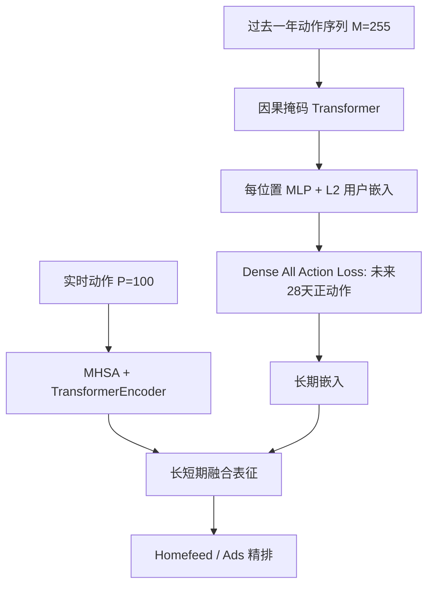
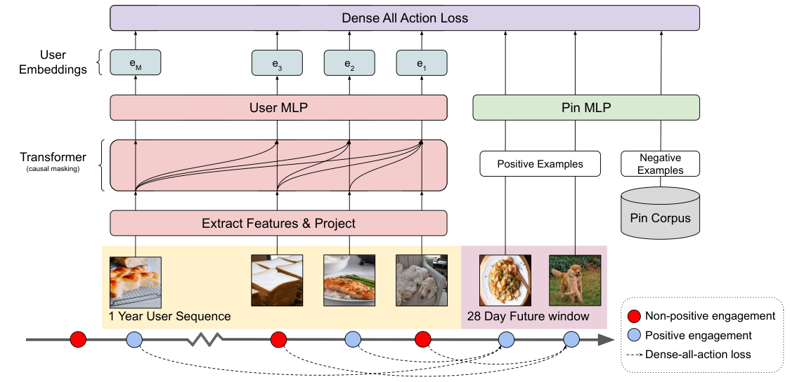

# Rethinking Personalized Ranking at Pinterest: An End-to-End Approach (重新思考 Pinterest 的个性化排序：一种端到端方法)

- **会议/期刊**: RecSys 2022
- **作者与机构**: Jiajing Xu, Andrew Zhai, Charles Rosenberg；Pinterest Inc.
- **推荐链路定位**: 精排（Homefeed Ranking / Related Pins Ads Ranking）
- **研究方向**: 序列与会话推荐 / 工业级全链路架构
- **论文原文**: [论文原文链接](https://arxiv.org/abs/2209.08435v1)
- **开源代码**: 暂未开源

## TL;DR (1分钟核心速览)

针对工业推荐中用户表征仅聚合 top-k PinnerSage、序列模型只预测下一动作的痛点，本文提出 PinnerFormer：用因果 Transformer 对一年行为序列建模，并以 Dense All Action 损失在 $M$ 个位置监督未来 28 天全部正动作；再用实时序列建模短期意图。Pinterest Homefeed/Related Pins Ads 线上 A/B 中，完整模型相对生产基线 Organic Repin +12.5%、Ads CTR +14.0%。

## Background & Motivation (背景与核心矛盾)

- **主流范式**: 工业界常用 PinnerSage 等用户嵌入，将用户历史 Pin 的 top-k 嵌入加权平均后作为排序特征；序列模型则多用于预测下一动作。
- **前人局限**: top-k 聚合会丢失长序列细节；next-action 目标监督稀疏且偏即时反馈，难以表征两周以上的长期兴趣。此外，线上服务 Transformer 的延迟与成本是硬约束。
- **核心洞察 (Key Insight)**: 用户意图可分解为长期兴趣与短期意图；若在历史序列的每个位置都监督“未来一段时间内的全部正动作”，可获得更稠密、更稳健的长期用户表征。
- **本文切入点**: 长期分支用 PinnerFormer + Dense All Action Loss，短期分支用实时动作序列，二者融合后进入精排，并以混合 CPU/GPU 服务降延迟。

## Method (核心方法设计)

### 1. 整体框架 (Overall Architecture)

输入为用户过去一年按时间升序的动作序列，取最近 $M=255$条动作；每条动作由 PinSage 嵌入与动作类型、时间戳、停留时长、场景等元特征拼接。序列经 PreNorm Transformer 与因果掩码编码，每个位置输出经小 MLP 与$L_2$归一化得到用户嵌入；Pin 侧用 MLP 将 PinSage 映射并归一化。长期分支以 Dense All Action Loss 对每个位置预测未来 28 天正动作；短期分支取$P=100$ 条实时动作，经 MHSA 后与长期嵌入共同进入 TransformerEncoder。最终用户表征作为 Homefeed 与 Ads 精排模型特征。

<figure class="paper-figure" markdown="span">
  <figcaption>图2：PinnerFormer 架构概览。特征通过带因果掩码的 Transformer，并在每个时间步返回嵌入。蓝色圆圈表示与正动作相关的嵌入，红色圆圈表示与非正动作相关的嵌入（但不一定是负动作）。</figcaption>
</figure>

### 2. 关键设计拆解 (Key Designs)

1. **PinnerFormer 与 Dense All Action Loss（稠密长期兴趣监督）**：传统序列模型只在末端预测下一动作，监督信号少且受偶然点击影响；本文在因果掩码 Transformer 的每个位置 $t$输出$\boldsymbol{u}_t$，并对该位置后 28 天内所有正动作做平均交叉熵：
   $\mathcal{L}_{\mathrm{DAA}}=-\frac{1}{M}\sum_{t=1}^{M}\frac{1}{|\mathcal{P}_t|}\sum_{i\in\mathcal{P}_t}\log\frac{\exp(\boldsymbol{u}_t^\top\boldsymbol{v}_i/\tau)}{\sum_{j\in\mathcal{N}_t}\exp(\boldsymbol{u}_t^\top\boldsymbol{v}_j/\tau)}$其中$\mathcal{P}_t$为未来正动作集合，$\mathcal{N}_t$为候选/负例集合。直觉是：多未来正例相当于对长期兴趣做去噪聚合，$M$ 个位置均贡献梯度，缓解 next-action 的稀疏与短视。

2. **长短期意图分解与时间窗掩码**：仅长期嵌入无法响应当下意图；引入 $P=100$ 条实时动作，经 MHSA 后与 PinnerFormer 嵌入共同编码。早期实时特征使模型过度敏感（看过食物后首页被食物 Pin 淹没），训练时对实时序列加时间窗掩码，抑制最近动作的支配效应，使短期信号“补充而非覆盖”长期兴趣。

3. **训练目标、负采样与推理效率**：长期分支使用上述 DAA 损失；短期分支与下游精排模型联合学习。原文未披露负采样比例、难负例策略及总损失权重，仅说明从 Pin Corpus 构造正负例。推理侧 $M=255$、$P=100$，通过算子级设备编排控制延迟。

## Experimental Setup & Evaluation Protocol (实验设置与评估协议)

- **数据集与预处理**: 论文使用 Pinterest 工业日志，未公开用户/物品/交互统计，也未报告 5-core 等过滤；离线评估仅称优于前代基线 [13]，无公开表格。特征侧 PinSage 嵌入聚合视觉、文本与互动信息；Related Pins Ads 受基础设施限制，实时动作改用 Pin 文本标注。

| 数据集 | #Users | #Items | #Interactions | 稀疏度/密度 | 特征/场景说明 |
| :--- | :---: | :---: | :---: | :---: | :--- |
| Pinterest Homefeed | 未披露 | 未披露 | 未披露 | 未披露 | 一年行为序列；长期+实时特征 |
| Related Pins Ads | 未披露 | 未披露 | 未披露 | 未披露 | Ads CTR；实时序列用文本标注 |

- **数据划分与防穿越 (Splitting Strategy)**: 用户动作按时间升序排列；长期兴趣取过去一年序列，训练监督窗口为未来 28 天，文中另提“14 天长期兴趣窗口”作为兴趣定义。线上 A/B 中各组排序模型使用同一日期范围训练以保证公平。
- **排名评测协议 (Ranking Protocol)**: 采用线上 A/B 排序实验，指标为 Organic Repin 与 Ads CTR；未报告离线 Full-Ranking 或 Sampled Ranking，也未给出正负采样比。
- **对比基线与超参设置**: 生产基线为 top-k PinnerSage 嵌入加权平均；处理组为 PinnerFormer、PinnerFormer+Real-time。$M=255$、$P=100$；嵌入维度$d$与显著性$p$ 值未披露。原文仅 1 个生产基线，未列 5–8 个学术 SOTA，故不虚构补充。

## Key Experimental Results (实验关键数据)

### 1. 主实验对比 (Main Results)

| 模型/配置 | Organic Repin Lift | Ads CTR Lift | 相对 PinnerFormer 增量 |
| :--- | :---: | :---: | :---: |
| 生产基线（PinnerSage top-k 加权） | 0 | 0 | — |
| PinnerFormer（仅长期兴趣） | **+7.5%** | **+9.1%** | — |
| PinnerFormer+Real-time（长+短） | **+12.5%** | **+14.0%** | +5.0pp / +4.9pp |

### 2. 消融实验 (Ablation Study)

原文没有标准离线消融，仅有线上组件对比与部署方式对比：

| 配置 | 关键变化 | Organic Repin | Ads CTR | 延迟变化 |
| :--- | :--- | :---: | :---: | :---: |
| w/o Real-time | 仅 PinnerFormer | +7.5% | +9.1% | — |
| + Real-time | 增加 $P=100$ 实时动作 | +12.5% | +14.0% | — |
| CPU-only | 全 CPU 服务 | — | — | +300% |
| GPU-only | 全 GPU 服务 | — | — | +400% |
| Mixed CPU-GPU | Embedding/projection/预处理在 CPU，Transformer 在 GPU | — | — | +10% |

### 3. 关键实验发现 (Key Findings)

1. **单长期嵌入已显著优于此前的 top-k 聚合**：PinnerFormer 单独带来 Organic Repin +7.5%、Ads CTR +9.1%，说明用完整行为序列 + 稠密未来监督替代 PinnerSage 加权平均，能同时提升自然流量与广告排序。
2. **短期实时序列与长期兴趣互补，但增益依赖时间窗掩码**：加入实时动作后两项指标分别升至 +12.5% 与 +14.0%，相对仅长期模型再增约 5pp；作者明确指出无掩码时模型会过度响应最近兴趣。
3. **工业收益的关键在混合设备服务而非单纯堆 GPU**：全 CPU 延迟 +300%、全 GPU +400%，而将轻量 embedding 相关算子留在 CPU、Transformer 放 GPU 后仅 +10%，使复杂模型具备上线可行性。

## Highlights & Limitations (亮点、对比与审稿批判)

- **与代表作对比 (vs. Prior Work)**: 相比 PinnerSage 的 top-k 嵌入聚合，本文用端到端序列模型保留完整行为上下文；相比传统 next-action 序列模型，Dense All Action 在未来多正动作上做稠密监督；相比纯离线学术模型，本文给出混合 CPU/GPU 的工业部署路径。
- **可迁移亮点**: “因果 Transformer 每位置输出 + 未来全正动作平均损失”可迁移到电商/短视频用户表征；算子级 CPU/GPU 切分对工业精排降延迟有直接参考价值。
- **审稿级局限批判**: 其一，论文仅 4 页，未公开数据集、离线主表、负采样细节与显著性检验，复现与公平比较困难；其二，14 天兴趣定义与 28 天训练窗口并存但未解释，且线上 A/B 无置信区间，长期收益与实时特征成本仍需更细粒度归因。

## Rating (四维评分)

- **方法创新性 (Novelty)**: ⭐⭐⭐⭐ （Dense All Action 损失把 next-action 监督扩展为多位置多未来正例，长短期分解清晰，但整体仍是工业序列建模的增量式创新）
- **评估协议与实验扎实度 (Protocol & Experiments)**: ⭐⭐ （仅有线上 A/B 与延迟表，缺少公开数据、离线 Full-Ranking 协议、负采样设置、显著性检验与标准消融）
- **写作与数学规范度 (Clarity & Rigor)**: ⭐⭐⭐⭐ （架构与部署叙述清楚，但关键公式、负采样和 14/28 天窗口定义未充分展开，4 页篇幅限制明显）
- **工业落地与复现价值 (Industrial & Practical Value)**: ⭐⭐⭐⭐⭐ （Pinterest 全量上线，Organic Repin +12.5%、Ads CTR +14.0%，混合 CPU/GPU 将延迟增幅压到 +10%，工业价值突出）

