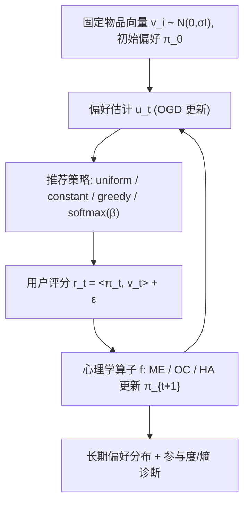
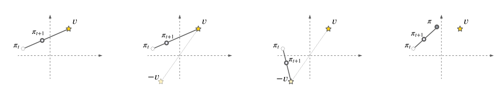

# Towards Psychologically-Grounded Dynamic Preference Models (面向心理学接地的动态偏好模型)

- **会议/期刊**: RecSys 2022 (Sixteenth ACM Conference on Recommender Systems)
- **作者与机构**: Mihaela Curmei (UC Berkeley), Andreas Haupt (MIT), Dylan Hadfield-Menell (MIT), Benjamin Recht (UC Berkeley)
- **推荐链路定位**: 召回（用户/物品表征的动态演化侧）——本文不提出新召回器，而是为"推荐→偏好改变→再推荐"闭环提供可仿真的用户模型
- **研究方向**: 序列与会话推荐 / 强化学习与动态探索推荐
- **论文原文**: [https://arxiv.org/abs/2208.01534v2](https://arxiv.org/abs/2208.01534v2)
- **开源代码**: 暂未开源（作者称复现仿真代码置于论文补充材料）

## TL;DR (1分钟核心速览)

现有动态偏好模型（极化/极端化理论）常假设偏好可无界放大，缺乏心理学证据且预测不具可实现性。本文提出"陈述效应→数学形式化→仿真导出可检验预测→数据校验→修正"的五步方法论，并把单纯曝光 (ME)、操作性条件作用 (OC)、享乐适应 (HA) 统一写成偏好向量的增量算子 $\pi_{t+1}-\pi_t=\gamma f(\cdot)$。在$d\in\{2,8\}$、$N\in\{1000,5000\}$ 的闭环仿真中证明：三者产生**定性可区分**的轨迹（收敛/振荡/回归基线），且 ME 下"持续性 softmax"可同时在参与度与消费熵上严格优于静态最优 softmax，说明常用指标无法度量动态用户下的系统健康。

## Background & Motivation (背景与核心矛盾)

- **主流范式**: 离线 train-test 划分 + 静态偏好假设（矩阵分解/序列模型均把用户表征视为缓变或不变），以参与度（评分）与熵（多样性）作为设计目标。
- **前人局限 1**: 闭环理论模型（如文献[33]的曝光放大模型、[35]的条件作用式模型）数学上推出偏好范数发散、用户极端化；但实证审计发现真实系统的推荐内容反而比自然消费更多样，未观测到强极化。
- **前人局限 2**: 现有动态模型多为"纯数学描述"（如指数滑动平均 $u_{t+1}=(1-\gamma)u_t+\gamma v_t$），未说明对应哪一种心理机制，因而无法判断参数取值范围是否合理、也无法跨域迁移。
- **核心洞察 (Key Insight)**: 心理学实验已给出可量化的效应强度（如每增加一次曝光，7 分制吸引力评分 +0.2；100 分制下 3 天内对贴纸的满意度 −4.5），这些量级可直接约束偏好更新算子的步长 $\gamma$，从而使模型**有界且可检验**。
- **本文切入点**: 把"心理学效应"当作模型设计的第一性约束，用仿真先筛掉不可信的算子形式，再交给线上数据检验。

## Method (核心方法设计)

### 1. 整体框架 (Overall Architecture)

设物品向量 $v\in\mathbb{R}^d$固定、单用户偏好$\pi_t\in\mathbb{R}^d$，评分$r(\pi_t,v)=\langle\pi_t,v\rangle+\varepsilon_t$。推荐器维护偏好估计$u_t$（非真实$\pi_t$），按 softmax 温度$\beta$采样物品，用户返回带噪评分后真实偏好按所选的心理学算子$f$更新，估计器再用在线梯度下降 (OGD) 追上。整条闭环用于观察"真实偏好轨迹"与"估计得分轨迹"的长期形态，并据此导出可证伪的预测。核心结论是：只要各效应权重满足$\gamma_{ME}+\gamma_{OC}+\gamma_{HA}\le 1$，偏好范数对任意推荐序列**有界**（命题 4.1），从根上排除了前人模型的发散预测。

<figure class="paper-figure" markdown="span">
  <figcaption>图 2. 偏好空间中的更新：单纯曝光、操作性条件作用与享乐适应。单纯曝光将偏好向量按距离的恒定比例移向推荐内容；操作性条件作用根据意外的方向和幅度，向推荐内容移动或远离推荐内容。享乐适应导致收敛到基线评分。</figcaption>
</figure>

### 2. 关键设计拆解 (Key Designs)

1. **三效应统一增量算子族**：痛点是前人算子无界、且效应之间不可比。本文统一为 $\pi_{t+1}-\pi_t=\gamma f(\cdot)$，其中 ME 为$\gamma(v_t-\pi_t)$（向被推荐内容按固定比例靠拢，与评分高低无关）；HA 为$\gamma(\bar{\pi}-\pi_t)$（向基线偏好线性回归，与推荐内容无关）；OC 见下条。三者取凸组合即得命题 4.1 的有界性，直觉是"所有算子都是向某个固定点的收缩映射"。
2. **基于"惊喜度"的条件作用算子**：痛点是 OC 只描述行为、不描述偏好，且正/负强化不应同权。定义惊喜 $s=\arctan\!\big(\frac{\sum_{\tau=1}^{t-1}\delta^{\tau}r_{t-\tau}}{\sum_{\tau=1}^{t-1}\delta^{\tau}}-r_t\big)$（指数折扣的历史期望 vs 当前评分的偏差，映射到$[-1,1]$），更新为$\pi_{t+1}-\pi_t=\gamma|s|\big(\mathrm{sgn}(s)\,v_t-\pi_t\big)$。正向惊喜把偏好拉向$v_t$、负向拉向$-v_t$，位移幅度随惊讶程度缩放——这直接产生"参与度振荡"的可检验预测。
3. **训练目标、估计器与推理开销**：无监督损失，估计器为带 $\ell_2$的 OGD：$u_{t+1}=(1-\alpha\eta)u_t+\alpha(r_{it}-s_{it})v_i$；推荐分布$P[i^*=i]\propto\exp(\beta s_{it}/\|u_t\|)$（除以$\|u_t\|$以保持相邻轮期望参与度恒定，是本文关键的公平比较技巧）。每轮仅需$O(Nd)$ 打分与一次向量更新，成本与标准 MF 在线服务同阶；无需负采样。

## Experimental Setup & Evaluation Protocol (实验设置与评估协议)

- **说明**: 本文为**纯仿真研究**，不含真实数据集、不含离线 ranking 基准，故无 Full-Ranking / 采样排序协议与 5-core 过滤。下表为仿真配置统计。

| 仿真配置 | 维度 $d$| 物品数$N$| 轮数$T$ | 关键参数 | 说明 |
| :--- | :---: | :---: | :---: | :---: | :--- |
| 低维轨迹可视化 | 2 | 1000 | 数千 | $\gamma_{ME/OC}=0.1$,$\gamma_{HA}=0.01$ | 画偏好轨迹与长期分布云 |
| 高维统计诊断 | 8 | 5000 | 5000–10000 | $\beta\in\{1,2,3,4,5\}$ | 参与度/范数/熵曲线 |
| 估计噪声 | — | — | — | $\varepsilon,\varepsilon'\sim\mathcal{N}(0,\sigma' I)$ | 加噪以避免不稳定平衡点 |

- **划分与防穿越**: 无数据集划分；改用"**oracle 模型 vs 估计模型**"双轨对照（附录 B 给出直接访问真实 $\pi_t$ 的 oracle 版本），以证明观察到的动态源于行为算子而非估计误差。
- **评测协议**: 无 ranking 指标；评测对象为**轨迹形态**（收敛点、振荡周期/幅度）与**系统级指标**（平均评分=参与度、消费分布熵=多样性），以及二者的帕累托前沿。
- **对比策略与超参**: 基线为 uniform / constant / greedy 三种选择规则，主对比为 softmax($\beta$) 温度族；物品与初始偏好均采$\mathcal{N}(0,\sigma I_d)$，$\delta\in\{0.99,0.999\}$。

## Key Experimental Results (实验关键数据)

### 1. 主实验对比 (Main Results)

原文未给出数值型主实验表，仅以图 3–8 呈现定性/半定量趋势；下表如实汇总各算子在不同推荐策略下的**可区分签名**（↑/↓ 表示随 $\beta$或$\gamma$ 增大而增/减）。

| 心理学算子 | uniform | constant / greedy | softmax(β↑) | 偏好范数 $\|\pi\|$ | 参与度 | 消费熵 |
| :--- | :--- | :--- | :--- | :---: | :---: | :---: |
| **ME (单纯曝光)** | 收敛到原点附近的球 | 收敛到被反复推荐的物品 | 偏好绕物品空间"转圈"，$\beta$小则转得快 | ↑ | ↑（$\gamma_{ME}$放大） | 高位保持（$\beta=4$ 仍高） |
| **OC (条件作用)** | 近似随机 | **振荡**（周期/幅度随 $\beta$、$\delta$变） |$\beta$ 越大振幅越大、周期越短 | 振荡 | 振荡 | 振荡 |
| **HA (享乐适应)** | 收敛到基线 $\bar{\pi}$| 收敛到基线$\bar{\pi}$ | 偏置但不压过 ME/OC | → 基线 | → 基线 | — |
| **ME + HA** | — | — | 轨迹在物品空间"走得更少" | 收缩 | 略降 | 降 |
| **OC + HA** | — | — | 振荡被限制在基线方向附近 | 振荡+偏置 | 振荡 | — |

### 2. 消融实验 (Ablation Study)

| 消融项 | 变化 | 观测结果 |
| :--- | :--- | :--- |
| $\gamma_{ME}=0$（静态偏好） | 静态 vs 动态 | softmax 处于"参与度–熵"帕累托最优（定理 6.4） |
| $\gamma_{ME}=0.1$ | 动态偏好 | 持续性 softmax（式 2）在**两项指标上同时**优于所有 softmax(β) |
| $\delta:0.99\to0.999$ | 近因偏差减弱 | OC 振荡频率下降、周期变长（图 6） |
| $\gamma_{OC}=0.01\to0.1$| 强化强度增大 | 振荡幅度显著增大，$\delta$ 对周期的影响被放大 |
| oracle vs OGD 估计 | 去除估计误差 | 定性结论不变，动态由行为算子主导 |

### 3. 关键实验发现 (Key Findings)

1. **ME 会把"高参与度"变成廉价指标**：图 4(a) 显示 $\beta=5$且$\gamma_{ME}=0.5$时参与度最高，但图 4(c) 显示即使$\beta=4$，消费内容熵仍可维持高位——即系统可通过不断把用户偏好"推着走"同时刷高参与度与多样性，二者都不再代表用户福利。
2. **OC 天然产生"先上瘾后厌倦"的振荡**：greedy 策略下，偏好被正向惊喜推高→历史期望追平→噪声触发负向惊喜→偏好被拉向 $-v_t$而崩塌至$\pi_t\approx 0$，随后期望衰减、另一方向重新获得正向惊喜。该振荡在心理学文献中**未见报道**，作者据此承认形式化可能过强（负强化效应被高估、$\delta$ 需下调）。
3. **指标失效可被"反向利用"**：式 (2) 的持续性 softmax 只推荐落在最近一次偏好移动方向半空间内的内容（$\mathbb{1}_{\langle\hat u_t-\hat u_{t-1},v\rangle>0}$），刻意改变偏好以提升消费熵，却在图 8(b) 中严格占优静态最优 softmax 的帕累托前沿——证明"参与度+多样性"双高并不等于系统健康。

## Highlights & Limitations (亮点、对比与审稿批判)

- **与代表作对比 (vs. Prior Work)**: 相较 [33]（曝光放大导致偏好无界）与 [35]（偏好估计直接反写真实偏好、证明发散），本文的算子族以凸组合保证有界，并明确区分"估计 $u_t$"与"真实$\pi_t$"，因果方向更干净；相较 DPF 类高斯随机游走模型，本文把漂移项换成有心理学证据支撑的定向算子，可解释性与可检验性更强。
- **可迁移亮点**: (1) softmax 里用 $\beta/\|u_t\|$ 归一化温度，使不同偏好范数下的探索强度可比，可直接用于 bandit 探索的公平对照；(2) "先仿真导出可证伪签名（振荡 vs 恒定），再用线上日志判别"的验证范式，可迁移到 LLM 对话推荐中的偏好漂移检测。
- **审稿级局限批判**: (1) **零真实数据验证**——所有结论来自合成高斯物品向量，作者自己承认未做部署系统检验，$\gamma$的可辨识性、物品因子与偏好动态的耦合估计完全未解决；(2) 物品向量固定、单用户、$d\le 8$、$N\le 5000$，且不区分"曝光"与"消费"，与工业级千万级候选、多用户竞争的闭环相去甚远；对"指标失效"的论证仅一个构造性反例，缺少对常见离线指标（NDCG/Recall）的正式分析。

## Rating (四维评分)

- **方法创新性 (Novelty)**: ⭐⭐⭐⭐ （把心理实验量级作为偏好算子的先验约束，并用有界性命题排除前人的发散结论，视角新颖但算子形式本身较简洁）
- **评估协议与实验扎实度 (Protocol & Experiments)**: ⭐⭐ （纯仿真、无真实数据集与统计显著性检验，仅有定性趋势与 oracle 对照，实验强度远低于常规 RecSys 论文）
- **写作与数学规范度 (Clarity & Rigor)**: ⭐⭐⭐⭐ （三效应形式化统一、命题 4.1 与定理 6.4 表述干净，图示与轨迹可视化直观；OC 的惊喜项参数化略随意）
- **工业落地与复现价值 (Industrial & Practical Value)**: ⭐⭐ （无开源仓库，无法直接上线；但提供了评估"参与度/多样性"指标是否被动态偏好污染的诊断框架，对长期生态指标设计有启发）

