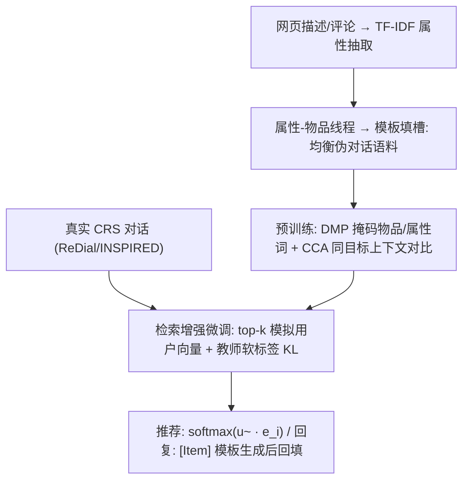
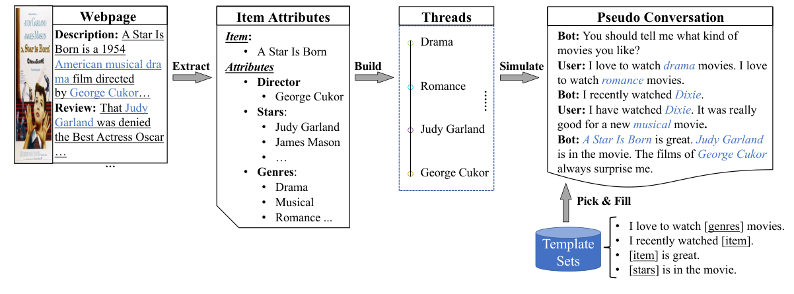
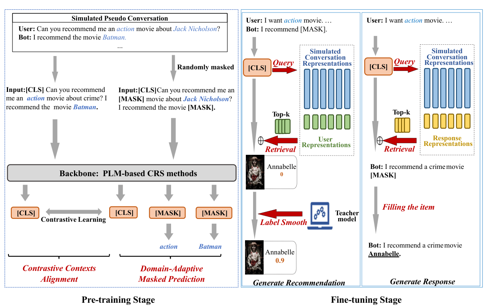

# Alleviating the Long-Tail Problem in Conversational Recommender Systems (缓解对话推荐系统中的长尾问题)

- **会议/期刊**: RecSys 2023 (Seventeenth ACM Conference on Recommender Systems)
- **作者与机构**: Zhipeng Zhao, Kun Zhou, Xiaolei Wang, Wayne Xin Zhao, Fan Pan, Zhao Cao, Ji-Rong Wen（北京理工大学 / 中国人民大学高瓴人工智能学院 / 华为泊松实验室）
- **推荐链路定位**: 端到端生成式（推荐打分 + 回复生成双任务，PLM 骨干）
- **研究方向**: 对话推荐与智能体仿真 / 冷启动与长尾推荐
- **论文原文**: [https://arxiv.org/abs/2307.11650v1](https://arxiv.org/abs/2307.11650v1)
- **开源代码**: [https://github.com/Oran-Ac/LOT-CRS](https://github.com/Oran-Ac/LOT-CRS)

## TL;DR (1分钟核心速览)

现有 CRS 数据集严重长尾：ReDial 中大量物品在对话里从未被提及，KGSF/BERT 的 Tail-Recall@10 仅 0.011/0.002，模型只会推热门片。本文提出 LOT-CRS：先用网页描述/评论抽取属性、按"属性→物品"线程和人工模板模拟出**物品频次均衡**的伪对话语料，再用 DMP（只掩码物品/属性词的领域自适应掩码预测）与 CCA（同目标物品上下文对比）做继续预训练，最后在真实数据上做**检索增强 + 教师软标签**微调。在 ReDial/INSPIRED 上以 UniCRS 为骨干，Tail-Coverage@50 分别提升 23.1% 与 5.6%，Recall@1 提升 5.9%/2.4%。

## Background & Motivation (背景与核心矛盾)

- **主流范式**: PLM-based CRS（BERT/BART/UniCRS）把对话历史拼成长序列编码 `[CLS]` 作为用户表征做物品分类，并用生成式解码器产出回复；另一支靠 KG（KBRD/KGSF）注入实体语义。
- **前人局限**: ①对话上下文对长尾物品**缺乏属性证据**（描述、评论在语料中缺失），模型学不到可分表征；②真实语料对长尾物品**缺乏训练信号**，交叉熵在极度偏斜分布下退化为"只推头部"，故重采样/重加权只能治标。
- **核心洞察 (Key Insight)**: 长尾的根因是**标注数据的分布偏斜**而非模型容量；而物品属性这类外部知识在网页上对头部/尾部是**同等可得**的，因此可以低成本"合成"一份物品频次均衡的对话语料作为知识源。
- **本文切入点**: 把"平衡语料"当作可检索的外部记忆——预训练阶段注入属性证据，微调阶段检索相似上下文补足稀疏语境，并用在该语料上训练的教师模型软标签矫正曝光偏置。

## Method (核心方法设计)

### 1. 整体框架 (Overall Architecture)

框架分三阶段闭环。**数据模拟**：抓取物品描述与评论，TF-IDF 选关键词作属性；从一个公共属性（如类型）出发逐条追加属性构成"对话线程"，直到属性组合唯一定位目标物品；再用挖出的高频"求推荐/给推荐"句式模板填槽生成伪对话，并用启发式规则控制各物品被填频次以实现均衡。**预训练**：在该语料上做 DMP 与 CCA 两个任务，使 PLM 掌握长尾物品的属性语义与"上下文→目标物品"的对应关系。**微调**：真实对话编码后从模拟语料的离线稠密索引里检索 top-$k$ 用户表征做交叉注意力融合，并以模拟语料上训练的教师模型提供软标签；回复端则检索相似回复表征作为 soft prompt，先生成含 `[Item]` 占位的模板再回填推荐结果。

<figure class="paper-figure" markdown="span">
  <figcaption>图 2. 我们提出的用于模拟一个对话示例的流程示意图。我们首先从网页收集物品属性，然后从随机属性到物品构建对话线程。最后，基于该线程使用人工编写的模板模拟对话。</figcaption>
</figure>
<figure class="paper-figure" markdown="span">
  <figcaption>图 3. 我们设计特定的预训练和微调策略，以充分利用模拟的平衡 CRS 数据集。在预训练阶段，我们提出 Domain-Adaptive Masked Prediction 和 Contrastive Contexts Alignment 任务来预训练 CRS 模型。在微调阶段，我们分别从模拟数据集中检索 top-𝑘 用户表示和回复表示，以改进推荐和回复生成任务。</figcaption>
</figure>

### 2. 关键设计拆解 (Key Designs)

1. **平衡数据模拟（把长尾证据外置化）**：痛点是对长尾物品没有任何属性描述与对话。做法是用 TF-IDF 抽属性 $a_i=\mathrm{TopK}_{w}\big(\mathrm{TF-IDF}(w,d_i)\big)$，再按"属性逐条累加至可唯一定位物品"构造线程并模板填槽，且用规则把各物品被提及频次拉平。直觉：模拟语料的语言多样性差但**属性-物品对应关系正确**，正适合当知识库而非语言模型语料。

2. **DMP + CCA 双预训练（token 级证据 + 句子级对齐）**：常规 MLM 掩码全词表，模板语料下会浪费容量在虚词上；DMP 只掩码物品与属性词，逼模型从上下文恢复长尾实体与其属性：$\mathcal{L}_{DMP}=\sum_{w_i\in W_{mask}}-\log p(w_i\mid\hat{C})$。CCA 则采样"推荐同一目标物品的两段不同对话"，令其 `[CLS]` 表征互为正样本、in-batch 为负样本，$\mathcal{L}_{CCA}(\boldsymbol{h}_1,\boldsymbol{h}_2)=\log\frac{\exp(\mathrm{sim}(\boldsymbol{h}_1,\boldsymbol{h}_2)/\tau)}{\sum_{\boldsymbol{h}^{-}_j}\exp(\mathrm{sim}(\boldsymbol{h}_1,\boldsymbol{h}^{-}_j)/\tau)}$。这直接优化"上下文→物品"的语义距离，也保证后续检索模块的可靠性。

3. **检索增强 + 标签平滑微调与训练目标**：真实语境稀疏时，用离线 ANN 索引检索 top-$k$相似模拟对话的用户表征并加权融合，$\tilde{\boldsymbol{u}}=\boldsymbol{u}+\gamma\sum_{j=1}^{k}\alpha_j\boldsymbol{u}'_j$，$\alpha_j=\frac{\exp(\boldsymbol{u}^{\top}\mathbf{W}_1\boldsymbol{u}'_j)}{\sum_{j'}\exp(\boldsymbol{u}^{\top}\mathbf{W}_1\boldsymbol{u}'_{j'})}$；同时以 KGSF 为教师，用 KL 正则把软标签（含长尾概率质量）蒸馏进骨干：$\mathcal{L}_{SOFT}=-\sum_{j}\sum_{i}D_{KL}(y'_{j,i}\,\|\,y_{j,i})$。总目标$\mathcal{L}_{REC}=\mathcal{L}_{CE}+\lambda_1\mathcal{L}_{SOFT}+\lambda_2\mathcal{L}_{CCA}$；回复端$\mathcal{L}_{GEN}$ 为模板序列的 token 级交叉熵。负采样：CCA 用 in-batch，推荐任务为全物品 softmax，无额外负采样。

## Experimental Setup & Evaluation Protocol (实验设置与评估协议)

| 数据集 | #Dialogs | #Utterances | #Items | 说明 |
| :--- | :---: | :---: | :---: | :--- |
| ReDial | 10,006 | 182,150 | 51,699 | 电影，众包人-人对话，长尾极端 |
| INSPIRED | 1,001 | 35,811 | 1,783 | 电影，小规模、物品集更紧 |

- **数据划分**: 沿用 CRSLab 默认的**对话级训练/验证/测试切分**（非 Leave-One-Out、非全局时间戳切分、无显式冷启动划分）；原文未报告具体比例与过滤规则，属可复现性短板。
- **排名评测协议**: 对所有物品**全库打分排序**（Full-Ranking，ReDial 候选集为 51,699 个物品），未使用采样候选集；指标为 Recall@1/10/50、Coverage@10/50、Tail-Coverage@10/50（长尾定义为语料频次 $<4$）。
- **对话评测**: Distinct-2/3/4 + 3 名标注员对 Fluency/Informativeness 打 0–2 分。
- **基线与超参**: ReDial/KBRD/KGSF、GPT-2/DialoGPT、BERT-base/BART-base（12 层，$d=768$）、UniCRS；显著性$t$-test$p<0.05$（表中 `*`）；预训练 lr 5e-5，推荐 1e-5，回复 1e-4。

## Key Experimental Results (实验关键数据)

### 1. 主实验对比 (Main Results)

| Dataset | Model | R@1 | R@10 | C@50 | TC@10 | TC@50 |
| :--- | :--- | :---: | :---: | :---: | :---: | :---: |
| ReDial | KBRD | 0.033 | 0.175 | 0.432 | 0.082 | 0.266 |
| ReDial | KGSF | 0.035 | 0.177 | 0.462 | 0.140 | 0.300 |
| ReDial | DialoGPT | 0.030 | 0.173 | 0.480 | 0.046 | 0.270 |
| ReDial | BERT | 0.030 | 0.156 | 0.281 | 0.014 | 0.087 |
| ReDial | BERT + Ours | 0.049 | 0.216 | **0.605** | 0.090 | 0.293 |
| ReDial | BART + Ours | 0.048 | **0.224** | 0.491 | 0.046 | 0.191 |
| ReDial | UniCRS | 0.051 | 0.224 | 0.576 | 0.117 | 0.351 |
| ReDial | UniCRS + Ours | **0.054** | **0.238** | 0.581 | **0.150** | **0.432** |
| ReDial | Improv. | +5.9% | +6.3% | +0.9% | +28.2% | +23.1% |
| INSPIRED | KGSF | 0.055 | 0.178 | 0.055 | 0.004 | 0.027 |
| INSPIRED | BERT | 0.043 | 0.148 | 0.196 | 0.026 | 0.153 |
| INSPIRED | BERT + Ours | 0.051 | 0.160 | 0.467 | 0.066 | 0.393 |
| INSPIRED | BART + Ours | 0.055 | 0.148 | 0.471 | 0.052 | 0.399 |
| INSPIRED | UniCRS | 0.084 | 0.200 | 0.607 | 0.308 | 0.588 |
| INSPIRED | UniCRS + Ours | **0.086** | **0.218** | **0.637** | **0.334** | **0.621** |
| INSPIRED | Improv. | +2.4% | +9.0% | +4.9% | +8.4% | +5.6% |

### 2. 消融实验 (Ablation Study)

以 UniCRS 为骨干、ReDial 为测试集（数值读自原文图 6/图 7，为近似趋势）：

| 变体 | R@10 | TC@50 | Dist-4 |
| :--- | :---: | :---: | :---: |
| LOT-CRS (full) | ≈0.238 | ≈0.432 | ≈1.16 |
| w/o CCA | ≈0.230 | ≈0.380 | ≈1.08 |
| w/o LS（标签平滑） | ≈0.235 | ≈0.400 | — |
| w/o RET（检索增强） | ≈0.232 | ≈0.390 | ≈0.90 |
| w/o DMP | ≈0.221 | ≈0.330 | ≈1.10 |
| w/o TEP（模板生成-回填） | — | — | ≈1.05 |

### 3. 关键实验发现 (Key Findings)

1. **增益几乎全部落在长尾侧**：ReDial 上 UniCRS+Ours 的 TC@50 从 0.351→0.432（+23.1%），而 R@1 仅 +5.9%；BERT 骨干上 TC@50 从 0.087→0.293（+236%），验证了"补属性证据"打击的正是稀有物品的可分性而非整体排序。
2. **优于"只改损失"的长尾方案**：BERT+Regularization / +CE_cbs 虽把 TC@50 提到 0.187/0.203，但 R@10 反而跌至 0.150/0.146；本文同时取得 TC@50 0.293 与 R@10 0.216，说明"数据侧注入 + 损失侧矫正"比单纯重加权更不易过拟合尾部。
3. **样本效率与组件归因**：仅用 20% 真实训练数据时 LOT-CRS 仍优于用满量数据的 KGSF/DialoGPT/UniCRS；消融中 DMP 缺失对推荐端 TC@50 伤害最大（≈-0.10），RET 缺失对回复 Dist-4 伤害最大（≈-0.26），二者分别对应"上下文理解"与"回复信息量"两条链路。

## Highlights & Limitations (亮点、对比与审稿批判)

- **与代表作对比**: 相比 KBRD/KGSF（靠 KG 邻居扩展实体语义，但仍受标注对话频次限制）与 UniCRS（知识增强 prompt，长尾依赖 KG 覆盖率），本文**根本性地改造训练数据分布**；相比重采样/类平衡损失（Class-Balanced Softmax、Regularization）只在损失函数上做偏置校正，本文用平衡语料同时服务预训练与检索记忆，长尾收益更大且不掉精度。
- **可迁移亮点**: ①用"均衡合成语料上训练的弱教师"提供软标签来矫正真实数据曝光偏置，可移植到任何全库 softmax 推荐的去偏；②回复生成时用 `[Item]` 占位再回填推荐结果，把生成词表与物品词表解耦，工程上可直接复用。
- **审稿级局限批判**: ①模拟语料依赖人工模板与 TF-IDF 属性，语言多样性弱且长尾阈值（频次 $<4$）与均衡规则带有较强人工先验，跨域（如电商、POI）迁移时需重建模板与属性抽取；②微调阶段需维护 top-$k$ANN 索引并额外训练 KGSF 教师，推理与训练开销上升，且$\gamma$、$k$在原图中呈明显倒 U 型敏感（$k$ 过大时用户表征被检索结果主导）；③评测仅用对话级切分、未声明负采样与显著性以外的方差报告，Full-Ranking 下 Tail-Coverage 对语料频次阈值高度敏感，结论稳健性有待补充。

## Rating (四维评分)

- **方法创新性 (Novelty)**: ⭐⭐⭐⭐ （首次把 CRS 长尾问题转成"平衡语料模拟 + 检索记忆"问题，DMP/CCA 与软标签三者组合有新意，但单点技术均为已有组件的任务适配）
- **评估协议与实验扎实度 (Protocol & Experiments)**: ⭐⭐⭐⭐ （两个数据集、三种 PLM 骨干、精度/覆盖/长尾/多样性与人工评测齐全并做 $t$-test，但切分比例与负采样协议报告不足）
- **写作与数学规范度 (Clarity & Rigor)**: ⭐⭐⭐⭐ （框架图与公式链条清晰、损失逐项可复现，模拟规则与超参敏感性仅给图不给阈值细节）
- **工业落地与复现价值 (Industrial & Practical Value)**: ⭐⭐⭐⭐ （代码开源，属性抽取 + 模板模拟 + ANN 检索的流水线可直接落地，代价是需额外索引与教师模型维护成本）

