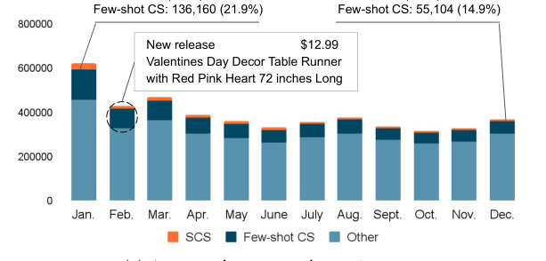
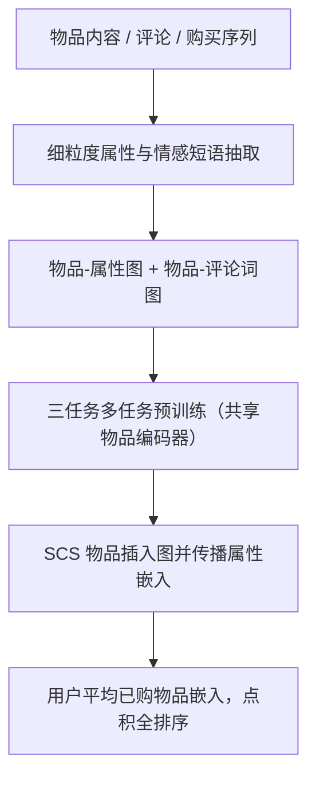
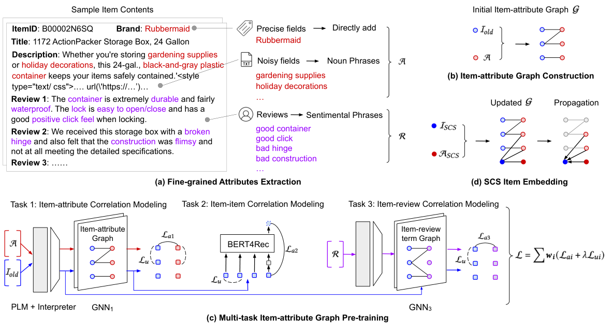

# Multi-task Item-attribute Graph Pre-training for Strict Cold-start Item Recommendation (面向严格冷启动物品推荐的多任务物品-属性图预训练)

- **会议/期刊**: RecSys 2023
- **作者与机构**: Yuwei Cao, Liangwei Yang, Chen Wang, Zhiwei Liu, Hao Peng, Chenyu You, Philip S. Yu；University of Illinois Chicago / Salesforce AI / Beihang University / Yale University
- **推荐链路定位**: 召回（SCS 物品嵌入检索）
- **研究方向**: 冷启动与长尾推荐 / 图神经网络与知识图谱推荐
- **论文原文**: [论文原文链接](https://arxiv.org/abs/2306.14462v1)
- **开源代码**: [开源代码仓库链接](https://github.com/YuweiCao-UIC/ColdGPT)

## TL;DR (1分钟核心速览)

针对严格冷启动（SCS）物品无任何交互、ID 嵌入完全失效的痛点，ColdGPT 从物品内容抽取细粒度属性并构建物品-属性二部图，以物品内容、购买序列、评论短语三路自监督任务联合预训练，再用对齐-均匀性损失抑制多任务负迁移。在 Yelp/Amazon 三个 SCS 全排序协议上，较最强基线 UniSRec 的 NDCG@20 提升 8.2%–48.2%。

## Background & Motivation (背景与核心矛盾)

- **主流范式**: 冷启动物品推荐依赖内容特征把新物品映射到已有物品；近期方法用 PLM 编码标题/描述，或把交互序列转成语言序列做预训练。
- **前人局限**: ① 现有 SCS 方法对内容 coarse-grained 处理：UniSRec 拼接字段后截断，P5 把数值评分序列“语言化”，易混入噪声或丢失信息；② 方法普遍忽略购买序列中的 item-item 相关性与评论中的细粒度主观属性。
- **核心洞察 (Key Insight)**: 新物品持续出现，但物品属性相对稳定——Home-SCS 的 2,867 个测试物品仅引入 1 个新属性；因此属性可充当已有物品与 SCS 物品之间的桥。
- **本文切入点**: 不直接学固定 item ID 矩阵，而是预训练一个可扩展的物品-属性图，SCS 物品到来时插入其属性并传播即可得到嵌入。

<figure class="paper-figure" markdown="span">
  <figcaption>图1. 2017年Amazon-home购买分布（a）及我们提出的物品-属性图示例（b）。在（a）中，‘SCS’、‘Few-shot CS’和‘Other’分别统计SCS、少样本冷启动（购买次数&gt;1且≤20次的物品）和</figcaption>
</figure>

## Method (核心方法设计)

### 1. 整体框架 (Overall Architecture)

输入为物品内容、用户历史购买序列、评论文本。ColdGPT 先从品牌/类目等精确字段直接取属性，对长描述去 URL/HTML/特殊字符后抽名词短语；评论经短语级情感分析抽“情感+名词短语”评论词。物品-属性图与物品-评论词图分别构图，三个子任务共享任务 1 的物品编码器：任务 1 学 item-attribute 相关，任务 2 用双向 Transformer 做掩码物品预测以注入 item-item 相关，任务 3 学 item-review 相关；训练用统一 alignment-and-uniformity 损失。推理时把 SCS 物品及新属性插入图，前向传播得到嵌入，用户嵌入取已购物品均值，点积全排序。

<figure class="paper-figure" markdown="span">
  <figcaption>图2. 我们提出的ColdGPT框架总体架构。蓝色、红色和紫色节点分别表示物品、属性和评论词。（a）展示细粒度属性的提取。（b）展示物品-属性图的构建。（c）展示物品-属性图的多任务预训练，其中PLM（灰色矩形）的参数固定。（d）展示使用预训练物品-属性图的SCS物品嵌入。</figcaption>
</figure>

### 2. 关键设计拆解 (Key Designs)

1. **细粒度物品-属性图与可扩展嵌入矩阵**：痛点在于原始描述含大量无关词与截断噪声。本文只保留品牌/类目等精确字段，长文本抽名词短语作属性，构建 $V=\mathcal{I}_{old}\cup\mathcal{A}$、$E=\{(i,a)\mid i\text{ has }a\}$的二部图；节点经$\mathbf{h}_1(x)=\mathrm{GNN}_1(\mathrm{Interpreter}(\mathrm{PLM}(x)))$ 编码。直觉是属性比原始内容更干净，且 SCS 插入后可直接复用邻接属性嵌入。

2. **三路任务与统一对齐-均匀性损失**：痛点在于不同子模块若用 InfoNCE/CE 等异构损失会负迁移。本文对每个任务统一为
$\mathcal{L}_{ak}=\mathbb{E}_{(x,y)\sim p^+}\|\mathbf{h}_k(x)-\mathbf{h}_k(y)\|_2$，
$\mathcal{L}_{uk}=\log\mathbb{E}_{(x,x')\sim p}e^{-\|\mathbf{h}_k(x)-\mathbf{h}_k(x')\|_2^2}$。
任务 1 对齐 item-attribute，任务 2 将序列编码 $\mathbf{h}_2(i)$对齐任务 1 的$\mathbf{h}_1(i)$，任务 3 对齐 item-review term；总损失$\mathcal{L}=\sum_{k=1}^{3}w_k(\mathcal{L}_{ak}+\lambda\mathcal{L}_{uk})$。对齐拉近正相关，均匀性防止嵌入塌缩并把多任务知识压到同一超球面。

3. **训练目标、负采样与推理效率**：无显式负采样，用 in-batch 的 item/attribute/review-term 样本近似数据分布；任务 2 掩码率 0.2，PLM 固定为 SBERT，GNN 各 1 层，$d=64$。推理仅需插入 SCS 节点并传播：$\mathbf{u}=\frac{1}{|\mathcal{I}_u|}\sum_{i\in\mathcal{I}_u}\mathbf{h}(i)$，$\hat y_{ui}=\mathbf{u}^\top\mathbf{h}(i)$；无需 fine-tuning，Yelp-SCS 推理 <60s，而 IDCF-HY/P5 需 11/20 小时。

## Experimental Setup & Evaluation Protocol (实验设置与评估协议)

- **数据集与预处理**: Yelp/Amazon-home 过滤交互过少用户与物品（Yelp <20，Home <15），并过滤属性少于 5 的物品；Sports 用旧版训练、新版中 P5 未见物品构造 3 个测试集。

| 数据集 | #Users | #Items(train/test) | #Attrs(train/test) | #Ratings(train/test) |
| :--- | :---: | :---: | :---: | :---: |
| Yelp-SCS | 4,901 | 2,258 / 263 | 2,035 / 43 | 185,097 / 5,492 |
| Home-SCS | 96,420 | 24,515 / 2,867 | 24,877 / 1 | 1,277,815 / 44,105 |
| Sports-SCS-1/2/3 | 81,778 | 26,483 / 440,456,468 | 12,130 / 24,24,25 | 456,050 / 1,540,1,688,1,581 |

- **数据划分与防穿越**: 按物品历史购买记录长度 9:1 分 train/test，训练集最后 5% 作验证；验证/测试中未在训练集出现的用户被移除，测试物品交互完全不进训练，保证 SCS。
- **排名评测协议**: 对 SCS 测试物品做 **Full-Ranking（全测试物品排序，未采样负例）**；报告 NDCG@5/20/40 与 Recall@5/20/40，5 次运行取均值。
- **对比基线与超参**: 基线含 BERT、BERT+R、AFM、DropoutNet、Heater、IDCF-HY、GPT-GNN、UniSRec、P5 及跨域 UniSRec-PT；ColdGPT 设 batch=512、$d=64$、lr=0.005、$\lambda=0.6$、任务权重$[0.6,0.2,0.2]$。主表未报告显著性检验，图 4 相关性分析为$p<0.01$。

## Key Experimental Results (实验关键数据)

### 1. 主实验对比 (Main Results)

下表每格为 `NDCG@20 / Recall@20`；加粗为最优，`Δ` 为相对最强基线 UniSRec 的提升。

| Dataset | BERT | AFM | DropoutNet | Heater | GPT-GNN | P5 | UniSRec | ColdGPT | Δ |
| :--- | :---: | :---: | :---: | :---: | :---: | :---: | :---: | :---: | :---: |
| Yelp-SCS | .0301/.0756 | .0308/.0729 | .0304/.0734 | .0301/.0743 | .0091/.0234 | / | .0383/.0989 | **.0556/.1282** | +45.2%/+29.6% |
| Home-SCS | .0027/.0073 | .0026/.0070 | .0025/.0070 | .0026/.0071 | .0056/.0179 | / | .0112/.0263 | **.0166/.0383** | +48.2%/+45.6% |
| Sports-SCS-1 | .0154/.0448 | .0135/.0411 | .0190/.0505 | .0152/.0446 | .0000/.0000 | .0182/.0473 | .0613/.1624 | **.0663/.1760** | +8.2%/+8.4% |
| Sports-SCS-2 | .0121/.0347 | .0168/.0497 | .0114/.0303 | .0158/.0421 | .0022/.0075 | .0148/.0386 | .0636/.1621 | **.0660/.1788** | +3.8%/+10.3% |
| Sports-SCS-3 | .0117/.0308 | .0107/.0336 | .0108/.0345 | .0113/.0289 | .0002/.0007 | .0138/.0367 | .0628/.1515 | **.0692/.1758** | +10.2%/+16.0% |

P5 仅能识别预训练中见过的用户，Yelp/Home 不可用；“/”表示不可得。

### 2. 消融实验 (Ablation Study)

Yelp-SCS 上逐项移除核心组件：

| 配置 | NDCG@20 | Recall@20 |
| :--- | :---: | :---: |
| Default (三任务 + 统一损失 + 情感词) | **.0556** | **.1282** |
| 仅 Task1 ($w=[1,0,0]$) | .0454 | .1015 |
| w/o Task2 ($w=[0.8,0,0.2]$) | .0548 | .1242 |
| w/o Task3 ($w=[0.8,0.2,0]$) | .0546 | .1223 |
| w/o 情感词（Task3 仅名词短语） | .0510 | .1227 |
| InfoNCE+CE 替代统一对齐-均匀性损失 | .0385 | .0990 |

### 3. 关键实验发现 (Key Findings)

1. **细粒度属性图显著强于粗粒度内容编码**：Yelp-SCS 上 ColdGPT 较 UniSRec 的 NDCG@20 提升 45.2%，Home-SCS 提升 48.2%；说明“名词短语属性+图传播”比拼接截断更能保留判别信息。
2. **三任务存在协同增益，统一损失是正迁移关键**：仅 Task1 的 NDCG@20 为 .0454，加入 Task2/Task3 分别升至 .0546/.0548，三任务全开达 .0556；替换为 InfoNCE+CE 后骤降至 .0385，且训练损失震荡至 0–30,000，验证异构损失会导致任务冲突。
3. **数据效率与推理效率兼得**：ColdGPT 仅用 62,795 条 Sports 评分预训练，即在 Sports-SCS-1/2 上超过用 1,400 万跨域评分预训练的 UniSRec-PT（NDCG@20 .0663 vs .0609、.0660 vs .0574）；推理 <60s，远快于 IDCF-HY 的 11h 与 P5 的 20h。

## Highlights & Limitations (亮点、对比与审稿批判)

- **与代表作对比 (vs. Prior Work)**: UniSRec 用 PLM 粗粒度编码内容并截断，ColdGPT 把内容拆成细粒度属性图；P5 把评分序列转成自然语言且只服务预训练见过用户，ColdGPT 显式建模 item-item 序列关系并支持零交互新物品；DropoutNet/Heater 只做内容到协同嵌入的重建，未利用评论与序列。
- **可迁移亮点**: ① 物品-属性图可作为“可扩展 item embedding matrix”，适合任何新物品零样本插入场景；② 统一 alignment-and-uniformity 的多任务损失可迁移到多源异构推荐的联合预训练。
- **审稿级局限批判**: ① 评论情感短语依赖外部 NLP 工具，跨语言/领域噪声与工具误差会传导；任务权重和 $\lambda$明显敏感（如$w=[0.2,0.8,0]$ 时显著下降），需较多调参。② 评测仅覆盖英文 Yelp/Amazon，Sports 测试还限定为 P5 已见用户；跨域 SCS、多语言与真正新用户场景未验证。③ 推理虽 <60s，但大图插入与 PLM 属性编码的规模化开销仍未量化。

## Rating (四维评分)

- **方法创新性 (Novelty)**: ⭐⭐⭐⭐ （把细粒度属性图作为 SCS 可扩展嵌入矩阵，并用多任务对齐-均匀性统一异构预训练任务，机制新颖且有实证支撑）
- **评估协议与实验扎实度 (Protocol & Experiments)**: ⭐⭐⭐⭐ （三个数据集严格构造 SCS 并做全排序，5 次运行与充分消融；但主表缺显著性检验、领域覆盖有限）
- **写作与数学规范度 (Clarity & Rigor)**: ⭐⭐⭐⭐ （三任务损失定义统一清晰，公式与图结构对应明确；部分实现细节和复杂度分析略简）
- **工业落地与复现价值 (Industrial & Practical Value)**: ⭐⭐⭐⭐ （代码与 SCS 数据集开源，推理无需 fine-tuning 且 <60s；但评论抽取管线与图更新工程化仍需评估）

