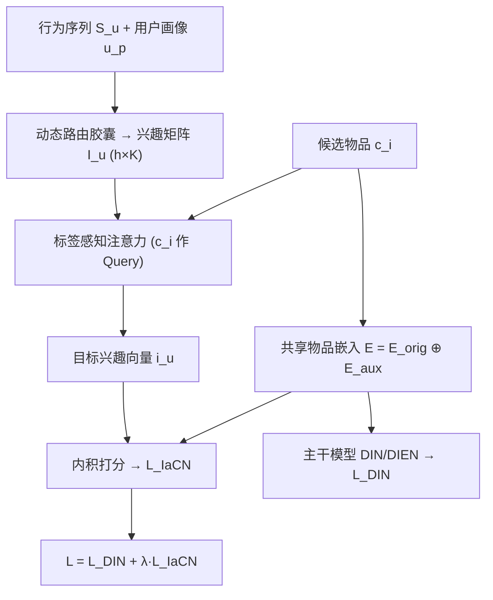
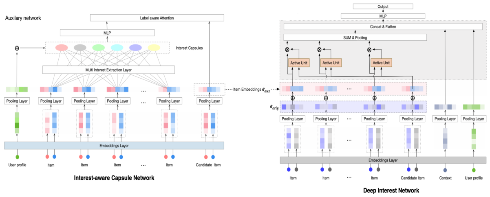

# A Model-Agnostic Framework for Recommendation via Interest-aware Item Embeddings (面向兴趣感知物品嵌入的模型无关推荐框架)

- **会议/期刊**: RecSys 2023 (LBR Track, 短文)
- **作者与机构**: Amit Kumar Jaiswal, Yu Xiong (University of Surrey, UK)
- **推荐链路定位**: 精排 / CTR 预估
- **研究方向**: 协同过滤与双塔召回 / 序列与会话推荐
- **论文原文**: [https://arxiv.org/abs/2308.09202v1](https://arxiv.org/abs/2308.09202v1)
- **开源代码**: 暂未开源

## TL;DR (1分钟核心速览)

现有 DIN/DIEN 等精排模型只由 item-based 的 CTR 损失反传塑造物品嵌入，用户多兴趣信号在深层网络中被"标签扩散"稀释；若照搬 MIND 式多兴趣胶囊则需重构主干架构。本文提出 IaCN——把"行为序列→多兴趣胶囊"做成**可插拔辅助任务**，用动态路由+标签感知注意力独立产出兴趣侧物品嵌入，与主干物品嵌入拼接共享，并按比例 $\delta$ 混合两路梯度。在 Amazon Books/Electronics 上即插即用于 Wide&Deep、DIN、DIEN，AUC 全线提升（Books DIEN 0.8534→0.8633，+1.16% 相对），且长序列下增益更明显。

## Background & Motivation (背景与核心矛盾)

- **主流范式**: 以 DIN 的注意力池化、DIEN 的 GRU+AUGRU 为代表，用行为序列聚合出**单一**用户兴趣向量，再与候选物品嵌入做内积/MLP 打分。
- **前人局限**: 其一，物品嵌入仅服务 CTR 目标，用户多兴趣经由逐层 label diffusion 后对嵌入更新的贡献被严重削弱；其二，MIND 类多兴趣胶囊虽能解耦兴趣维度，但要求整体重构模型或引入额外特征/数据，难以嵌入既有工业链路。
- **核心洞察 (Key Insight)**: 用户兴趣的"信息量"其实不需要在主模型里显式建模才生效——只要**给物品嵌入引入一条独立的、以兴趣为监督的梯度通路**，就能增强主干模型的表征质量。
- **本文切入点**: 把多兴趣胶囊网络降格为辅助任务 IaCN，只共享物品嵌入，不动主干结构。

## Method (核心方法设计)

### 1. 整体框架 (Overall Architecture)

主模型（Wide&Deep / DIN / DIEN）与辅助网络 IaCN 并行共享同一张物品嵌入表：物品嵌入被拆成两段并拼接 $E = E_{original} \oplus E_{auxiliary}$，主干只读写$E_{original}$的原始语义，IaCN 侧则读取完整嵌入。IaCN 把用户画像$u_p$与点击行为序列$S_u$送入$K=\lceil \log_2|I_c^u|\rceil$个兴趣胶囊做动态路由，得到兴趣矩阵$\mathbf{I}_u\in\mathbb{R}^{h\times K}$；再用候选物品作 query 对该矩阵做标签感知注意力得到目标兴趣向量，与候选物品同空间内积后计算辅助损失。训练时总损失为主干损失与辅助损失加权和，辅助段嵌入接收两路混合梯度；**推理阶段可直接丢弃 IaCN**，主干零额外开销。

<figure class="paper-figure" markdown="span">
  <figcaption>图 1. IaCN 框架的示意架构，该框架作为辅助任务，并与 Deep Interest Network 共享物品嵌入。在 IaCN 中，用户交互行为序列和用户画像被纳入，并通过动态路由胶囊机制进行处理。该机制能够以胶囊形式提取用户兴趣。我们在兴趣胶囊与候选物品嵌入之间采用缩放点积，使这些元素在同一表示空间内对齐。</figcaption>
</figure>

### 2. 关键设计拆解 (Key Designs)

1. **兴趣胶囊动态路由（把序列压成 K 个兴趣向量）**: 痛点是注意力池化会把多兴趣压成单峰。IaCN 沿用 Behavior-to-Interest 路由：路由 logits 由兴趣胶囊与行为物品的小型双线性映射给出，$b_{ij} = \mathbf{u}_j^{\top} M \mathbf{c}_i$（$M\in\mathbb{R}^{h\times h}$为共享映射矩阵），经$a_{ij}=\exp(b_{ij})/\sum_k \exp(b_{ik})$加权聚合$\mathbf{s}_j=\sum_i a_{ij}W_{ij}\mathbf{x}_j$，再用 squash 非线性$\mathbf{i}_j=\frac{\|\mathbf{s}_j\|^2}{1+\|\mathbf{s}_j\|^2}\frac{\mathbf{s}_j}{\|\mathbf{s}_j\|}$ 保方向、压缩模长。直觉：胶囊长度编码"兴趣强度"，方向编码"兴趣语义"，从而让体育/食品/服饰等异构兴趣各自占据独立子空间而非被平均。

2. **标签感知注意力 + 物品嵌入拼接共享（把兴趣信号注入主干）**: 若兴趣向量与物品嵌入不在同一空间，辅助梯度就是噪声。作者令候选物品作 Query、兴趣胶囊作 Key/Value 做缩放点积，$\mathbf{i}_u=\mathbf{I}_u\,\mathrm{Softmax}\big(\mathrm{pow}(\mathbf{I}_u^{\top}\mathbf{c}_i,\,p)\big)$，得到"以该候选物品为中心"的兴趣读出头，再由$\mathcal{L}_{IaCN}=-\sum_{u,i}\log P(\mathbf{c}_i\mid \mathbf{i}_u)$监督。关键在于$E_{auxiliary}$与$E_{original}$ 拼接后被主干共同消费，等效于把兴趣侧表征"白送"给 CTR 打分器，而无需在主干中增加任何模块。

3. **训练目标、梯度混合与推理效率**: 总损失 $\mathcal{L}=\mathcal{L}_{DIN}+\lambda\mathcal{L}_{IaCN}$，$\lambda=1$；辅助段嵌入的梯度按$\boldsymbol{g}_e^{aux}=(1-\delta)\boldsymbol{g}_e^{aux\_aux}+\delta\boldsymbol{g}_e^{aux\_main}$、$\delta\in[0,1]$（取 0.3）混合，即让兴趣嵌入以 70% 权重服从兴趣目标、30% 权重服从 CTR 目标，防止兴趣空间被主任务同化回单兴趣。负样本处理仅表述为"对标签物品对应的负样本做 mask"，**论文未交代明确的负采样策略**；Adam，学习率 1e-4。

## Experimental Setup & Evaluation Protocol (实验设置与评估协议)

- **数据集与预处理**: 仅报告原始规模，未说明 `5-core` 等过滤、也未给出稀疏度，难以复现切分细节。

| 数据集 | #Users | #Items | #Interactions | 稀疏度/密度 | 特征/场景说明 |
| :--- | :---: | :---: | :---: | :---: | :--- |
| Amazon Electronics | 192,403（评论数） | 63,001 | 1,689,188 样本 | 未报告 | 801 类电子产品，序列最大长 10 |
| Amazon Books | 603,668（评论数） | 367,982 | 未报告 | 未报告 | 1,600 类图书，序列最大长 20 |

- **数据划分与防穿越 (Splitting Strategy)**: 论文**未明确**说明；从"样本级 + 评论数/物品数"的描述推断为 CTR 样本级随机划分，既非 `Leave-One-Out` 也非全局时间戳切分，存在潜在时间泄漏风险。
- **排名评测协议 (Ranking Protocol)**: 未使用任何排序评测，仅用 **AUC 逐点分类指标**，无 `Full-Ranking` / `Sampled Ranking` 协议，故无法评估 top-K 命中能力。
- **对比基线与超参设置**: 基线仅 3 个（Wide&Deep、DIN、DIEN），胶囊数 $K=\lceil\log_2|I_c^u|\rceil$，$\lambda=1$，$\delta=0.3$；每组实验重复 5 次并报告 SD，但**未做配对显著性检验**。

## Key Experimental Results (实验关键数据)

### 1. 主实验对比 (Main Results)

| 模型 (Books / Electronics) | Books AUC | Δ 相对 | Electronics AUC | Δ 相对 |
| :--- | :---: | :---: | :---: | :---: |
| Wide&Deep | 0.7860 ± 0.0013 | — | 0.7461 ± 0.0015 | — |
| Wide&Deep + IaCN | 0.7928 ± 0.0009 | +0.87% | 0.7502 ± 0.0010 | +0.55% |
| DIN | 0.7970 ± 0.0010 | — | 0.7569 ± 0.0009 | — |
| DIN + IaCN | 0.8002 ± 0.0009 | +0.40% | 0.7606 ± 0.0013 | +0.49% |
| DIEN | 0.8534 ± 0.0018 | — | 0.7706 ± 0.0021 | — |
| **DIEN + IaCN** | **0.8633 ± 0.0019** | **+1.16%** | **0.7723 ± 0.0002** | +0.22% |

### 2. 消融实验 (Ablation Study)

| 因素 | 设置 | Books AUC | 说明 |
| :--- | :---: | :---: | :--- |
| 梯度混合比 $\delta$| 0.1 / 0.2–0.4 / 0.5 / 0.6–0.9 / 1.0 | 0.862 / **0.864** / 0.861 / 0.861–0.862 / 0.860 |$\delta$ 平台宽，1.0 退化至无辅助水平 |
| 序列长度 $l$（DIEN） | 10 / 20 / 50 | 0.854 / 0.853 / 0.850 | 基线随长度单调退化 |
| 序列长度 $l$（DIEN+IaCN） | 10 / 20 / 50 | 0.857 / **0.863** / 0.861 | 长序列增益放大至 +0.9~1.1 pp |
| 主干替换 | W&D / DIN / DIEN | 均正增益 | 验证模型无关性 |
| 去除 IaCN（即基线） | — | 见主表 | 唯一消融形式，无模块级拆解 |

### 3. 关键实验发现 (Key Findings)

1. **增益与主干序列建模强度并非单调**: 在 Books 上 DIEN 收益最大（+0.99 pp, +1.16% 相对），因为 GRU 捕捉了兴趣演化后，胶囊提供的"多兴趣解耦"才能被充分利用；而在 Electronics 上三者增益被压缩到 +0.17~0.41 pp，说明小物品库/短序列场景下兴趣维度 $K$ 的可分性不足。
2. **长序列是主要受益区**: 基线在 $l$:10→50 时 AUC 由 0.854 掉到 0.850（-0.4 pp），IaCN 反而在$l=20$达 0.863（+0.9 pp）、$l=50$ 达 0.861（+1.1 pp），证实"多兴趣瓶颈"确实存在于长行为序列，且胶囊路由对序列噪声有隐式鲁棒性。
3. **$\delta$的 U 形平坦区印证双目标必要性**:$\delta\in[0.2,0.4]$稳定给出 0.864，$\delta=1.0$（辅助嵌入完全由主模型梯度驱动，等价于禁用兴趣梯度）跌至 0.860，反向验证"兴趣侧梯度必须为主"这一设计前提，而非简单增加参数量带来的收益。

## Highlights & Limitations (亮点、对比与审稿批判)

- **与代表作对比 (vs. Prior Work)**: 与 MIND（多兴趣胶囊，需整体重构为召回双塔）相比，本文把同一机制降级为**旁路辅助任务**，成本与侵入性极低；与 DIN/DIEN 相比，本文不改注意力/GRU 结构而改变**嵌入信息来源**，是对"表征学习目标单一"的正交补丁；与同期多任务辅助学习（如 CTR 辅助序列任务）相比，本文的辅助监督是"兴趣级而非标签级"，避免了辅助任务与主任务的高同质性。
- **可迁移亮点**: ①"共享嵌入 + 双梯度混合比 $\delta$"是一个极轻量的通用增广范式，可直接挂到任何含 embedding table 的精排模型上；②$K=\lceil\log_2|I_c^u|\rceil$ 的自适应兴趣数是免调参的好实践。
- **审稿级局限批判**: ①**评估协议薄弱**——仅有 3 个基线、单一 AUC 指标、无排序协议、无数据划分与显著性检验说明，AUC 增益仅 0.002~0.01，不足以支撑"显著提升"的结论；②**公式与实验报告严谨性不足**——标签感知注意力写成 `pow(I_u^T c_i, p)` 且把 $p$称为"用户画像"，量纲与语义均不自洽，负采样策略、稀疏度、Books 交互总数均缺失；③胶囊路由在$K$较大时的训练开销未见复杂度分析，且$\lambda$ 完全未做敏感性实验。

## Rating (四维评分)

- **方法创新性 (Novelty)**: ⭐⭐⭐ （"多兴趣胶囊→辅助任务+梯度混合"的思路实用且低成本，但胶囊/动态路由与 MIND 高度同源，理论增量有限）
- **评估协议与实验扎实度 (Protocol & Experiments)**: ⭐⭐ （仅 3 个基线、单 AUC 指标、无排序协议与显著性检验，消融只做了 $\delta$ 与序列长度两项）
- **写作与数学规范度 (Clarity & Rigor)**: ⭐⭐⭐ （整体架构叙述清楚，但标签感知注意力公式与 $p$ 的定义含糊，负采样与数据划分缺失）
- **工业落地与复现价值 (Industrial & Practical Value)**: ⭐⭐⭐⭐ （主干零改动、推理零额外开销、$\delta$ 平台稳健，极易嵌入现有精排链路；但无开源代码，复现需自行补齐预处理细节）

### 四、图表按需内嵌规范（宁缺毋滥，严禁堆砌！）
- 如果提供了可用图表占位符（如 ``），**仅当某张图（如核心架构图或关键动机对比图）确实非常适合放在某一段文字正下方辅助理解时，才在对应段落后单独另起一行插入最多 1–2 个占位符**。
- **如果没有特别合适的位置，或者图片只是次要曲线/表格截图，请直接忽略不要插入任何占位符（不是非放不可）！严禁在文末集中罗列图片！**
- 正文引用图表时统一使用中文“图 n / 表 n”，所有图注（figcaption）必须使用中文。

