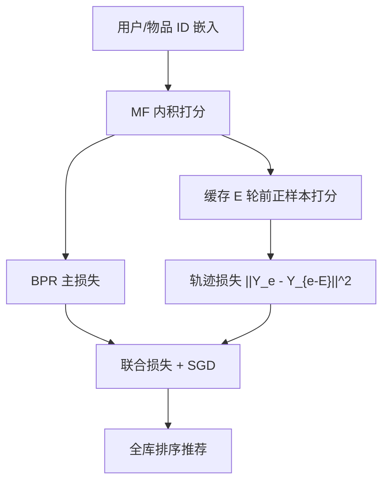
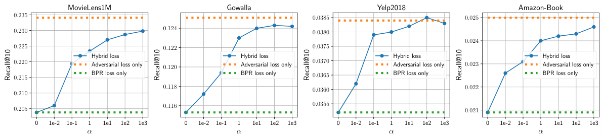
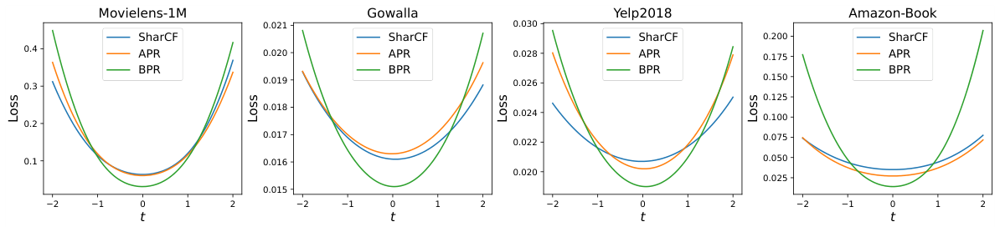

# Adversarial Collaborative Filtering for Free (免额外开销的对抗协同过滤)

- **会议/期刊**: RecSys 2023
- **作者与机构**: Huiyuan Chen 等，Visa Research
- **推荐链路定位**: 召回（矩阵分解式 CF 训练）
- **研究方向**: 协同过滤与双塔召回 / 自监督对比学习与交互去噪
- **论文原文**: [论文原文链接](https://arxiv.org/abs/2308.13541v1)
- **开源代码**: [LightGCN 数据/基线仓库](https://github.com/kuandeng/LightGCN)（注：非 SharpCF 官方实现）

## TL;DR (1分钟核心速览)

SharpCF 针对 CF 中假阳性噪声与 APR 的 min-max 训练开销问题，理论上把对抗训练解释为 Sharpness-aware Minimization：对抗训练追求邻域内损失一致低的平坦极小值。其用当前与 $E$ 轮前模型正样本打分的轨迹损失替代内层扰动更新，仅需标准 SGD。在 4 个数据集的全库排序协议下，Recall@10/NDCG@10 平均超 BPR 18.1%、超 APR 6.82%，训练速度几乎与 BPR 持平。

## Background & Motivation (背景与核心矛盾)

- **主流范式**: CF 以 BPR 成对排序学习用户/物品嵌入；APR 在嵌入上加最坏扰动，以 min-max 交替优化提升鲁棒性。
- **前人局限**: ① APR 缺乏“为何扰动可泛化”的理论解释；② 每步需额外前/反向传播更新扰动，Amazon-Book 每 epoch 230.1s，而 BPR 仅 127.8s，难扩展。
- **核心洞察 (Key Insight)**: 把对抗目标拆为 $L(\Theta)+R(\Theta)$，其中$R(\Theta)=\max_{\|\Delta\|_2\le\rho}L(\Theta+\Delta)-L(\Theta)$，正是 Sharpness-aware Minimization；对抗训练是在找平坦极小值。
- **本文切入点**: 若平坦性可由训练轨迹的稳定性隐式约束，则无需显式求扰动，从而“免费”获得对抗训练收益。

## Method (核心方法设计)

### 1. 整体框架 (Overall Architecture)

SharpCF 保留 MF 编码器与 BPR 主损失；前 200 epoch 仅用 BPR 预热，之后缓存同一 mini-batch 在 $E$轮前的正样本打分，将当前打分与该历史打分的$l_2$ 差作为轨迹正则，与 BPR 联合用标准 SGD 更新。推理仍为内积全库排序，不引入额外扰动或二阶计算。

### 2. 关键设计拆解 (Key Designs)

1. **简化 APR：去掉冗余 BPR 项**：APR 目标为 $L_{APR}=L_{BPR}(\Theta)+\alpha L_{BPR}(\Theta+\Delta_{adv})$。作者在四个数据集上扫$\alpha$发现$\alpha>0$即优于纯 BPR，且$\alpha$足够大时仅保留对抗损失也不显著掉点（图1），故分析阶段可化为$\min_\Theta\max_{\|\Delta\|_2\le\rho}L_{BPR}(\Theta+\Delta)$；最终 SharpCF 仍保留 BPR 主损失并加轨迹正则。

<figure class="paper-figure" markdown="span">
  <figcaption>图 1：APR 在不同 𝛼 值下的性能。Hybrid loss 是 BPR loss 与 Adversarial loss 的组合，其中 𝛼 取除 +∞ 外的一系列值；而 Adversarial loss 通过设置 𝛼=+∞ 完全消除了 BPR loss 的影响。</figcaption>
</figure>

2. **从对抗训练到 Sharpness-aware**：将上式拆为 $L(\Theta)+R(\Theta)$，$R(\Theta)$度量参数邻域内损失上升速度。一阶近似得$\hat{\Delta}=\rho\nabla_\Theta L(\Theta)/\|\nabla_\Theta L(\Theta)\|_2$，于是$R_B(\Theta)\approx\rho\|\nabla_\Theta L_B(\Theta)\|_2$。因此对抗训练等价于惩罚梯度范数、寻找平坦极小值；但直接优化梯度范数需 Hessian，代价高。

3. **轨迹损失：用历史预测差替代二阶项**：由 SGD 轨迹推导，最小化 $R_{B_t}(\Theta_t)$可转化为最小化$L_{B_t}(\Theta_1)-L_{B_t}(\Theta_t)$的$l_2$范数；只保留过去$E$轮窗口，并用正样本打分$\hat{Y}_B$ 实现：
$\mathcal{L}_{SharpCF}=L_{BPR}(\Theta_e)+\frac{\lambda}{|B|}\|\hat{Y}_B(\Theta_e)-\hat{Y}_B(\Theta_{e-E})\|_2^2$。
负采样仍为每 batch 随机负采样；训练复杂度与 BPR 同阶，仅多 $O(E|O|)$ 缓存；推理无额外开销。

## Experimental Setup & Evaluation Protocol (实验设置与评估协议)

- **数据集与预处理**:

| 数据集 | #Users | #Items | #Interactions | 密度 | 过滤/说明 |
| :--- | :---: | :---: | :---: | :---: | :--- |
| MovieLens1M | 6,040 | 3,900 | 1,000,209 | 4.190% | 全评分二值化 |
| Gowalla | 29,858 | 40,981 | 1,027,370 | 0.084% | 10-core |
| Yelp2018 | 31,668 | 38,048 | 1,561,406 | 0.130% | 10-core |
| Amazon-Book | 52,643 | 91,599 | 2,984,108 | 0.062% | 10-core |

- **数据划分与防穿越**: 原文未明确给出切分比例，仅说明以训练集未交互物品为候选、在测试集评估；细节交代不足，复现时需谨慎。
- **排名评测协议**: 无偏 `Full-Ranking`，对用户未交互的全库物品打分排序，报告 Recall@10/20、NDCG@10/20。
- **对比基线与超参**: 基线仅 BPR、APR，均以 MF 为骨干；$d=128$，$\rho=0.5$，$E=3$，$E_{start}=200$，5 次重复取均值；未报告显著性检验。

## Key Experimental Results (实验关键数据)

### 1. 主实验对比 (Main Results)

| 数据集 | 方法 | Recall@10 | NDCG@10 | Time/epoch |
| :--- | :--- | :---: | :---: | :---: |
| MovieLens1M | BPR | 0.2038 | 0.3396 | 16.5s |
|  | APR | 0.2273 | 0.3705 | 30.5s |
|  | **SharpCF** | **0.2354** | **0.4123** | **17.1s** |
| Gowalla | BPR | 0.1153 | 0.1258 | 28.3s |
|  | APR | 0.1242 | 0.1375 | 50.1s |
|  | **SharpCF** | **0.1296** | **0.1456** | **28.7s** |
| Yelp2018 | BPR | 0.0352 | 0.0446 | 45.8s |
|  | APR | 0.0397 | 0.0477 | 88.6s |
|  | **SharpCF** | **0.0411** | **0.0526** | **46.1s** |
| Amazon-Book | BPR | 0.0207 | 0.0223 | 127.8s |
|  | APR | 0.0241 | 0.0259 | 230.1s |
|  | **SharpCF** | **0.0267** | **0.0294** | **128.9s** |

SharpCF 相对 APR 的 NDCG@10 提升分别为 +11.3%、+5.89%、+10.3%、+13.5%。

### 2. 消融实验 (Ablation Study)

原文未设独立 `w/o` 表；以 $\lambda=0$（等价 BPR，去掉轨迹损失）作核心消融：

| 数据集 | BPR (w/o 轨迹) NDCG@10 | SharpCF NDCG@10 | Δ |
| :--- | :---: | :---: | :---: |
| MovieLens1M | 0.3396 | 0.4123 | +21.4% |
| Gowalla | 0.1258 | 0.1456 | +15.7% |
| Yelp2018 | 0.0446 | 0.0526 | +17.9% |
| Amazon-Book | 0.0223 | 0.0294 | +31.9% |

### 3. 关键实验发现 (Key Findings)

- **轨迹损失是主要增益源**：去掉后即退化为 BPR，NDCG@10 回退 15.7%–31.9%，说明“训练轨迹平滑”比显式扰动更关键。
- **收益不靠更多计算**：Amazon-Book 上 SharpCF 128.9s/epoch，与 BPR 127.8s 基本持平，而 APR 为 230.1s；整体平均超 APR 6.82%。
- **长尾更稳**：图4中 item degree $[0,100)$ 组，SharpCF/APR 均优于 BPR，表明平坦化提升稀疏物品泛化；但原文仅给趋势，未给该分组精确数值。

<figure class="paper-figure" markdown="span">
  <figcaption>图 3：BPR、APR 和 SharpCF 在不同数据集上的训练曲线。</figcaption>
</figure>

## Highlights & Limitations (亮点、对比与审稿批判)

- **与代表作对比**: APR 显式 min-max 求扰动；SharpCF 用轨迹损失隐式正则，去掉内层优化。与 FreeAT/GradAlign 等快速对抗训练相比，本文不依赖启发式初始化/循环学习率，且面向离散 ID 嵌入。
- **可迁移亮点**: 轨迹损失可直接加到 LightGCN/序列模型等任意编码器；用正样本打分缓存降低实现成本。
- **审稿级局限批判**: ① 划分协议与显著性检验交代不足，主实验仅 BPR/APR 两个基线，缺少与 SOTA CF/去噪方法对比；② 轨迹缓存需存 $E$轮 batch 打分，$E$增大内存上升，且$E_{start}/\lambda$ 需调参；③ 理论连接基于一阶近似，实际 flatness 与泛化界仍有差距。

## Rating (四维评分)

- **方法创新性 (Novelty)**: ⭐⭐⭐⭐ （把 APR 等价为 SAM，并用轨迹损失免二阶/免内层优化，视角新颖）
- **评估协议与实验扎实度 (Protocol & Experiments)**: ⭐⭐⭐ （四数据集+全库排序+5 次平均，但基线少、划分与显著性缺失）
- **写作与数学规范度 (Clarity & Rigor)**: ⭐⭐⭐⭐ （推导链条清晰，部分近似与符号可更严谨）
- **工业落地与复现价值 (Industrial & Practical Value)**: ⭐⭐⭐⭐⭐ （与 BPR 同速、易嵌入现有 MF/召回训练，工程价值高）

