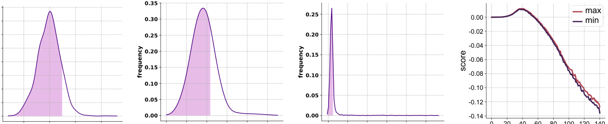
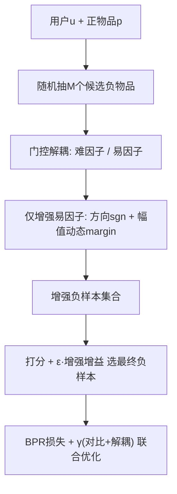
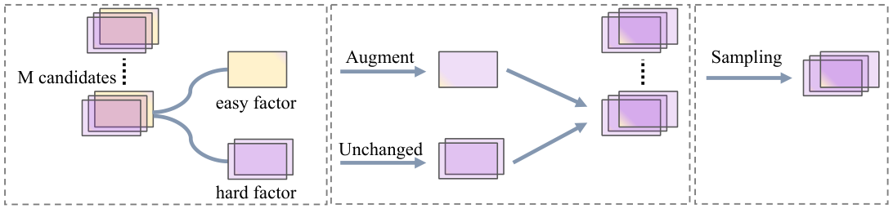

# Augmented Negative Sampling for Collaborative Filtering (增强负采样：难易因子解耦与受控合成)

- **会议/期刊**: RecSys 2023
- **作者与机构**: Yuhan Zhao, Rui Chen, Riwei Lai, Qilong Han, Hongtao Song（哈尔滨工程大学）、Li Chen（香港浸会大学）
- **推荐链路定位**: 召回（隐式反馈 CF 的训练期负采样）
- **研究方向**: 协同过滤与双塔召回 / 自监督与交互去噪
- **论文原文**: [论文原文链接](https://arxiv.org/abs/2308.05972v1)
- **开源代码**: [https://github.com/Asa9aoTK/ANS-Recbole](https://github.com/Asa9aoTK/ANS-Recbole)

## TL;DR (1分钟核心速览)

难负采样普遍采用 two-pass 范式，但负样本只能从**原始物品库**里挑，天然受限：首轮随机采样常漏掉难样本（歧义陷阱），次轮又过度偏爱高分样本（信息歧视）。本文提出 ANS，把负物品嵌入解耦为「难因子/易因子」，只对易因子沿正物品方向做**方向+幅值双重校准**的扰动，合成原数据集中不存在的增强负样本，并用「增强增益」修正采样打分。在 5 个真实数据集、全库排序（Full-Ranking）协议下，Beauty 的 Hit@15/Recall@15/NDCG@15 相对最强基线 DENS 分别提升 29.74%/23.76%/31.06%。

## Background & Motivation (背景与核心矛盾)

- **主流范式**: 隐式反馈 CF 用 BPR 优化，负样本质量决定决策边界；SOTA 是难负采样（DNS/SRNS/MixGCF/DENS），为控开销普遍走 two-pass：先按静态分布抽 $M$ 个候选，再按模型打分精选。
- **前人局限 (1) 歧义陷阱**: 训练推进后未交互物品打分高度集中在低分区，首轮均匀抽 $M\ll|\mathcal{I}|$ 个候选几乎抽不到真正的高分难样本，第二轮再精巧也无力回天（图 1）。
- **前人局限 (2) 信息歧视**: 第二轮几乎只看高分样本；作者用 Pairwise Exclusive-hit Ratio 量化，`PER(RNS, DNS)` 在 Last.fm/Beauty 达 0.20/0.33，说明被 DNS 丢弃的低分样本仍携带 DNS 学不到的独有信息。
- **核心洞察 (Key Insight)**: 瓶颈不在「采样函数怎么设计」，而在「候选池只能由原始物品构成」——与其在有限集合内挑，不如**生成**一个更接近正样本却仍是负样本的合成物品。
- **本文切入点**: 从维度粒度理解「硬度」，只增强负物品中「易」的那部分，把扰动限制在决策边界之内。

<figure class="paper-figure" markdown="span">
  <figcaption>图1：展示DNS中歧义陷阱现象的实验结果。</figcaption>
</figure>

## Method (核心方法设计)

### 1. 整体框架 (Overall Architecture)

ANS 是模型无关的三段式范式：优先随机抽 $M$个未交互物品作为候选集$\mathcal{E}$；**解耦**阶段用门控把每个候选负物品切成难因子$e^{hard}_n$与易因子$e^{easy}_n$，并由对比损失$\mathcal{L}_c$、解耦损失$\mathcal{L}_d$在无监督条件下保证切分可信；**增强**阶段固定难因子不动，仅对易因子叠加方向由正物品象限符号决定、幅值由难因子-正因子相似度动态约束的噪声，得到增强候选集$\mathcal{E}^{aug}$；**采样**阶段用$\text{score}+\epsilon\cdot\text{score}_{aug}$ 从增强候选中选最终负样本参与 BPR 训练。推理阶段与传统 MF 完全一致，无额外开销。

### 2. 关键设计拆解 (Key Designs)

1. **难易因子门控解耦（无监督硬度的维度级刻画）**：硬度定义为「负物品在该维度上是否与用户相似」。用门控给出维度权重并以逐元素相减切分：

   $$\mathbf{g}_{hard}=\sigma(\mathbf{W}_{item}\mathbf{e}_n\odot\mathbf{W}_{user}\mathbf{e}_u),\quad \mathbf{e}^{hard}_n=\mathbf{e}_n\odot\mathbf{g}_{hard},\quad \mathbf{e}^{easy}_n=\mathbf{e}_n-\mathbf{e}^{hard}_n$$

   由于无真值监督，作者用 $\mathcal{L}_c=\sum_{e_n\in\mathcal{E}}[s(e_u,e^{easy}_n)-s(e_u,e^{hard}_n)]$拉开两因子与用户的相似度，但该式存在「把所有维度都判成难因子」的平凡解，故对正物品复用**同一门控**得到$e'_p,e''_p$，再以$\mathcal{L}_d=\sum\|e'_p-e^{hard}_n\|^2+s(e''_p,e^{easy}_n)$ 做锚定——难因子用欧氏距离强约束（可靠硬度），易因子用内积弱约束（信息本就不可靠），这种非对称设计是解耦能收敛的关键。

2. **受控增强（方向压到象限、幅值随硬度自适应）**：若直接令扰动方向为 $e''_p-e^{easy}_n$，会注入过多正样本先验导致模型坍塌甚至把负样本推成正样本。故方向仅保留符号：$e_{dir}=\text{sgn}(e''_p-e^{easy}_n)$，把连续空间压缩到象限空间；幅值先取$\Delta\sim U[0,0.1]$ 保随机性，再以硬因子相似度动态收紧上界：

   $$\|\Delta\|\le\sigma\big(\mathbf{W}(e^{hard}_n\odot e'_p)^\top\big),\qquad e^{aug}_n=(e^{easy}_n+\Delta\odot e_{dir})+e^{hard}_n$$

   直觉是：难因子已与正样本很像，说明该负样本信息量已足，只应小幅增强，避免越界成假阴性。

3. **增强增益采样与训练目标**：除增强后得分外引入 $score_{aug}=s(e_u,e^{aug}_n)-s(e_u,e_n)$，最终选

   $$e^{final}_n=\arg\max_{e^{aug}_n\in\mathcal{E}^{aug}}\big(score+\epsilon\cdot score_{aug}\big)$$

   低分但增益大的样本因而有被选中机会，直接对冲信息歧视。总损失 $\mathcal{L}=\sum-\ln\sigma(s(e_u,e_p)-s(e_u,e^{final}_n))+\gamma(\mathcal{L}_c+\mathcal{L}_d)+\lambda\|\Theta\|_2^2$；文中证明 DNS、MixGCF、SRNS 均是去掉某一步的特例，说明 ANS 是统一框架。

<figure class="paper-figure" markdown="span">
  <figcaption>图3：增强负采样（ANS）范式的工作流程。</figcaption>
</figure>

## Experimental Setup & Evaluation Protocol (实验设置与评估协议)

| 数据集 | #Users | #Items | #Interactions | 稀疏度/说明 |
| :--- | :---: | :---: | :---: | :--- |
| Amazon-Baby | 4,314 | 5,854 | 42,657 | 极稀疏，育儿品类 |
| Amazon-Beauty | 7,670 | 10,887 | 82,297 | 极稀疏，美妆品类 |
| Last.fm | 640 | 4,165 | 120,975 | 高密度音乐社交 |
| Yelp | 31,669 | 38,049 | 1,561,406 | 本地商户 |
| Gowalla | 29,859 | 40,982 | 1,027,370 | LBSN 签到 |

- **数据划分与防穿越**: Baby/Beauty/Last.fm 按**全局时间戳切分**（2014-04-01 / 2010-04-01，训练集仅含该时刻之前交互），再从训练集随机抽 10% 作验证集，避免泄漏；Yelp/Gowalla 用 80%/10%/10% 比例划分。
- **排名评测协议**: **Full-Ranking 全库排序**（对全部未交互物品打分，非采样排序），指标 Hit@K / Recall@K / NDCG@K（K=10/15/20）。
- **对比基线与超参**: 负采样基线 RNS / DNS / SRNS / MixGCF / DENS；骨干为 MF-BPR，并额外把 ANS 插入 NGCF / LightGCN / SGL 验证模型无关性。嵌入维 $d=64$（Xavier 初始化），Adam，lr=0.001，batch=2048，$\lambda=10^{-4}$，$M\in\{2,4,8,16,32\}$，$\gamma,\epsilon\in[0,1]$ 网格搜索；基于 RecBole v1.1.1 复现并做统计显著性检验。

## Key Experimental Results (实验关键数据)

### 1. 主实验对比 (Main Results)

MF-BPR 骨干，Top-20 结果（Recall / NDCG，加粗为最优）：

| 数据集 | 指标 | RNS | DNS | SRNS | MixGCF | DENS | **ANS** | Improv. |
| :--- | :--- | :---: | :---: | :---: | :---: | :---: | :---: | :---: |
| Baby | Recall@20 | 0.0232 | 0.0238 | 0.0235 | 0.0248 | 0.0320 | **0.0352** | +10.0% |
| Baby | NDCG@20 | 0.0116 | 0.0118 | 0.0119 | 0.0121 | 0.0158 | **0.0171** | +8.2% |
| Beauty | Recall@20 | 0.0229 | 0.0262 | 0.0260 | 0.0248 | 0.0266 | **0.0323** | +21.4% |
| Beauty | NDCG@20 | 0.0122 | 0.0143 | 0.0142 | 0.0121 | 0.0146 | **0.0188** | +28.8% |
| Last.fm | Recall@20 | 0.0929 | 0.1067 | 0.1052 | 0.1101 | 0.1105 | **0.1282** | +16.0% |
| Last.fm | NDCG@20 | 0.0909 | 0.0999 | 0.0988 | 0.0903 | 0.1015 | **0.1045** | +3.0% |
| Yelp | Recall@20 | 0.0717 | 0.0848 | 0.0869 | 0.0871 | 0.0877 | **0.0902** | +2.9% |
| Gowalla | Recall@20 | 0.1389 | 0.1708 | 0.1746 | 0.1728 | 0.1765 | **0.1778** | +0.7% |

跨模型泛化（Recall@20，w/o → w/ ANS）：LightGCN 在 Gowalla 0.1849→**0.1967**、Yelp 0.0884→**0.1044**；NGCF 在 Gowalla 0.1490→**0.1642**；SGL 在 Gowalla 0.1897→**0.1961**。

### 2. 消融实验 (Ablation Study)

Top-20（Last.fm / Beauty）：

| 变体 | Last.fm Recall | Last.fm NDCG | Beauty Recall | Beauty NDCG |
| :--- | :---: | :---: | :---: | :---: |
| w/o disentanglement | 0.1108 | 0.0936 | 0.0286 | 0.0155 |
| w/o augmentation gain | 0.1269 | 0.1036 | 0.0305 | 0.0166 |
| w/o regulated direction | 0.1025 | 0.0806 | 0.0191 | 0.0106 |
| w/o regulated magnitude | 0.0056 | 0.0024 | 0.0018 | 0.0007 |
| **ANS (full)** | **0.1282** | **0.1045** | **0.0323** | **0.0188** |

### 3. 关键实验发现 (Key Findings)

- **增益在稀疏集上最大、稠密集趋平**：Beauty 上 Hit@15/Recall@15/NDCG@15 相对 DENS 提升 29.74%/23.76%/31.06%，而 Gowalla 的 Recall@20 仅从 0.1765 涨到 0.1778（+0.7%）——稠密数据本身候选池里就不缺难样本，合成增益的空间被压缩，说明 ANS 的收益主要来自「候选池贫瘠」场景。
- **幅值校准是命门而非锦上添花**：去掉受控幅值后 Recall@20 从 0.1282 崩到 0.0056（Last.fm）、0.0323 崩到 0.0018（Beauty），比去掉解耦（0.1108）低一个数量级，直接证实「无约束增强会把负样本推过决策边界」，MixGCF 式无约束混合不能直接搬到 CF；去掉方向约束也掉到 0.1025，说明方向与幅值缺一不可。
- **确实缓解了信息歧视且具模型无关性**：ANS 与 DNS 选中的高分负样本重叠率仅 47.3%(Baby)/49.0%(Beauty)/38.1%(Last.fm)，即过半训练负样本来自 DNS 会丢弃的低分区；同时把 ANS 插入 LightGCN/SGL 仍带来 0.1849→0.1967、0.1897→0.1961 的 Recall@20 增益，验证范式通用性。效率上 ANS 每 epoch 0.89s（Beauty）vs DNS 0.64s、RNS 0.47s，收敛 epoch 数与 DNS 相当。

## Highlights & Limitations (亮点、对比与审稿批判)

- **与代表作对比**: DNS/SRNS 只改「从原始物品中怎么挑」，候选池不变；MixGCF 也做合成，但用图结构与正样本信息**无约束**混合，噪声不可控（消融中 w/o mag 的崩塌即其极端版）；DENS 同样解耦「相关/不相关因子」，但因子仅用于重加权采样，不生成新样本。ANS 是把解耦、生成、采样串成闭环的统一范式。
- **可迁移亮点**: (1)「方向取 sign 压到象限 + 幅值随相似度自适应收紧」的受控扰动策略，可直接迁移到序列推荐/图对比学习的负样本或数据增广；(2) 用 `score + ε·augmentation_gain` 的增益项修正采样分布，是缓解难负采样信息歧视的轻量插件。
- **审稿级局限批判**: (1) 「增强后仍为负样本」只有启发式保障（幅值上界 + 符号方向），缺少形式化边界证明，$\gamma$过大时性能骤降（视为解耦任务主导）说明训练目标间存在张力，对$\gamma,\epsilon,M$ 三个超参敏感；(2) 评估仅限离线 Full-Ranking，未给线上 A/B 或时延分析，每 epoch 训练开销比 DNS 高约 40%，在亿级物品库上的工业落地性仍待验证。

## Rating (四维评分)

- **方法创新性 (Novelty)**: ⭐⭐⭐⭐ （首次把负采样从「选择」转为「受控生成」，难易因子解耦+方向幅值双校准的思路清晰，但本质仍是启发式噪声注入，缺理论边界）
- **评估协议与实验扎实度 (Protocol & Experiments)**: ⭐⭐⭐⭐ （5 个数据集、Full-Ranking、6 类基线 + 4 种骨干、消融与超参分析齐备，并做显著性检验；但缺线上实验与更大规模工业数据）
- **写作与数学规范度 (Clarity & Rigor)**: ⭐⭐⭐⭐ （三段式范式与 DNS/MixGCF/SRNS 的特例归约讲得很透，公式简洁；部分符号如 $e''_p$与$e^{easy}_p$ 混用，可读性略受损）
- **工业落地与复现价值 (Industrial & Practical Value)**: ⭐⭐⭐⭐ （代码基于 RecBole 开源、可即插即用，推理零额外开销；仅训练期约 40% 时间成本换来显著召回提升，性价比高）

