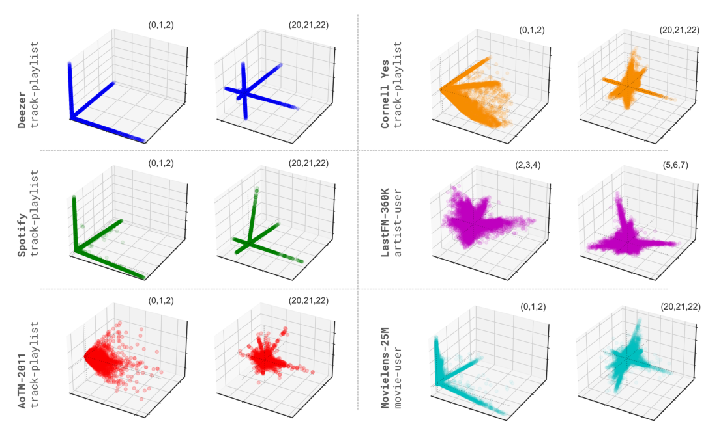
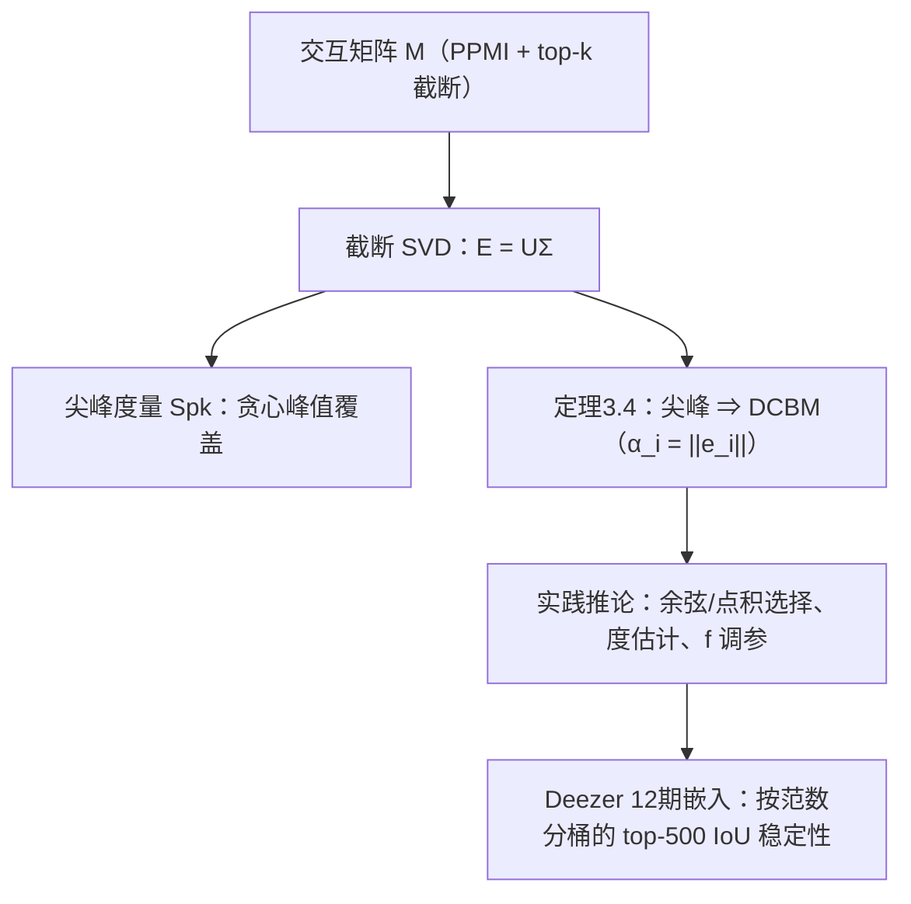

# Of Spiky SVDs and Music Recommendation (论带尖峰的 SVD 与音乐推荐)

- **会议/期刊**: RecSys 2023 (Singapore)
- **作者与机构**: Darius Afchar, Romain Hennequin (Deezer Research)；Vincent Guigue (AgroParisTech, MLIA – Sorbonne Universités)
- **推荐链路定位**: 召回（相似物品检索 / 通用物品嵌入）
- **研究方向**: 协同过滤与双塔召回 / 图神经网络与知识图谱推荐
- **论文原文**: [https://arxiv.org/abs/2307.01212v1](https://arxiv.org/abs/2307.01212v1)
- **开源代码**: [https://github.com/deezer/spiky_svd](https://github.com/deezer/spiky_svd)

## TL;DR (1分钟核心速览)

本文针对一个**被忽视但普遍存在**的现象：在 6 个推荐数据集上用截断 SVD（PureSVD）得到的物品嵌入，会自发组织成过原点的“尖峰”射线。作者提出量化指标 $\mathrm{Spk}$（Deezer 上仅$0.04\%$的峰值点即可覆盖 50% 的嵌入），并**首次证明反向命题**：尖峰结构$\Leftrightarrow$带度异质性的社区模型 DCBM，从而把“余弦 vs. 点积”“截断维度$f$”“嵌入时效稳定性”三个工程盲点变成可推导结论。Deezer 12 期工业 SVD 实验显示：用点积时高范数物品一年后 top-500 邻域 Jaccard 仍 >80%，低范数则迅速失效。

## Background & Motivation (背景与核心矛盾)

- **主流范式**: 音乐推荐中，截断 SVD 依旧是相似物品检索与下游任务嵌入的强基线（神经网络 CF 在其上并无稳定增益），业界常用 $U$、$U\Sigma$ 与余弦/点积的多种组合，但选择多凭经验。
- **前人局限**: 其一，余弦归一化把所有点压到超球面，**把范数信息整体抹除**，导致尖峰结构长期“视而不见”；其二，社区检测文献（DCBM 谱分析）只证明了“DCBM $\Rightarrow$ 尖峰”，并把尖峰当作需要修正的噪声，而非可利用的信号。
- **核心洞察 (Key Insight)**: 作者在高维切片投影中发现，嵌入点并非各向同性云团，而是**极少数高范数峰值方向吸收了大部分点**（图 1）；且尖峰在前若干主维度最清晰、在噪声主导的后维度退化为模糊云。
- **本文切入点**: 先给尖峰一个可计算的定义与度量，再证明“尖峰 $\Rightarrow$ 变度社区”的逆命题，最后用一条工业时间序列验证范数即“稳定性的代理量”。

<figure class="paper-figure" markdown="span">
  <figcaption>图1. 在多个独立计算的SVD中自然出现的“尖峰”结构。由于嵌入向量是高维的，我们只能展示这些点在维度切片上的部分投影（切片维度已在图上方标出）。</figcaption>
</figure>

## Method (核心方法设计)

### 1. 整体框架 (Overall Architecture)

全文是一条“**度量 → 证明 → 实践**”的闭环，而非一个新的打分模型。预处理统一为：对交互矩阵取对称化 $MM^{*}$、按物品保留 top-$k$非零交互、施加 PPMI 归一化（该归一化与 skip-gram 负采样等价，同时抑制流行度偏差），随后做$f$维截断 SVD 并取$E=U\Sigma$作为物品嵌入。在嵌入空间上计算$\mathrm{Spk}$度量并观察尖峰；再用谱定理把$E$的行分解为“方向$\times$标量范数”，证明尖峰方向对应社区、范数对应社区内度，从而把 DCBM 参数从嵌入中读出；最后在 Deezer 跨 12 个时间戳的 SVD 上，按范数分桶检验 top-$k$ 邻域的时序稳定性。

### 2. 关键设计拆解 (Key Designs)

1. **尖峰度量 $\mathrm{Spk}$（把“看起来像射线”变成可比较的数）**：痛点是高维下 kurtosis 一类统计量对超参极敏感且无自然多变量推广。作者按范数降序取候选峰$e^{*}$，若$\cos(e^{*},e)>\cos\theta$则视$e$属于该尖峰，贪心覆盖到比例$\rho$的点后停止（高维部分集合覆盖的启发式上界），最终$\mathrm{Spk}=\#\{e^{*}\}/n$。其直觉是：若极少的峰就能吞掉半个分布，说明分布高度共线；作者进一步把$\mathrm{Spk}$解读为社区数$K$ 的近似估计。

2. **定理 3.4（尖峰 $\Leftrightarrow$变度社区）**：由 Lemma 3.3，$U$行成尖峰则$U\Sigma^{p}$与$V$的行同样成尖峰（仅方向旋转），故可固定$E=U\Sigma$。设$e_i=\alpha_i s_{C(i)}$，则对$i,j\le n'$：
$$\tilde{M}_{ij}=|(EV^{*})_{ij}|=\alpha_i\alpha_j\langle s_{C(i)},s'_{C(j)}\rangle,\quad \tilde{M}\propto K^{2}\cdot\mathrm{DCBM}\big((C(i))_{i\le n'};\,B;\,(\alpha_i/K)_{i\le n'}\big)$$
即“常数块矩阵”逐元素乘以秩 1 的 $[\alpha_i\alpha_j]$，且$\alpha_i=\|e_i\|$ 正是社区内度。解释力在于：矩阵稀疏时，**用尽量多的秩 1 因子重建尽量多的社区**比“用多个特征向量精修单个社区”更省误差，这解释了尖峰的普遍自发涌现。

3. **训练目标、负采样与推理效率**：本文无新损失函数，训练目标即 $\min\|\hat{M}-M\|_F^{2}$（Eckart–Young–Mirsky 最优），负采样被 PPMI 归一化隐含吸收（与负采样 skip-gram 等价）。推理零额外开销：$\mathrm{Spk}$ 与度估计都直接在已有嵌入上做，无需显式构图；工业侧仅需一次分布式 RSVD。

## Experimental Setup & Evaluation Protocol (实验设置与评估协议)

- **数据集与预处理**: 6 个数据集覆盖歌单、播放、社交标签与电影场景；统一 top-$k$截断 + PPMI，$f=128$，$E=U\Sigma$。原文未给出各数据集的用户/物品/交互统计表（详见开源仓库），故下表只列场景与规模量级：

| 数据集 | #Users | #Items | #Interactions | 稀疏度/密度 | 特征/场景说明 |
| :--- | :---: | :---: | :---: | :---: | :--- |
| Deezer (私有) | — | 1.5M 曲目（跨 12 期公共交集） | PPMI 后对称矩阵，稀疏 | 极稀疏 | 工业 user–track 隐式反馈，12 期 SVD 跨 2022-05→2023-05 |
| Spotify Million Playlist | — | 百万级曲目 | playlist–track，稀疏 | 极稀疏 | 歌单共现，尖峰最清晰的公开集之一 |
| AoTM-2011 | — | 十万级 | playlist–track | 稀疏 | Art of the Mix 歌单 |
| Cornell Playlists | — | 万级 | playlist–track | 稀疏 | 学术歌单集合 |
| LastFM-360K | 360K 用户量级 | 艺术家级 | user–artist 标签 | 稀疏 | 社交/标签共现 |
| MovieLens-25M | 25M 评分量级 | 万级电影 | 密集于音乐集 | 相对更密 | 跨域佐证：电影数据同样出现尖峰 |

- **数据划分与防穿越 (Splitting Strategy)**: **无监督几何分析，不做训练/测试划分**；第 4 节采用**全局时间戳切分**——以 2022-05 的 SVD 为参考嵌入，与后续 11 期（每 5 周一步）逐一比较，天然避免未来信息泄漏。
- **排名评测协议 (Ranking Protocol)**: 非标准 accuracy 评测。核心协议为：在每期 SVD 内，于约 30 万候选池中取参考嵌入的 **top-500 相似物品**（分别用余弦与点积），以 **Jaccard / IoU** 度量跨期邻域一致性；并额外以 $\mathcal{N}(0,1)$高斯采样（$f$维下随机向量几乎不可能共线）作为“无尖峰”参照下界。$\mathrm{Spk}$报告取$\cos\theta=0.9$、$\rho=50\%$。
- **对比基线与超参设置**: 基线为不同截断维度 $f\in\{16,32,64,128\}$的 SVD 变体与高斯随机参照；关键超参为$f$、$\theta$、$\rho$ 与相似度函数（余弦 vs. 点积）。

## Key Experimental Results (实验关键数据)

### 1. 主实验对比 (Main Results)

$\mathrm{Spk}$越小表示尖峰越强（覆盖 50% 点所需的峰值比例，$\cos\theta=0.9$）：

| 变体 / 数据 | Deezer | Spotify | AoTM-2011 | Cornell | LastFM-360K | ML-25M | $\mathcal{N}(0,1)$ |
| :--- | :---: | :---: | :---: | :---: | :---: | :---: | :---: |
| Spk@128 | **0.04%** | **0.14%** | 18.1% | 4.55% | 2.42% | 7.09% | 50% (=$\rho$) |
| Spk@64 | **150/n < 0.01%** | **228/n < 0.03%** | 11.4% | 1.59% | 0.49% | 3.05% | 50% |
| Spk@32 | **50/n < 0.01%** | **55/n < 0.01%** | 2.31% | 0.49% | 0.14% | 1.12% | 50% |
| Spk@16 | **23/n < 0.01%** | **23/n < 0.01%** | 0.93% | 0.09% | 0.06% | 0.02% | 49.4% |
| 含义（最优=最少峰） | 361 个峰覆盖半数百万级嵌入 | 1395 个峰覆盖半数嵌入 | 尖峰最弱 | 中等 | 中等偏强 | 中等 | 无结构（上界） |

### 2. 消融/敏感性分析 (Ablation & Sensitivity)

| 变化维度 | 设置 | 现象 | 结论 |
| :--- | :--- | :--- | :--- |
| 截断维度 $f$|$f$: 16 → 128 | Deezer/Spotify 在低$f$时 150/n、228/n 级；Spotify 在$f=128$骤升至 0.14% | Deezer 取$f=128$、Spotify 取$f=64$才能捕获“干净社区”，$\mathrm{Spk}$可作选$f$ 的离线指标 |
| 相似度函数 | 余弦 vs. 点积 | 点积的稳定性曲线分化最剧烈；余弦曲线被拉平 | 余弦≈球形聚类（抹掉 $\alpha_i$），点积保留社区内度 |
| 范数分桶（5 等分） | 低 → 高范数 | 点积下高范数 top-500 邻域近一年 IoU > 80%，低范数快速失效 | 范数是嵌入时效鲁棒性的强预测因子 |
| 维度位置 | 前若干主维 vs. 高索引维 | 前维尖峰锐利，后维退化为模糊云 | 与鲁棒 SVD “先结构后噪声”一致 |

### 3. 关键实验发现 (Key Findings)

1. **尖峰是结构性而非数据集偶然**：Deezer 用 0.04%、Spotify 用 0.14% 的峰值点即可覆盖 50% 的嵌入，而 128 维高斯随机点需要 50%（等于 $\rho$ 上界），相差 2–3 个数量级，说明 SVD 嵌入几乎必然带有 DCBM 式块结构。
2. **$\mathrm{Spk}$的拐点即$f$的饱和点**：Spotify 在$f=128$时$\mathrm{Spk}$从 228/n 暴涨到 0.14%，对应“噪声开始渗入、峰数随点数线性增长”；据此选$f=64$与 Deezer 的$f=128$ 是数据驱动的调参依据，而非网格搜索。
3. **范数决定时序稳定性**：按范数五等分后，点积相似度下高范数物品一年后 top-500 邻域仍保持 80% 以上重合，低范数物品迅速漂移——这为“哪些嵌入需要高频重算、哪些可低频更新”提供了直接的成本分配准则。

## Highlights & Limitations (亮点、对比与审稿批判)

- **与代表作对比 (vs. Prior Work)**: 与 PureSVD/EASE 类工作相比，本文不改打分函数，而是给出**几何解释层**；与 DCBM 谱聚类（Karrer & Newman 等）相比，本文证明的是被前人视为噪声而需修正的**逆命题**（尖峰 ⇒ DCBM），并允许 $n'<n$（部分点带噪），适用面更宽；与神经 CF 复现性研究相比，本文为“简单基线为何难被打败”补上了一块理论拼图。
- **可迁移亮点**: ① 用 $\mathrm{Spk}$作为选择嵌入维度$f$的无监督离线指标，可直接迁移到双塔召回与语义 ID 码本维度选择；② 用$\|e_i\|$ 作为节点度的免费估计与“重算优先级”信号，无需显式构图即可做增量更新调度。
- **审稿级局限批判**: ① 结论建立在 $M$近似非负、块近似的秩 1 假设上，对 rank$>1$的社区结构明确“留待未来工作”，实际多兴趣用户场景可能失效；②$\mathrm{Spk}$是 NP-hard 覆盖问题的贪心上界，且对$\theta,\rho$敏感，跨数据集绝对值不可直接横比；③ 工业验证仅一条 Deezer 曲线、无线上 A/B 或召回准确率指标，且$n'=\rho n$ 的假设把非尖峰点一律当噪声，可能丢弃有用信号。

## Rating (四维评分)

- **方法创新性 (Novelty)**: ⭐⭐⭐⭐⭐ （把被余弦归一化掩盖的尖峰几何提升为一等公民，并首次证明“尖峰 ⇒ DCBM”的逆命题，理论增量清晰且非平凡）
- **评估协议与实验扎实度 (Protocol & Experiments)**: ⭐⭐⭐ （6 个数据集 + 高斯参照的几何验证有说服力，但全程无召回/排序准确率指标，工业部分仅单条时间序列、无显著性检验）
- **写作与数学规范度 (Clarity & Rigor)**: ⭐⭐⭐⭐ （引理—定理—推论的链条紧凑，符号统一；$\mathrm{Spk}$ 的启发式性质与假设边界都主动交代，唯数据集统计表缺失略减分）
- **工业落地与复现价值 (Industrial & Practical Value)**: ⭐⭐⭐⭐ （代码开源、零额外推理开销，$f$ 选择与嵌入更新调度两条结论可直接落到生产管线；但收益是“省成本/调参”而非“涨指标”）

